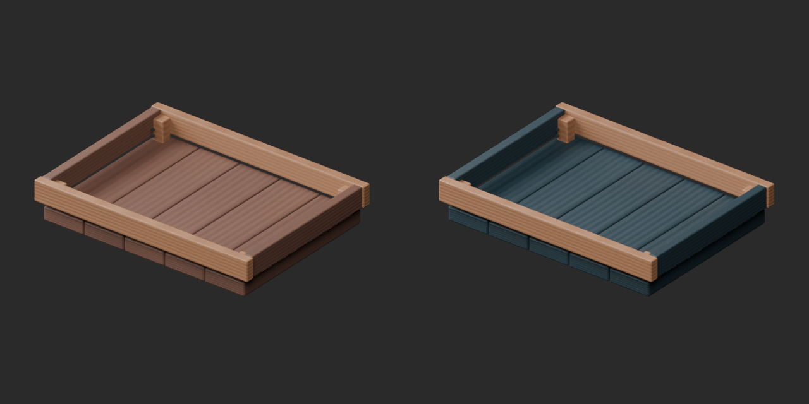
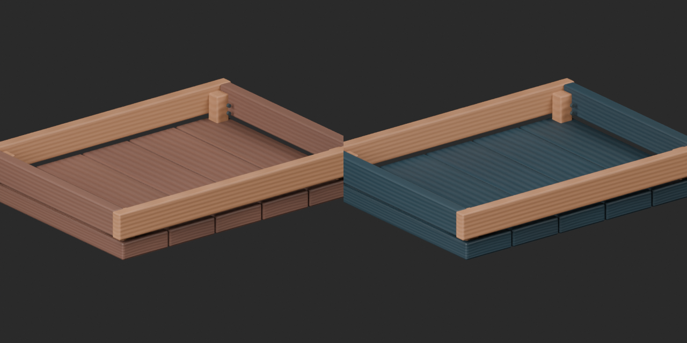

# Quality46 / 品質第46便 / 质量第46批

Base1008 unchanged; material variants157=156+1 separately. No revisions or new base. Originals retained.

BM020 shallow parts tray: blue walnut-board UV tint, pale frame/iron and non-basecolor channels unchanged. Original geometry, UV and vertex colors retained. Same-camera comparison against brown original. Not a new shape or functional improvement.

10配布10収録モデル査定。改訂0、部品箱青木目variant1件のみ別集計。釘束の釘を個別加算しません。10个配布记录/10个模型；仅1个蓝色木板变体，不新增基本模型。

Final ZIP BLEND/GLB geometry/UV/spatial vertex-color guard and four old missing-color rejection fixtures matched. Public artifact matching is pending. Publication did not rerun Blender.

Assessed456 distribution records;552 remain;134 budget issues unchanged. All10 within20k; BM007 attachment diagnosis persists. BM012 already revised source has no original vertex colors, not export loss. Existing angular style/chips/scratch strips not redesigned. Source audit GLB only, original bundled BLEND not independently imported; delivered variant ZIP both formats tested. No collision/rig/strength/function/Blender4.3.2 approval.

Models/embedded materials only CC0; images separate catalogue artwork. [License](../LICENSE.md). Private reports/code excluded.

## BM_020__bluewood — Shallow parts tray

浅い部品箱

Blue UV tint on walnut board surfaces of shallow parts tray; lighter frame, iron and all non-basecolor channels unchanged. Original mesh, UV and vertex colors preserved. Same base model, not new shape.

[ZIP · BLEND/GLB](https://raw.githubusercontent.com/k3peta/tales-on-a-table/main/distributions/quality-bm011-020-v1/BM_020__bluewood_CC0.zip)

Left: original; right: accepted revision/variant, identical camera/light/scale.
