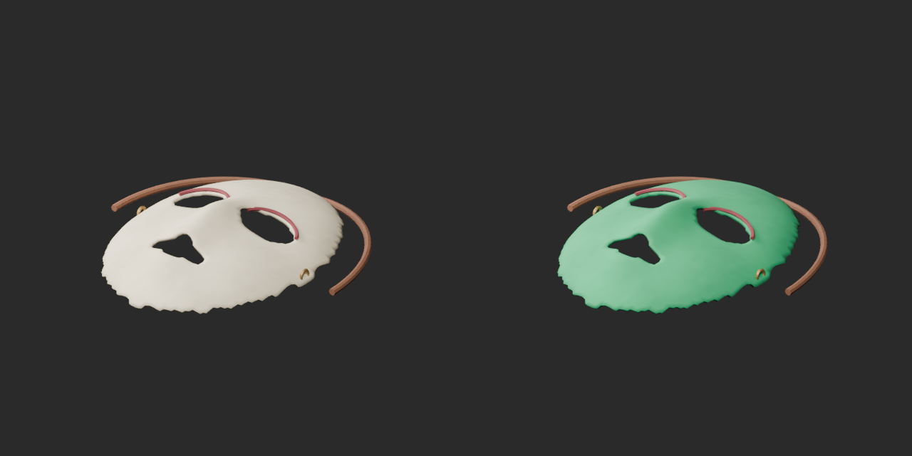
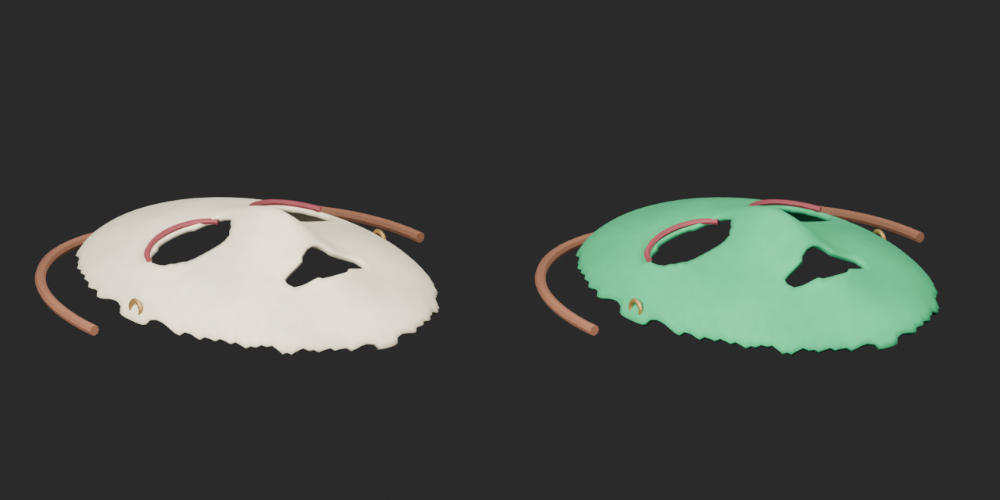

# Quality47 / 品質第47便 / 质量第47批

Base1008 unchanged; material variants158=157+1 separately. No revisions or new base. Originals retained.

BM026 teal mask face only: original geometry/UV/vertex colors retained, red eye edging/brass/straps and other material channels unchanged. Open straps are not a wearable rig. BM029 blue-glass candidate rejected because exported GLB lost glass vertex colors; failed candidate ZIP and images are NOT published. Original lantern unchanged; not a confirmed defect of the public base.

10配布11収録モデル査定、青緑仮面variant1件のみ。青ガラス提灯候補は不採用・非公開、元提灯は不変。10个配布记录/11个模型；仅青绿色面具变体发布。蓝玻璃候选因顶点色不匹配被拒绝，原提灯不变。

Same camera/light/scale comparison. Authoritative final-ZIP validation-v2 checks BLEND/GLB geometry/UV/spatial vertex colors, four old loss fixtures rejected. Public artifact matching is pending. Publication did not rerun Blender.

Assessed466 distribution records;542 remain;134 budget issues and BM007 diagnosis unchanged. Existing key color member, coin arrangement and single shoe not inflated into new counts. Source audit GLB only; original bundled BLEND not independently imported. Accepted ZIP both formats tested. Static chain/scales/straps; no collision/load/rig/function/transparent-sort/Blender4.3.2 approval.

Models/embedded materials only CC0; images separate catalogue artwork. [License](../LICENSE.md). Private reports/code excluded.

## BM_026__tealmask — Nameless mask

名前のない仮面

Teal UV tint on ivory mask face; straps/red trim/brass and other channels unchanged. Original geometry, UV and vertex colors preserved. Not a new shape.

[ZIP · BLEND/GLB](https://raw.githubusercontent.com/k3peta/tales-on-a-table/main/distributions/quality-bm021-030-v1/BM_026__tealmask_CC0.zip)

Left: original; right: accepted revision/variant, identical camera/light/scale.
