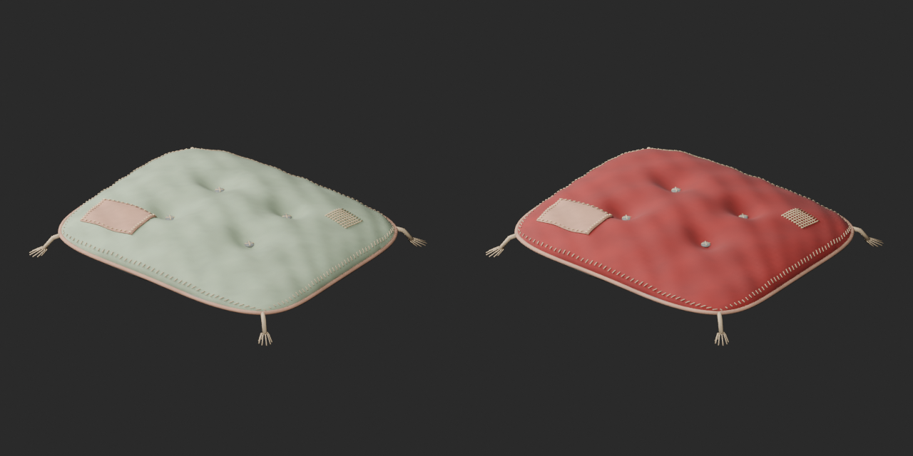
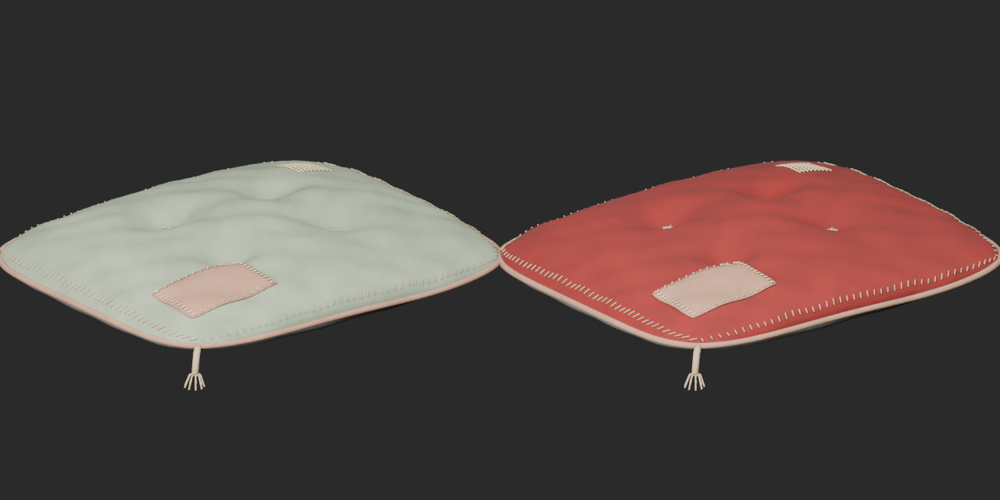
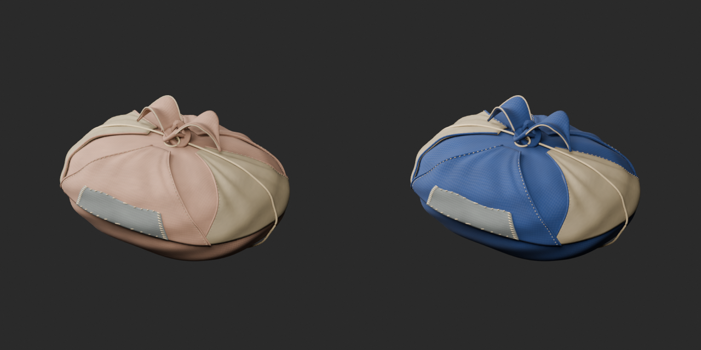
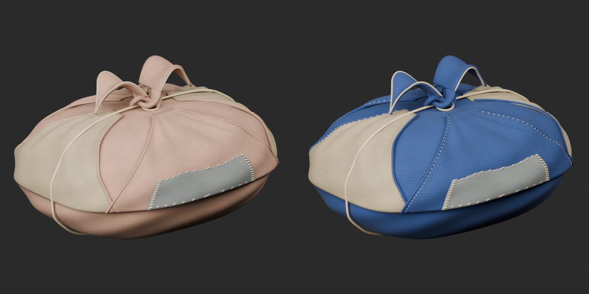

# Quality48 / 品質第48便 / 质量第48批

Base1008 unchanged; material variants160=158+2 separately. No revisions or new base. Originals retained.

BM034 rust-red cushion and BM037 blue cloth bundle: main fabric tint only. Original geometry, UV, vertex colors, patches, cords and non-basecolor channels retained. Both remain over the polygon budget; these are color choices, not lightweight repairs.

10配布レコード・収録13モデルを査定。赤い座布団と青い布包の材質variant2件、基本・改訂加算0。10个配布记录/13个模型；红色坐垫、蓝色布包两个材质变体，基础数量不变。

Same camera/light/scale comparison. Authoritative final-ZIP checks both BLEND/GLB geometry/UV/spatial vertex colors. Five known color-loss fixtures rejected. Public artifact matching is pending. Publication did not rerun Blender.

Assessed476 distribution records;532 remain;137 polygon-budget issues remain. BM007 attachment diagnosis unresolved. BM029 blue-glass candidate remains rejected and unpublished; public original colors are present. Exact shader/export cause is not isolated; alpha alone is not established as cause. Failed candidate is not evidence of a defect in the public original.

Source audit GLB only; original bundled BLEND not independently imported. Accepted ZIP both formats tested. Compound contents and broken derivatives are not counted separately. No collision/load/rig/function/physical optics/Blender4.3.2 approval.

Models/embedded materials only CC0; images separate catalogue artwork. [License](../LICENSE.md). Private reports/code excluded.

## BM_034__rustred — Flattened cushion

ぺしゃんこの座布団

Rust-red UV tint on cushion main moss fabric. Original geometry, UV, vertex colors, patches/cords and non-basecolor channels unchanged. Not a mesh repair or new shape; polygon budget remains exceeded.

[ZIP · BLEND/GLB](https://raw.githubusercontent.com/k3peta/tales-on-a-table/main/distributions/quality-bm031-040-v1/BM_034__rustred_CC0.zip)

Left: original; right: accepted revision/variant, identical camera/light/scale.

## BM_037__bluecloth — Tied cloth bundle

紐で括った布包み

Blue UV tint on cloth bundle main rust fabric. Original geometry, UV, vertex colors, patches/cords and non-basecolor channels unchanged. Not a mesh repair or new shape; polygon budget remains exceeded.

[ZIP · BLEND/GLB](https://raw.githubusercontent.com/k3peta/tales-on-a-table/main/distributions/quality-bm031-040-v1/BM_037__bluecloth_CC0.zip)

Left: original; right: accepted revision/variant, identical camera/light/scale.
