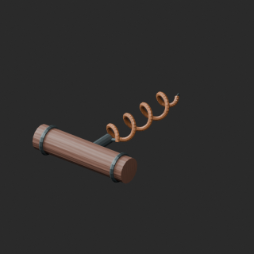
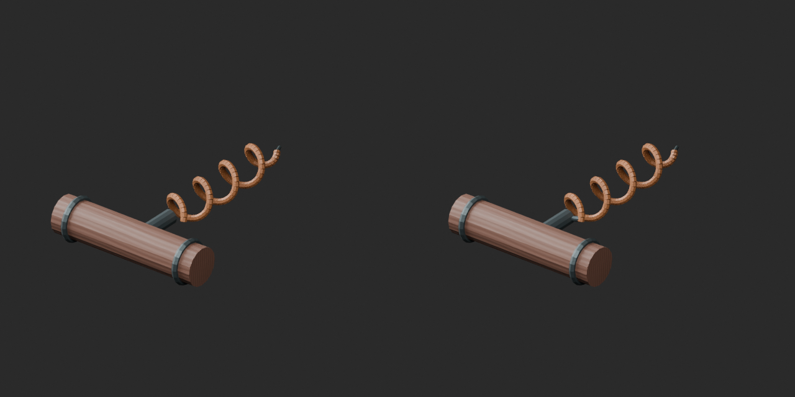
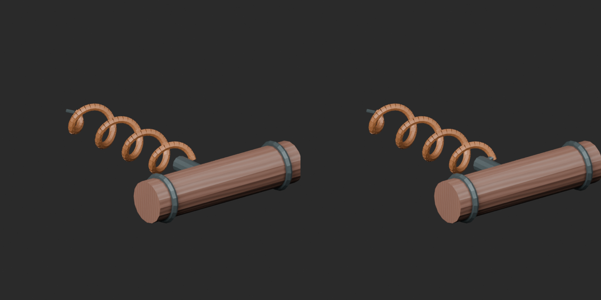
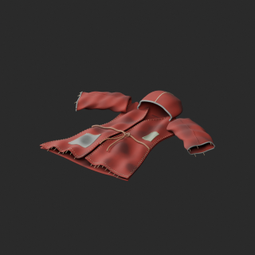
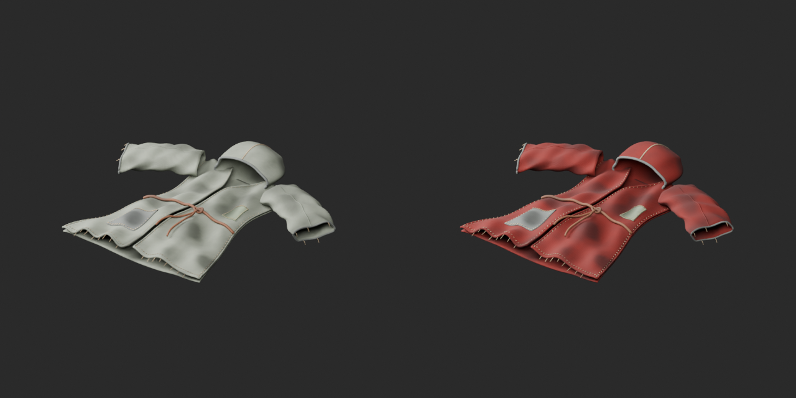
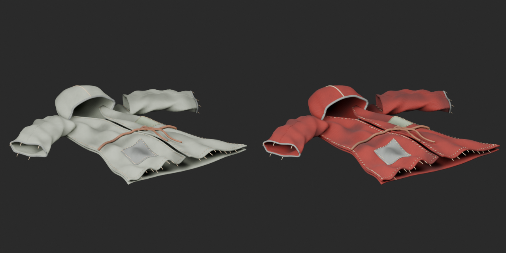
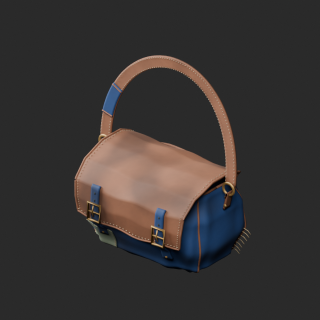
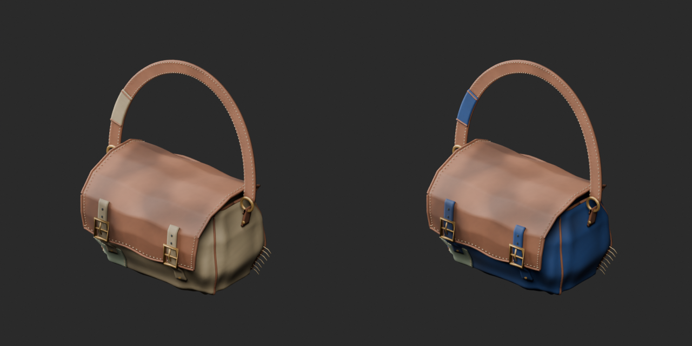
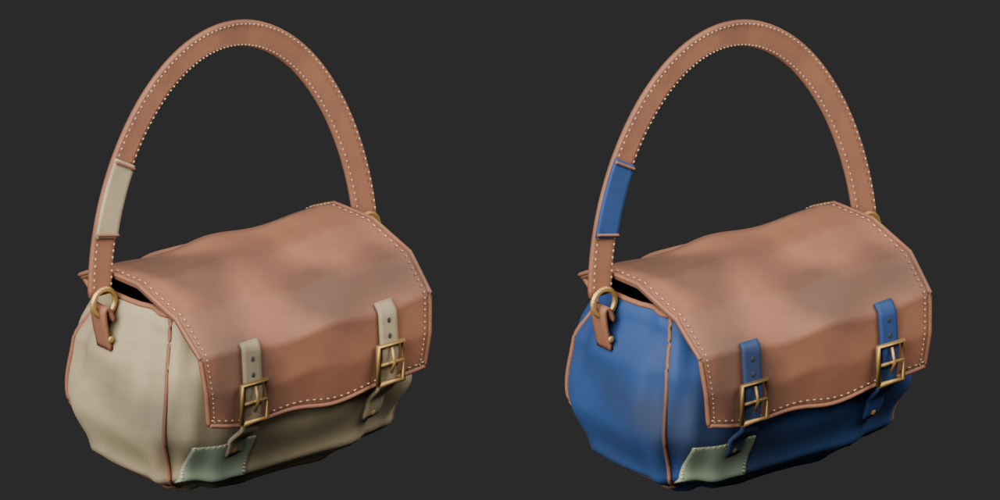

# Quality49 / 品質第49便 / 质量第49批

Base1008 unchanged; material variants162=160+2 separately. One geometry revision, no new base. Originals retained.

BM041 corkscrew: measured8.263mm gap between shank and helix bridged by48 new triangles (3424 to3472). Original surfaces/UV/colors retained. This is an overlapping static assembly, NOT a watertight union or strength guarantee. New connector uses BYTE_COLOR after initial FLOAT_COLOR export quantization failed; only final-zip-validation-v2 artifacts accepted.

BM042 rust-red robe and BM043 blue bag: main fabric tint only, geometry/UV/vertex colors and other channels retained.60240 and60566tri remain over20k budget; neither is a lightweight repair.

10配布レコード/10モデル査定。オープナー接続改訂1件は非加算、赤い衣服と青い袋のvariant2件は別集計。10个配布记录/10个模型；开瓶器连接修订不增加基本数量，两个布料颜色变体单独统计。

Same camera/light/scale comparisons. Final-ZIP validation-v2 checks BLEND/GLB geometry/UV/spatial vertex colors against explicit connector baseline where geometry changed; not a same-geometry variant. Five known color-loss fixtures rejected. Public artifact matching is pending. Publication did not rerun Blender.

Assessed486 distribution records;522 remain;142 polygon-budget issues remain. Donkey66103tri uses provisional50k static-display warning assigned before measurement; no animal-specific threshold in the plan. Cart42600tri below50k assembly warning. BM007 attachment diagnosis remains. BM029 failed blue-glass candidate is unpublished, not an established public-original defect; exact export cause unresolved.

Source audit GLB only; original bundled BLEND not independently imported. Final accepted ZIP both formats tested. No collision/load/wearable rig/locomotion/function/optical accuracy/Blender4.3.2 approval.

Models/embedded materials only CC0; images separate catalogue artwork. [License](../LICENSE.md). Private reports/code excluded.

## BM_041__repair — Rusty corkscrew

錆びたワインオープナー

Static shank-to-helix connector added48tri; original mesh/UV/colors retained, overlapping assembly not watertight union; no functional strength guarantee.

[ZIP · BLEND/GLB](https://raw.githubusercontent.com/k3peta/tales-on-a-table/main/distributions/quality-bm041-050-v1/BM_041__repair_CC0.zip)

Left: original; right: accepted revision/variant, identical camera/light/scale.

## BM_042__rustred — Dirty robe

汚れたローブ

Main robe/bag UV color tint only, original geometry/UV/vertex colors and other material channels preserved. Polygon budget remains exceeded.

[ZIP · BLEND/GLB](https://raw.githubusercontent.com/k3peta/tales-on-a-table/main/distributions/quality-bm041-050-v1/BM_042__rustred_CC0.zip)

Left: original; right: accepted revision/variant, identical camera/light/scale.

## BM_043__bluebag — Dirty bag

汚れたバッグ

Main robe/bag UV color tint only, original geometry/UV/vertex colors and other material channels preserved. Polygon budget remains exceeded.

[ZIP · BLEND/GLB](https://raw.githubusercontent.com/k3peta/tales-on-a-table/main/distributions/quality-bm041-050-v1/BM_043__bluebag_CC0.zip)

Left: original; right: accepted revision/variant, identical camera/light/scale.
