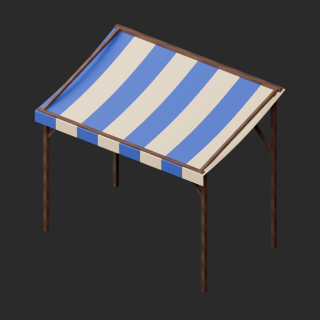
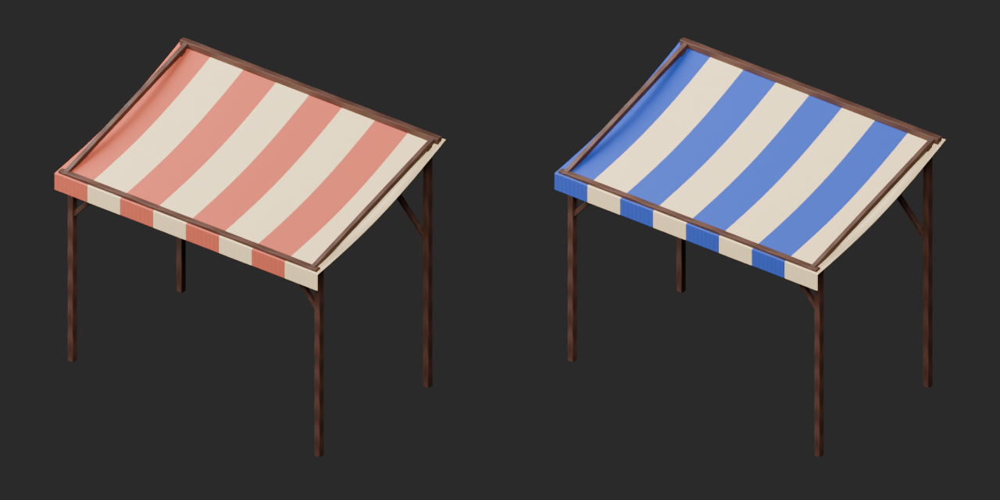
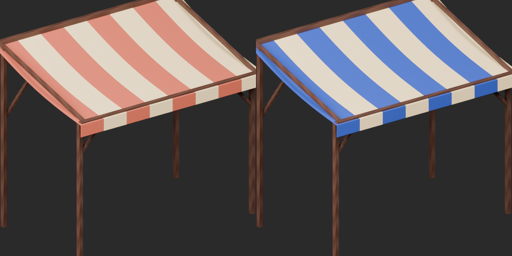
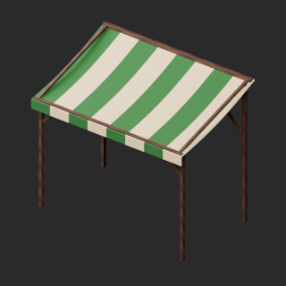
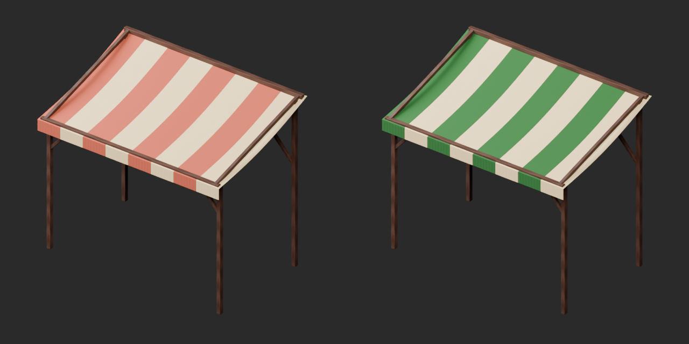
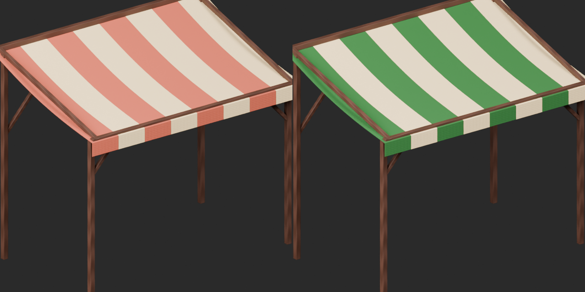

# Quality50 / 品質第50便 / 质量第50批

Base1008 unchanged; material variants164=162+2 separately. No revisions or new base. Originals retained.

BM059 market awning blue/green stripes: packed UV base-color texture changes colored stripes only. Original geometry/UV/attribute presence retained; ivory stripes, wood, normal, roughness, alpha and emission unchanged. No emission or weathering added.3304tri below50k furnishing warning.

10配布レコード・収録11モデルを査定。日除けの青/緑variant2件、基本・改訂加算0。10个配布记录/11个模型；遮阳棚蓝色和绿色条纹两个材质变体，基础数量不变。

Same camera/light/scale comparison. Final-ZIP checks both BLEND/GLB geometry/UV/spatial vertex attributes. Five known color-loss fixtures rejected. Public ZIP/member hashes match the final guarded artifacts. Publication did not rerun Blender.

Assessed496 distribution records;512 remain;142 polygon-budget issues remain, none added this batch. BM007 diagnosis remains. BM054 tea-vessel narrow mouth makes contents hard to read; detached liquid is not established, original generator intent unavailable. Purpose/readability diagnosis remains open; not repaired or a polygon-budget issue. BM029 failed blue-glass candidate remains unpublished, not an established public-original defect.

Source audit GLB only; original bundled BLEND not independently imported. Accepted ZIP both formats tested. BM057 map and rolled painting are two members of one record. Bread crumbs and loose rope are intentional elements, not additional records. No collision/load/cable physics/structural strength/gameplay/Blender4.3.2 approval.

Models/embedded materials only CC0; images separate catalogue artwork. [License](../LICENSE.md). Private reports/code excluded.

## BM_059__blue_stripe — Striped canvas awning

縞布の市庇

Awning colored stripe base color replaced by packed UV texture; geometry, UV and original attribute presence retained. Ivory stripes, wood and other material channels unchanged. No emission added.

[ZIP · BLEND/GLB](https://raw.githubusercontent.com/k3peta/tales-on-a-table/main/distributions/quality-bm051-060-v1/BM_059__blue_stripe_CC0.zip)

Left: original; right: accepted revision/variant, identical camera/light/scale.

## BM_059__green_stripe — Striped canvas awning

縞布の市庇

Awning colored stripe base color replaced by packed UV texture; geometry, UV and original attribute presence retained. Ivory stripes, wood and other material channels unchanged. No emission added.

[ZIP · BLEND/GLB](https://raw.githubusercontent.com/k3peta/tales-on-a-table/main/distributions/quality-bm051-060-v1/BM_059__green_stripe_CC0.zip)

Left: original; right: accepted revision/variant, identical camera/light/scale.

[Exact package validation evidence](../distributions/quality-bm051-060-v1/validation.json).
