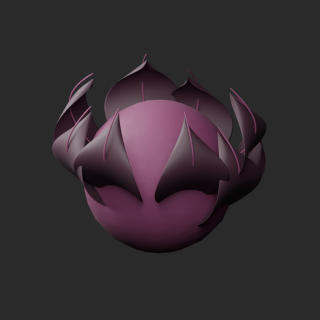
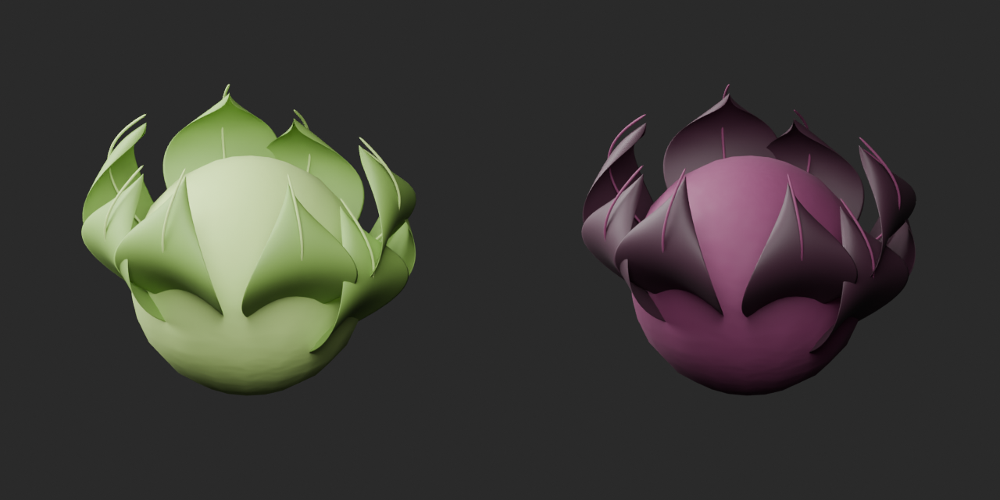
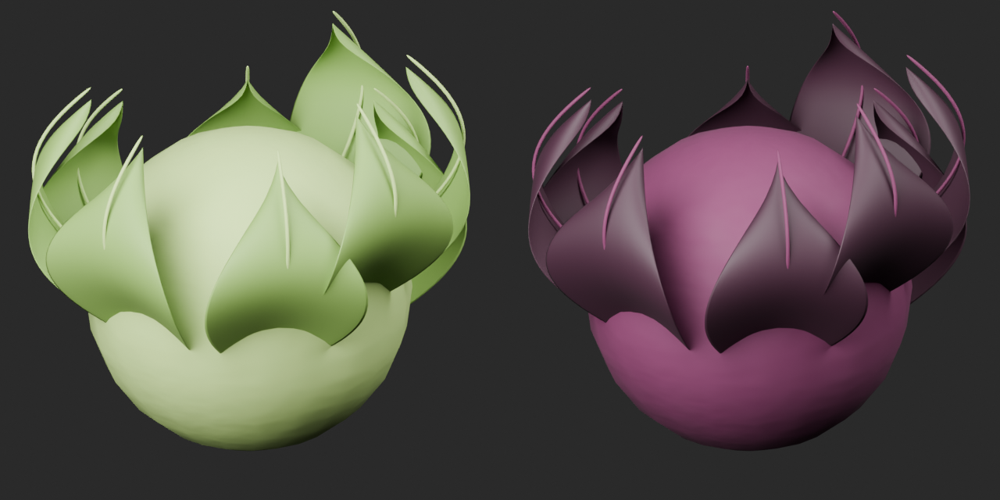
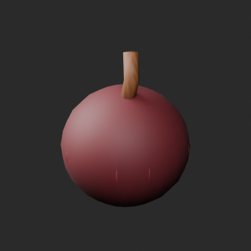
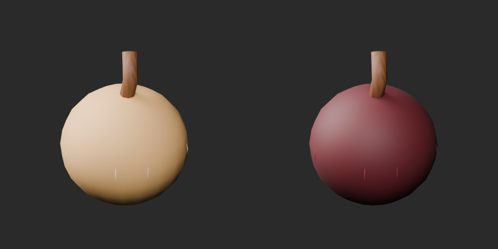
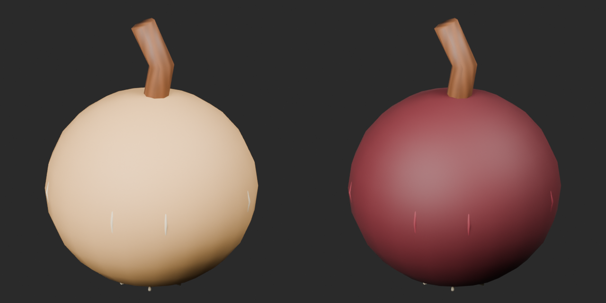

# Quality51 / 品質第51便 / 质量第51批

Base1008 unchanged; material variants166=164+2 separately. No revisions or new base. Originals retained.

BM061 purple cabbage and BM063 red onion: packed UV surface color textures, geometry/UV/attribute presence retained. No emission added; normal/roughness/alpha unchanged. Onion roots and neck retain original colors. Cabbage35000tri exceeds20k small-prop warning; onion3100tri does not. The shared package description mentions cabbage's budget even in the onion package; this warning applies to BM061 only.

10配布レコード/10モデル査定。紫キャベツ・赤玉葱variant2件、基本・改訂加算0。10个配布记录/10个模型；紫甘蓝与红洋葱两个材质变体，基础数量不变。多边形预算超限仅指甘蓝。

Same camera/light/scale comparison. Final-ZIP checks both BLEND/GLB geometry/UV/spatial vertex attributes. All ten originals lack COLOR_0; retained absence is not color loss. Five known color-loss fixtures rejected. Public artifact matching is pending. Publication did not rerun Blender.

Assessed506 distribution records;502 remain;143 polygon-budget issues remain including cabbage. Color variants do not repair geometry or raise quality scores. Cabbage vein-curve redesign not implemented; a normal texture's leather name alone does not establish a reference defect. BM007/BM054 diagnoses remain unresolved. BM029 failed candidate remains distinct from the public original.

Source audit GLB only; original bundled BLEND not independently imported. Accepted ZIP both formats tested. Static grill/skewer/kettle: no heat safety, food, fluid, collision, gameplay, structural strength or Blender4.3.2 approval. Small gem recolors not produced or counted.

Models/embedded materials only CC0; images separate catalogue artwork. [License](../LICENSE.md). Private reports/code excluded.

## BM_061__purple_cabbage — Leafy cabbage

葉付きキャベツ

Vegetable surface color replaced by packed UV textures; original geometry, UV and attribute presence retained. Other material channels unchanged; no emission added. Cabbage remains35000tri above20k small-prop warning, not a geometry repair.

[ZIP · BLEND/GLB](https://raw.githubusercontent.com/k3peta/tales-on-a-table/main/distributions/quality-bm061-070-v1/BM_061__purple_cabbage_CC0.zip)

Left: original; right: accepted revision/variant, identical camera/light/scale.

## BM_063__red_onion — Onion

玉葱

Vegetable surface color replaced by packed UV textures; original geometry, UV and attribute presence retained. Other material channels unchanged; no emission added. Cabbage remains35000tri above20k small-prop warning, not a geometry repair.

[ZIP · BLEND/GLB](https://raw.githubusercontent.com/k3peta/tales-on-a-table/main/distributions/quality-bm061-070-v1/BM_063__red_onion_CC0.zip)

Left: original; right: accepted revision/variant, identical camera/light/scale.
