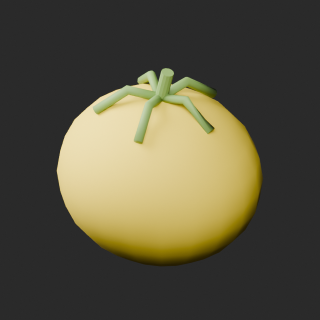
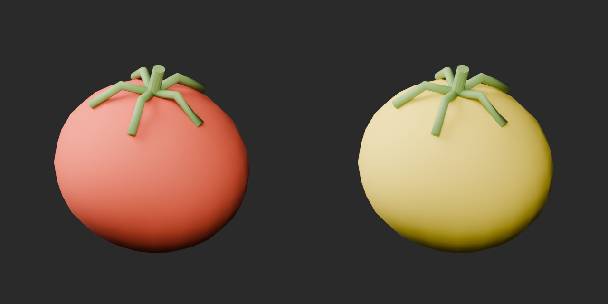
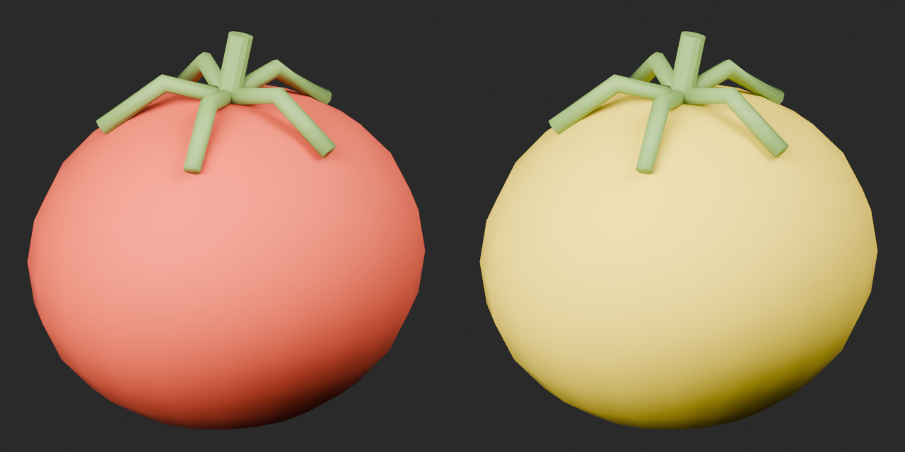
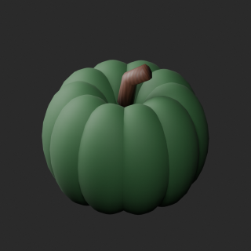
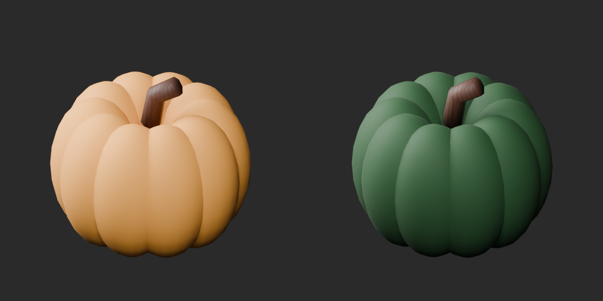
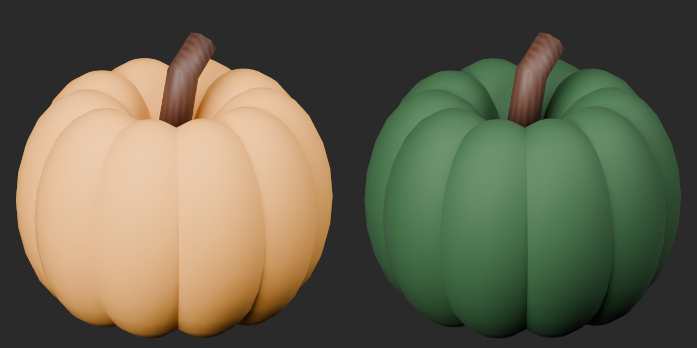

# Quality52 / 品質第52便 / 质量第52批

Base1008 unchanged; material variants168=166+2 separately. No revisions or new base. Originals retained.

BM073 yellow tomato704tri and BM074 green pumpkin4444tri: packed UV fruit-surface color textures, geometry/UV/attribute presence retained. Leaves/stems and other material channels unchanged. No emission, weathering or new botanical shape added.

10配布レコード/10モデル査定。黄トマト・緑南瓜variant2件、基本・改訂加算0。10个配布记录/10个模型；黄色番茄与绿色南瓜两个材质变体，基础数量不变。

Same camera/light/scale comparison. Final-ZIP checks both BLEND/GLB geometry/UV/spatial vertex attributes. All ten originals lack COLOR_0; retained absence is not color loss. Five known color-loss fixtures rejected. Public artifact matching is pending. Publication did not rerun Blender.

Assessed516 distribution records;492 remain;143 polygon-budget issues unchanged. BM007/BM054 diagnoses remain unresolved. BM072 plate and BM079 divided-box repeated wood bands remain material-improvement candidates, not repaired or established wrong-normal references. BM071 sparrow catalog depth differs0.596mm from vertex bounds: catalog matches transformed local bounding-box union; direct dimension comparison remains false, original unchanged. This source measurement discrepancy does not concern the two adopted fruit variants. BM029 failed candidate remains distinct from public original.

Source audit GLB only; original bundled BLEND not independently imported. Accepted ZIP both formats tested. No collision/load/rig/locomotion/food safety/species/edibility/structural strength/Blender4.3.2 approval. Empty shelf intentional; fine mushroom gills not resolved in standard upper views. Color changes do not improve base quality scores.

Models/embedded materials only CC0; images separate catalogue artwork. [License](../LICENSE.md). Private reports/code excluded.

## BM_073__yellow_tomato — Tomato with stalk

蔕付きトマト

Vegetable surface color replaced by packed UV textures; original geometry, UV and attribute presence retained. Other material channels unchanged; no emission added. Stem and leaves retain original materials; no geometry repair.

[ZIP · BLEND/GLB](https://raw.githubusercontent.com/k3peta/tales-on-a-table/main/distributions/quality-bm071-080-v1/BM_073__yellow_tomato_CC0.zip)

Left: original; right: accepted revision/variant, identical camera/light/scale.

## BM_074__green_pumpkin — Ribbed pumpkin

肋のある南瓜

Vegetable surface color replaced by packed UV textures; original geometry, UV and attribute presence retained. Other material channels unchanged; no emission added. Stem and leaves retain original materials; no geometry repair.

[ZIP · BLEND/GLB](https://raw.githubusercontent.com/k3peta/tales-on-a-table/main/distributions/quality-bm071-080-v1/BM_074__green_pumpkin_CC0.zip)

Left: original; right: accepted revision/variant, identical camera/light/scale.
