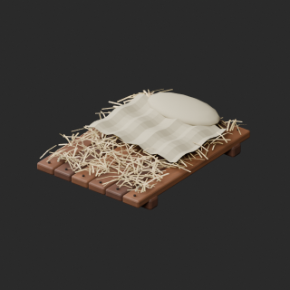
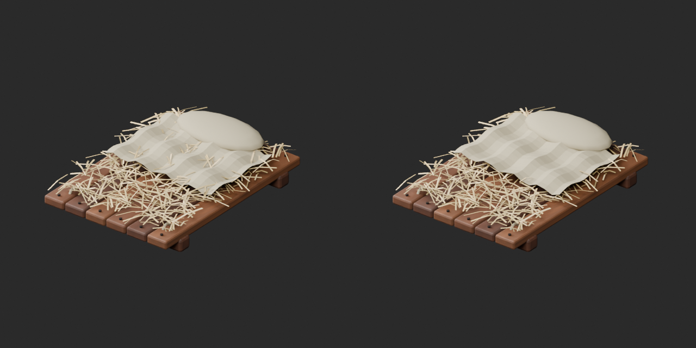
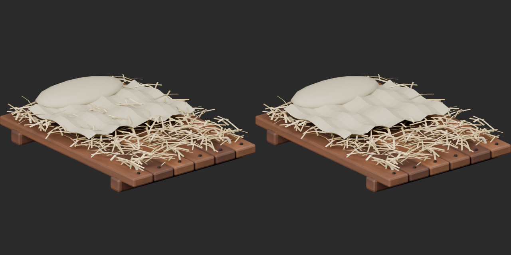

# Quality53 / 品質第53便 / 质量第53批

Base1008 unchanged; material variants169=168+1 separately. One geometry revision, no new base. Originals retained.

FP006 sleeping pallet:118 whole straw components crossing blanket/pillow removed (472tri;7884 to7412tri). Remaining432 straw components have0 detected edge-test crossings in both final ZIP formats. Retained geometry/UV/corner normals and other objects preserved. Not exhaustive triangle collision testing or cloth simulation. This revision uses an explicitly repaired baseline, NOT a same-shape variant.

BM083 blue hanging valance: same geometry/UV/attribute presence, only canvas UV color changed.1712tri flat panel intentional; no cloth dynamics or shape improvement.

10配布レコード/10モデル査定。藁寝床改訂1件は非加算、青い垂れ布variant1件別集計。10个配布记录/10个模型；草铺修订不增加基本数量，蓝色挂布变体单独统计。零交叉仅限已检查的边与布枕表面。

Same camera/light/scale comparisons. Final-ZIP checks BLEND/GLB geometry/UV/spatial vertex attributes. All ten originals lack COLOR_0; retained absence is not loss. Five known color-loss fixtures rejected. Public ZIP/member hashes match the final guarded artifacts. Publication did not rerun Blender.

Assessed526 distribution records;482 remain;143 polygon-budget issues unchanged. BM007/BM054 diagnoses and BM072/079 wood review remain; BM082 sign/FP003 desk repetitive wood grain added as material-review candidates, not repaired. No physical security, opening mechanism, locks, seating, strength, watertightness, gameplay or Blender4.3.2 approval.

Source audit GLB only; original bundled BLEND not independently imported. Final accepted ZIP both formats tested. Color alone does not increase quality score; FP006 geometric criterion changed. Original versions retained.

Models/embedded materials only CC0; images separate catalogue artwork. [License](../LICENSE.md). Private reports/code excluded.

## BM_083__blue_canvas — Stall valance cloth

屋台の前掛け布

Blue valance canvas packed UV texture, original geometry/UV/material channels unchanged. No emission added.

[ZIP · BLEND/GLB](https://raw.githubusercontent.com/k3peta/tales-on-a-table/main/distributions/quality-bm081-fp007-v1/BM_083__blue_canvas_CC0.zip)

Left: original; right: accepted revision/variant, identical camera/light/scale.

## FP006__repair — Straw sleeping pallet

寝藁の寝台

Remove whole straw components that intersect blanket/pillow faces; retained geometry/UV/materials/corner normals preserved, other objects unchanged. Static edge-intersection test, not exhaustive collision validation.

[ZIP · BLEND/GLB](https://raw.githubusercontent.com/k3peta/tales-on-a-table/main/distributions/quality-bm081-fp007-v1/FP006__repair_CC0.zip)

Left: original; right: accepted revision/variant, identical camera/light/scale.

[Exact package validation evidence](../distributions/quality-bm081-fp007-v1/validation.json).
