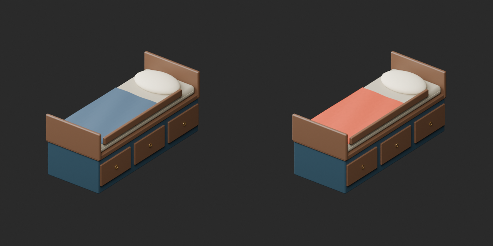
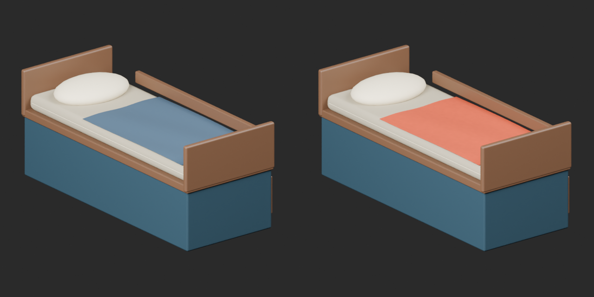
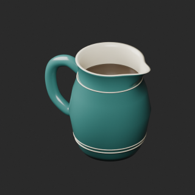
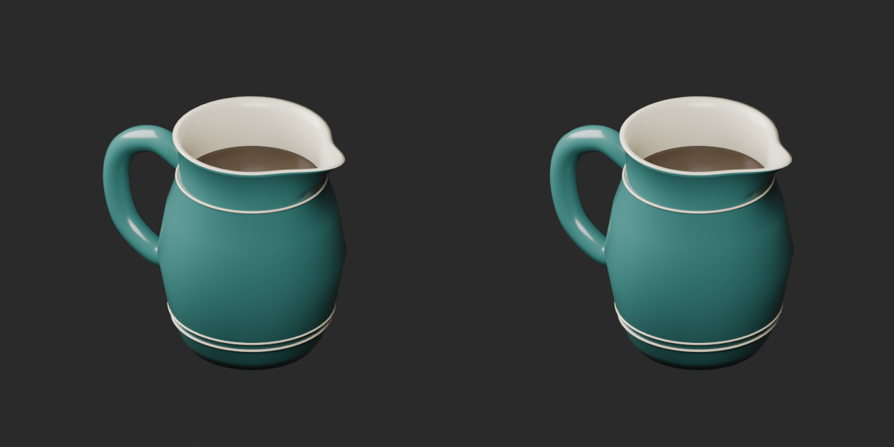
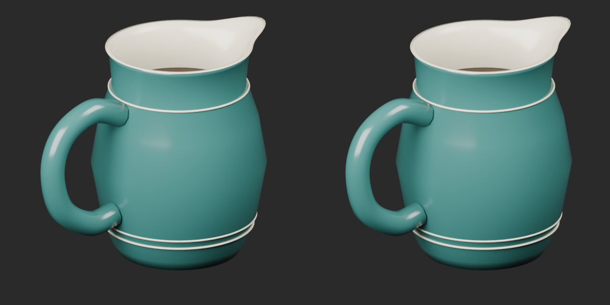
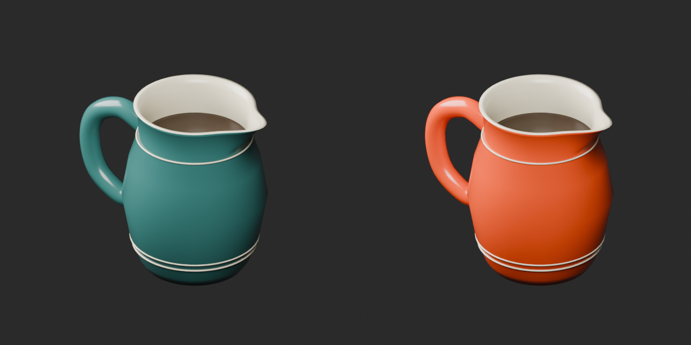
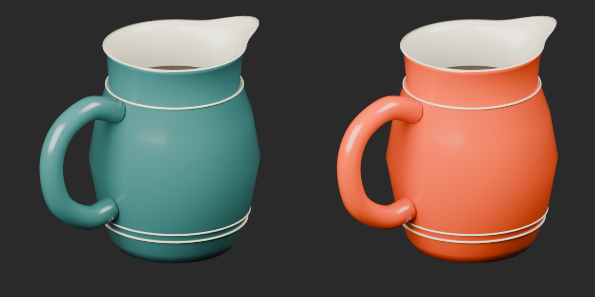

# Quality33 / 品質第33便 / 质量第33批

Base1008 unchanged; material variants135=133+2 counted separately. CP023 repair adds no model. Old versions retained; rejected periodic crosshatch glaze excluded.

CP023 exact-zero triangles384 removed (192 coffee,192 jug),11248 to10864 triangles; positive surfaces retained. Two missing UV layers added. CP019 orange wool retains geometry but adds one missing UV layer. Neither is described as fully original-UV-invariant. CP023 smooth orange glaze uses the repaired geometry and UV baseline. The handle-joint shading remains under diagnosis; color variation is not its repair.

改訂1件は非加算。CP019に欠落UV1層、CP023に2層を追加。橙釉variantは修復後基準。取手接合部の陰影は診断中、周期格子釉候補は不採用で非公開です。

1个修订不新增模型。CP019补充1层UV、CP023补充2层UV；橙釉变体以修复后模型为基准。把手接合处阴影仍待诊断，周期网格釉候选未发布。

Same camera/light/scale comparisons. Producer final-ZIP guard binds accepted packages, input/script/model hashes and run/time/build. Public ZIP/member hashes match the final guarded artifacts. Publication did not rerun Blender.

Assessed326 distribution records,682 remain;58 budget/redesign issues unresolved. CP02037712tri remains over20k budget;9 constant-color meshes lack UV. CP0212 and CP0221 constant-color meshes lack UV. CP01724 positive tiny triangles retained. CP013 chart strokes thin in thumbnail; CP022 dark optical reflection retained. CP018 absent from this batch:10 assessed records, not11. No optical/navigation calibration, load, hinge motion, collision or Blender4.3.2 guarantee.

Models/embedded materials only CC0; images separate catalogue artwork. [License](../LICENSE.md). Private reports/code excluded.

## CP_019__orange_wool — Cabin berth with storage

収納付きの船室寝台

Orange texture mapped to CP019 wool or CP023 exterior glaze only. CP019 original geometry retained; CP023 uses zero-area-cleaned baseline. Missing UV is explicitly added where recorded; all other material properties retained.

[ZIP · BLEND/GLB](https://raw.githubusercontent.com/k3peta/tales-on-a-table/main/distributions/quality-cp013-023-v1/CP_019__orange_wool_CC0.zip)

Left: original; right: accepted revision/variant, identical camera/light/scale.

## CP_023__repair — Ceramic coffee jug

コーヒー入りの陶製ジャグ

Exact-zero-area cleanup only, all positive surfaces retained; missing UV added where recorded in revision notes. No new base.

[ZIP · BLEND/GLB](https://raw.githubusercontent.com/k3peta/tales-on-a-table/main/distributions/quality-cp013-023-v1/CP_023__repair_CC0.zip)

Left: original; right: accepted revision/variant, identical camera/light/scale.

## CP_023__orange_glaze_smooth — Ceramic coffee jug

コーヒー入りの陶製ジャグ

Orange texture mapped to CP019 wool or CP023 exterior glaze only. CP019 original geometry retained; CP023 uses zero-area-cleaned baseline. Missing UV is explicitly added where recorded; all other material properties retained.

[ZIP · BLEND/GLB](https://raw.githubusercontent.com/k3peta/tales-on-a-table/main/distributions/quality-cp013-023-v1/CP_023__orange_glaze_smooth_CC0.zip)

Left: original; right: accepted revision/variant, identical camera/light/scale.

[Exact package validation evidence](../distributions/quality-cp013-023-v1/validation.json).
