# Quality34 / 品質第34便 / 质量第34批

Base1008 unchanged; material variants136=135+1 counted separately. Six revisions add no model. Old versions and the initial single-GLB input failure retained. IF002: main/HQ only; original distant LOD1 remains unassessed and unmodified.

Exact-zero triangles removed: CP025126, CP026256, CP028549, CP03132, IF0011229, IF00227504. All positive surfaces retained. CP02870 missing UV layers added; CP0252 and CP0262 missing UV layers also added. Green silk hat variant uses the cleaned CP025 geometry and added-UV baseline: not a claim of original-UV invariance.

改訂6件は非加算。緑絹の帽子variant1は修復後の形状・追加UV基準。CP028に欠落UV70層を追加。IF002はHQ本体だけの改訂で、元のLOD1は未査定・未変更です。

6个修订不新增模型。绿色丝绸帽变体以修复后的几何及补充UV为基准。CP028补充70层UV。IF002仅修订HQ主体，原LOD1未经本轮审查且未更改。

Same camera/light/scale comparisons. Producer final-ZIP guard binds accepted packages, input/script/model hashes and run/time/build. Public artifact matching is pending. Publication did not rerun Blender.

Assessed336 distribution records,672 remain;63 budget/redesign issues unresolved. Remaining excessive triangle counts: CP02494360, CP02536394, CP02825127, IF001112271, IF002138158. Cleanup is not complete lightweight redesign. CP024 shoulder/neck and trim contact, CP030 loose-looking inner straps and CP031 strap continuity need diagnosis. CP023 handle shading and earlier issues remain. No collision, gameplay, load, animal fit, animation, map accuracy or Blender4.3.2 guarantee.

Models/embedded materials only CC0; images separate catalogue artwork. [License](../LICENSE.md). Private reports/code excluded.

## CP_025__repair — Gold-trimmed admiral's hat

金縁と徽章の提督帽

Exact-zero-area cleanup only, all positive surfaces retained; missing UV added where recorded in revision notes. No new base.

[ZIP · BLEND/GLB](https://raw.githubusercontent.com/k3peta/tales-on-a-table/main/distributions/quality-cp024-if002-v1/CP_025__repair_CC0.zip)

[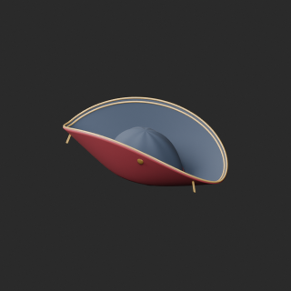](../previews/quality-cp024-if002-v1/CP_025__repair_thumb.png)

[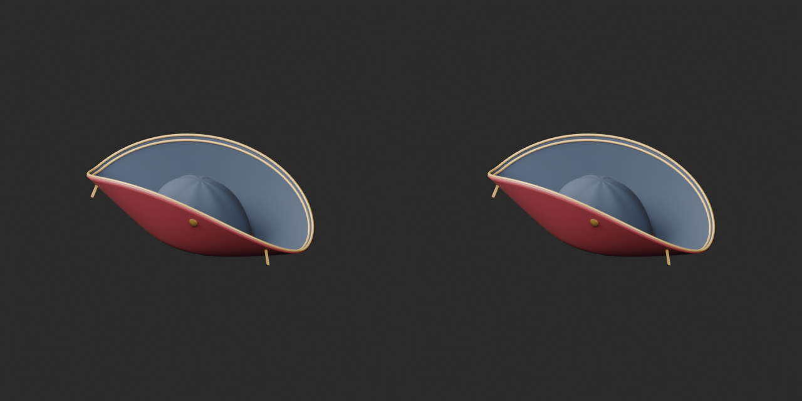](../previews/quality-cp024-if002-v1/CP_025__repair_overview_comparison.png)

[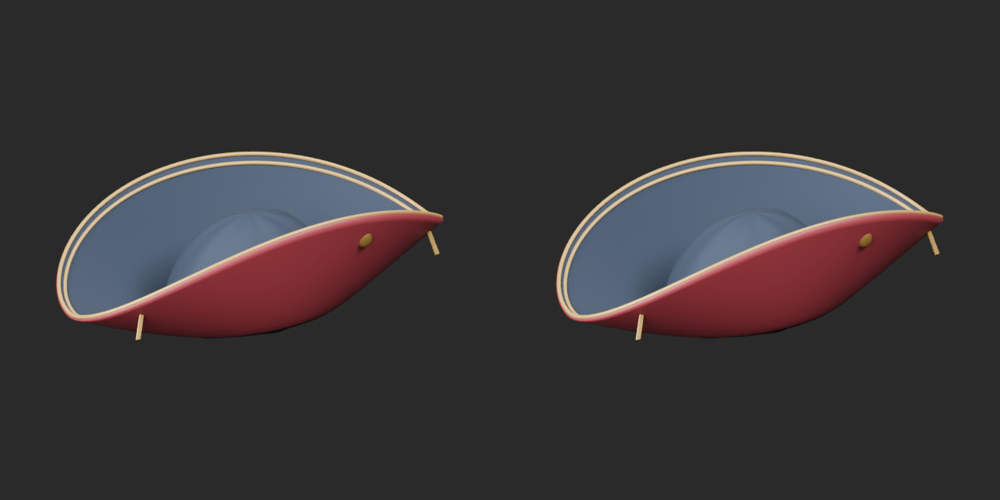](../previews/quality-cp024-if002-v1/CP_025__repair_close_comparison.png)

Left: original; right: accepted revision/variant, identical camera/light/scale.

## CP_025__green_silk — Gold-trimmed admiral's hat

金縁と徽章の提督帽

Green silk texture mapped to CP025 wine silk material only, using cleaned geometry and explicitly added missing UV baseline. Other material properties unchanged.

[ZIP · BLEND/GLB](https://raw.githubusercontent.com/k3peta/tales-on-a-table/main/distributions/quality-cp024-if002-v1/CP_025__green_silk_CC0.zip)

[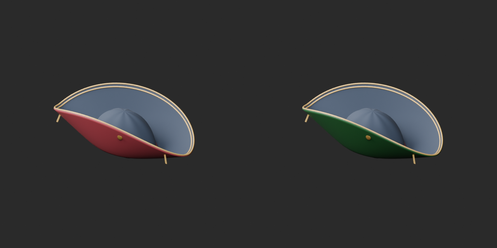](../previews/quality-cp024-if002-v1/CP_025__green_silk_overview_comparison.png)

[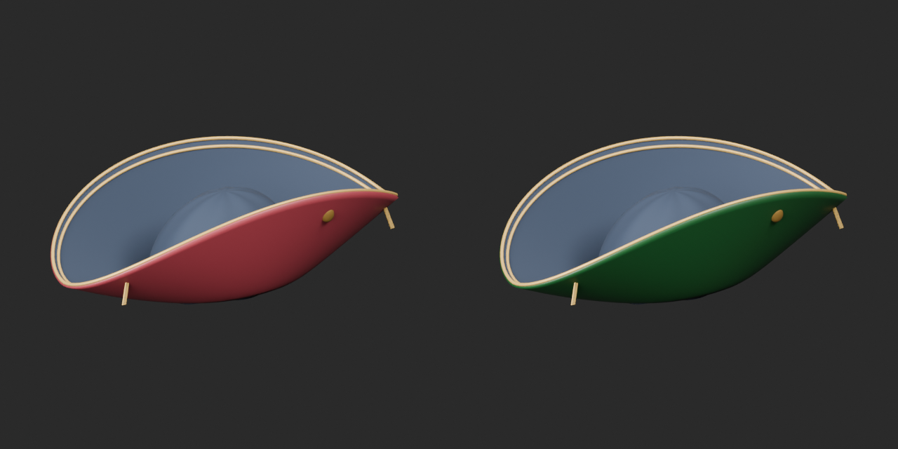](../previews/quality-cp024-if002-v1/CP_025__green_silk_close_comparison.png)

Left: original; right: accepted revision/variant, identical camera/light/scale.

## CP_026__repair — Large birdcage with open door

開く扉付きの大型鳥籠

Exact-zero-area cleanup only, all positive surfaces retained; missing UV added where recorded in revision notes. No new base.

[ZIP · BLEND/GLB](https://raw.githubusercontent.com/k3peta/tales-on-a-table/main/distributions/quality-cp024-if002-v1/CP_026__repair_CC0.zip)

[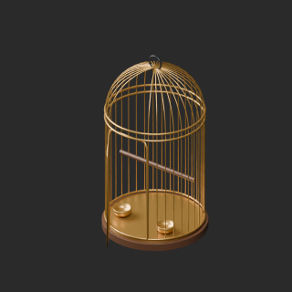](../previews/quality-cp024-if002-v1/CP_026__repair_thumb.png)

[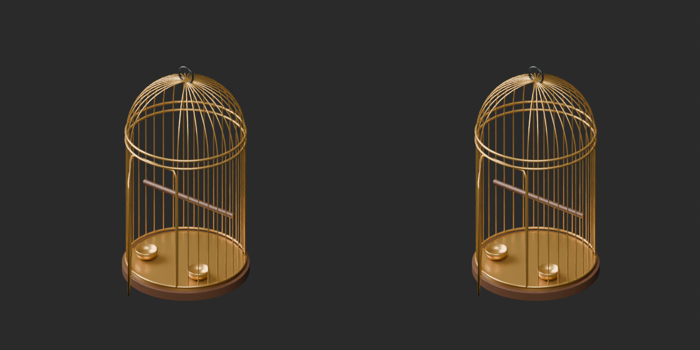](../previews/quality-cp024-if002-v1/CP_026__repair_overview_comparison.png)

[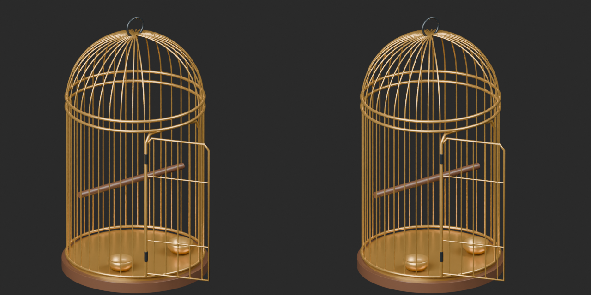](../previews/quality-cp024-if002-v1/CP_026__repair_close_comparison.png)

Left: original; right: accepted revision/variant, identical camera/light/scale.

## CP_028__repair — Scarlet macaw

赤い大型鸚鵡

Exact-zero-area cleanup only, all positive surfaces retained; missing UV added where recorded in revision notes. No new base.

[ZIP · BLEND/GLB](https://raw.githubusercontent.com/k3peta/tales-on-a-table/main/distributions/quality-cp024-if002-v1/CP_028__repair_CC0.zip)

[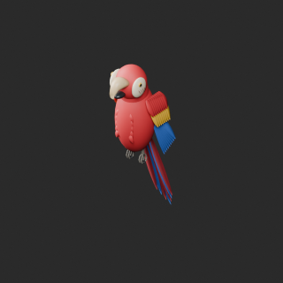](../previews/quality-cp024-if002-v1/CP_028__repair_thumb.png)

[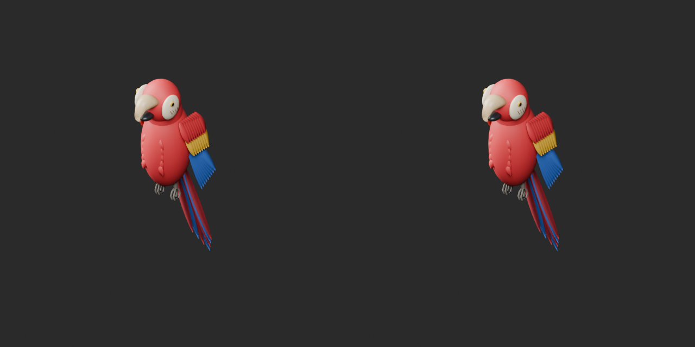](../previews/quality-cp024-if002-v1/CP_028__repair_overview_comparison.png)

[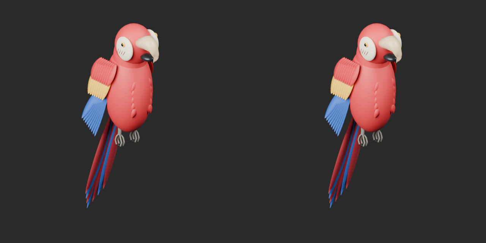](../previews/quality-cp024-if002-v1/CP_028__repair_close_comparison.png)

Left: original; right: accepted revision/variant, identical camera/light/scale.

## CP_031__repair — Tall leather travel bag

縦型の大型革旅行バッグ

Exact-zero-area cleanup only, all positive surfaces retained; missing UV added where recorded in revision notes. No new base.

[ZIP · BLEND/GLB](https://raw.githubusercontent.com/k3peta/tales-on-a-table/main/distributions/quality-cp024-if002-v1/CP_031__repair_CC0.zip)

[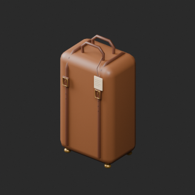](../previews/quality-cp024-if002-v1/CP_031__repair_thumb.png)

[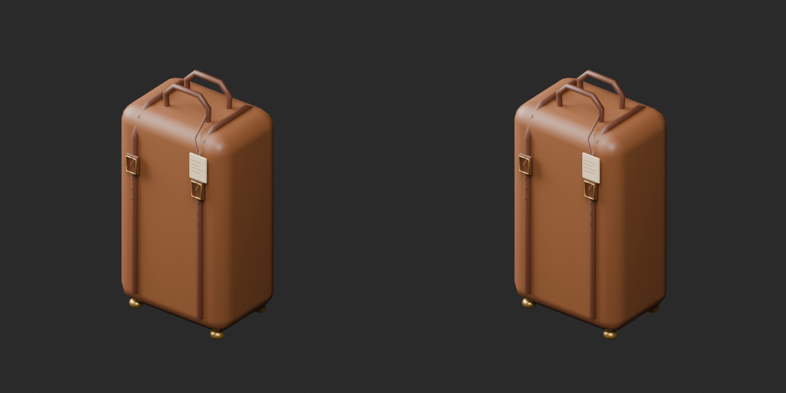](../previews/quality-cp024-if002-v1/CP_031__repair_overview_comparison.png)

[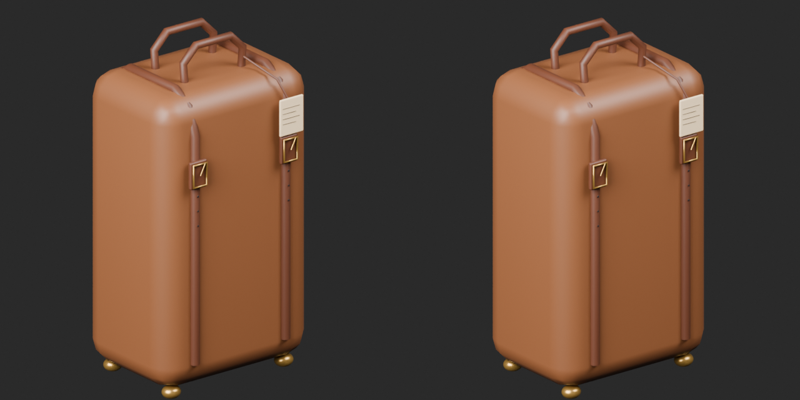](../previews/quality-cp024-if002-v1/CP_031__repair_close_comparison.png)

Left: original; right: accepted revision/variant, identical camera/light/scale.

## IF_001__repair — Leather two-seat sofa

革張りの二人掛けソファ

Exact-zero-area cleanup only, all positive surfaces retained; missing UV added where recorded in revision notes. No new base.

[ZIP · BLEND/GLB](https://raw.githubusercontent.com/k3peta/tales-on-a-table/main/distributions/quality-cp024-if002-v1/IF_001__repair_CC0.zip)

[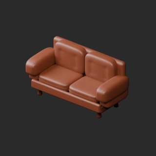](../previews/quality-cp024-if002-v1/IF_001__repair_thumb.png)

[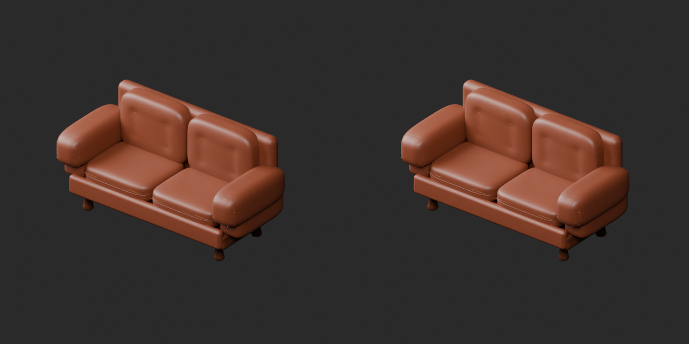](../previews/quality-cp024-if002-v1/IF_001__repair_overview_comparison.png)

[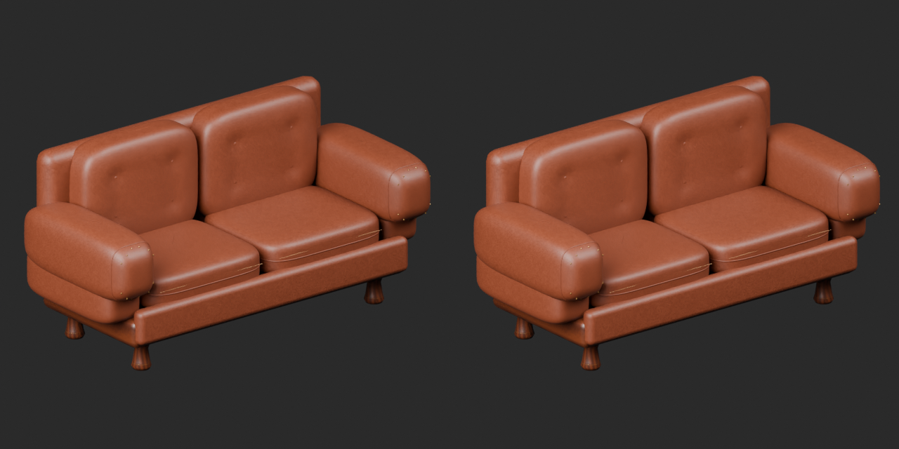](../previews/quality-cp024-if002-v1/IF_001__repair_close_comparison.png)

Left: original; right: accepted revision/variant, identical camera/light/scale.

## IF_002__repair — Short-pile fur rug

毛足のある楕円ファーラグ

Exact-zero-area cleanup only, all positive surfaces retained; missing UV added where recorded in revision notes. No new base.

[ZIP · BLEND/GLB](https://raw.githubusercontent.com/k3peta/tales-on-a-table/main/distributions/quality-cp024-if002-v1/IF_002__repair_CC0.zip)

[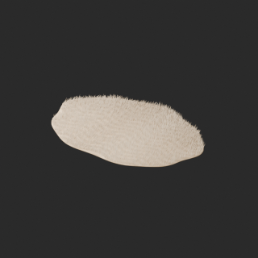](../previews/quality-cp024-if002-v1/IF_002__repair_thumb.png)

[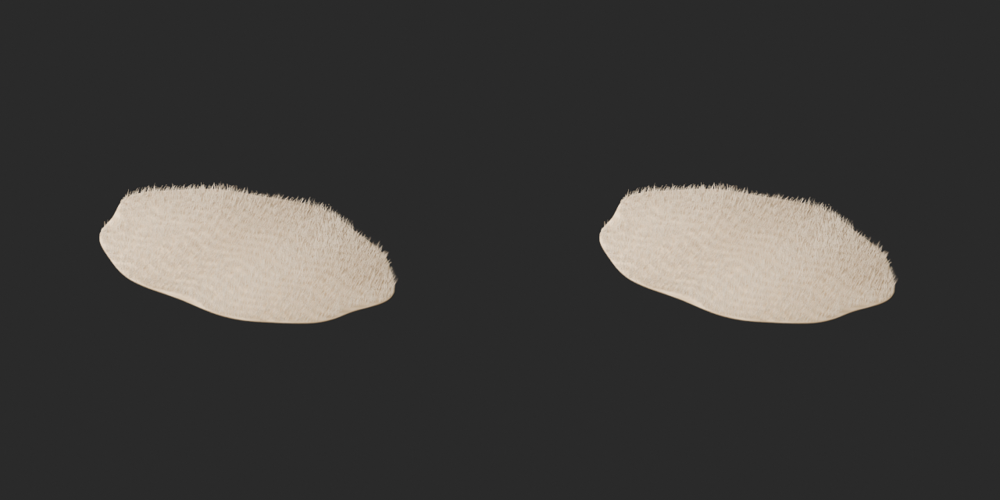](../previews/quality-cp024-if002-v1/IF_002__repair_overview_comparison.png)

[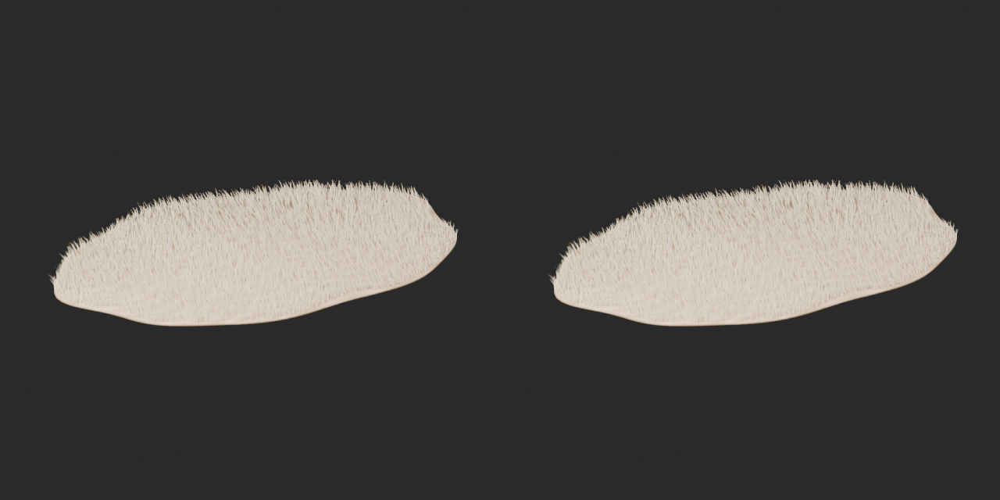](../previews/quality-cp024-if002-v1/IF_002__repair_close_comparison.png)

Left: original; right: accepted revision/variant, identical camera/light/scale.
