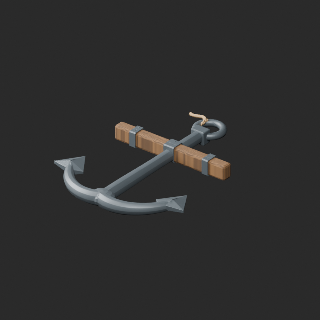
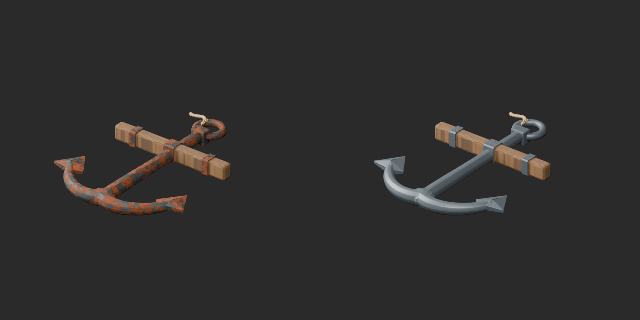
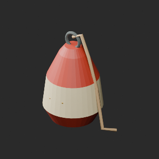
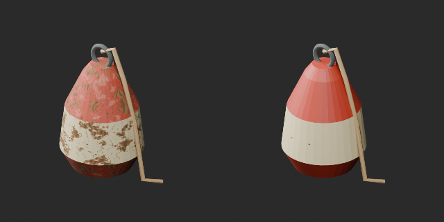
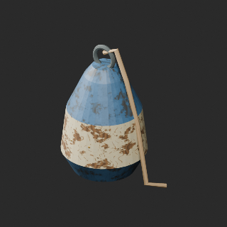
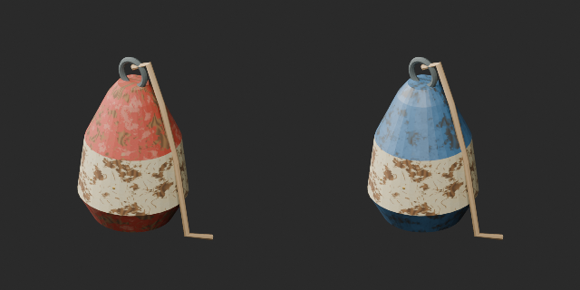
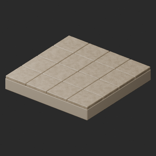
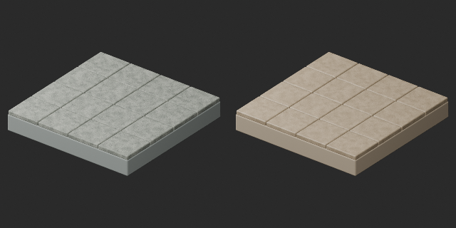

# FH001–010 材質variant / Material variants / 材质变体

**Existing 1008 records unchanged; 81 material variants = 77 + 4, counted separately.**

査定10配布記録、採用4・棄却6。品質改訂0、新基本0。累積査定66/1008配布記録（残942）であり独立形状数ではありません。錨の手入れ鉄色、浮標の塗直し赤/クリームと青、暖砂色敷石。形状保持、既存UV保持、錨のUV不足15meshにUVを追加。GLB再読込のUV最大誤差2.98e-8、完全hash一致ではなく数値許容1e-6で確認。濡れた接続地形6候補は棄却し公開しません。ロープ約28396triでLODなし。接続作例は配布/加算しません。全多様体/衝突/歩行/物理/航海安全/魚種精度/Blender4.3.2/他engineは未検証。潮汐・水位動作は未実装。

Ten distribution records assessed, four accepted material variants and six rejected; no base replacements or new base shapes. Cumulative 66/1008 assessed records, not unique shapes. Original geometry and existing UV retained; missing UV added on 15 anchor meshes. GLB UV numerical error up to 2.98e-8 within 1e-6 tolerance, not identical hash. Rejected wet terrain variants excluded. Rope remains 28396 triangles without LOD. Connection examples excluded from distribution. Full manifold/collision/walking/physics/safety/older Blender/other engines unverified; no tide simulation.

査定10条配布记录，采用4材质变体、拒绝6，基本1008不变。累计査定66条不是独立形状数；缺失UV已补，微小浮点误差按容差验证。真实功能、安全和旧版兼容未验证。

モデル/埋込材質のみCC0。画像は閲覧用でモデルCC0対象外、[既存画像権利](../LICENSE.md)維持。代码图片私有査定不属模型CC0。

## FH_002__new — 錆びた小舟用の錨

material_variant · [ZIP · BLEND/GLB](https://raw.githubusercontent.com/k3peta/tales-on-a-table/main/distributions/quality-fh001-010-v1/FH_002__new_CC0.zip)

[拡大 / Full image](https://raw.githubusercontent.com/k3peta/tales-on-a-table/main/previews/quality-fh001-010-v1/FH_002__new_thumb.png)

[拡大 / Full image](https://raw.githubusercontent.com/k3peta/tales-on-a-table/main/previews/quality-fh001-010-v1/FH_002__new_comparison.png)

left: original base; right: accepted variant; same overview camera

## FH_004__new — 塗装が剥げた木製ブイ

material_variant · [ZIP · BLEND/GLB](https://raw.githubusercontent.com/k3peta/tales-on-a-table/main/distributions/quality-fh001-010-v1/FH_004__new_CC0.zip)

[拡大 / Full image](https://raw.githubusercontent.com/k3peta/tales-on-a-table/main/previews/quality-fh001-010-v1/FH_004__new_thumb.png)

[拡大 / Full image](https://raw.githubusercontent.com/k3peta/tales-on-a-table/main/previews/quality-fh001-010-v1/FH_004__new_comparison.png)

left: original base; right: accepted variant; same overview camera

## FH_004__color — 塗装が剥げた木製ブイ

material_variant · [ZIP · BLEND/GLB](https://raw.githubusercontent.com/k3peta/tales-on-a-table/main/distributions/quality-fh001-010-v1/FH_004__color_CC0.zip)

[拡大 / Full image](https://raw.githubusercontent.com/k3peta/tales-on-a-table/main/previews/quality-fh001-010-v1/FH_004__color_thumb.png)

[拡大 / Full image](https://raw.githubusercontent.com/k3peta/tales-on-a-table/main/previews/quality-fh001-010-v1/FH_004__color_comparison.png)

left: original base; right: accepted variant; same overview camera

## FH_009__color — 岸壁・敷石2m

material_variant · [ZIP · BLEND/GLB](https://raw.githubusercontent.com/k3peta/tales-on-a-table/main/distributions/quality-fh001-010-v1/FH_009__color_CC0.zip)

[拡大 / Full image](https://raw.githubusercontent.com/k3peta/tales-on-a-table/main/previews/quality-fh001-010-v1/FH_009__color_thumb.png)

[拡大 / Full image](https://raw.githubusercontent.com/k3peta/tales-on-a-table/main/previews/quality-fh001-010-v1/FH_009__color_comparison.png)

left: original base; right: accepted variant; same overview camera
