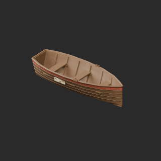
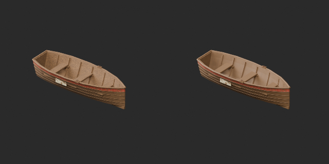
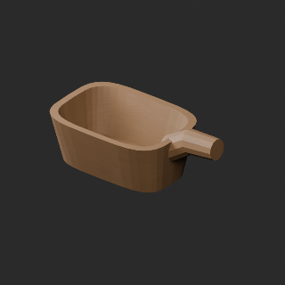
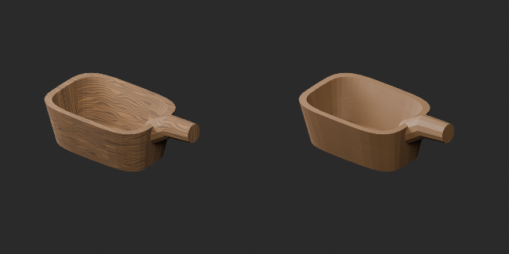

# FH011–020 品質改訂と材質variant / Revisions and material variants / 修订与材质变体

**Existing 1008 records unchanged; 85 material variants = 81 + 4, counted separately. Two revisions are not new records.**

査定10配布記録、材質改訂2（漁船FH017・あか汲みFH020）、同形材質variant4、新基本0。累積査定76/1008配布記録、未査定932。独立形状数ではありません。漁船内側とあか汲みの強い反復木目を低減し構造を読みやすくしました。形状・原UV0は保持、WearUV追加。UV再配置ではなく継ぎ目完全除去は未達。暖色胸壁、係船柱・係留環・港灯の手入れ材質をvariantとして採用。元の錆状態を不良品とは扱わず旧版保持。弱い使用感5候補と漁船青帯1候補は棄却。24形式再読込の形状/UV数値誤差0という制作報告を照合。

Ten records assessed; two material revisions (fishing boat FH017 and bailer FH020), four same-geometry material variants, zero new bases. Cumulative76/1008 records,932 unassessed; not unique shapes. Repetitive wood grain reduced; original geometry/UV0 retained with WearUV added. UV seams are not fully removed. Original rusty states preserved. Six rejected candidates excluded. Producer24 format reimports report zero geometry/UV coordinate error.

査定10条、材质修订2、变体4，基本不增；累计76条不是独立形状数。保留旧版和原形状UV，木纹弱化不等于完全消除接缝。

胸壁幅1.988m、2m配置では12mm目地。今回原寸法変更なし。全体接続作例、舟の水密性/浮力、灯火安全、登攀/衝突/強度/他engine透明/Blender4.3.2互換は未検証。鑑賞用で実用品設計ではありません。

Parapet width1.988m leaves12mm joint on2m spacing; dimensions unchanged. Full connection assemblies, watertightness/buoyancy, lamp safety, climbing/collision/strength, other-engine transparency and Blender4.3.2 untested. Static viewing models, not functional designs.

モデル/埋込材質のみCC0。画像は閲覧用でモデルCC0対象外、[既存画像権利](../LICENSE.md)維持。代码图片私有査定不属模型CC0。

## FH_011__color — 海側の低い胸壁

material_variant · [ZIP · BLEND/GLB](https://raw.githubusercontent.com/k3peta/tales-on-a-table/main/distributions/quality-fh011-020-v1/FH_011__color_CC0.zip)

[拡大 / Full image](https://raw.githubusercontent.com/k3peta/tales-on-a-table/main/previews/quality-fh011-020-v1/FH_011__color_thumb.png)

[拡大 / Full image](https://raw.githubusercontent.com/k3peta/tales-on-a-table/main/previews/quality-fh011-020-v1/FH_011__color_comparison.png)

left: original base; right: accepted variant; same overview camera

## FH_012__new — 鉄の係船柱

material_variant · [ZIP · BLEND/GLB](https://raw.githubusercontent.com/k3peta/tales-on-a-table/main/distributions/quality-fh011-020-v1/FH_012__new_CC0.zip)

[拡大 / Full image](https://raw.githubusercontent.com/k3peta/tales-on-a-table/main/previews/quality-fh011-020-v1/FH_012__new_thumb.png)

[拡大 / Full image](https://raw.githubusercontent.com/k3peta/tales-on-a-table/main/previews/quality-fh011-020-v1/FH_012__new_comparison.png)

left: original base; right: accepted variant; same overview camera

## FH_013__new — 石留めの係留環

material_variant · [ZIP · BLEND/GLB](https://raw.githubusercontent.com/k3peta/tales-on-a-table/main/distributions/quality-fh011-020-v1/FH_013__new_CC0.zip)

[拡大 / Full image](https://raw.githubusercontent.com/k3peta/tales-on-a-table/main/previews/quality-fh011-020-v1/FH_013__new_thumb.png)

[拡大 / Full image](https://raw.githubusercontent.com/k3peta/tales-on-a-table/main/previews/quality-fh011-020-v1/FH_013__new_comparison.png)

left: original base; right: accepted variant; same overview camera

## FH_015__new — 防風ガラスの港灯

material_variant · [ZIP · BLEND/GLB](https://raw.githubusercontent.com/k3peta/tales-on-a-table/main/distributions/quality-fh011-020-v1/FH_015__new_CC0.zip)

[拡大 / Full image](https://raw.githubusercontent.com/k3peta/tales-on-a-table/main/previews/quality-fh011-020-v1/FH_015__new_thumb.png)

[拡大 / Full image](https://raw.githubusercontent.com/k3peta/tales-on-a-table/main/previews/quality-fh011-020-v1/FH_015__new_comparison.png)

left: original base; right: accepted variant; same overview camera

## FH_017__repair — 木造の小さな漁船

revision · [ZIP · BLEND/GLB](https://raw.githubusercontent.com/k3peta/tales-on-a-table/main/distributions/quality-fh011-020-v1/FH_017__repair_CC0.zip)

[拡大 / Full image](https://raw.githubusercontent.com/k3peta/tales-on-a-table/main/previews/quality-fh011-020-v1/FH_017__repair_thumb.png)

[拡大 / Full image](https://raw.githubusercontent.com/k3peta/tales-on-a-table/main/previews/quality-fh011-020-v1/FH_017__repair_comparison.png)

left: original base; right: accepted variant; same overview camera

## FH_020__repair — 木製のあか汲み

revision · [ZIP · BLEND/GLB](https://raw.githubusercontent.com/k3peta/tales-on-a-table/main/distributions/quality-fh011-020-v1/FH_020__repair_CC0.zip)

[拡大 / Full image](https://raw.githubusercontent.com/k3peta/tales-on-a-table/main/previews/quality-fh011-020-v1/FH_020__repair_thumb.png)

[拡大 / Full image](https://raw.githubusercontent.com/k3peta/tales-on-a-table/main/previews/quality-fh011-020-v1/FH_020__repair_comparison.png)

left: original base; right: accepted variant; same overview camera
