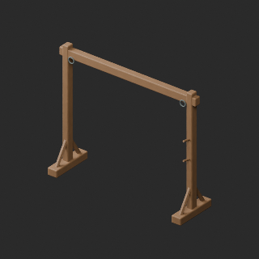
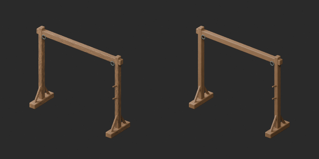
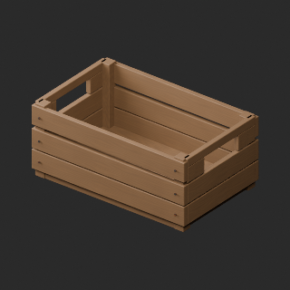
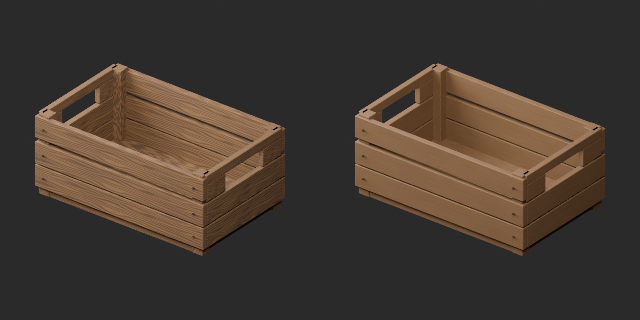
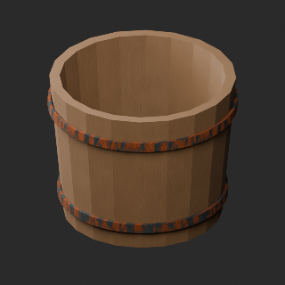
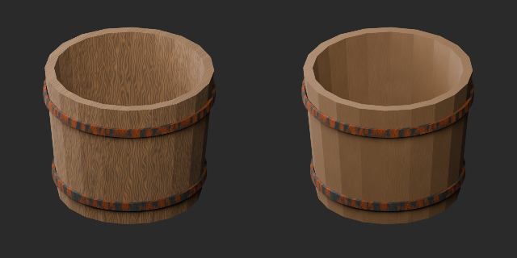

# FH021–030 材質改訂とvariant / Material revisions and variants / 材质修订与变体

**Existing 1008 records unchanged; 87 material variants = 85 + 2, counted separately. Three revisions are not new records.**

査定10配布記録、累積86/1008、未査定922。独立形状数の証明ではありません。網干し木枠FH023・魚運び木箱FH027・塩漬け桶FH028の過度な反復木目を抑えた材質改訂3件。淡青灰の帆FH021と赤茶浮子索FH029の同形variant2件。新基本/幾何改訂0、棄却5件は非公開。元形状・原UV0保持、WearUV追加。UV継ぎ目完全除去ではなくコントラスト軽減です。元の版と錆びた箍・索・結び紐を保持。

Ten assessed distribution records, cumulative86/1008 and922 unassessed; not unique shapes. Three material revisions reduce repetitive wood grain on net frame FH023, fish crate FH027 and salting tub FH028. Two variants: blue-grey folded sail FH021 and red-brown floats FH029. No new base or geometry revision. Five rejected candidates excluded. Original geometry/UV0 preserved with WearUV added; UV seams are not fully removed. Earlier versions retained.

査定10条、累计86条，未査定922条；材质修订3、同形变体2，基本不增。保留原形状UV与旧版，木纹弱化不等于消除接缝。

軽量化候補FH024/025/026は本配布に一切含みません。既存の約24〜26k三角形と小物予算超過は本材質便では未解決です。別工程の採否と混同しません。干し網FH022は上部原点で最下点約−1.197m、吊り高さ指定が必要（今回は未配布）。実吊り接続/結び目強度/物理/浮力/捕獲性能/食品衛生/全交差衝突/Blender4.3.2は未検証。

No lightweight candidates FH024/025/026 are included. Their existing24–26k triangle budget issue remains unresolved by this material batch. Suspended net FH022 uses top origin, minimum z about−1.197m (not distributed here). Real suspension/strength/physics/buoyancy/capture/food safety/full collision and Blender4.3.2 untested.

モデル/埋込材質のみCC0。画像は閲覧用でモデルCC0対象外、[既存画像権利](../LICENSE.md)維持。代码图片私有査定不属模型CC0。

## FH_021__color — 畳んで縛った小さな帆

material_variant · [ZIP · BLEND/GLB](https://raw.githubusercontent.com/k3peta/tales-on-a-table/main/distributions/quality-fh021-030-v1/FH_021__color_CC0.zip)

[拡大 / Full image](https://raw.githubusercontent.com/k3peta/tales-on-a-table/main/previews/quality-fh021-030-v1/FH_021__color_thumb.png)

[拡大 / Full image](https://raw.githubusercontent.com/k3peta/tales-on-a-table/main/previews/quality-fh021-030-v1/FH_021__color_comparison.png)

left: original base; right: accepted variant; same overview camera

## FH_023__repair — 網干し用の木枠

revision · [ZIP · BLEND/GLB](https://raw.githubusercontent.com/k3peta/tales-on-a-table/main/distributions/quality-fh021-030-v1/FH_023__repair_CC0.zip)

[拡大 / Full image](https://raw.githubusercontent.com/k3peta/tales-on-a-table/main/previews/quality-fh021-030-v1/FH_023__repair_thumb.png)

[拡大 / Full image](https://raw.githubusercontent.com/k3peta/tales-on-a-table/main/previews/quality-fh021-030-v1/FH_023__repair_comparison.png)

left: original base; right: accepted variant; same overview camera

## FH_027__repair — 魚運びの木箱

revision · [ZIP · BLEND/GLB](https://raw.githubusercontent.com/k3peta/tales-on-a-table/main/distributions/quality-fh021-030-v1/FH_027__repair_CC0.zip)

[拡大 / Full image](https://raw.githubusercontent.com/k3peta/tales-on-a-table/main/previews/quality-fh021-030-v1/FH_027__repair_thumb.png)

[拡大 / Full image](https://raw.githubusercontent.com/k3peta/tales-on-a-table/main/previews/quality-fh021-030-v1/FH_027__repair_comparison.png)

left: original base; right: accepted variant; same overview camera

## FH_028__repair — 塩漬け桶

revision · [ZIP · BLEND/GLB](https://raw.githubusercontent.com/k3peta/tales-on-a-table/main/distributions/quality-fh021-030-v1/FH_028__repair_CC0.zip)

[拡大 / Full image](https://raw.githubusercontent.com/k3peta/tales-on-a-table/main/previews/quality-fh021-030-v1/FH_028__repair_thumb.png)

[拡大 / Full image](https://raw.githubusercontent.com/k3peta/tales-on-a-table/main/previews/quality-fh021-030-v1/FH_028__repair_comparison.png)

left: original base; right: accepted variant; same overview camera

## FH_029__color — 小さな浮子を並べた索

material_variant · [ZIP · BLEND/GLB](https://raw.githubusercontent.com/k3peta/tales-on-a-table/main/distributions/quality-fh021-030-v1/FH_029__color_CC0.zip)

[拡大 / Full image](https://raw.githubusercontent.com/k3peta/tales-on-a-table/main/previews/quality-fh021-030-v1/FH_029__color_thumb.png)

[拡大 / Full image](https://raw.githubusercontent.com/k3peta/tales-on-a-table/main/previews/quality-fh021-030-v1/FH_029__color_comparison.png)

left: original base; right: accepted variant; same overview camera
