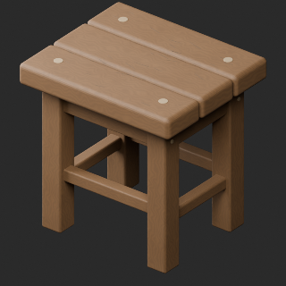
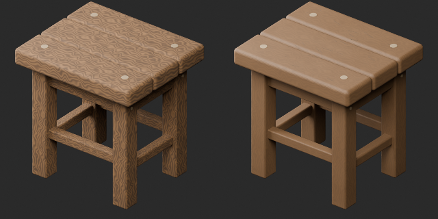
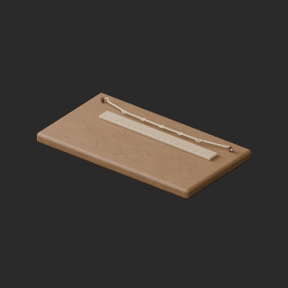
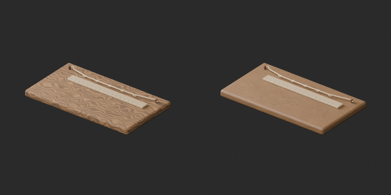
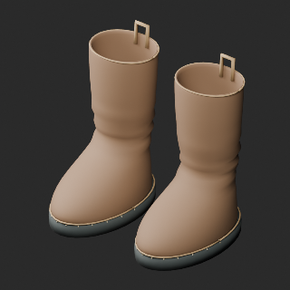
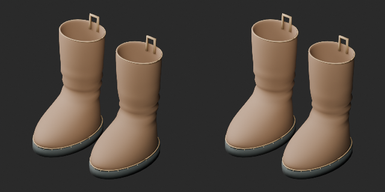
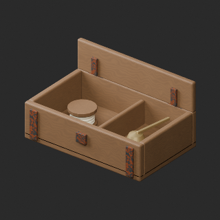
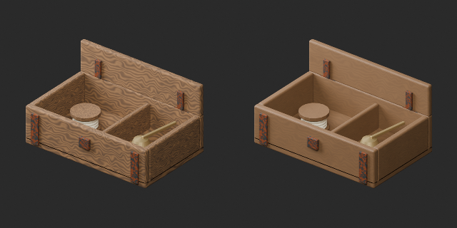
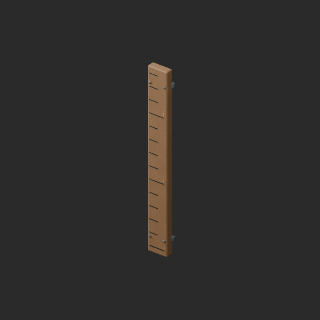
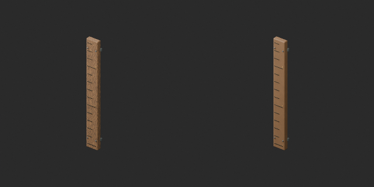

# FH031–040 品質改訂と材質variant / Revisions and variants / 修订与变体

**Existing 1008 records unchanged; 89 material variants = 87 + 2, counted separately. Five revisions are not new records.**

査定10配布記録、累積96/1008、未査定912。独立形状数の証明ではありません。材質改訂4（FH033腰掛け/034補修板/039灯火手入れ箱/040潮位板）は強い反復木目を軽減。UV補修1（FH038長靴）は甲2meshの欠落UVを追加、既存UV保持。新基本/幾何改訂0。FH035金具の手入れ材質とFH037青灰外套の同形variant2。使用感2候補は棄却。形状/寸法/原点保持、WearUV追加。UV補修後を再読込比較の基準に使用し、元UV全て不変とは表現しません。木目改訂もUV継ぎ目完全除去ではありません。

Ten distribution records assessed, cumulative96/1008,912 unassessed; not unique shapes. Four material revisions reduce repetitive grain (FH033/034/039/040); FH038 adds missing UV on two boot upper meshes while retaining existing UV. No new base or geometry revision. Two variants: cared metal hardware FH035 and blue-grey cloak FH037; two rejected wear candidates excluded. Geometry/dimensions/origin retained, WearUV added. Reimport UV comparison uses repaired UV for FH038, not an unchanged-original claim. Wood seams are not fully removed.

査定10条、累计96条、未査定912条；材质修订4与UV补修1不加新数，变体2单独统计。长靴缺失UV补修，以补修后UV验证，保留旧版。

旧版と棄却品は保持、FH024/025/026軽量化候補はすべて棄却・公開対象外。猫の塊感や非写実性は完全改修ではなく、猫21480triの暫定予算内という評価は性能保証ではありません。全非多様体/衝突を網羅検査したとはしません。動物animation/実歩行/荷重/食品衛生/防水/潮位測定精度/ゲーム性能/他engine透明/Blender4.3.2未検証。外套は配置者が壁掛け高さを指定、潮位板は装飾目盛りです。

Earlier versions preserved. All lightweight candidates FH024/025/026 rejected and excluded. Cat remains stylized; triangle budget is not a performance guarantee. Full manifold/collision, animation/walking/load/food safety/waterproofing/tide accuracy/game performance/other engines/Blender4.3.2 unverified. Cloak hanging height requires placement; tide-board marks are decorative.

モデル/埋込材質のみCC0。画像は閲覧用でモデルCC0対象外、[既存画像権利](../LICENSE.md)維持。代码图片私有査定不属模型CC0。

## FH_033__repair — 網補修用の低い腰掛け

revision · [ZIP · BLEND/GLB](https://raw.githubusercontent.com/k3peta/tales-on-a-table/main/distributions/quality-fh031-040-v1/FH_033__repair_CC0.zip)

[拡大 / Full image](https://raw.githubusercontent.com/k3peta/tales-on-a-table/main/previews/quality-fh031-040-v1/FH_033__repair_thumb.png)

[拡大 / Full image](https://raw.githubusercontent.com/k3peta/tales-on-a-table/main/previews/quality-fh031-040-v1/FH_033__repair_comparison.png)

left: original base; right: accepted variant; same overview camera

## FH_034__repair — 網補修の木板

revision · [ZIP · BLEND/GLB](https://raw.githubusercontent.com/k3peta/tales-on-a-table/main/distributions/quality-fh031-040-v1/FH_034__repair_CC0.zip)

[拡大 / Full image](https://raw.githubusercontent.com/k3peta/tales-on-a-table/main/previews/quality-fh031-040-v1/FH_034__repair_thumb.png)

[拡大 / Full image](https://raw.githubusercontent.com/k3peta/tales-on-a-table/main/previews/quality-fh031-040-v1/FH_034__repair_comparison.png)

left: original base; right: accepted variant; same overview camera

## FH_035__new — 布紐で留めた弁当箱

material_variant · [ZIP · BLEND/GLB](https://raw.githubusercontent.com/k3peta/tales-on-a-table/main/distributions/quality-fh031-040-v1/FH_035__new_CC0.zip)

[拡大 / Full image](https://raw.githubusercontent.com/k3peta/tales-on-a-table/main/previews/quality-fh031-040-v1/FH_035__new_thumb.png)

[拡大 / Full image](https://raw.githubusercontent.com/k3peta/tales-on-a-table/main/previews/quality-fh031-040-v1/FH_035__new_comparison.png)

left: original base; right: accepted variant; same overview camera

## FH_037__color — 釘に掛かった雨よけ外套

material_variant · [ZIP · BLEND/GLB](https://raw.githubusercontent.com/k3peta/tales-on-a-table/main/distributions/quality-fh031-040-v1/FH_037__color_CC0.zip)

[拡大 / Full image](https://raw.githubusercontent.com/k3peta/tales-on-a-table/main/previews/quality-fh031-040-v1/FH_037__color_thumb.png)

[拡大 / Full image](https://raw.githubusercontent.com/k3peta/tales-on-a-table/main/previews/quality-fh031-040-v1/FH_037__color_comparison.png)

left: original base; right: accepted variant; same overview camera

## FH_038__repair — 乾かしている長靴一組

revision · [ZIP · BLEND/GLB](https://raw.githubusercontent.com/k3peta/tales-on-a-table/main/distributions/quality-fh031-040-v1/FH_038__repair_CC0.zip)

[拡大 / Full image](https://raw.githubusercontent.com/k3peta/tales-on-a-table/main/previews/quality-fh031-040-v1/FH_038__repair_thumb.png)

[拡大 / Full image](https://raw.githubusercontent.com/k3peta/tales-on-a-table/main/previews/quality-fh031-040-v1/FH_038__repair_comparison.png)

left: original base; right: accepted variant; same overview camera

## FH_039__repair — 灯火の手入れ箱

revision · [ZIP · BLEND/GLB](https://raw.githubusercontent.com/k3peta/tales-on-a-table/main/distributions/quality-fh031-040-v1/FH_039__repair_CC0.zip)

[拡大 / Full image](https://raw.githubusercontent.com/k3peta/tales-on-a-table/main/previews/quality-fh031-040-v1/FH_039__repair_thumb.png)

[拡大 / Full image](https://raw.githubusercontent.com/k3peta/tales-on-a-table/main/previews/quality-fh031-040-v1/FH_039__repair_comparison.png)

left: original base; right: accepted variant; same overview camera

## FH_040__repair — 潮位を刻んだ木板

revision · [ZIP · BLEND/GLB](https://raw.githubusercontent.com/k3peta/tales-on-a-table/main/distributions/quality-fh031-040-v1/FH_040__repair_CC0.zip)

[拡大 / Full image](https://raw.githubusercontent.com/k3peta/tales-on-a-table/main/previews/quality-fh031-040-v1/FH_040__repair_thumb.png)

[拡大 / Full image](https://raw.githubusercontent.com/k3peta/tales-on-a-table/main/previews/quality-fh031-040-v1/FH_040__repair_comparison.png)

left: original base; right: accepted variant; same overview camera
