# FH041–050 材質改訂とvariant / Material revisions and variant / 材质修订与变体

**Existing 1008 records unchanged; 90 material variants = 89 + 1, counted separately. Seven revisions are not new records.**

元配布記録10件を査定、累積106/1008、未査定902。独立形状総数ではありません。材質改訂7（FH041/042/043/046/048/049/050）は木目の過度な周期コントラストを低減。形状/原UV/寸法/原点を保持、WearUV追加。UV継ぎ目の完全除去ではありません。FH044皿のみ赤茶色の同形variant1、貝殻は保持。FH045使用感/青灰の2候補は効果不足で棄却。新基本/幾何改訂0、旧版保持。

Ten original distribution records assessed, cumulative106/1008,902 unassessed; not unique shapes. Seven material revisions reduce repetitive wood grain on FH041/042/043/046/048/049/050. Original geometry/UV/dimensions/origin retained, WearUV added; UV seams not fully removed. One variant recolors only FH044 ceramic dish, shells unchanged. Two FH045 candidates rejected; zero new bases or geometry revisions.

査定10条，累计106条，未査定902条；材质修订7不加新数，皿颜色变体1单独统计。保留原形状UV与旧版，接缝未完全消除。

FH041壁掛け原点で最下点約−0.45m、配置者が吊り高さ指定。FH047防舷材27756triは小物予算20000超過、別手法再設計候補で未改修・本配布対象外。FH024/025/026軽量化は全棄却で公開しません。FH050のガラスは保持、白帯は撮影照明反射。全非多様体/衝突、車輪動作、滑車索耐荷重、食品安全、緩衝性能、ゲーム性能、他engine透明/Blender4.3.2未検証。静的鑑賞用です。

FH041 has wall-hanging origin/minimum z about−0.45m; placement sets hanging height. FH047 remains27756 triangles over20000 small-prop budget, awaits separate redesign and is not distributed here. All lightweight FH024/025/026 candidates rejected and excluded. FH050 glass unchanged; white band is studio reflection. Full manifold/collision, moving wheels, pulley/rope load, food safety, cushioning, game performance, other-engine transparency and Blender4.3.2 untested. Static viewing only.

モデル/埋込材質のみCC0。画像は閲覧用でモデルCC0対象外、[既存画像権利](../LICENSE.md)維持。代码图片私有査定不属模型CC0。

## FH_041__repair — 帰港札の掛け板

revision · [ZIP · BLEND/GLB](https://raw.githubusercontent.com/k3peta/tales-on-a-table/main/distributions/quality-fh041-050-v1/FH_041__repair_CC0.zip)

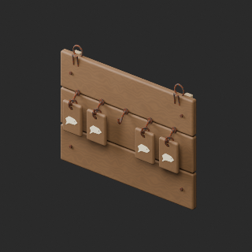

[拡大 / Full image](https://raw.githubusercontent.com/k3peta/tales-on-a-table/main/previews/quality-fh041-050-v1/FH_041__repair_thumb.png)

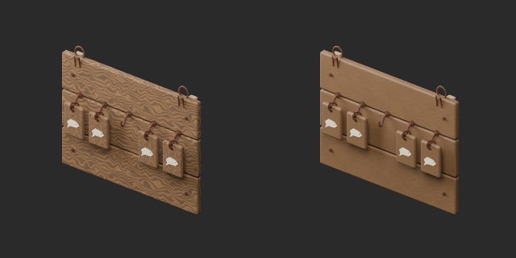

[拡大 / Full image](https://raw.githubusercontent.com/k3peta/tales-on-a-table/main/previews/quality-fh041-050-v1/FH_041__repair_comparison.png)

left: original base; right: accepted variant; same overview camera

## FH_042__repair — すり減った帰港札

revision · [ZIP · BLEND/GLB](https://raw.githubusercontent.com/k3peta/tales-on-a-table/main/distributions/quality-fh041-050-v1/FH_042__repair_CC0.zip)

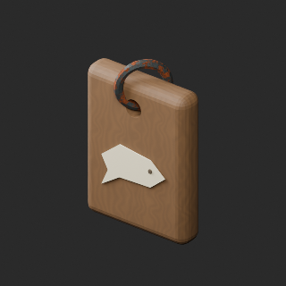

[拡大 / Full image](https://raw.githubusercontent.com/k3peta/tales-on-a-table/main/previews/quality-fh041-050-v1/FH_042__repair_thumb.png)

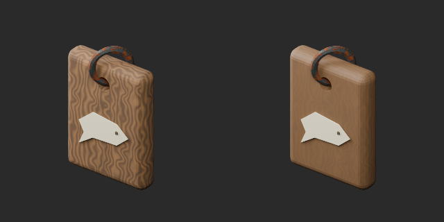

[拡大 / Full image](https://raw.githubusercontent.com/k3peta/tales-on-a-table/main/previews/quality-fh041-050-v1/FH_042__repair_comparison.png)

left: original base; right: accepted variant; same overview camera

## FH_043__repair — 航海守りの小祠

revision · [ZIP · BLEND/GLB](https://raw.githubusercontent.com/k3peta/tales-on-a-table/main/distributions/quality-fh041-050-v1/FH_043__repair_CC0.zip)

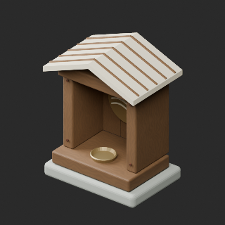

[拡大 / Full image](https://raw.githubusercontent.com/k3peta/tales-on-a-table/main/previews/quality-fh041-050-v1/FH_043__repair_thumb.png)

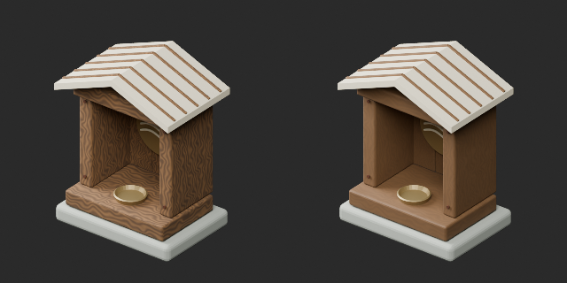

[拡大 / Full image](https://raw.githubusercontent.com/k3peta/tales-on-a-table/main/previews/quality-fh041-050-v1/FH_043__repair_comparison.png)

left: original base; right: accepted variant; same overview camera

## FH_044__color — 貝殻のお供え皿

material_variant · [ZIP · BLEND/GLB](https://raw.githubusercontent.com/k3peta/tales-on-a-table/main/distributions/quality-fh041-050-v1/FH_044__color_CC0.zip)

[拡大 / Full image](https://raw.githubusercontent.com/k3peta/tales-on-a-table/main/previews/quality-fh041-050-v1/FH_044__color_thumb.png)

[拡大 / Full image](https://raw.githubusercontent.com/k3peta/tales-on-a-table/main/previews/quality-fh041-050-v1/FH_044__color_comparison.png)

left: original base; right: accepted variant; same overview camera

## FH_046__repair — 二輪の荷車

revision · [ZIP · BLEND/GLB](https://raw.githubusercontent.com/k3peta/tales-on-a-table/main/distributions/quality-fh041-050-v1/FH_046__repair_CC0.zip)

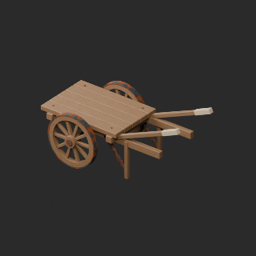

[拡大 / Full image](https://raw.githubusercontent.com/k3peta/tales-on-a-table/main/previews/quality-fh041-050-v1/FH_046__repair_thumb.png)

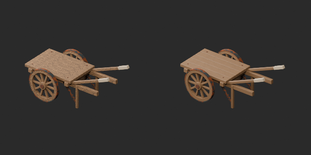

[拡大 / Full image](https://raw.githubusercontent.com/k3peta/tales-on-a-table/main/previews/quality-fh041-050-v1/FH_046__repair_comparison.png)

left: original base; right: accepted variant; same overview camera

## FH_048__repair — 外して置いた滑車

revision · [ZIP · BLEND/GLB](https://raw.githubusercontent.com/k3peta/tales-on-a-table/main/distributions/quality-fh041-050-v1/FH_048__repair_CC0.zip)

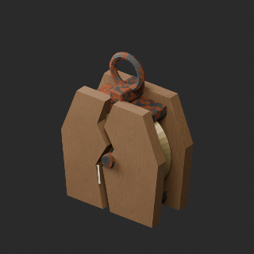

[拡大 / Full image](https://raw.githubusercontent.com/k3peta/tales-on-a-table/main/previews/quality-fh041-050-v1/FH_048__repair_thumb.png)

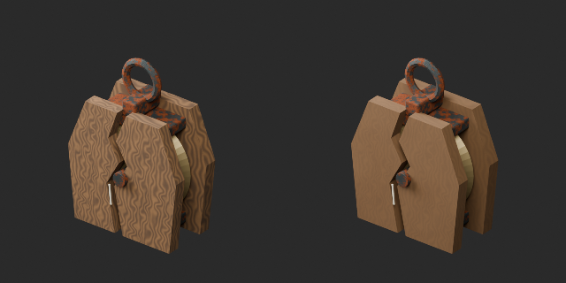

[拡大 / Full image](https://raw.githubusercontent.com/k3peta/tales-on-a-table/main/previews/quality-fh041-050-v1/FH_048__repair_comparison.png)

left: original base; right: accepted variant; same overview camera

## FH_049__repair — 小さな船大工道具束

revision · [ZIP · BLEND/GLB](https://raw.githubusercontent.com/k3peta/tales-on-a-table/main/distributions/quality-fh041-050-v1/FH_049__repair_CC0.zip)

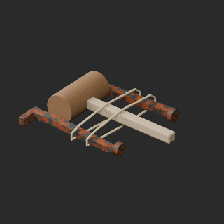

[拡大 / Full image](https://raw.githubusercontent.com/k3peta/tales-on-a-table/main/previews/quality-fh041-050-v1/FH_049__repair_thumb.png)

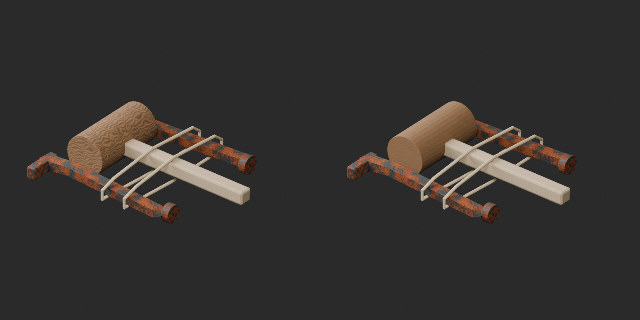

[拡大 / Full image](https://raw.githubusercontent.com/k3peta/tales-on-a-table/main/previews/quality-fh041-050-v1/FH_049__repair_comparison.png)

left: original base; right: accepted variant; same overview camera

## FH_050__repair — 漂着した瓶と流木

revision · [ZIP · BLEND/GLB](https://raw.githubusercontent.com/k3peta/tales-on-a-table/main/distributions/quality-fh041-050-v1/FH_050__repair_CC0.zip)

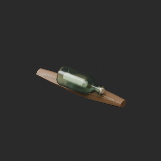

[拡大 / Full image](https://raw.githubusercontent.com/k3peta/tales-on-a-table/main/previews/quality-fh041-050-v1/FH_050__repair_thumb.png)

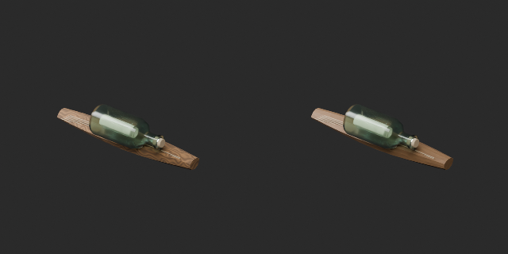

[拡大 / Full image](https://raw.githubusercontent.com/k3peta/tales-on-a-table/main/previews/quality-fh041-050-v1/FH_050__repair_comparison.png)

left: original base; right: accepted variant; same overview camera
