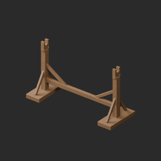
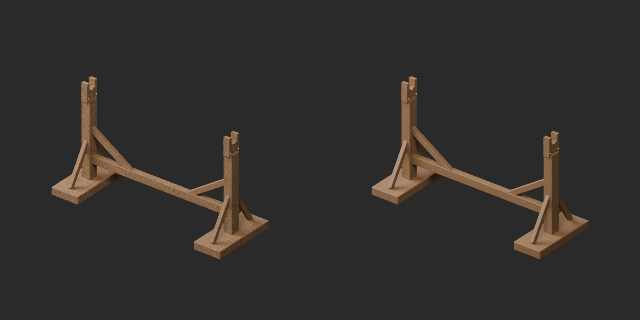
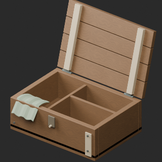
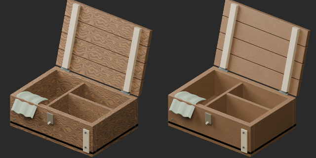
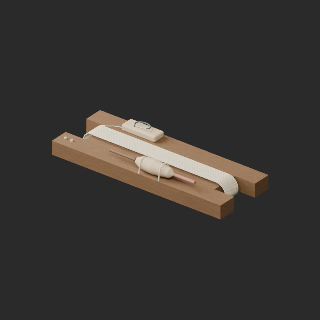
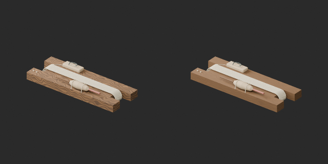

# FH051–056 / OL001–004 材質改訂とvariant / Revisions and variants / 修订与变体

**Existing 1008 records unchanged; 92 material variants = 90 + 2, counted separately. Three revisions are not new records.**

元配布記録10件査定、累積116/1008、未査定892。独立形状数でも全欠陥修復済み件数でもありません。木製FH053竿立て/054餌箱/055仕掛け巻きの材質改訂3は反復木目を低減。形状/原UV/寸法/原点を保持、WearUV追加。UV継ぎ目完全除去ではありません。OL003壺の赤茶色とOL004カウンター前面赤タイルの同形variant2、金装飾・石天板等は保持。新基本/幾何改訂0、旧版保持。

Ten original records assessed, cumulative116/1008,892 unassessed; not unique shapes or fully fixed records. Three material revisions reduce repetitive grain on FH053 rod stand/FH054 bait box/FH055 rig winder. Original geometry/UV/dimensions/origin retained, WearUV added; seams not fully removed. Two variants recolor OL003 pot and OL004 counter-front tiles, retaining metal decoration/stone top. No new base or geometry revision.

査定10条、累计116条、未査定892条；材质修订3不加新数，变体2单独统计。査定完成不等于所有缺陷已修复，旧版保留。

OL001/002ランタン色2候補は濁り/差不足で棄却、公開しません。名称に琥珀色があっても元実物は多色ガラスです。既存発光を維持し、色差のため発光を増減していません。FH05229400/FH05629800/OL00139196/OL00238908triの小物予算超過は未解決、別途再設計残件。FH024/025/026軽量化棄却を保持。本便に含めません。査定進捗と未解決課題は別に管理します。

Both OL001/002 lantern colors rejected for muddiness/weak difference and excluded. Originals use multicolor glass despite amber naming; existing emission retained. FH05229400/FH05629800/OL00139196/OL00238908 triangle budgets remain unresolved redesign work. FH024/025/026 lightweight candidates remain rejected. Assessment status and unresolved issues tracked separately.

全非多様体/貫通/実衝突、釣り機構/動作/荷重/防水/食品安全/実機性能/他engine透明発光/Blender4.3.2互換は未検証。静的鑑賞用です。

Full manifold/intersection/collision, fishing mechanisms/motion/load/waterproofing/food safety/game performance/other-engine transparency and emission/Blender4.3.2 untested. Static viewing only.

モデル/埋込材質のみCC0。画像は閲覧用でモデルCC0対象外、[既存画像権利](../LICENSE.md)維持。代码图片私有査定不属模型CC0。

## FH_053__repair — 竿立て

revision · [ZIP · BLEND/GLB](https://raw.githubusercontent.com/k3peta/tales-on-a-table/main/distributions/quality-fh051-056-ol001-004-v1/FH_053__repair_CC0.zip)

[拡大 / Full image](https://raw.githubusercontent.com/k3peta/tales-on-a-table/main/previews/quality-fh051-056-ol001-004-v1/FH_053__repair_thumb.png)

[拡大 / Full image](https://raw.githubusercontent.com/k3peta/tales-on-a-table/main/previews/quality-fh051-056-ol001-004-v1/FH_053__repair_comparison.png)

left: original base; right: accepted variant; same overview camera

## FH_054__repair — 餌箱

revision · [ZIP · BLEND/GLB](https://raw.githubusercontent.com/k3peta/tales-on-a-table/main/distributions/quality-fh051-056-ol001-004-v1/FH_054__repair_CC0.zip)

[拡大 / Full image](https://raw.githubusercontent.com/k3peta/tales-on-a-table/main/previews/quality-fh051-056-ol001-004-v1/FH_054__repair_thumb.png)

[拡大 / Full image](https://raw.githubusercontent.com/k3peta/tales-on-a-table/main/previews/quality-fh051-056-ol001-004-v1/FH_054__repair_comparison.png)

left: original base; right: accepted variant; same overview camera

## FH_055__repair — 仕掛け巻き

revision · [ZIP · BLEND/GLB](https://raw.githubusercontent.com/k3peta/tales-on-a-table/main/distributions/quality-fh051-056-ol001-004-v1/FH_055__repair_CC0.zip)

[拡大 / Full image](https://raw.githubusercontent.com/k3peta/tales-on-a-table/main/previews/quality-fh051-056-ol001-004-v1/FH_055__repair_thumb.png)

[拡大 / Full image](https://raw.githubusercontent.com/k3peta/tales-on-a-table/main/previews/quality-fh051-056-ol001-004-v1/FH_055__repair_comparison.png)

left: original base; right: accepted variant; same overview camera

## OL_003__color — 青い飾り壺

material_variant · [ZIP · BLEND/GLB](https://raw.githubusercontent.com/k3peta/tales-on-a-table/main/distributions/quality-fh051-056-ol001-004-v1/OL_003__color_CC0.zip)

[拡大 / Full image](https://raw.githubusercontent.com/k3peta/tales-on-a-table/main/previews/quality-fh051-056-ol001-004-v1/OL_003__color_thumb.png)

[拡大 / Full image](https://raw.githubusercontent.com/k3peta/tales-on-a-table/main/previews/quality-fh051-056-ol001-004-v1/OL_003__color_comparison.png)

left: original base; right: accepted variant; same overview camera

## OL_004__color — 彫刻入りカウンター

material_variant · [ZIP · BLEND/GLB](https://raw.githubusercontent.com/k3peta/tales-on-a-table/main/distributions/quality-fh051-056-ol001-004-v1/OL_004__color_CC0.zip)

[拡大 / Full image](https://raw.githubusercontent.com/k3peta/tales-on-a-table/main/previews/quality-fh051-056-ol001-004-v1/OL_004__color_thumb.png)

[拡大 / Full image](https://raw.githubusercontent.com/k3peta/tales-on-a-table/main/previews/quality-fh051-056-ol001-004-v1/OL_004__color_comparison.png)

left: original base; right: accepted variant; same overview camera
