# Quality54 / 品質第54便 / 质量第54批

Base1008 unchanged; material variants170=169+1 separately. Four geometry revisions, no new base. Originals retained.

FP010 bowl64, FP011 jug64, FP012 cup48, FP015 candle tray64 exact-zero-area triangles removed:240 total. Only area==0 removed, no tolerance relaxation. Positive surface coordinates/UV/materials/corner normals retained; intended chips and original wear remain. No silhouette redesign or polygon-budget repair claimed.

FP011 blue glaze variant uses repaired960tri jug baseline (original1024tri). Same-shape means same as repaired FP011, NOT original degenerate mesh. Dark wear luminance and alpha/normal/roughness/emission unchanged. Existing flame emission retained in torch/candle; no new emission added.

10配布レコード/10モデル査定。ゼロ面除去改訂4件は非加算、修復後水差し基準の青variant1件別集計。10个配布记录/10个模型；四个零面积清理修订不增加基本数量，蓝色釉面变体以修复后水壶为基准。

Same camera/light/scale comparisons. Final-ZIP checks BLEND/GLB geometry/UV/spatial attributes against explicit repaired baselines. Originals lack COLOR_0; absence retained, not loss. Five known color-loss fixtures rejected. Public artifact matching is pending. Publication did not rerun Blender.

Assessed536 distribution records;472 remain;143 budget issues unchanged. BM007/BM054 and wood/material diagnoses retained. No collision/chain rig/fluid/food-use/fire/melting/bristle physics/gameplay/Blender4.3.2 guarantee. Geometry score changes do not mean all-quality approval.

Source audit GLB only; original bundled BLEND not independently imported. Final candidate both formats tested. Private scripts/handoff excluded. Models/embedded materials only CC0; images separate catalogue artwork. [License](../LICENSE.md).

## FP010__repair — Chipped food bowl

欠けた食器

Remove exact zero-area faces only; positive-area geometry, UV, colors and corner normals retained. Visual silhouette unchanged; cleanup is not a new base model.

[ZIP · BLEND/GLB](https://raw.githubusercontent.com/k3peta/tales-on-a-table/main/distributions/quality-fp008-017-v1/FP010__repair_CC0.zip)

[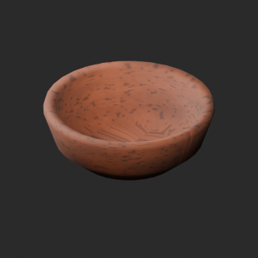](../previews/quality-fp008-017-v1/FP010__repair_thumb.png)

[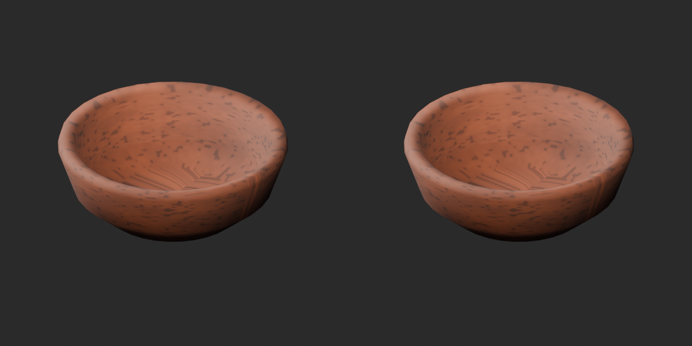](../previews/quality-fp008-017-v1/FP010__repair_overview_comparison.png)

[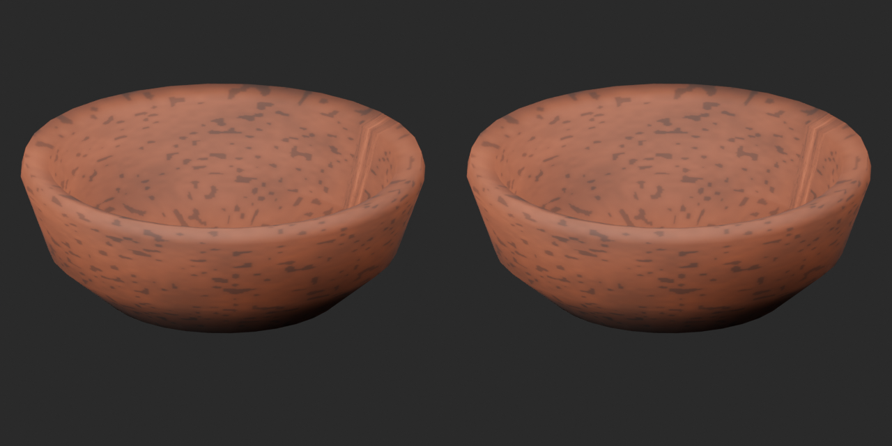](../previews/quality-fp008-017-v1/FP010__repair_close_comparison.png)

Left: original; right: accepted revision/variant, identical camera/light/scale.

## FP011__repair — Water jug

水差し

Remove exact zero-area faces only; positive-area geometry, UV, colors and corner normals retained. Visual silhouette unchanged; cleanup is not a new base model.

[ZIP · BLEND/GLB](https://raw.githubusercontent.com/k3peta/tales-on-a-table/main/distributions/quality-fp008-017-v1/FP011__repair_CC0.zip)

[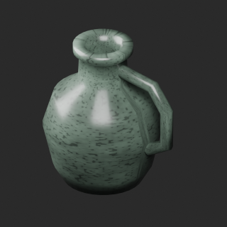](../previews/quality-fp008-017-v1/FP011__repair_thumb.png)

[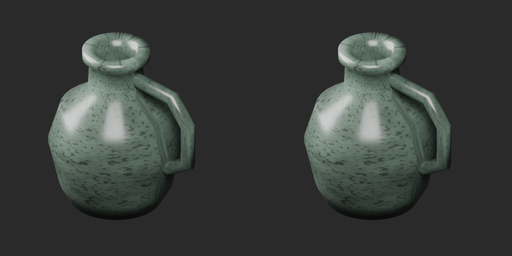](../previews/quality-fp008-017-v1/FP011__repair_overview_comparison.png)

[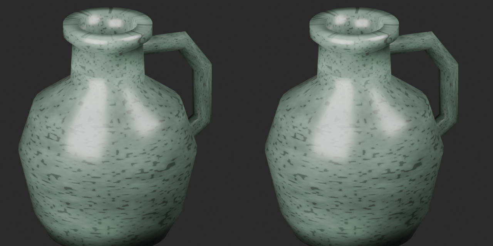](../previews/quality-fp008-017-v1/FP011__repair_close_comparison.png)

Left: original; right: accepted revision/variant, identical camera/light/scale.

## FP012__repair — Pewter drinking cup

錫の杯

Remove exact zero-area faces only; positive-area geometry, UV, colors and corner normals retained. Visual silhouette unchanged; cleanup is not a new base model.

[ZIP · BLEND/GLB](https://raw.githubusercontent.com/k3peta/tales-on-a-table/main/distributions/quality-fp008-017-v1/FP012__repair_CC0.zip)

[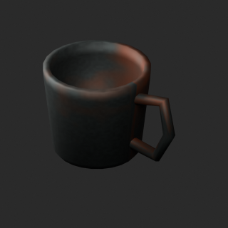](../previews/quality-fp008-017-v1/FP012__repair_thumb.png)

[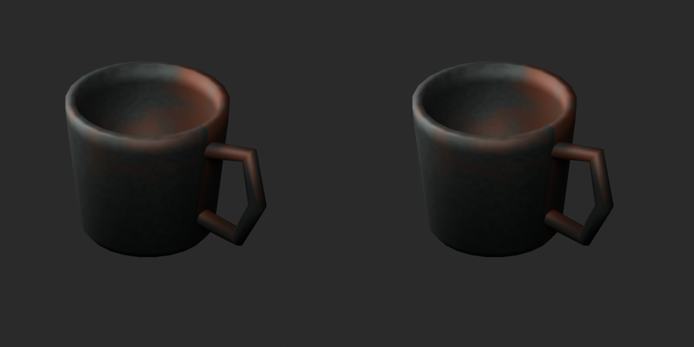](../previews/quality-fp008-017-v1/FP012__repair_overview_comparison.png)

[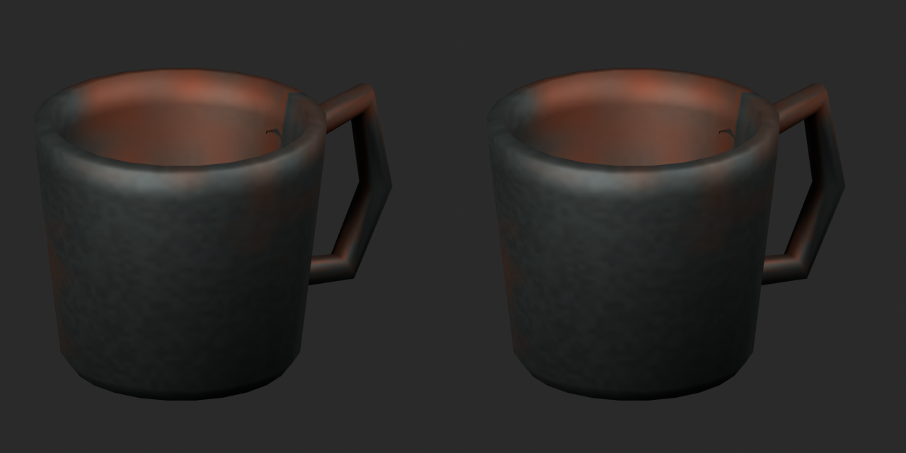](../previews/quality-fp008-017-v1/FP012__repair_close_comparison.png)

Left: original; right: accepted revision/variant, identical camera/light/scale.

## FP015__repair — Candle and drip tray

蝋燭と受け皿

Remove exact zero-area faces only; positive-area geometry, UV, colors and corner normals retained. Visual silhouette unchanged; cleanup is not a new base model.

[ZIP · BLEND/GLB](https://raw.githubusercontent.com/k3peta/tales-on-a-table/main/distributions/quality-fp008-017-v1/FP015__repair_CC0.zip)

[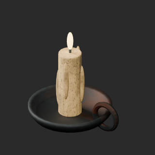](../previews/quality-fp008-017-v1/FP015__repair_thumb.png)

[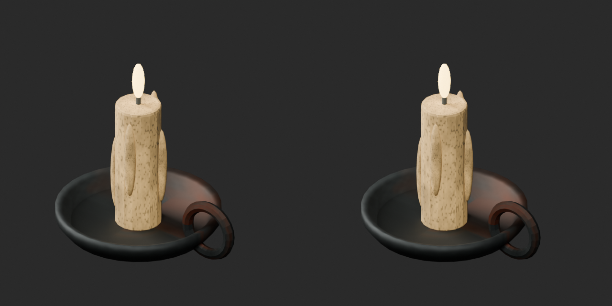](../previews/quality-fp008-017-v1/FP015__repair_overview_comparison.png)

[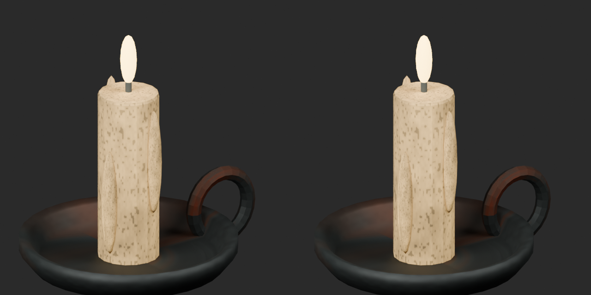](../previews/quality-fp008-017-v1/FP015__repair_close_comparison.png)

Left: original; right: accepted revision/variant, identical camera/light/scale.

## FP011__blue_glaze — Water jug

水差し

Blue glaze UV texture recolor based on repaired FP011 geometry; original wear luminance retained, alpha/normal/roughness/emission unchanged. Geometry same as repaired baseline, not unmodified original.

[ZIP · BLEND/GLB](https://raw.githubusercontent.com/k3peta/tales-on-a-table/main/distributions/quality-fp008-017-v1/FP011__blue_glaze_CC0.zip)

[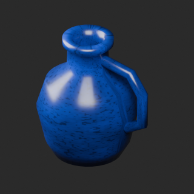](../previews/quality-fp008-017-v1/FP011__blue_glaze_thumb.png)

[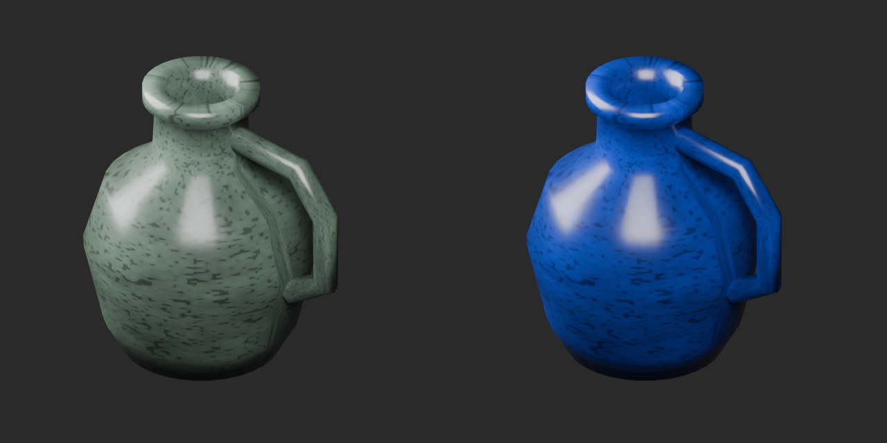](../previews/quality-fp008-017-v1/FP011__blue_glaze_overview_comparison.png)

[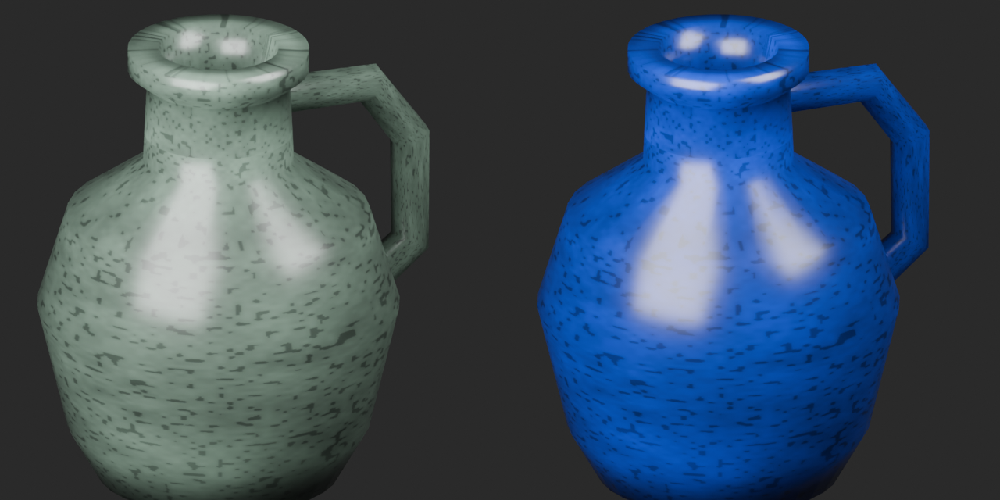](../previews/quality-fp008-017-v1/FP011__blue_glaze_close_comparison.png)

Left: original; right: accepted revision/variant, identical camera/light/scale.
