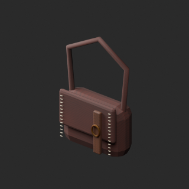
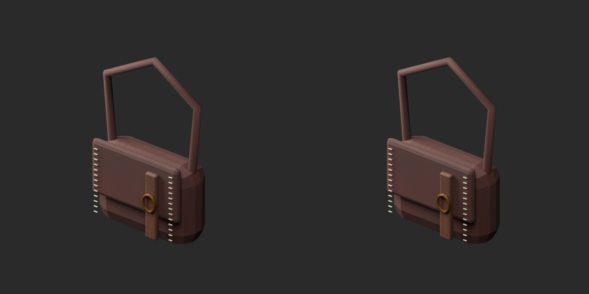
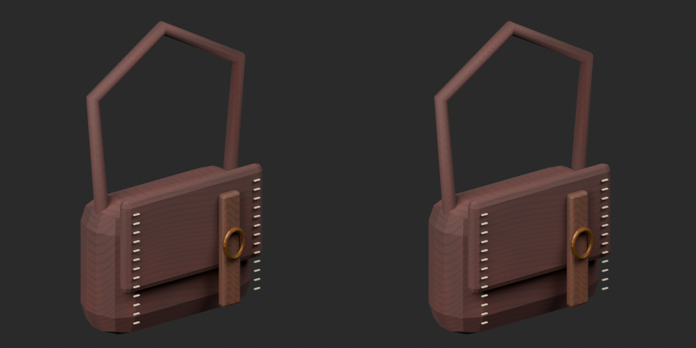
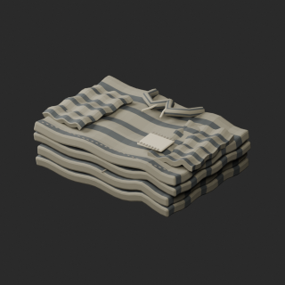
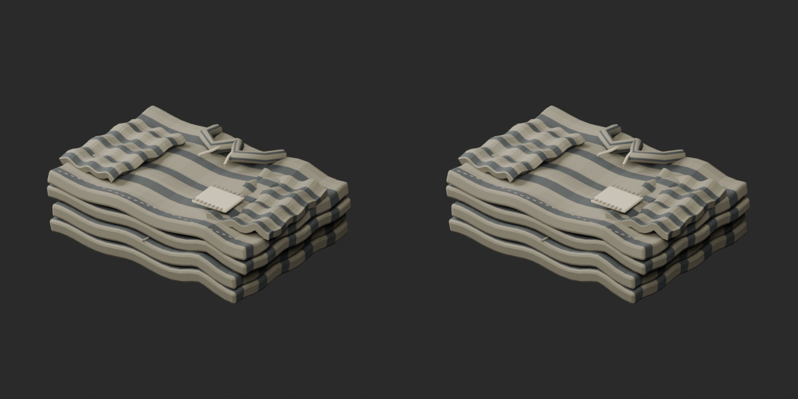
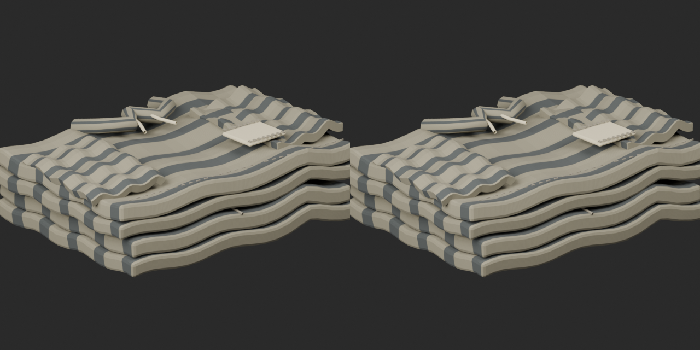
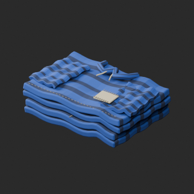
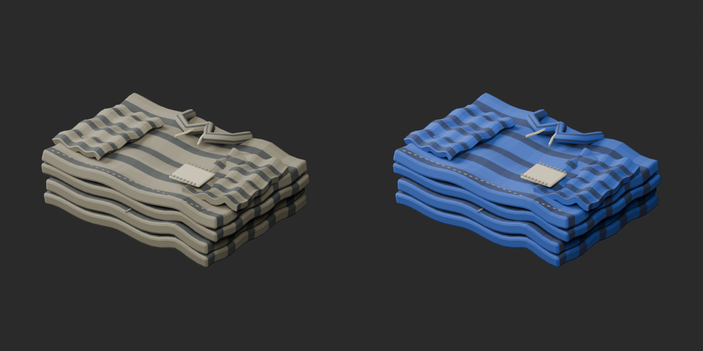
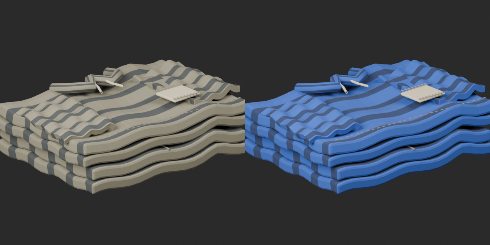

# Quality55 / 品質第55便 / 质量第55批

Base1008 unchanged; material variants171=170+1 separately. Two geometry revisions, no new base. Originals retained.

FP021 satchel24 and FP025 folded uniform24 exact-zero-area faces removed:48 total. Positive surface geometry/UV/materials/corner normals retained, including FP025 tiny positive faces. No tolerance relaxation. Satchel periodic leather texture remains a material-review candidate.

FP025 blue linen uses repaired17958tri baseline (original17982tri), not original degenerate topology. Original wear luminance, collar/thread details and noncolor channels retained. No rig/unfolding or new emission.

10配布レコード/10モデル査定。鞄・囚人服改訂2件は非加算、修復後青服variant1件別集計。10个配布记录/10个模型；两个零面积修订不增加基本数量，蓝色制服变体以修复后形状为基准。

PM001 floor2x2m,top approximately0,bottom-0.16m,SW origin as source README;3x3 scene inspected as private validation only, not new distribution. PM002 wall1.72m intentionally uses0.28m pillars at2m pitch;not a missing-gap repair. FP018 stool positive lower bound preserved because intended pivot is unverified; world-floor placement needs height adjustment.

Same camera/light/scale comparisons. Final-ZIP checks both formats geometry/UV/spatial attributes against cleaned baselines. Originals lack COLOR_0; absence retained,not loss. Five known color-loss fixtures rejected. Public artifact matching is pending. Publication did not rerun Blender.

Assessed546 distribution records;462 remain;143 budget issues and BM007/BM054/prior diagnostics retained. No collision/load/locks/chain mechanism/rig/gameplay/Blender4.3.2 guarantee. Source GLB audited; original bundled BLEND not independently imported; final candidates both formats tested. Nonmodular pivot/front not inferred from bounds.

Models/embedded materials only CC0; images separate catalogue artwork. [License](../LICENSE.md). Private scripts/handoff/3x3 scene excluded.

## FP021__repair — Leather dispatch satchel

革の書類鞄

Remove exact zero-area faces only; positive-area geometry, UV, colors and corner normals retained. Visual silhouette unchanged; cleanup is not a new base model.

[ZIP · BLEND/GLB](https://raw.githubusercontent.com/k3peta/tales-on-a-table/main/distributions/quality-fp018-pm002-v1/FP021__repair_CC0.zip)

Left: original; right: accepted revision/variant, identical camera/light/scale.

## FP025__repair — Folded prison uniform

畳んだ囚人服

Remove exact zero-area faces only; positive-area geometry, UV, colors and corner normals retained. Visual silhouette unchanged; cleanup is not a new base model.

[ZIP · BLEND/GLB](https://raw.githubusercontent.com/k3peta/tales-on-a-table/main/distributions/quality-fp018-pm002-v1/FP025__repair_CC0.zip)

Left: original; right: accepted revision/variant, identical camera/light/scale.

## FP025__blue_linen — Folded prison uniform

畳んだ囚人服

Blue linen UV texture recolor based on repaired FP025 geometry; original wear luminance retained, alpha/normal/roughness/emission unchanged. Geometry same as repaired baseline, not unmodified original.

[ZIP · BLEND/GLB](https://raw.githubusercontent.com/k3peta/tales-on-a-table/main/distributions/quality-fp018-pm002-v1/FP025__blue_linen_CC0.zip)

Left: original; right: accepted revision/variant, identical camera/light/scale.
