# FT001–010 材質variant / Material variants / 材质变体

**Existing distribution records:1008; material variants:20 separately. New base shapes:0; base replacements:0.** Not a claim of1028 independent shapes.

## 日本語

基本10件の制作側査定78.75〜83.75、70未満0。基本置換なし。newは手入れ済み/新品寄り、usedは彩度と艶を抑えた使い込み。無傷の新品保証ではありません。形状・UV保持。FT004/008/009/010の粗い木目は残り、全UV再設計・全交差・ゲーム・旧Blender互換は未検証。モデルと同梱材質CC0、コード画像査定私的記録は除外。

## English

Ten original models retained, producer assessment78.75–83.75; none below70. Optional new/cared-for and used finishes, not guaranteed pristine. Geometry/UV retained according to exact generation hashes and40 format reload checks. Rough wood patterns remain especially FT004/008/009/010. Full UV redesign/intersection audit/game use/older Blender compatibility unverified. Model/embedded material CC0 only, code/renders/private audit excluded.

## 中文

保留10个基本模型，制作方评分78.75–83.75，无低于70项，不替换基本版。20个材质变体另计，几何UV保持。新品倾向不是无瑕保证。粗木纹仍存在，全UV重设、全部交叉、游戏与旧Blender兼容未验证。仅模型内嵌材质CC0，不含代码图片私有査定。

実作レンダー / Actual model renders. Images are supplied for browsing, excluded from model CC0; existing [image rights](../LICENSE.md) remain unchanged. Images do not add model records.

## 実画像比較 / Render comparison

### FT_001 — 木と黒鉄の酒場カウンター

原本 / Original

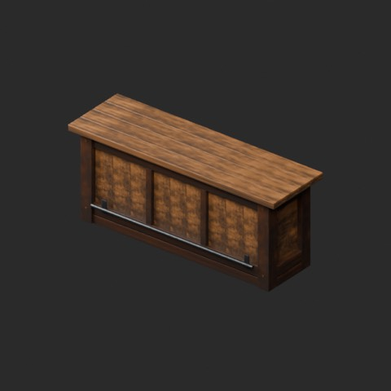

[拡大原図 / Open full-size image](https://raw.githubusercontent.com/k3peta/tales-on-a-table/main/previews/catalog-originals-20261024/FT_001-original.png)

#### FT_001__new

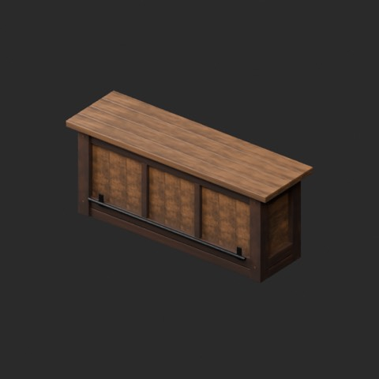

[拡大原図 / Open full-size image](https://raw.githubusercontent.com/k3peta/tales-on-a-table/main/previews/catalog-originals-20261024/FT_001__new-overview.png)

**FT_001__new** · new · [ZIP](https://raw.githubusercontent.com/k3peta/tales-on-a-table/main/distributions/material-variants-ft001-010-v1/FT_001__new_CC0.zip)

#### FT_001__used

[拡大原図 / Open full-size image](https://raw.githubusercontent.com/k3peta/tales-on-a-table/main/previews/catalog-originals-20261024/FT_001__used-overview.png)

**FT_001__used** · used · [ZIP](https://raw.githubusercontent.com/k3peta/tales-on-a-table/main/distributions/material-variants-ft001-010-v1/FT_001__used_CC0.zip)

代表接写 / Detail: **FT_001__used**

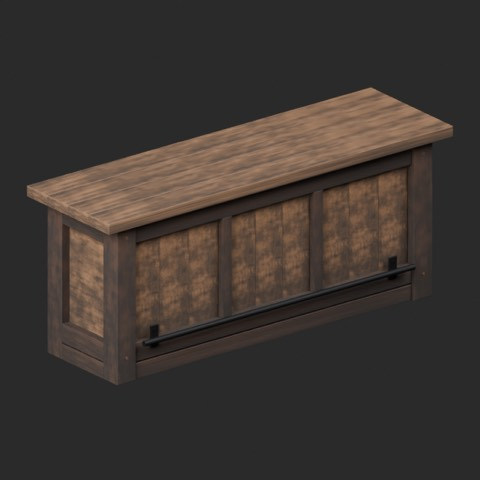

[拡大原図 / Open full-size image](https://raw.githubusercontent.com/k3peta/tales-on-a-table/main/previews/catalog-originals-20261024/FT_001__used-close.png)

### FT_002 — 架台テーブル / Trestle Table

原本 / Original

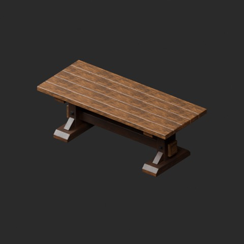

[拡大原図 / Open full-size image](https://raw.githubusercontent.com/k3peta/tales-on-a-table/main/previews/catalog-originals-20261024/FT_002-original.png)

#### FT_002__new

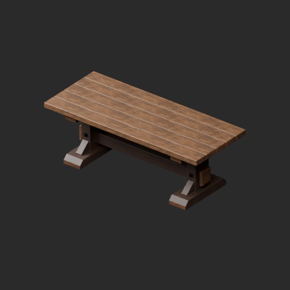

[拡大原図 / Open full-size image](https://raw.githubusercontent.com/k3peta/tales-on-a-table/main/previews/catalog-originals-20261024/FT_002__new-overview.png)

**FT_002__new** · new · [ZIP](https://raw.githubusercontent.com/k3peta/tales-on-a-table/main/distributions/material-variants-ft001-010-v1/FT_002__new_CC0.zip)

#### FT_002__used

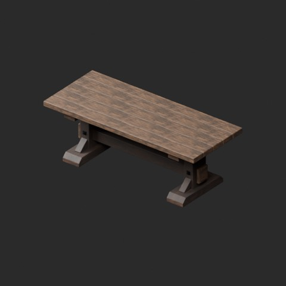

[拡大原図 / Open full-size image](https://raw.githubusercontent.com/k3peta/tales-on-a-table/main/previews/catalog-originals-20261024/FT_002__used-overview.png)

**FT_002__used** · used · [ZIP](https://raw.githubusercontent.com/k3peta/tales-on-a-table/main/distributions/material-variants-ft001-010-v1/FT_002__used_CC0.zip)

代表接写 / Detail: **FT_002__used**

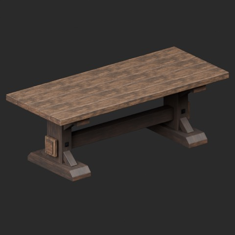

[拡大原図 / Open full-size image](https://raw.githubusercontent.com/k3peta/tales-on-a-table/main/previews/catalog-originals-20261024/FT_002__used-close.png)

### FT_003 — 木製背もたれ椅子 / Oak Tavern Chair

原本 / Original

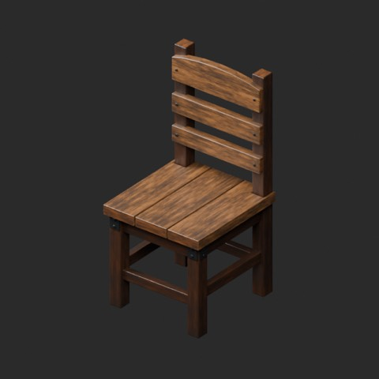

[拡大原図 / Open full-size image](https://raw.githubusercontent.com/k3peta/tales-on-a-table/main/previews/catalog-originals-20261024/FT_003-original.png)

#### FT_003__new

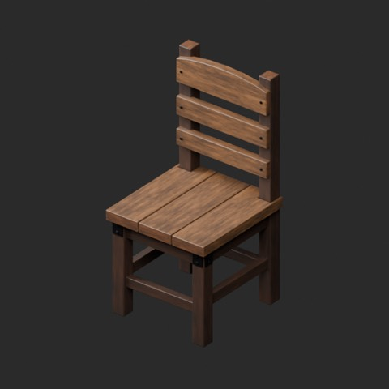

[拡大原図 / Open full-size image](https://raw.githubusercontent.com/k3peta/tales-on-a-table/main/previews/catalog-originals-20261024/FT_003__new-overview.png)

**FT_003__new** · new · [ZIP](https://raw.githubusercontent.com/k3peta/tales-on-a-table/main/distributions/material-variants-ft001-010-v1/FT_003__new_CC0.zip)

#### FT_003__used

[拡大原図 / Open full-size image](https://raw.githubusercontent.com/k3peta/tales-on-a-table/main/previews/catalog-originals-20261024/FT_003__used-overview.png)

**FT_003__used** · used · [ZIP](https://raw.githubusercontent.com/k3peta/tales-on-a-table/main/distributions/material-variants-ft001-010-v1/FT_003__used_CC0.zip)

代表接写 / Detail: **FT_003__used**

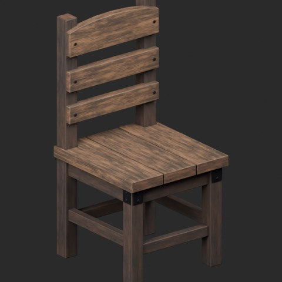

[拡大原図 / Open full-size image](https://raw.githubusercontent.com/k3peta/tales-on-a-table/main/previews/catalog-originals-20261024/FT_003__used-close.png)

### FT_004 — 木と黒鉄の高いバースツール

原本 / Original

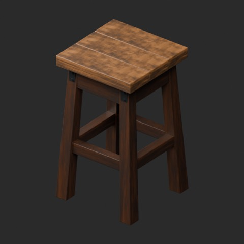

[拡大原図 / Open full-size image](https://raw.githubusercontent.com/k3peta/tales-on-a-table/main/previews/catalog-originals-20261024/FT_004-original.png)

#### FT_004__new

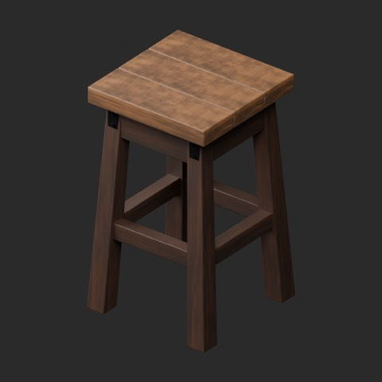

[拡大原図 / Open full-size image](https://raw.githubusercontent.com/k3peta/tales-on-a-table/main/previews/catalog-originals-20261024/FT_004__new-overview.png)

**FT_004__new** · new · [ZIP](https://raw.githubusercontent.com/k3peta/tales-on-a-table/main/distributions/material-variants-ft001-010-v1/FT_004__new_CC0.zip)

#### FT_004__used

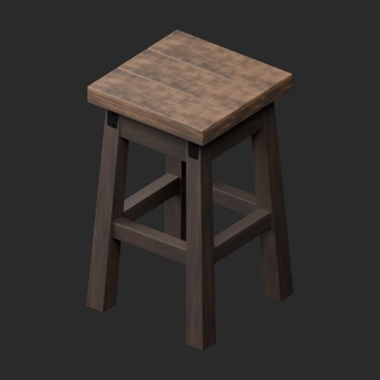

[拡大原図 / Open full-size image](https://raw.githubusercontent.com/k3peta/tales-on-a-table/main/previews/catalog-originals-20261024/FT_004__used-overview.png)

**FT_004__used** · used · [ZIP](https://raw.githubusercontent.com/k3peta/tales-on-a-table/main/distributions/material-variants-ft001-010-v1/FT_004__used_CC0.zip)

代表接写 / Detail: **FT_004__used**

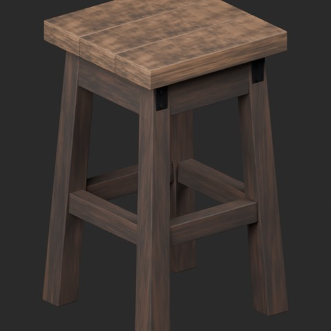

[拡大原図 / Open full-size image](https://raw.githubusercontent.com/k3peta/tales-on-a-table/main/previews/catalog-originals-20261024/FT_004__used-close.png)

### FT_005 — 長い木製ベンチ

原本 / Original

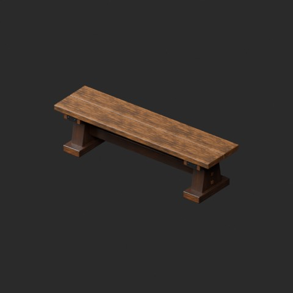

[拡大原図 / Open full-size image](https://raw.githubusercontent.com/k3peta/tales-on-a-table/main/previews/catalog-originals-20261024/FT_005-original.png)

#### FT_005__new

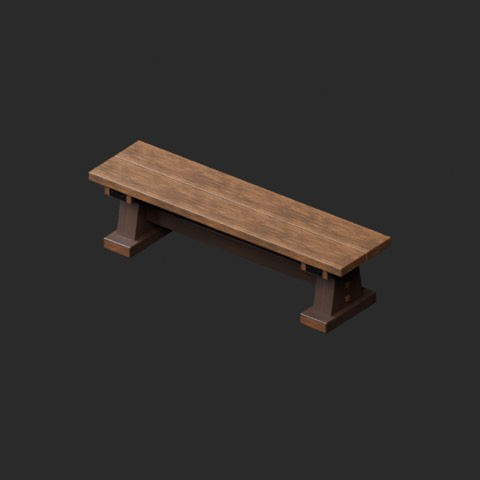

[拡大原図 / Open full-size image](https://raw.githubusercontent.com/k3peta/tales-on-a-table/main/previews/catalog-originals-20261024/FT_005__new-overview.png)

**FT_005__new** · new · [ZIP](https://raw.githubusercontent.com/k3peta/tales-on-a-table/main/distributions/material-variants-ft001-010-v1/FT_005__new_CC0.zip)

#### FT_005__used

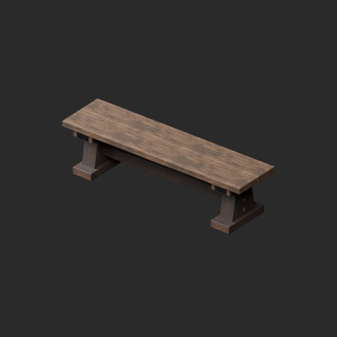

[拡大原図 / Open full-size image](https://raw.githubusercontent.com/k3peta/tales-on-a-table/main/previews/catalog-originals-20261024/FT_005__used-overview.png)

**FT_005__used** · used · [ZIP](https://raw.githubusercontent.com/k3peta/tales-on-a-table/main/distributions/material-variants-ft001-010-v1/FT_005__used_CC0.zip)

代表接写 / Detail: **FT_005__used**

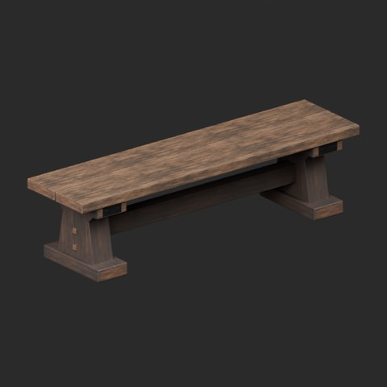

[拡大原図 / Open full-size image](https://raw.githubusercontent.com/k3peta/tales-on-a-table/main/previews/catalog-originals-20261024/FT_005__used-close.png)

### FT_006 — 丸い支柱テーブル / Round Pedestal Table

原本 / Original

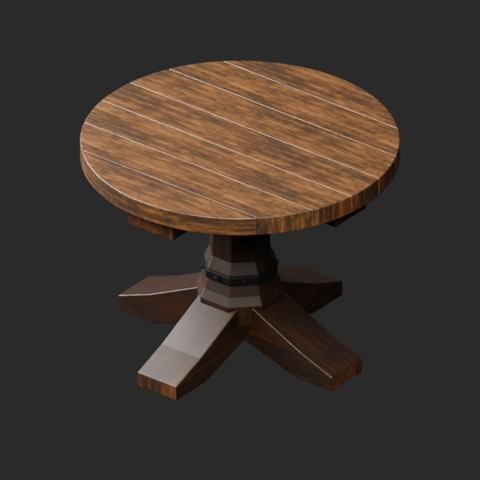

[拡大原図 / Open full-size image](https://raw.githubusercontent.com/k3peta/tales-on-a-table/main/previews/catalog-originals-20261024/FT_006-original.png)

#### FT_006__new

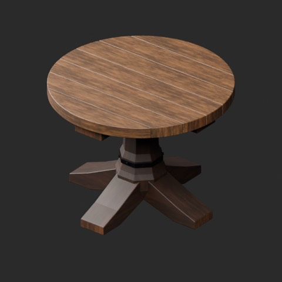

[拡大原図 / Open full-size image](https://raw.githubusercontent.com/k3peta/tales-on-a-table/main/previews/catalog-originals-20261024/FT_006__new-overview.png)

**FT_006__new** · new · [ZIP](https://raw.githubusercontent.com/k3peta/tales-on-a-table/main/distributions/material-variants-ft001-010-v1/FT_006__new_CC0.zip)

#### FT_006__used

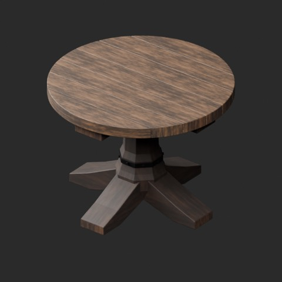

[拡大原図 / Open full-size image](https://raw.githubusercontent.com/k3peta/tales-on-a-table/main/previews/catalog-originals-20261024/FT_006__used-overview.png)

**FT_006__used** · used · [ZIP](https://raw.githubusercontent.com/k3peta/tales-on-a-table/main/distributions/material-variants-ft001-010-v1/FT_006__used_CC0.zip)

代表接写 / Detail: **FT_006__used**

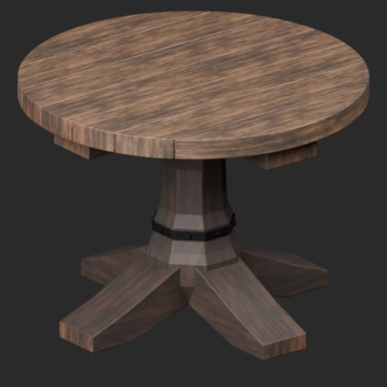

[拡大原図 / Open full-size image](https://raw.githubusercontent.com/k3peta/tales-on-a-table/main/previews/catalog-originals-20261024/FT_006__used-close.png)

### FT_007 — L字の木製コーナーベンチ

原本 / Original

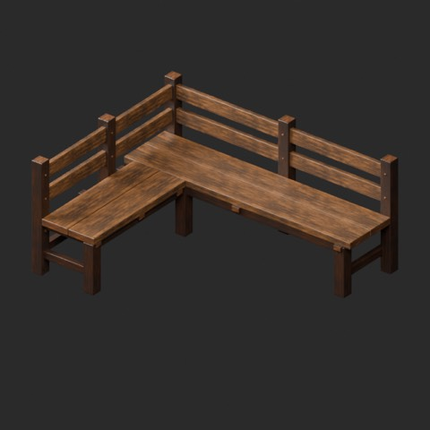

[拡大原図 / Open full-size image](https://raw.githubusercontent.com/k3peta/tales-on-a-table/main/previews/catalog-originals-20261024/FT_007-original.png)

#### FT_007__new

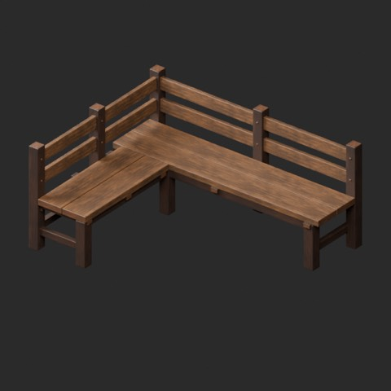

[拡大原図 / Open full-size image](https://raw.githubusercontent.com/k3peta/tales-on-a-table/main/previews/catalog-originals-20261024/FT_007__new-overview.png)

**FT_007__new** · new · [ZIP](https://raw.githubusercontent.com/k3peta/tales-on-a-table/main/distributions/material-variants-ft001-010-v1/FT_007__new_CC0.zip)

#### FT_007__used

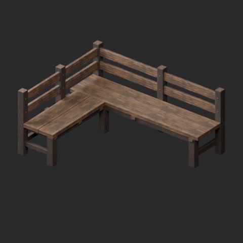

[拡大原図 / Open full-size image](https://raw.githubusercontent.com/k3peta/tales-on-a-table/main/previews/catalog-originals-20261024/FT_007__used-overview.png)

**FT_007__used** · used · [ZIP](https://raw.githubusercontent.com/k3peta/tales-on-a-table/main/distributions/material-variants-ft001-010-v1/FT_007__used_CC0.zip)

代表接写 / Detail: **FT_007__used**

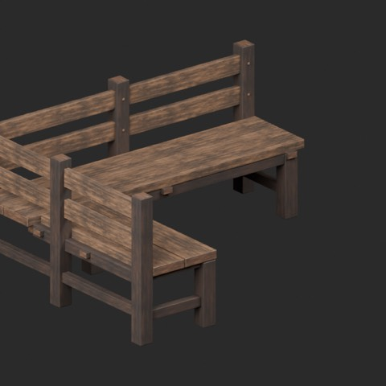

[拡大原図 / Open full-size image](https://raw.githubusercontent.com/k3peta/tales-on-a-table/main/previews/catalog-originals-20261024/FT_007__used-close.png)

### FT_008 — 自立式の酒場棚

原本 / Original

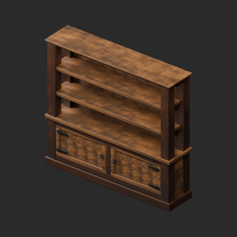

[拡大原図 / Open full-size image](https://raw.githubusercontent.com/k3peta/tales-on-a-table/main/previews/catalog-originals-20261024/FT_008-original.png)

#### FT_008__new

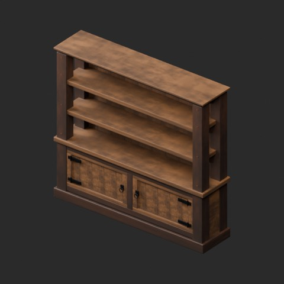

[拡大原図 / Open full-size image](https://raw.githubusercontent.com/k3peta/tales-on-a-table/main/previews/catalog-originals-20261024/FT_008__new-overview.png)

**FT_008__new** · new · [ZIP](https://raw.githubusercontent.com/k3peta/tales-on-a-table/main/distributions/material-variants-ft001-010-v1/FT_008__new_CC0.zip)

#### FT_008__used

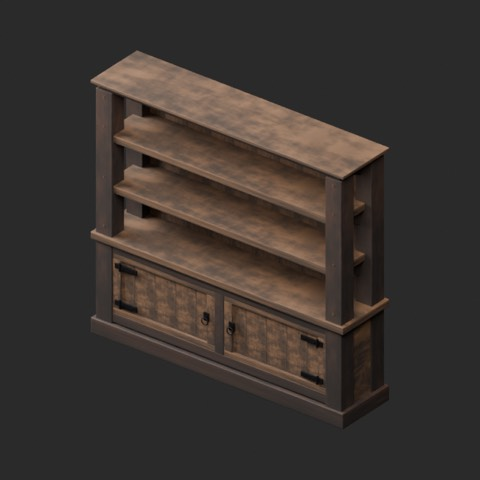

[拡大原図 / Open full-size image](https://raw.githubusercontent.com/k3peta/tales-on-a-table/main/previews/catalog-originals-20261024/FT_008__used-overview.png)

**FT_008__used** · used · [ZIP](https://raw.githubusercontent.com/k3peta/tales-on-a-table/main/distributions/material-variants-ft001-010-v1/FT_008__used_CC0.zip)

代表接写 / Detail: **FT_008__used**

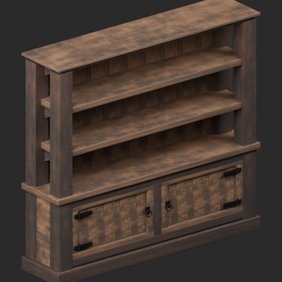

[拡大原図 / Open full-size image](https://raw.githubusercontent.com/k3peta/tales-on-a-table/main/previews/catalog-originals-20261024/FT_008__used-close.png)

### FT_009 — 壁付け棚

原本 / Original

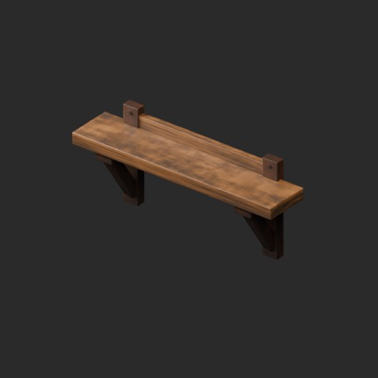

[拡大原図 / Open full-size image](https://raw.githubusercontent.com/k3peta/tales-on-a-table/main/previews/catalog-originals-20261024/FT_009-original.png)

#### FT_009__new

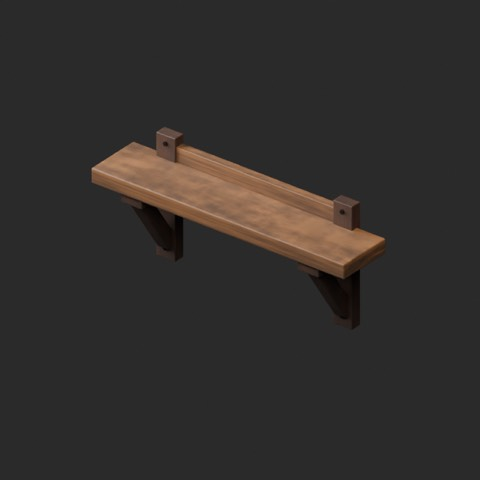

[拡大原図 / Open full-size image](https://raw.githubusercontent.com/k3peta/tales-on-a-table/main/previews/catalog-originals-20261024/FT_009__new-overview.png)

**FT_009__new** · new · [ZIP](https://raw.githubusercontent.com/k3peta/tales-on-a-table/main/distributions/material-variants-ft001-010-v1/FT_009__new_CC0.zip)

#### FT_009__used

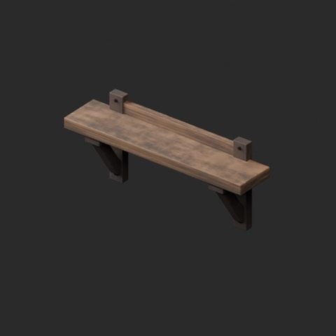

[拡大原図 / Open full-size image](https://raw.githubusercontent.com/k3peta/tales-on-a-table/main/previews/catalog-originals-20261024/FT_009__used-overview.png)

**FT_009__used** · used · [ZIP](https://raw.githubusercontent.com/k3peta/tales-on-a-table/main/distributions/material-variants-ft001-010-v1/FT_009__used_CC0.zip)

代表接写 / Detail: **FT_009__used**

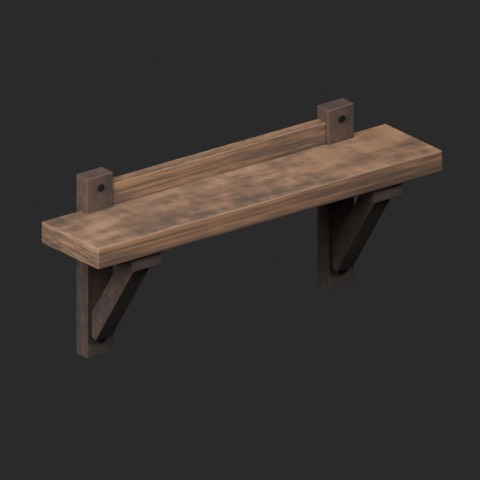

[拡大原図 / Open full-size image](https://raw.githubusercontent.com/k3peta/tales-on-a-table/main/previews/catalog-originals-20261024/FT_009__used-close.png)

### FT_010 — 両開き木製戸棚

原本 / Original

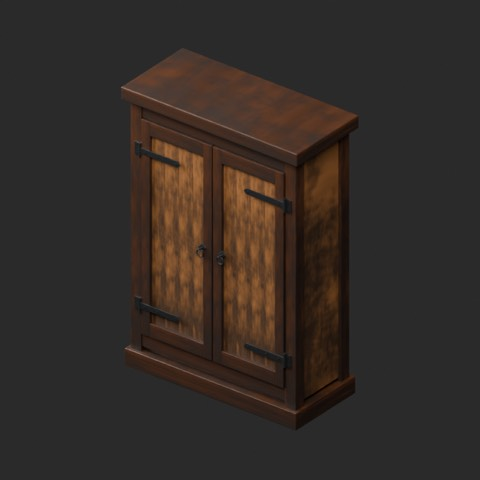

[拡大原図 / Open full-size image](https://raw.githubusercontent.com/k3peta/tales-on-a-table/main/previews/catalog-originals-20261024/FT_010-original.png)

#### FT_010__new

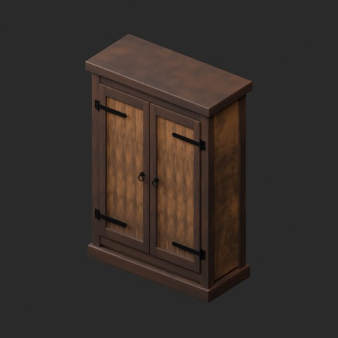

[拡大原図 / Open full-size image](https://raw.githubusercontent.com/k3peta/tales-on-a-table/main/previews/catalog-originals-20261024/FT_010__new-overview.png)

**FT_010__new** · new · [ZIP](https://raw.githubusercontent.com/k3peta/tales-on-a-table/main/distributions/material-variants-ft001-010-v1/FT_010__new_CC0.zip)

#### FT_010__used

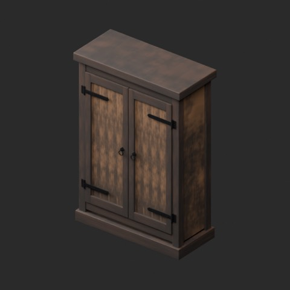

[拡大原図 / Open full-size image](https://raw.githubusercontent.com/k3peta/tales-on-a-table/main/previews/catalog-originals-20261024/FT_010__used-overview.png)

**FT_010__used** · used · [ZIP](https://raw.githubusercontent.com/k3peta/tales-on-a-table/main/distributions/material-variants-ft001-010-v1/FT_010__used_CC0.zip)

代表接写 / Detail: **FT_010__used**

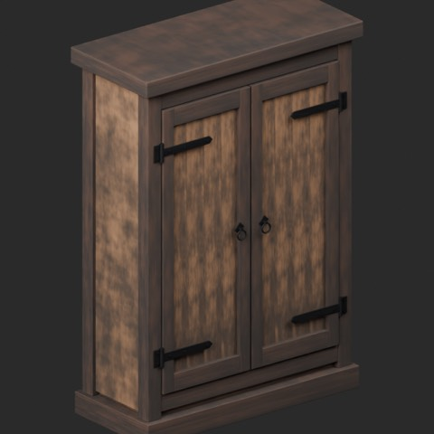

[拡大原図 / Open full-size image](https://raw.githubusercontent.com/k3peta/tales-on-a-table/main/previews/catalog-originals-20261024/FT_010__used-close.png)
