# FT011–020 材質variant / Material variants / 材质变体

**Existing distribution records1008 unchanged; material variants45 = prior20 + this batch25. New base shapes0/replacements0.**

## 日本語

基本10件の制作側査定76.25〜83.75、基本置換0。新品寄り10・使込10・自然色5を採用、差の小さい木製品の色5候補は除外。FT020は3本瓶の組合せで基本新種加算なし。元形状UV保持、金属/透過/IOR保持。粗木目と編み規則性は一部残り、完全な新品を保証しません。他engineガラス表示・ゲーム・全交差・全面UV再設計・旧版互換未検証。モデル材質CC0のみ、画像コード私的記録は除外。

## English

Ten originals assessed76.25–83.75 by producer; no replacements. Accepted10 cared-for/new,10 used and5 natural-color finishes; five low-difference wood color candidates excluded. FT020 is a three-bottle composite, not three new base shapes. Geometry/UV and metallic/transmission/IOR retained. Coarse grain/weave regularity remain. Other-engine glass, game use, full intersection/UV audit and old Blender unverified. Model/embedded material CC0 only; code/images/private records excluded.

## 中文

原10项评分76.25–83.75，无基本替换。采用新品倾向10、使用感10、自然色5，排除差异小的木制色5项。FT020为3瓶组合，不增加基本形状。几何UV和金属透射IOR保持。粗木纹及编织规律仍有残留，其他引擎玻璃、游戏、全交叉、完整UV重设和旧版兼容未验证。仅模型材质CC0。

実作レンダー / Actual model renders. Images are supplied for browsing, excluded from model CC0; existing [image rights](../LICENSE.md) remain unchanged. Images do not add model records.

## 実画像比較 / Render comparison

### FT_011 — 木樽

原本 / Original

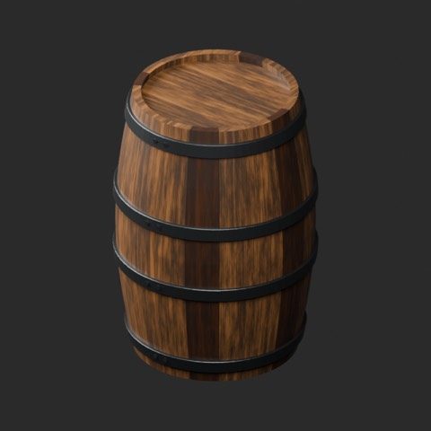

[拡大原図 / Open full-size image](https://raw.githubusercontent.com/k3peta/tales-on-a-table/main/previews/catalog-originals-20261024/FT_011-original.png)

#### FT_011__new

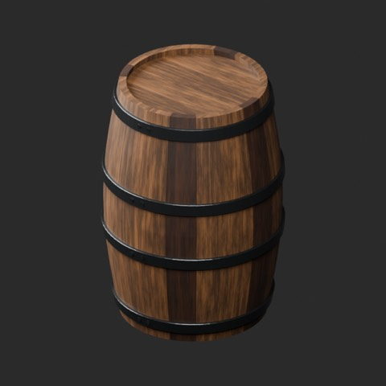

[拡大原図 / Open full-size image](https://raw.githubusercontent.com/k3peta/tales-on-a-table/main/previews/catalog-originals-20261024/FT_011__new-overview.png)

**FT_011__new** · new · [ZIP](https://raw.githubusercontent.com/k3peta/tales-on-a-table/main/distributions/material-variants-ft011-020-v1/FT_011__new_CC0.zip)

#### FT_011__used

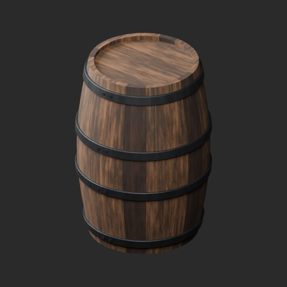

[拡大原図 / Open full-size image](https://raw.githubusercontent.com/k3peta/tales-on-a-table/main/previews/catalog-originals-20261024/FT_011__used-overview.png)

**FT_011__used** · used · [ZIP](https://raw.githubusercontent.com/k3peta/tales-on-a-table/main/distributions/material-variants-ft011-020-v1/FT_011__used_CC0.zip)

代表接写 / Detail: **FT_011__used**

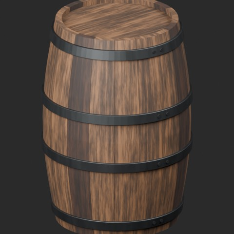

[拡大原図 / Open full-size image](https://raw.githubusercontent.com/k3peta/tales-on-a-table/main/previews/catalog-originals-20261024/FT_011__used-close.png)

### FT_012 — 横置き樽用の台

原本 / Original

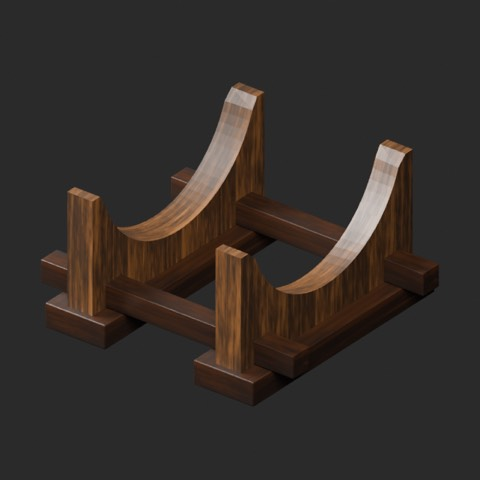

[拡大原図 / Open full-size image](https://raw.githubusercontent.com/k3peta/tales-on-a-table/main/previews/catalog-originals-20261024/FT_012-original.png)

#### FT_012__new

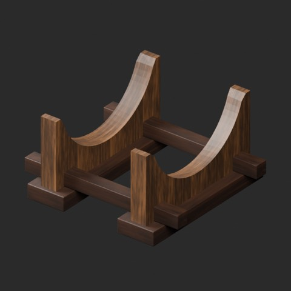

[拡大原図 / Open full-size image](https://raw.githubusercontent.com/k3peta/tales-on-a-table/main/previews/catalog-originals-20261024/FT_012__new-overview.png)

**FT_012__new** · new · [ZIP](https://raw.githubusercontent.com/k3peta/tales-on-a-table/main/distributions/material-variants-ft011-020-v1/FT_012__new_CC0.zip)

#### FT_012__used

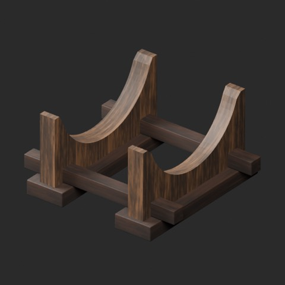

[拡大原図 / Open full-size image](https://raw.githubusercontent.com/k3peta/tales-on-a-table/main/previews/catalog-originals-20261024/FT_012__used-overview.png)

**FT_012__used** · used · [ZIP](https://raw.githubusercontent.com/k3peta/tales-on-a-table/main/distributions/material-variants-ft011-020-v1/FT_012__used_CC0.zip)

代表接写 / Detail: **FT_012__used**

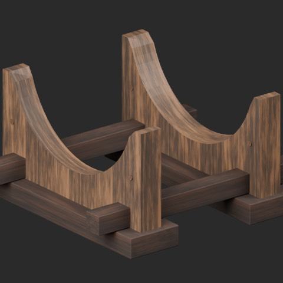

[拡大原図 / Open full-size image](https://raw.githubusercontent.com/k3peta/tales-on-a-table/main/previews/catalog-originals-20261024/FT_012__used-close.png)

### FT_013 — 蛇口付き小樽

原本 / Original

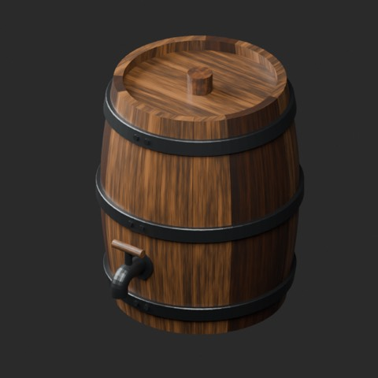

[拡大原図 / Open full-size image](https://raw.githubusercontent.com/k3peta/tales-on-a-table/main/previews/catalog-originals-20261024/FT_013-original.png)

#### FT_013__new

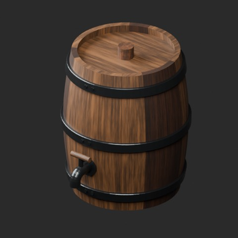

[拡大原図 / Open full-size image](https://raw.githubusercontent.com/k3peta/tales-on-a-table/main/previews/catalog-originals-20261024/FT_013__new-overview.png)

**FT_013__new** · new · [ZIP](https://raw.githubusercontent.com/k3peta/tales-on-a-table/main/distributions/material-variants-ft011-020-v1/FT_013__new_CC0.zip)

#### FT_013__used

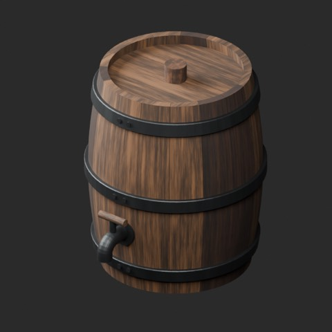

[拡大原図 / Open full-size image](https://raw.githubusercontent.com/k3peta/tales-on-a-table/main/previews/catalog-originals-20261024/FT_013__used-overview.png)

**FT_013__used** · used · [ZIP](https://raw.githubusercontent.com/k3peta/tales-on-a-table/main/distributions/material-variants-ft011-020-v1/FT_013__used_CC0.zip)

代表接写 / Detail: **FT_013__used**

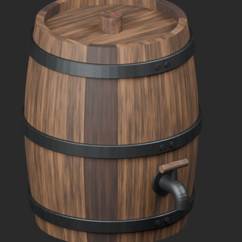

[拡大原図 / Open full-size image](https://raw.githubusercontent.com/k3peta/tales-on-a-table/main/previews/catalog-originals-20261024/FT_013__used-close.png)

### FT_014 — 開いた木箱

原本 / Original

[拡大原図 / Open full-size image](https://raw.githubusercontent.com/k3peta/tales-on-a-table/main/previews/catalog-originals-20261024/FT_014-original.png)

#### FT_014__new

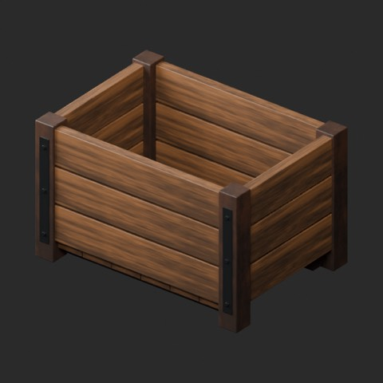

[拡大原図 / Open full-size image](https://raw.githubusercontent.com/k3peta/tales-on-a-table/main/previews/catalog-originals-20261024/FT_014__new-overview.png)

**FT_014__new** · new · [ZIP](https://raw.githubusercontent.com/k3peta/tales-on-a-table/main/distributions/material-variants-ft011-020-v1/FT_014__new_CC0.zip)

#### FT_014__used

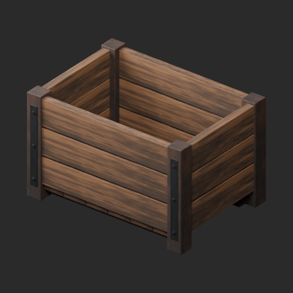

[拡大原図 / Open full-size image](https://raw.githubusercontent.com/k3peta/tales-on-a-table/main/previews/catalog-originals-20261024/FT_014__used-overview.png)

**FT_014__used** · used · [ZIP](https://raw.githubusercontent.com/k3peta/tales-on-a-table/main/distributions/material-variants-ft011-020-v1/FT_014__used_CC0.zip)

代表接写 / Detail: **FT_014__used**

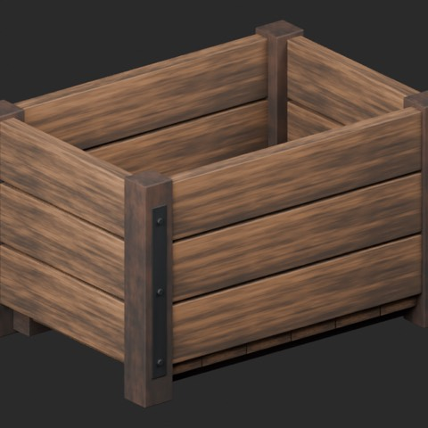

[拡大原図 / Open full-size image](https://raw.githubusercontent.com/k3peta/tales-on-a-table/main/previews/catalog-originals-20261024/FT_014__used-close.png)

### FT_015 — 持ち手付き編み籠

原本 / Original

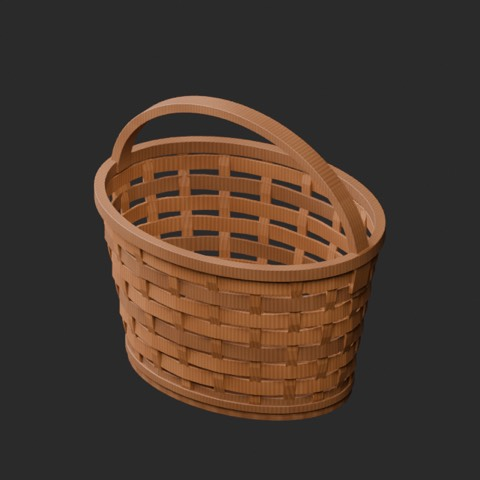

[拡大原図 / Open full-size image](https://raw.githubusercontent.com/k3peta/tales-on-a-table/main/previews/catalog-originals-20261024/FT_015-original.png)

#### FT_015__new

[拡大原図 / Open full-size image](https://raw.githubusercontent.com/k3peta/tales-on-a-table/main/previews/catalog-originals-20261024/FT_015__new-overview.png)

**FT_015__new** · new · [ZIP](https://raw.githubusercontent.com/k3peta/tales-on-a-table/main/distributions/material-variants-ft011-020-v1/FT_015__new_CC0.zip)

#### FT_015__used

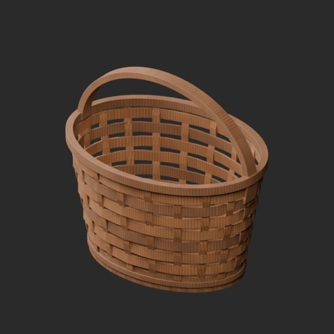

[拡大原図 / Open full-size image](https://raw.githubusercontent.com/k3peta/tales-on-a-table/main/previews/catalog-originals-20261024/FT_015__used-overview.png)

**FT_015__used** · used · [ZIP](https://raw.githubusercontent.com/k3peta/tales-on-a-table/main/distributions/material-variants-ft011-020-v1/FT_015__used_CC0.zip)

#### FT_015__color

[拡大原図 / Open full-size image](https://raw.githubusercontent.com/k3peta/tales-on-a-table/main/previews/catalog-originals-20261024/FT_015__color-overview.png)

**FT_015__color** · color · [ZIP](https://raw.githubusercontent.com/k3peta/tales-on-a-table/main/distributions/material-variants-ft011-020-v1/FT_015__color_CC0.zip)

代表接写 / Detail: **FT_015__used**

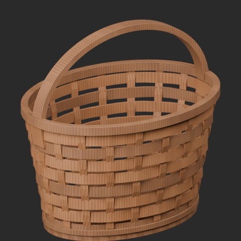

[拡大原図 / Open full-size image](https://raw.githubusercontent.com/k3peta/tales-on-a-table/main/previews/catalog-originals-20261024/FT_015__used-close.png)

### FT_016 — 金属製タンカード

原本 / Original

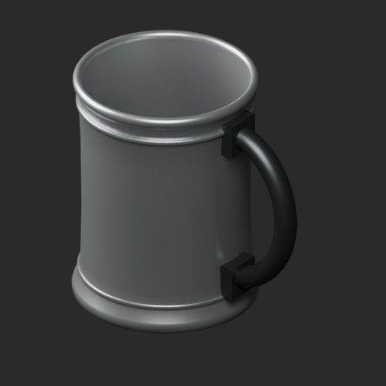

[拡大原図 / Open full-size image](https://raw.githubusercontent.com/k3peta/tales-on-a-table/main/previews/catalog-originals-20261024/FT_016-original.png)

#### FT_016__new

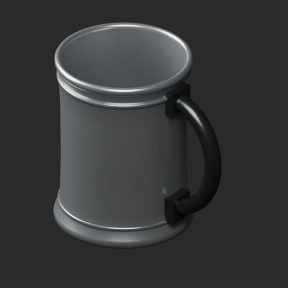

[拡大原図 / Open full-size image](https://raw.githubusercontent.com/k3peta/tales-on-a-table/main/previews/catalog-originals-20261024/FT_016__new-overview.png)

**FT_016__new** · new · [ZIP](https://raw.githubusercontent.com/k3peta/tales-on-a-table/main/distributions/material-variants-ft011-020-v1/FT_016__new_CC0.zip)

#### FT_016__used

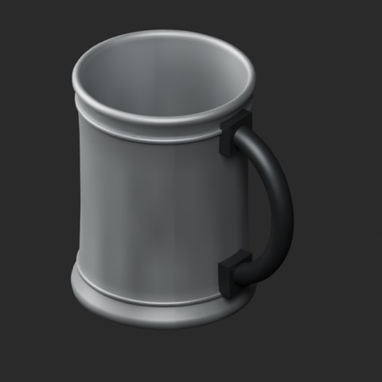

[拡大原図 / Open full-size image](https://raw.githubusercontent.com/k3peta/tales-on-a-table/main/previews/catalog-originals-20261024/FT_016__used-overview.png)

**FT_016__used** · used · [ZIP](https://raw.githubusercontent.com/k3peta/tales-on-a-table/main/distributions/material-variants-ft011-020-v1/FT_016__used_CC0.zip)

#### FT_016__color

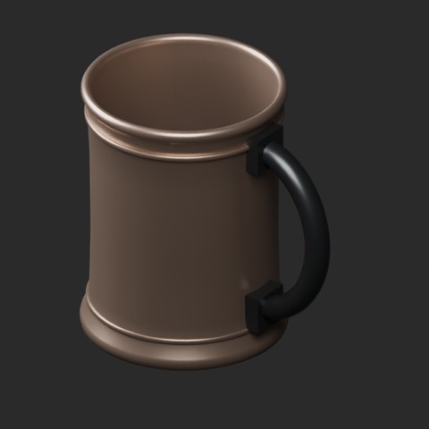

[拡大原図 / Open full-size image](https://raw.githubusercontent.com/k3peta/tales-on-a-table/main/previews/catalog-originals-20261024/FT_016__color-overview.png)

**FT_016__color** · color · [ZIP](https://raw.githubusercontent.com/k3peta/tales-on-a-table/main/distributions/material-variants-ft011-020-v1/FT_016__color_CC0.zip)

代表接写 / Detail: **FT_016__used**

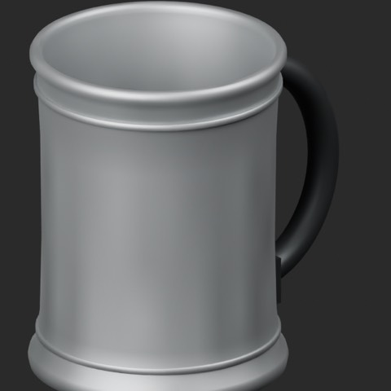

[拡大原図 / Open full-size image](https://raw.githubusercontent.com/k3peta/tales-on-a-table/main/previews/catalog-originals-20261024/FT_016__used-close.png)

### FT_017 — 木製マグ

原本 / Original

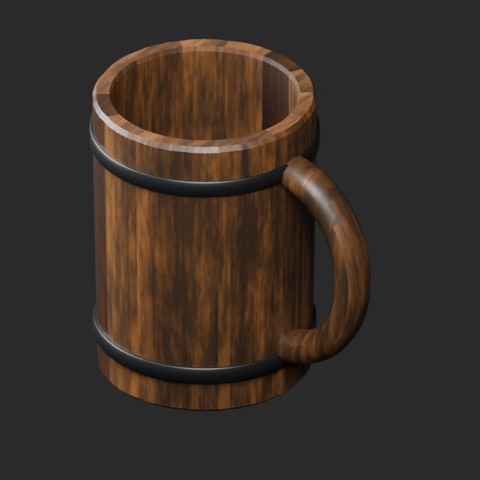

[拡大原図 / Open full-size image](https://raw.githubusercontent.com/k3peta/tales-on-a-table/main/previews/catalog-originals-20261024/FT_017-original.png)

#### FT_017__new

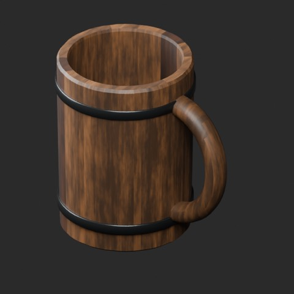

[拡大原図 / Open full-size image](https://raw.githubusercontent.com/k3peta/tales-on-a-table/main/previews/catalog-originals-20261024/FT_017__new-overview.png)

**FT_017__new** · new · [ZIP](https://raw.githubusercontent.com/k3peta/tales-on-a-table/main/distributions/material-variants-ft011-020-v1/FT_017__new_CC0.zip)

#### FT_017__used

[拡大原図 / Open full-size image](https://raw.githubusercontent.com/k3peta/tales-on-a-table/main/previews/catalog-originals-20261024/FT_017__used-overview.png)

**FT_017__used** · used · [ZIP](https://raw.githubusercontent.com/k3peta/tales-on-a-table/main/distributions/material-variants-ft011-020-v1/FT_017__used_CC0.zip)

代表接写 / Detail: **FT_017__used**

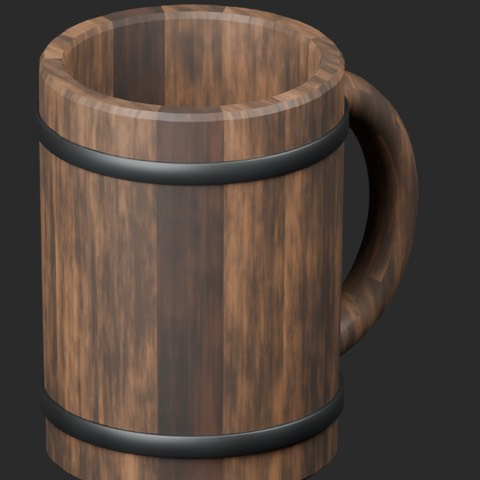

[拡大原図 / Open full-size image](https://raw.githubusercontent.com/k3peta/tales-on-a-table/main/previews/catalog-originals-20261024/FT_017__used-close.png)

### FT_018 — 陶器の水差し

原本 / Original

[拡大原図 / Open full-size image](https://raw.githubusercontent.com/k3peta/tales-on-a-table/main/previews/catalog-originals-20261024/FT_018-original.png)

#### FT_018__new

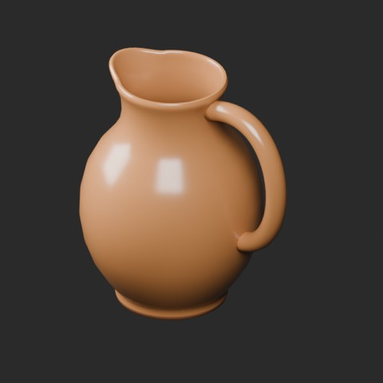

[拡大原図 / Open full-size image](https://raw.githubusercontent.com/k3peta/tales-on-a-table/main/previews/catalog-originals-20261024/FT_018__new-overview.png)

**FT_018__new** · new · [ZIP](https://raw.githubusercontent.com/k3peta/tales-on-a-table/main/distributions/material-variants-ft011-020-v1/FT_018__new_CC0.zip)

#### FT_018__used

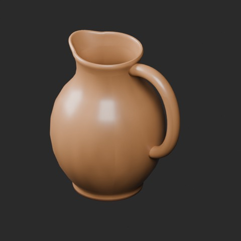

[拡大原図 / Open full-size image](https://raw.githubusercontent.com/k3peta/tales-on-a-table/main/previews/catalog-originals-20261024/FT_018__used-overview.png)

**FT_018__used** · used · [ZIP](https://raw.githubusercontent.com/k3peta/tales-on-a-table/main/distributions/material-variants-ft011-020-v1/FT_018__used_CC0.zip)

#### FT_018__color

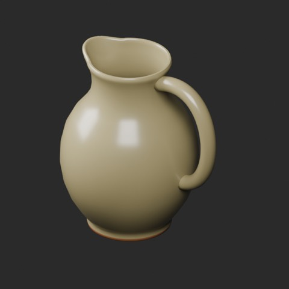

[拡大原図 / Open full-size image](https://raw.githubusercontent.com/k3peta/tales-on-a-table/main/previews/catalog-originals-20261024/FT_018__color-overview.png)

**FT_018__color** · color · [ZIP](https://raw.githubusercontent.com/k3peta/tales-on-a-table/main/distributions/material-variants-ft011-020-v1/FT_018__color_CC0.zip)

代表接写 / Detail: **FT_018__used**

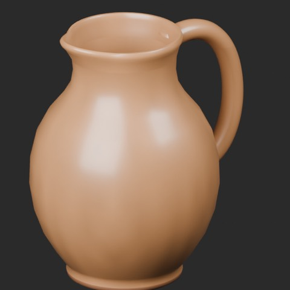

[拡大原図 / Open full-size image](https://raw.githubusercontent.com/k3peta/tales-on-a-table/main/previews/catalog-originals-20261024/FT_018__used-close.png)

### FT_019 — 脚付き金属杯

原本 / Original

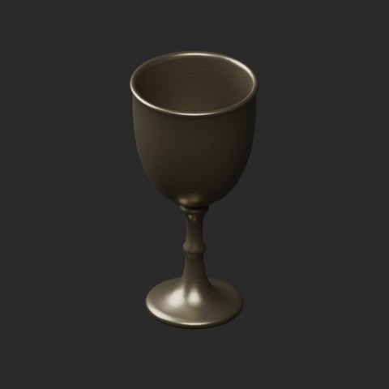

[拡大原図 / Open full-size image](https://raw.githubusercontent.com/k3peta/tales-on-a-table/main/previews/catalog-originals-20261024/FT_019-original.png)

#### FT_019__new

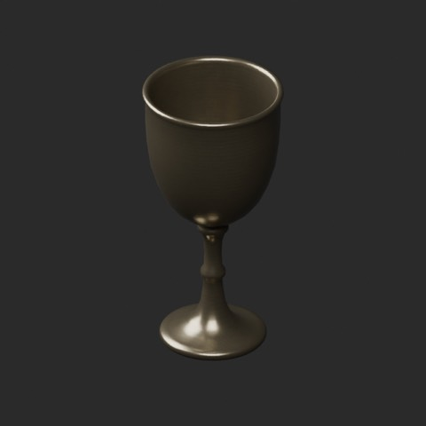

[拡大原図 / Open full-size image](https://raw.githubusercontent.com/k3peta/tales-on-a-table/main/previews/catalog-originals-20261024/FT_019__new-overview.png)

**FT_019__new** · new · [ZIP](https://raw.githubusercontent.com/k3peta/tales-on-a-table/main/distributions/material-variants-ft011-020-v1/FT_019__new_CC0.zip)

#### FT_019__used

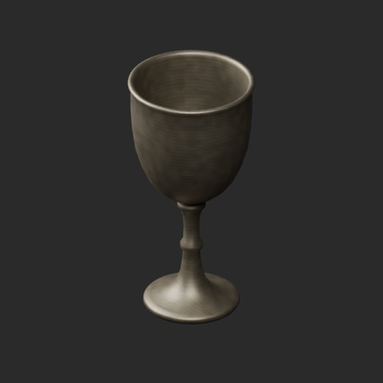

[拡大原図 / Open full-size image](https://raw.githubusercontent.com/k3peta/tales-on-a-table/main/previews/catalog-originals-20261024/FT_019__used-overview.png)

**FT_019__used** · used · [ZIP](https://raw.githubusercontent.com/k3peta/tales-on-a-table/main/distributions/material-variants-ft011-020-v1/FT_019__used_CC0.zip)

#### FT_019__color

[拡大原図 / Open full-size image](https://raw.githubusercontent.com/k3peta/tales-on-a-table/main/previews/catalog-originals-20261024/FT_019__color-overview.png)

**FT_019__color** · color · [ZIP](https://raw.githubusercontent.com/k3peta/tales-on-a-table/main/distributions/material-variants-ft011-020-v1/FT_019__color_CC0.zip)

代表接写 / Detail: **FT_019__used**

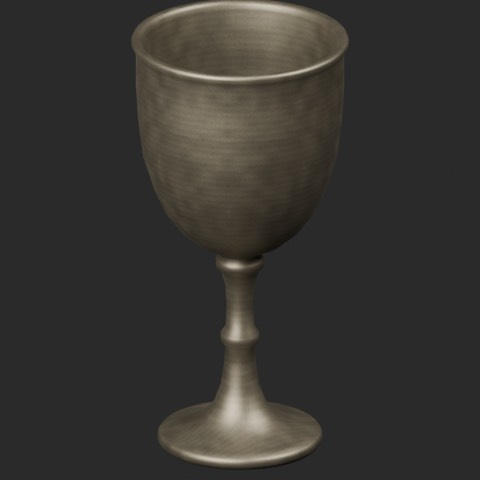

[拡大原図 / Open full-size image](https://raw.githubusercontent.com/k3peta/tales-on-a-table/main/previews/catalog-originals-20261024/FT_019__used-close.png)

### FT_020 — 3本の空のガラス瓶

原本 / Original

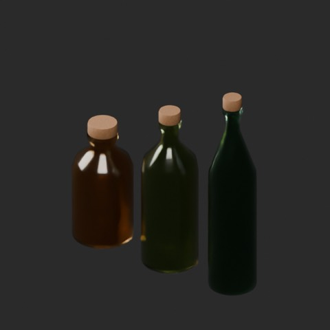

[拡大原図 / Open full-size image](https://raw.githubusercontent.com/k3peta/tales-on-a-table/main/previews/catalog-originals-20261024/FT_020-original.png)

#### FT_020__new

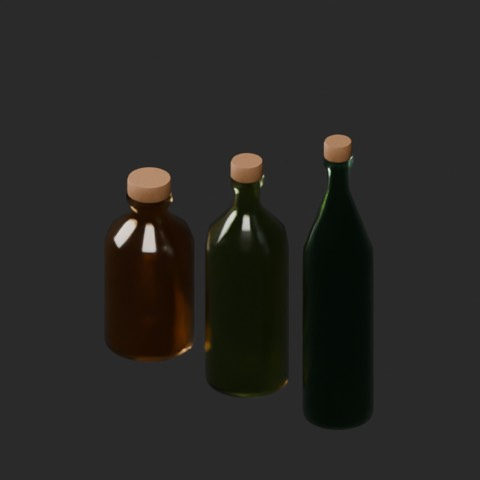

[拡大原図 / Open full-size image](https://raw.githubusercontent.com/k3peta/tales-on-a-table/main/previews/catalog-originals-20261024/FT_020__new-overview.png)

**FT_020__new** · new · [ZIP](https://raw.githubusercontent.com/k3peta/tales-on-a-table/main/distributions/material-variants-ft011-020-v1/FT_020__new_CC0.zip)

#### FT_020__used

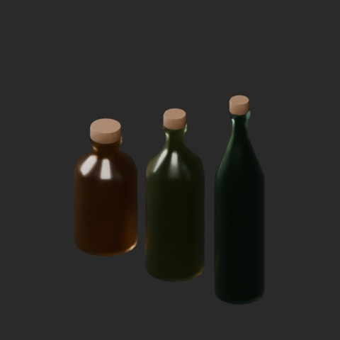

[拡大原図 / Open full-size image](https://raw.githubusercontent.com/k3peta/tales-on-a-table/main/previews/catalog-originals-20261024/FT_020__used-overview.png)

**FT_020__used** · used · [ZIP](https://raw.githubusercontent.com/k3peta/tales-on-a-table/main/distributions/material-variants-ft011-020-v1/FT_020__used_CC0.zip)

#### FT_020__color

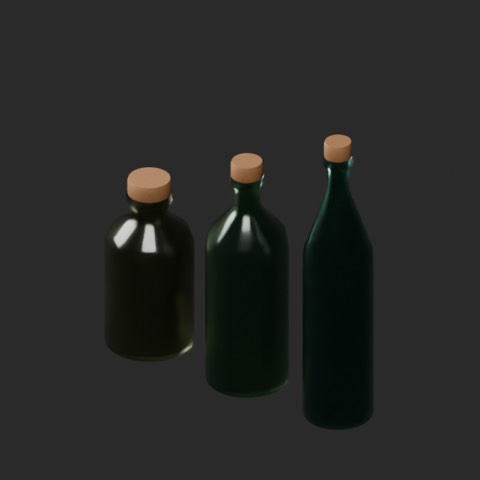

[拡大原図 / Open full-size image](https://raw.githubusercontent.com/k3peta/tales-on-a-table/main/previews/catalog-originals-20261024/FT_020__color-overview.png)

**FT_020__color** · color · [ZIP](https://raw.githubusercontent.com/k3peta/tales-on-a-table/main/distributions/material-variants-ft011-020-v1/FT_020__color_CC0.zip)

代表接写 / Detail: **FT_020__used**

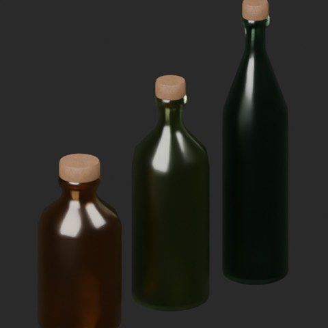

[拡大原図 / Open full-size image](https://raw.githubusercontent.com/k3peta/tales-on-a-table/main/previews/catalog-originals-20261024/FT_020__used-close.png)
