# FT021–030 材質variant / Material variants / 材质变体

**Existing1008 records unchanged; material variants54 =45+9. New base geometry0/replacements0.**

新品寄り2・使込1・色彩6を採用、13候補棄却。元形状とUV0保持、WearUVを追加。食品・蝋・芯は変更しません。粗木目抑制は写実性の保証ではなく、盆側面の規則的細部は残ります。ゲーム/全交差/他engineガラス/旧版互換未検証。モデル材質のみCC0。画像は閲覧用でモデルCC0対象外、[既存条件](../LICENSE.md)を維持。

Nine accepted finishes (new2/used1/color6),13 rejected. Original geometry/UV0 retained; WearUV added. Food/wax/wicks unchanged. No automatic quality-score gain for colors. Remaining patterned details, game/full intersections/other-engine glass/old Blender unverified. Preview images are not model CC0.

采用9项（新品倾向2、使用感1、色彩6），排除13项。保留原几何UV0并新增WearUV，食品蜡芯不变。基本模型不增加，图片不属模型CC0。

## FT_021__new — 手穴付き木製盆

[ZIP · BLEND/GLB](https://raw.githubusercontent.com/k3peta/tales-on-a-table/main/distributions/material-variants-ft021-030-v1/FT_021__new_CC0.zip) · new

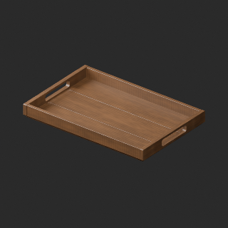

[拡大原図 / Open full-size image](https://raw.githubusercontent.com/k3peta/tales-on-a-table/main/previews/material-variants-ft021-030/FT_021__new_thumb.png)

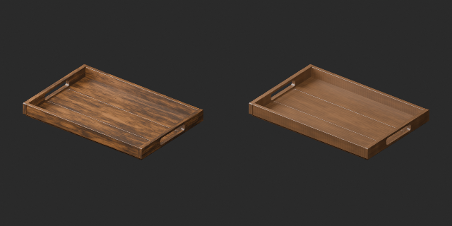

[拡大原図 / Open full-size image](https://raw.githubusercontent.com/k3peta/tales-on-a-table/main/previews/material-variants-ft021-030/FT_021__new_comparison.png)

比較画像: 左=原本、右=採用版 / Left original, right accepted.

## FT_021__used — 手穴付き木製盆

[ZIP · BLEND/GLB](https://raw.githubusercontent.com/k3peta/tales-on-a-table/main/distributions/material-variants-ft021-030-v1/FT_021__used_CC0.zip) · used

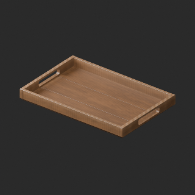

[拡大原図 / Open full-size image](https://raw.githubusercontent.com/k3peta/tales-on-a-table/main/previews/material-variants-ft021-030/FT_021__used_thumb.png)

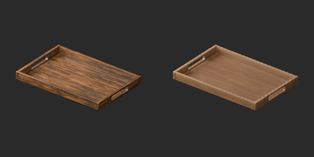

[拡大原図 / Open full-size image](https://raw.githubusercontent.com/k3peta/tales-on-a-table/main/previews/material-variants-ft021-030/FT_021__used_comparison.png)

比較画像: 左=原本、右=採用版 / Left original, right accepted.

## FT_022__color — 浅い陶器皿

[ZIP · BLEND/GLB](https://raw.githubusercontent.com/k3peta/tales-on-a-table/main/distributions/material-variants-ft021-030-v1/FT_022__color_CC0.zip) · color

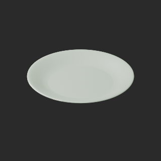

[拡大原図 / Open full-size image](https://raw.githubusercontent.com/k3peta/tales-on-a-table/main/previews/material-variants-ft021-030/FT_022__color_thumb.png)

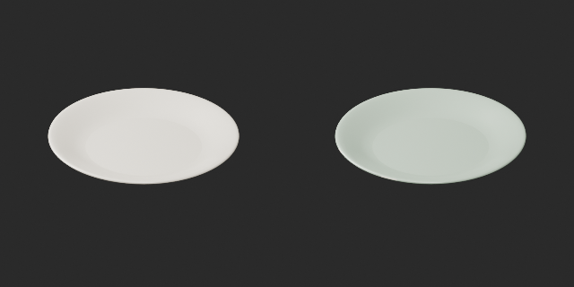

[拡大原図 / Open full-size image](https://raw.githubusercontent.com/k3peta/tales-on-a-table/main/previews/material-variants-ft021-030/FT_022__color_comparison.png)

比較画像: 左=原本、右=採用版 / Left original, right accepted.

## FT_023__new — スプーン・フォーク・食卓ナイフ

[ZIP · BLEND/GLB](https://raw.githubusercontent.com/k3peta/tales-on-a-table/main/distributions/material-variants-ft021-030-v1/FT_023__new_CC0.zip) · new

[拡大原図 / Open full-size image](https://raw.githubusercontent.com/k3peta/tales-on-a-table/main/previews/material-variants-ft021-030/FT_023__new_thumb.png)

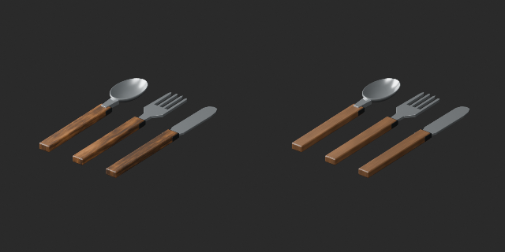

[拡大原図 / Open full-size image](https://raw.githubusercontent.com/k3peta/tales-on-a-table/main/previews/material-variants-ft021-030/FT_023__new_comparison.png)

比較画像: 左=原本、右=採用版 / Left original, right accepted.

## FT_023__color — スプーン・フォーク・食卓ナイフ

[ZIP · BLEND/GLB](https://raw.githubusercontent.com/k3peta/tales-on-a-table/main/distributions/material-variants-ft021-030-v1/FT_023__color_CC0.zip) · color

[拡大原図 / Open full-size image](https://raw.githubusercontent.com/k3peta/tales-on-a-table/main/previews/material-variants-ft021-030/FT_023__color_thumb.png)

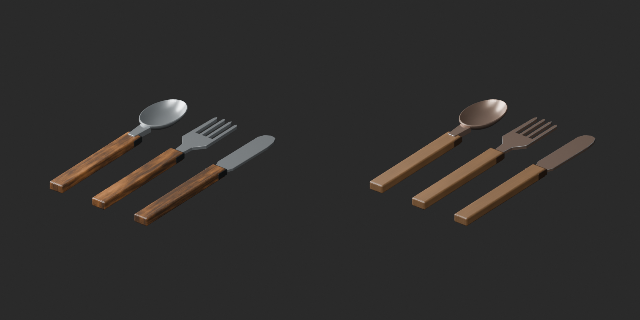

[拡大原図 / Open full-size image](https://raw.githubusercontent.com/k3peta/tales-on-a-table/main/previews/material-variants-ft021-030/FT_023__color_comparison.png)

比較画像: 左=原本、右=採用版 / Left original, right accepted.

## FT_026__color — シチュー入り陶器鉢

[ZIP · BLEND/GLB](https://raw.githubusercontent.com/k3peta/tales-on-a-table/main/distributions/material-variants-ft021-030-v1/FT_026__color_CC0.zip) · color

[拡大原図 / Open full-size image](https://raw.githubusercontent.com/k3peta/tales-on-a-table/main/previews/material-variants-ft021-030/FT_026__color_thumb.png)

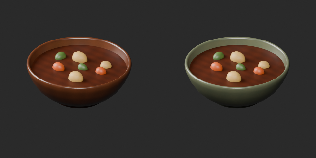

[拡大原図 / Open full-size image](https://raw.githubusercontent.com/k3peta/tales-on-a-table/main/previews/material-variants-ft021-030/FT_026__color_comparison.png)

比較画像: 左=原本、右=採用版 / Left original, right accepted.

## FT_027__color — ローストと野菜の盛皿

[ZIP · BLEND/GLB](https://raw.githubusercontent.com/k3peta/tales-on-a-table/main/distributions/material-variants-ft021-030-v1/FT_027__color_CC0.zip) · color

[拡大原図 / Open full-size image](https://raw.githubusercontent.com/k3peta/tales-on-a-table/main/previews/material-variants-ft021-030/FT_027__color_thumb.png)

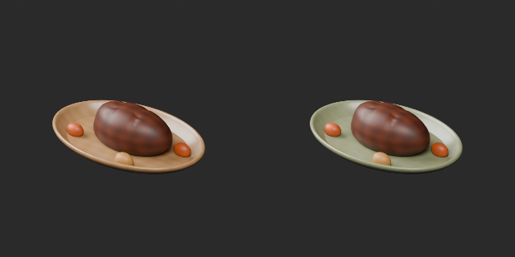

[拡大原図 / Open full-size image](https://raw.githubusercontent.com/k3peta/tales-on-a-table/main/previews/material-variants-ft021-030/FT_027__color_comparison.png)

比較画像: 左=原本、右=採用版 / Left original, right accepted.

## FT_028__color — 未点火の燭台

[ZIP · BLEND/GLB](https://raw.githubusercontent.com/k3peta/tales-on-a-table/main/distributions/material-variants-ft021-030-v1/FT_028__color_CC0.zip) · color

[拡大原図 / Open full-size image](https://raw.githubusercontent.com/k3peta/tales-on-a-table/main/previews/material-variants-ft021-030/FT_028__color_thumb.png)

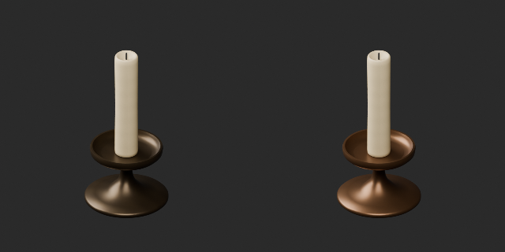

[拡大原図 / Open full-size image](https://raw.githubusercontent.com/k3peta/tales-on-a-table/main/previews/material-variants-ft021-030/FT_028__color_comparison.png)

比較画像: 左=原本、右=採用版 / Left original, right accepted.

## FT_030__color — 壁付けガラスランタン

[ZIP · BLEND/GLB](https://raw.githubusercontent.com/k3peta/tales-on-a-table/main/distributions/material-variants-ft021-030-v1/FT_030__color_CC0.zip) · color

[拡大原図 / Open full-size image](https://raw.githubusercontent.com/k3peta/tales-on-a-table/main/previews/material-variants-ft021-030/FT_030__color_thumb.png)

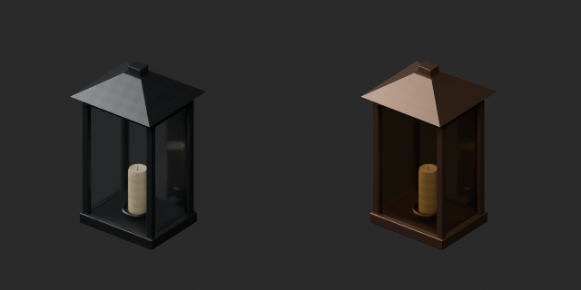

[拡大原図 / Open full-size image](https://raw.githubusercontent.com/k3peta/tales-on-a-table/main/previews/material-variants-ft021-030/FT_030__color_comparison.png)

比較画像: 左=原本、右=採用版 / Left original, right accepted.
