# FT031–040 品質改訂と材質variant

**Existing1008 records unchanged; material variants68=54+11+3. Two revisions are not added as new records.**

改訂2: FT033黒潰れ材質改善、FT040本体/蓋の欠落UV補完。元形状と既存UV0保持、WearUV追加。FT040 GLBはUV量子化hash不一致があり、実数差最大2.98e-8を検証（1e-6以内）。新基本形状0、改訂をvariantへ加算しません。11variant採用、6候補棄却。工具/燃焼機能、ゲーム、全交差、旧Blender互換は未検証。

Two revisions: FT033 material readability; FT040 missing UV repair. Geometry/existing UV retained; added UVs are not new geometry. Numeric GLB UV tolerance tested, not exact hash equality for FT040. Eleven variants, six rejects. Dynamic functions/game/older Blender unverified.

モデル/埋込材質のみCC0。画像は閲覧用でモデルCC0対象外、[既存画像権利](../LICENSE.md)維持。代码图片私有査定不属模型CC0。

## FT_031__used — 装飾用の石造暖炉

material_variant · [ZIP · BLEND/GLB](https://raw.githubusercontent.com/k3peta/tales-on-a-table/main/distributions/quality-ft031-040-v1/FT_031__used_CC0.zip)

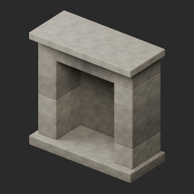

[拡大 / Full image](https://raw.githubusercontent.com/k3peta/tales-on-a-table/main/previews/quality-ft031-040-v1/FT_031__used_thumb.png)

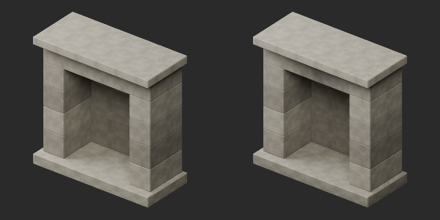

[拡大 / Full image](https://raw.githubusercontent.com/k3peta/tales-on-a-table/main/previews/quality-ft031-040-v1/FT_031__used_comparison.png)

left: original base; right: accepted variant; same overview camera

## FT_031__color — 装飾用の石造暖炉

material_variant · [ZIP · BLEND/GLB](https://raw.githubusercontent.com/k3peta/tales-on-a-table/main/distributions/quality-ft031-040-v1/FT_031__color_CC0.zip)

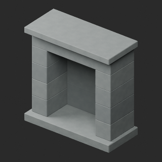

[拡大 / Full image](https://raw.githubusercontent.com/k3peta/tales-on-a-table/main/previews/quality-ft031-040-v1/FT_031__color_thumb.png)

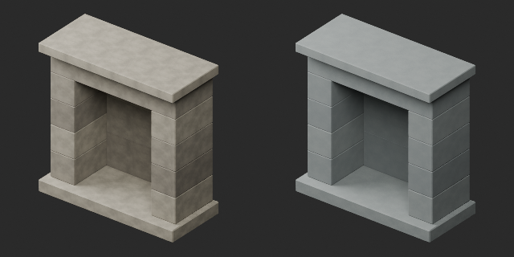

[拡大 / Full image](https://raw.githubusercontent.com/k3peta/tales-on-a-table/main/previews/quality-ft031-040-v1/FT_031__color_comparison.png)

left: original base; right: accepted variant; same overview camera

## FT_033__repair — 火かき道具と支持台

revision · [ZIP · BLEND/GLB](https://raw.githubusercontent.com/k3peta/tales-on-a-table/main/distributions/quality-ft031-040-v1/FT_033__repair_CC0.zip)

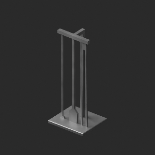

[拡大 / Full image](https://raw.githubusercontent.com/k3peta/tales-on-a-table/main/previews/quality-ft031-040-v1/FT_033__repair_thumb.png)

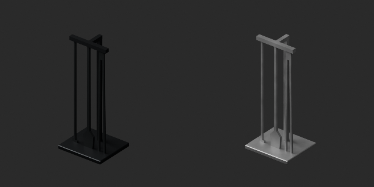

[拡大 / Full image](https://raw.githubusercontent.com/k3peta/tales-on-a-table/main/previews/quality-ft031-040-v1/FT_033__repair_comparison.png)

left: original base; right: accepted variant; same overview camera

## FT_034__new — 木製の的

material_variant · [ZIP · BLEND/GLB](https://raw.githubusercontent.com/k3peta/tales-on-a-table/main/distributions/quality-ft031-040-v1/FT_034__new_CC0.zip)

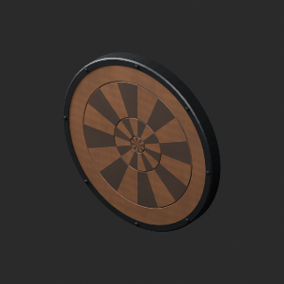

[拡大 / Full image](https://raw.githubusercontent.com/k3peta/tales-on-a-table/main/previews/quality-ft031-040-v1/FT_034__new_thumb.png)

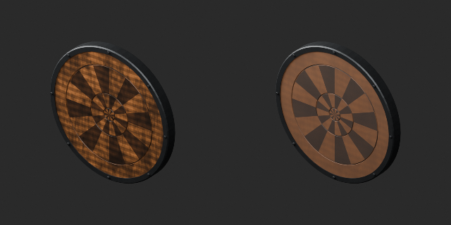

[拡大 / Full image](https://raw.githubusercontent.com/k3peta/tales-on-a-table/main/previews/quality-ft031-040-v1/FT_034__new_comparison.png)

left: original base; right: accepted variant; same overview camera

## FT_035__new — 無地の掲示板

material_variant · [ZIP · BLEND/GLB](https://raw.githubusercontent.com/k3peta/tales-on-a-table/main/distributions/quality-ft031-040-v1/FT_035__new_CC0.zip)

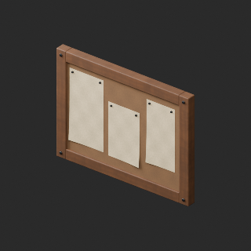

[拡大 / Full image](https://raw.githubusercontent.com/k3peta/tales-on-a-table/main/previews/quality-ft031-040-v1/FT_035__new_thumb.png)

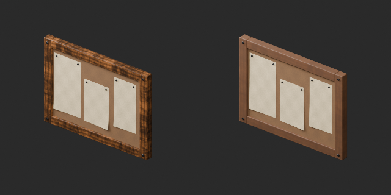

[拡大 / Full image](https://raw.githubusercontent.com/k3peta/tales-on-a-table/main/previews/quality-ft031-040-v1/FT_035__new_comparison.png)

left: original base; right: accepted variant; same overview camera

## FT_036__new — 無地のA型メニュー看板

material_variant · [ZIP · BLEND/GLB](https://raw.githubusercontent.com/k3peta/tales-on-a-table/main/distributions/quality-ft031-040-v1/FT_036__new_CC0.zip)

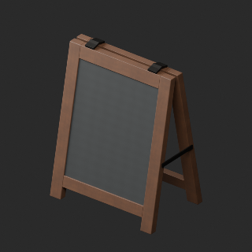

[拡大 / Full image](https://raw.githubusercontent.com/k3peta/tales-on-a-table/main/previews/quality-ft031-040-v1/FT_036__new_thumb.png)

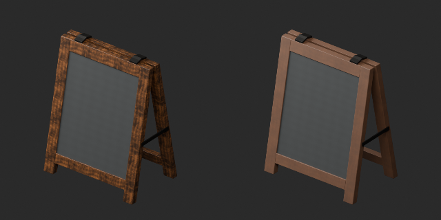

[拡大 / Full image](https://raw.githubusercontent.com/k3peta/tales-on-a-table/main/previews/quality-ft031-040-v1/FT_036__new_comparison.png)

left: original base; right: accepted variant; same overview camera

## FT_037__new — 無地の吊り看板

material_variant · [ZIP · BLEND/GLB](https://raw.githubusercontent.com/k3peta/tales-on-a-table/main/distributions/quality-ft031-040-v1/FT_037__new_CC0.zip)

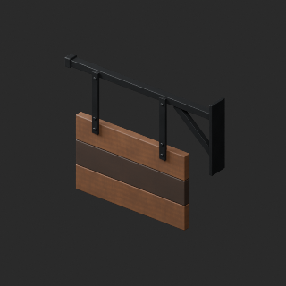

[拡大 / Full image](https://raw.githubusercontent.com/k3peta/tales-on-a-table/main/previews/quality-ft031-040-v1/FT_037__new_thumb.png)

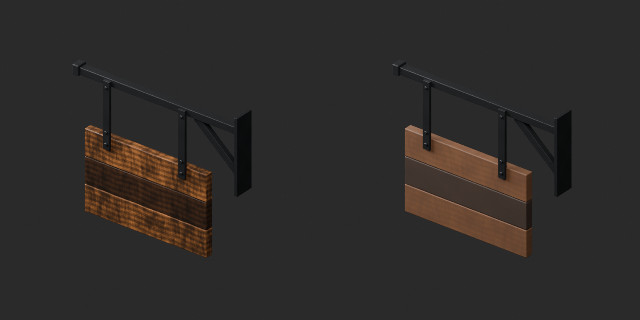

[拡大 / Full image](https://raw.githubusercontent.com/k3peta/tales-on-a-table/main/previews/quality-ft031-040-v1/FT_037__new_comparison.png)

left: original base; right: accepted variant; same overview camera

## FT_037__color — 無地の吊り看板

material_variant · [ZIP · BLEND/GLB](https://raw.githubusercontent.com/k3peta/tales-on-a-table/main/distributions/quality-ft031-040-v1/FT_037__color_CC0.zip)

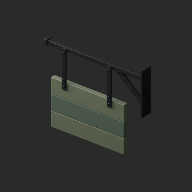

[拡大 / Full image](https://raw.githubusercontent.com/k3peta/tales-on-a-table/main/previews/quality-ft031-040-v1/FT_037__color_thumb.png)

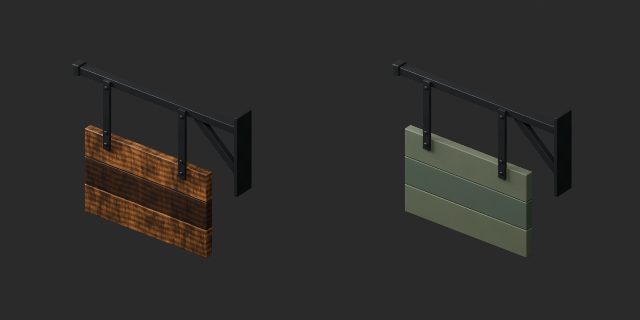

[拡大 / Full image](https://raw.githubusercontent.com/k3peta/tales-on-a-table/main/previews/quality-ft031-040-v1/FT_037__color_comparison.png)

left: original base; right: accepted variant; same overview camera

## FT_038__color — 閉じた革の巾着

material_variant · [ZIP · BLEND/GLB](https://raw.githubusercontent.com/k3peta/tales-on-a-table/main/distributions/quality-ft031-040-v1/FT_038__color_CC0.zip)

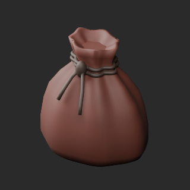

[拡大 / Full image](https://raw.githubusercontent.com/k3peta/tales-on-a-table/main/previews/quality-ft031-040-v1/FT_038__color_thumb.png)

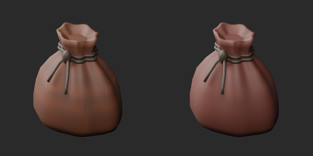

[拡大 / Full image](https://raw.githubusercontent.com/k3peta/tales-on-a-table/main/previews/quality-ft031-040-v1/FT_038__color_comparison.png)

left: original base; right: accepted variant; same overview camera

## FT_039__used — 空のダイスカップと二つのサイコロ

material_variant · [ZIP · BLEND/GLB](https://raw.githubusercontent.com/k3peta/tales-on-a-table/main/distributions/quality-ft031-040-v1/FT_039__used_CC0.zip)

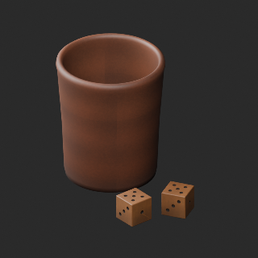

[拡大 / Full image](https://raw.githubusercontent.com/k3peta/tales-on-a-table/main/previews/quality-ft031-040-v1/FT_039__used_thumb.png)

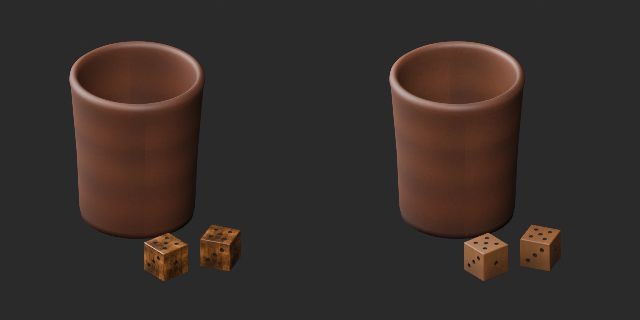

[拡大 / Full image](https://raw.githubusercontent.com/k3peta/tales-on-a-table/main/previews/quality-ft031-040-v1/FT_039__used_comparison.png)

left: original base; right: accepted variant; same overview camera

## FT_039__color — 空のダイスカップと二つのサイコロ

material_variant · [ZIP · BLEND/GLB](https://raw.githubusercontent.com/k3peta/tales-on-a-table/main/distributions/quality-ft031-040-v1/FT_039__color_CC0.zip)

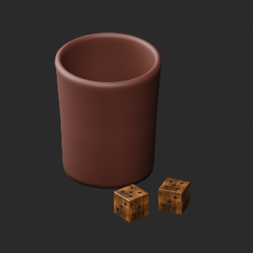

[拡大 / Full image](https://raw.githubusercontent.com/k3peta/tales-on-a-table/main/previews/quality-ft031-040-v1/FT_039__color_thumb.png)

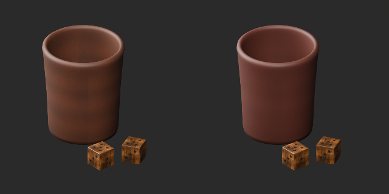

[拡大 / Full image](https://raw.githubusercontent.com/k3peta/tales-on-a-table/main/previews/quality-ft031-040-v1/FT_039__color_comparison.png)

left: original base; right: accepted variant; same overview camera

## FT_040__repair — 閉じた革の旅鞄

revision · [ZIP · BLEND/GLB](https://raw.githubusercontent.com/k3peta/tales-on-a-table/main/distributions/quality-ft031-040-v1/FT_040__repair_CC0.zip)

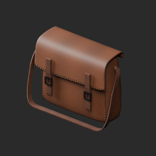

[拡大 / Full image](https://raw.githubusercontent.com/k3peta/tales-on-a-table/main/previews/quality-ft031-040-v1/FT_040__repair_thumb.png)

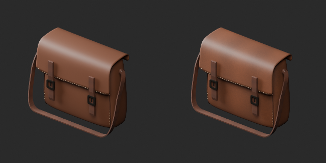

[拡大 / Full image](https://raw.githubusercontent.com/k3peta/tales-on-a-table/main/previews/quality-ft031-040-v1/FT_040__repair_comparison.png)

left: original base; right: accepted variant; same overview camera

## FT_040__color — 閉じた革の旅鞄

material_variant · [ZIP · BLEND/GLB](https://raw.githubusercontent.com/k3peta/tales-on-a-table/main/distributions/quality-ft031-040-v1/FT_040__color_CC0.zip)

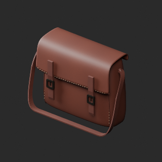

[拡大 / Full image](https://raw.githubusercontent.com/k3peta/tales-on-a-table/main/previews/quality-ft031-040-v1/FT_040__color_thumb.png)

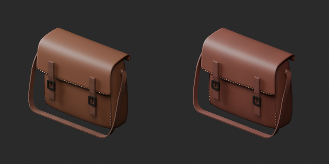

[拡大 / Full image](https://raw.githubusercontent.com/k3peta/tales-on-a-table/main/previews/quality-ft031-040-v1/FT_040__color_comparison.png)

left: original base; right: accepted variant; same overview camera
