# FT041–050 品質改訂と材質variant

**Existing1008 records unchanged; material variants74=68+6. Six revisions are not added as new records.**

材質改修6（FT041/042/043/045/047/048）、同形variant6、棄却8。原形状・原UV0保持、WearUV追加。粗い黒木目を抑制、FT047白い段鼻は欠損ではなく反射で艶消しへ修正。045/046床は2m角を2×2配置で4m角・接地Z0確認、規則的反復は残ります。FT044は3m壁、一律2m規格ではありません。一般接続/ゲーム衝突/実歩行/他engine/旧版互換は未検証。前便FT033/040を本便へ再加算しません。

Six material repairs, six same-geometry variants, eight rejects. Original geometry/UV0 retained with added WearUV. Reduced coarse dark grain; FT047 pale stair nosing was reflection, now matte. FT045/046 tested as2x2 floor assemblies; repetition remains. FT044 is3m wall, not universal2m. General connections/game/walking/other engines/older Blender unverified. Prior repairs not recounted.

材质修订6、同形变体6，排除8。保留原几何UV0，添加WearUV。基本模型不增加，旧版保留。全连接、游戏碰撞、步行和旧版兼容未验证。

モデル/埋込材質のみCC0。画像は閲覧用でモデルCC0対象外、[既存画像権利](../LICENSE.md)維持。代码图片私有査定不属模型CC0。

## FT_041__repair — 木製の扉と枠

revision · [ZIP · BLEND/GLB](https://raw.githubusercontent.com/k3peta/tales-on-a-table/main/distributions/quality-ft041-050-v1/FT_041__repair_CC0.zip)

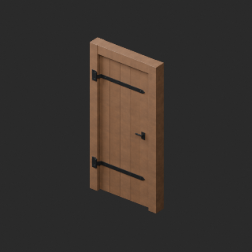

[拡大 / Full image](https://raw.githubusercontent.com/k3peta/tales-on-a-table/main/previews/quality-ft041-050-v1/FT_041__repair_thumb.png)

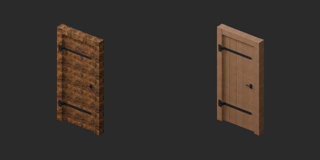

[拡大 / Full image](https://raw.githubusercontent.com/k3peta/tales-on-a-table/main/previews/quality-ft041-050-v1/FT_041__repair_comparison.png)

left: original base; right: accepted variant; same overview camera

## FT_041__used — 木製の扉と枠

material_variant · [ZIP · BLEND/GLB](https://raw.githubusercontent.com/k3peta/tales-on-a-table/main/distributions/quality-ft041-050-v1/FT_041__used_CC0.zip)

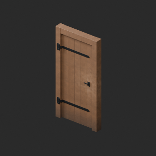

[拡大 / Full image](https://raw.githubusercontent.com/k3peta/tales-on-a-table/main/previews/quality-ft041-050-v1/FT_041__used_thumb.png)

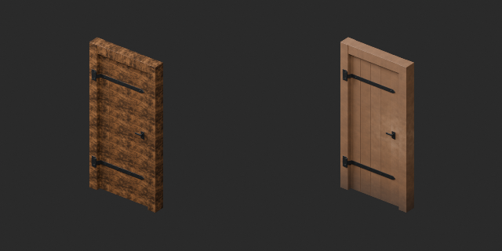

[拡大 / Full image](https://raw.githubusercontent.com/k3peta/tales-on-a-table/main/previews/quality-ft041-050-v1/FT_041__used_comparison.png)

left: original base; right: accepted variant; same overview camera

## FT_042__repair — 鉛桟のガラス窓

revision · [ZIP · BLEND/GLB](https://raw.githubusercontent.com/k3peta/tales-on-a-table/main/distributions/quality-ft041-050-v1/FT_042__repair_CC0.zip)

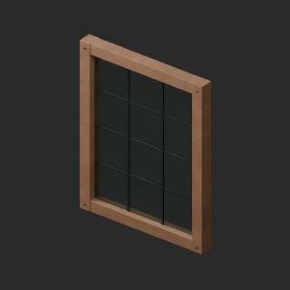

[拡大 / Full image](https://raw.githubusercontent.com/k3peta/tales-on-a-table/main/previews/quality-ft041-050-v1/FT_042__repair_thumb.png)

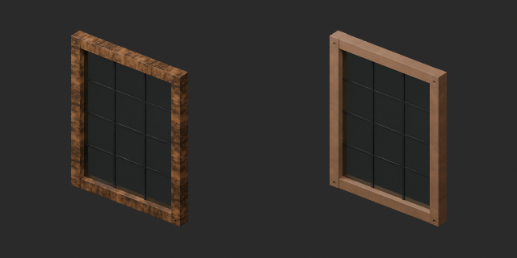

[拡大 / Full image](https://raw.githubusercontent.com/k3peta/tales-on-a-table/main/previews/quality-ft041-050-v1/FT_042__repair_comparison.png)

left: original base; right: accepted variant; same overview camera

## FT_043__repair — 木製の柱と横梁

revision · [ZIP · BLEND/GLB](https://raw.githubusercontent.com/k3peta/tales-on-a-table/main/distributions/quality-ft041-050-v1/FT_043__repair_CC0.zip)

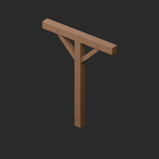

[拡大 / Full image](https://raw.githubusercontent.com/k3peta/tales-on-a-table/main/previews/quality-ft041-050-v1/FT_043__repair_thumb.png)

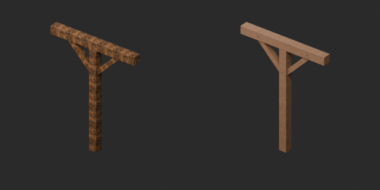

[拡大 / Full image](https://raw.githubusercontent.com/k3peta/tales-on-a-table/main/previews/quality-ft041-050-v1/FT_043__repair_comparison.png)

left: original base; right: accepted variant; same overview camera

## FT_044__color — 二つの実開口を持つ漆喰の壁

material_variant · [ZIP · BLEND/GLB](https://raw.githubusercontent.com/k3peta/tales-on-a-table/main/distributions/quality-ft041-050-v1/FT_044__color_CC0.zip)

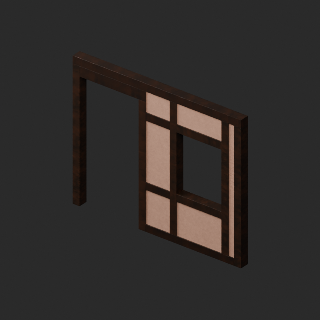

[拡大 / Full image](https://raw.githubusercontent.com/k3peta/tales-on-a-table/main/previews/quality-ft041-050-v1/FT_044__color_thumb.png)

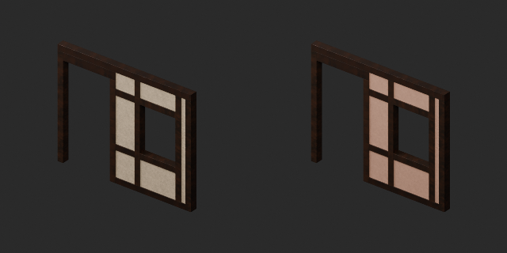

[拡大 / Full image](https://raw.githubusercontent.com/k3peta/tales-on-a-table/main/previews/quality-ft041-050-v1/FT_044__color_comparison.png)

left: original base; right: accepted variant; same overview camera

## FT_045__repair — 板張りの床モジュール

revision · [ZIP · BLEND/GLB](https://raw.githubusercontent.com/k3peta/tales-on-a-table/main/distributions/quality-ft041-050-v1/FT_045__repair_CC0.zip)

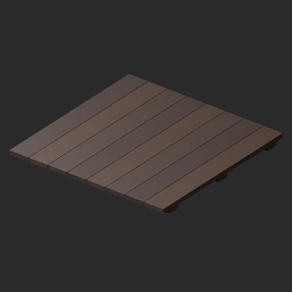

[拡大 / Full image](https://raw.githubusercontent.com/k3peta/tales-on-a-table/main/previews/quality-ft041-050-v1/FT_045__repair_thumb.png)

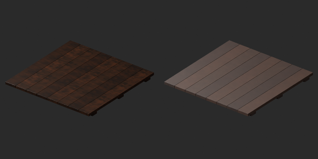

[拡大 / Full image](https://raw.githubusercontent.com/k3peta/tales-on-a-table/main/previews/quality-ft041-050-v1/FT_045__repair_comparison.png)

left: original base; right: accepted variant; same overview camera

## FT_046__color — 石敷きの床モジュール

material_variant · [ZIP · BLEND/GLB](https://raw.githubusercontent.com/k3peta/tales-on-a-table/main/distributions/quality-ft041-050-v1/FT_046__color_CC0.zip)

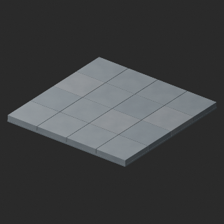

[拡大 / Full image](https://raw.githubusercontent.com/k3peta/tales-on-a-table/main/previews/quality-ft041-050-v1/FT_046__color_thumb.png)

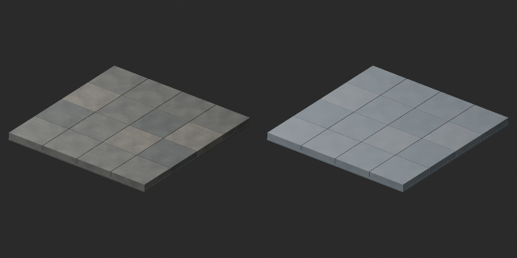

[拡大 / Full image](https://raw.githubusercontent.com/k3peta/tales-on-a-table/main/previews/quality-ft041-050-v1/FT_046__color_comparison.png)

left: original base; right: accepted variant; same overview camera

## FT_047__repair — 七段の木製階段

revision · [ZIP · BLEND/GLB](https://raw.githubusercontent.com/k3peta/tales-on-a-table/main/distributions/quality-ft041-050-v1/FT_047__repair_CC0.zip)

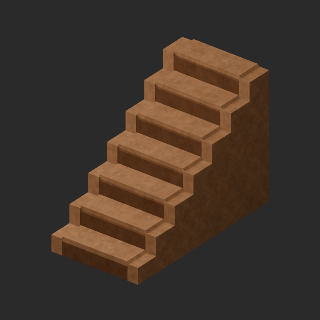

[拡大 / Full image](https://raw.githubusercontent.com/k3peta/tales-on-a-table/main/previews/quality-ft041-050-v1/FT_047__repair_thumb.png)

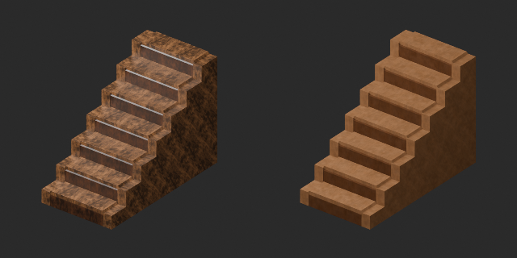

[拡大 / Full image](https://raw.githubusercontent.com/k3peta/tales-on-a-table/main/previews/quality-ft041-050-v1/FT_047__repair_comparison.png)

left: original base; right: accepted variant; same overview camera

## FT_048__repair — 固定式の木製手すり

revision · [ZIP · BLEND/GLB](https://raw.githubusercontent.com/k3peta/tales-on-a-table/main/distributions/quality-ft041-050-v1/FT_048__repair_CC0.zip)

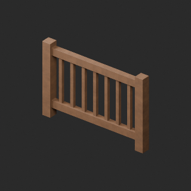

[拡大 / Full image](https://raw.githubusercontent.com/k3peta/tales-on-a-table/main/previews/quality-ft041-050-v1/FT_048__repair_thumb.png)

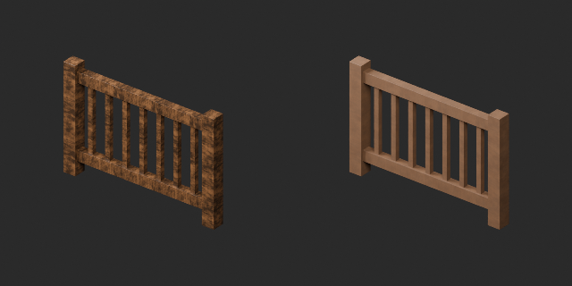

[拡大 / Full image](https://raw.githubusercontent.com/k3peta/tales-on-a-table/main/previews/quality-ft041-050-v1/FT_048__repair_comparison.png)

left: original base; right: accepted variant; same overview camera

## FT_049__used — 織り模様の薄いラグ

material_variant · [ZIP · BLEND/GLB](https://raw.githubusercontent.com/k3peta/tales-on-a-table/main/distributions/quality-ft041-050-v1/FT_049__used_CC0.zip)

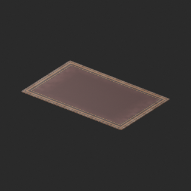

[拡大 / Full image](https://raw.githubusercontent.com/k3peta/tales-on-a-table/main/previews/quality-ft041-050-v1/FT_049__used_thumb.png)

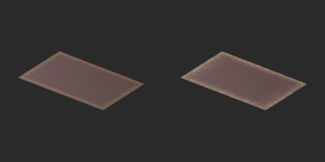

[拡大 / Full image](https://raw.githubusercontent.com/k3peta/tales-on-a-table/main/previews/quality-ft041-050-v1/FT_049__used_comparison.png)

left: original base; right: accepted variant; same overview camera

## FT_049__color — 織り模様の薄いラグ

material_variant · [ZIP · BLEND/GLB](https://raw.githubusercontent.com/k3peta/tales-on-a-table/main/distributions/quality-ft041-050-v1/FT_049__color_CC0.zip)

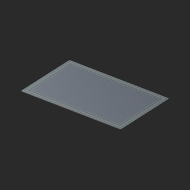

[拡大 / Full image](https://raw.githubusercontent.com/k3peta/tales-on-a-table/main/previews/quality-ft041-050-v1/FT_049__color_thumb.png)

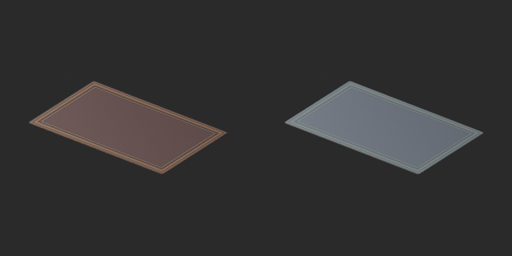

[拡大 / Full image](https://raw.githubusercontent.com/k3peta/tales-on-a-table/main/previews/quality-ft041-050-v1/FT_049__color_comparison.png)

left: original base; right: accepted variant; same overview camera

## FT_050__color — 木枠とリネンの二連衝立

material_variant · [ZIP · BLEND/GLB](https://raw.githubusercontent.com/k3peta/tales-on-a-table/main/distributions/quality-ft041-050-v1/FT_050__color_CC0.zip)

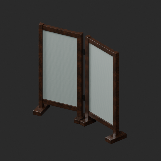

[拡大 / Full image](https://raw.githubusercontent.com/k3peta/tales-on-a-table/main/previews/quality-ft041-050-v1/FT_050__color_thumb.png)

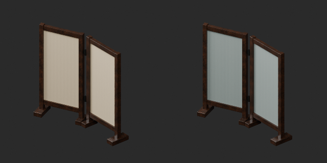

[拡大 / Full image](https://raw.githubusercontent.com/k3peta/tales-on-a-table/main/previews/quality-ft041-050-v1/FT_050__color_comparison.png)

left: original base; right: accepted variant; same overview camera
