# FT051–056 品質改訂と材質variant

**Existing1008 records unchanged; material variants77=74+3. Three revisions are not added as new records.**

査定6件（FT051〜056）。FT057〜060は未登録で査定対象外。改訂3（052材質、053/055形状＋材質）、variant3。053はGLB再読込後に面積1e-12平方m未満の正面積三角形11枚が残存、厳密ゼロ面0。微小面整理完了とはしません。工程計画の出荷停止条件に正面積小面だけの一律停止規定はなく、読込・有限値・材質等の検査報告を踏まえて静的鑑賞向けに限定公開。穴・閉多様体・全曲面同一性は未証明。原本からの双方向頂点距離は053約4.040µm/055約3.607µm、トポロジー変更あり。FT055色variantの基準はFT055__repairであり旧原本同形とは呼びません。小物に約2〜6万tri、低ポリ最適化なし。飲用/鍵の実機能/衛生武具安全/物理衝突/旧版/他engineは未検証。

Six assessed records only; FT057–060 absent. Three revisions and three variants, zero new base shapes. FT053 retains11 positive-area triangles below1e-12 square metres after GLB reimport, zero exact-zero faces; unresolved limitation, not zero-defect certification. The project stop criteria do not reject positive-area tiny faces alone. Topology changed in FT053/055 repairs, original displacement up to4.040/3.607 micrometres. FT055 color variant references the repaired geometry, not original. Manifold/hole/full-surface equivalence, real functions/safety/collision/older Blender/other engines unverified. Static viewing only; high triangle budgets remain.

只査定FT051至056，未登记057至060。修订3、材质变体3，基本数不增。053仍有11个正面积微三角形，零面积0；未解决限制保留。053/055拓扑变更，055颜色以修订模型为准。非零缺陷保证，真实功能安全和旧版兼容未验证。

モデル/埋込材質のみCC0。画像は閲覧用でモデルCC0対象外、[既存画像権利](../LICENSE.md)維持。代码图片私有査定不属模型CC0。

## FT_051__color — 補修された帳簿

material_variant · [ZIP · BLEND/GLB](https://raw.githubusercontent.com/k3peta/tales-on-a-table/main/distributions/quality-ft051-056-v1/FT_051__color_CC0.zip)

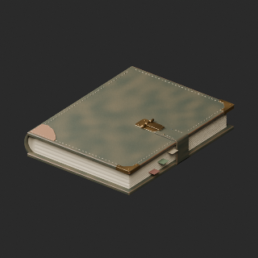

[拡大 / Full image](https://raw.githubusercontent.com/k3peta/tales-on-a-table/main/previews/quality-ft051-056-v1/FT_051__color_thumb.png)

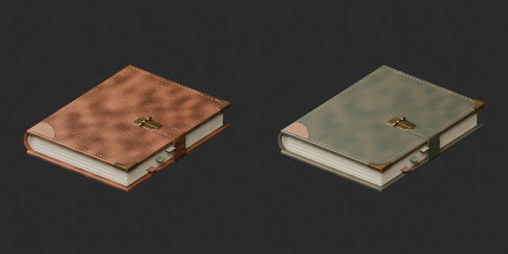

[拡大 / Full image](https://raw.githubusercontent.com/k3peta/tales-on-a-table/main/previews/quality-ft051-056-v1/FT_051__color_comparison.png)

left: original base; right: accepted revision or variant; same overview camera

## FT_052__repair — 修理された木の杯

revision · [ZIP · BLEND/GLB](https://raw.githubusercontent.com/k3peta/tales-on-a-table/main/distributions/quality-ft051-056-v1/FT_052__repair_CC0.zip)

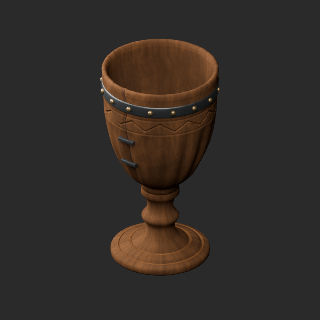

[拡大 / Full image](https://raw.githubusercontent.com/k3peta/tales-on-a-table/main/previews/quality-ft051-056-v1/FT_052__repair_thumb.png)

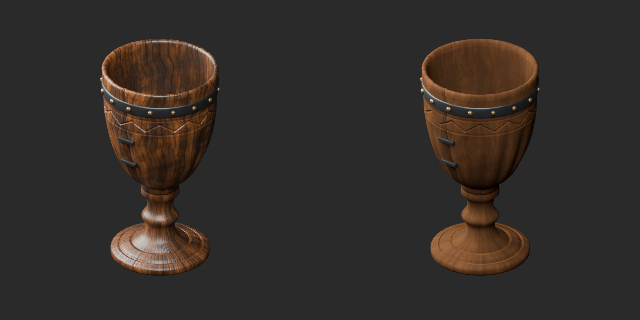

[拡大 / Full image](https://raw.githubusercontent.com/k3peta/tales-on-a-table/main/previews/quality-ft051-056-v1/FT_052__repair_comparison.png)

left: original base; right: accepted revision or variant; same overview camera

## FT_053__repair — 古い鍵と革札の束

revision · [ZIP · BLEND/GLB](https://raw.githubusercontent.com/k3peta/tales-on-a-table/main/distributions/quality-ft051-056-v1/FT_053__repair_CC0.zip)

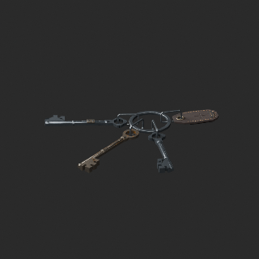

[拡大 / Full image](https://raw.githubusercontent.com/k3peta/tales-on-a-table/main/previews/quality-ft051-056-v1/FT_053__repair_thumb.png)

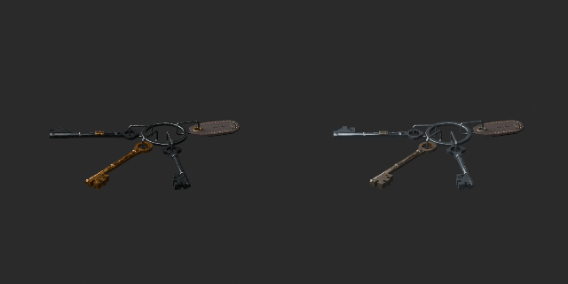

[拡大 / Full image](https://raw.githubusercontent.com/k3peta/tales-on-a-table/main/previews/quality-ft051-056-v1/FT_053__repair_comparison.png)

left: original base; right: accepted revision or variant; same overview camera

## FT_054__color — 修繕道具の巻き物

material_variant · [ZIP · BLEND/GLB](https://raw.githubusercontent.com/k3peta/tales-on-a-table/main/distributions/quality-ft051-056-v1/FT_054__color_CC0.zip)

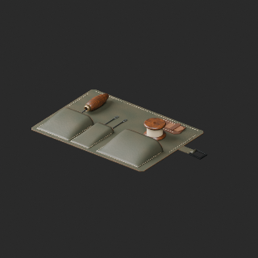

[拡大 / Full image](https://raw.githubusercontent.com/k3peta/tales-on-a-table/main/previews/quality-ft051-056-v1/FT_054__color_thumb.png)

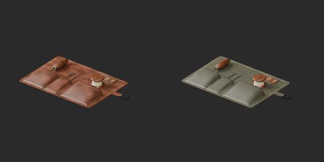

[拡大 / Full image](https://raw.githubusercontent.com/k3peta/tales-on-a-table/main/previews/quality-ft051-056-v1/FT_054__color_comparison.png)

left: original base; right: accepted revision or variant; same overview camera

## FT_055__repair — 貸出用の小盾

revision · [ZIP · BLEND/GLB](https://raw.githubusercontent.com/k3peta/tales-on-a-table/main/distributions/quality-ft051-056-v1/FT_055__repair_CC0.zip)

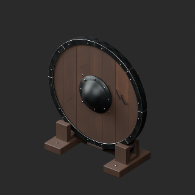

[拡大 / Full image](https://raw.githubusercontent.com/k3peta/tales-on-a-table/main/previews/quality-ft051-056-v1/FT_055__repair_thumb.png)

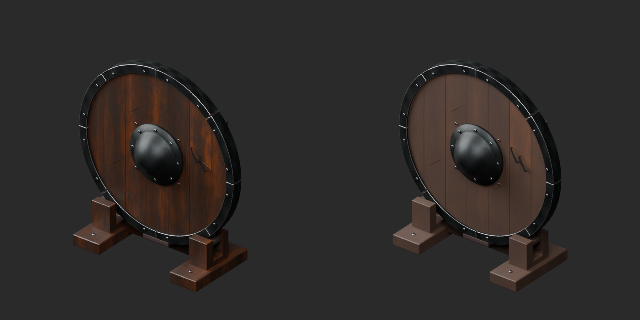

[拡大 / Full image](https://raw.githubusercontent.com/k3peta/tales-on-a-table/main/previews/quality-ft051-056-v1/FT_055__repair_comparison.png)

left: original base; right: accepted revision or variant; same overview camera

## FT_055__color — 貸出用の小盾

material_variant · [ZIP · BLEND/GLB](https://raw.githubusercontent.com/k3peta/tales-on-a-table/main/distributions/quality-ft051-056-v1/FT_055__color_CC0.zip)

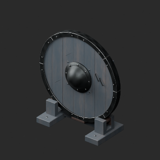

[拡大 / Full image](https://raw.githubusercontent.com/k3peta/tales-on-a-table/main/previews/quality-ft051-056-v1/FT_055__color_thumb.png)

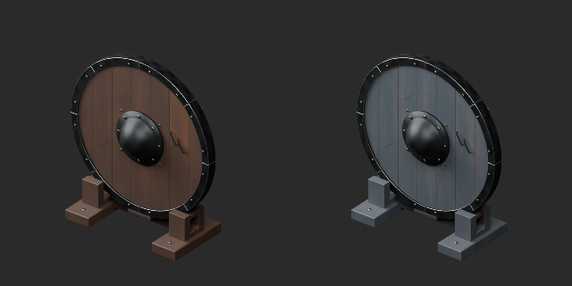

[拡大 / Full image](https://raw.githubusercontent.com/k3peta/tales-on-a-table/main/previews/quality-ft051-056-v1/FT_055__color_comparison.png)

left: repaired FT055 base; right: same-geometry color variant
