# Quality35 / 品質第35便 / 质量第35批

Base1008 unchanged; material variants137=136+1 counted separately. Seven revisions add no model. Original versions retained.

Exact-zero triangles removed: IF003320, IF004320, IF005344, IF006192, TD00296, TD00341, TD00620. All positive surfaces retained; positive tiny triangles retained. Missing UV added where recorded, including TD0026 layers, TD00383, TD0063. Orange ceramic variant uses repaired IF004 geometry/UV, retaining glass and flame. IF006 replaces broad striped walnut with lower-contrast analytic grain and reduces existing normal strength0.45 to0.08; fine regularity remains. This is a material revision, not another color variant.

改訂7件は非加算。橙陶器variant1はIF004修復後基準。IF006木目の抑制は材質改訂で、細い規則性は残ります。元UV完全不変・軽量化完了とは扱いません。

7个修订不新增模型。橙色陶瓷变体以修复后的IF004为基准。IF006木纹材质已调整，细小规律纹理仍存在；不宣称原UV完全不变或轻量化完成。

Same camera/light/scale comparisons. Producer final-ZIP guard binds accepted packages, input/script/model hashes and run/time/build. Public artifact matching is pending. Publication did not rerun Blender.

Assessed346 distribution records,662 remain;70 budget/redesign issues unresolved. TD001547056tri and TD0044652604tri require dedicated redesign/baking; no automatic decimation or color-only repair claim. IF00322120, IF00422956, IF00524100, TD003131673 and TD00633952tri remain over20k. Earlier CP023 handle and attachment diagnoses remain. No collision, gameplay, load, rig/animation, functional lighting/safety or Blender4.3.2 guarantee. Glass shading is engine-dependent.

Models/embedded materials only CC0; images separate catalogue artwork. [License](../LICENSE.md). Private reports/code excluded.

## IF_003__repair — Small brass chimney oil lamp

小型・持ち手付きホヤ油灯

Exact-zero-area cleanup, all positive surfaces retained; missing UV added where recorded. IF006 also replaces excessive striped wood basecolor and lowers existing normal strength to0.08. No new base.

[ZIP · BLEND/GLB](https://raw.githubusercontent.com/k3peta/tales-on-a-table/main/distributions/quality-if003-td006-v1/IF_003__repair_CC0.zip)

[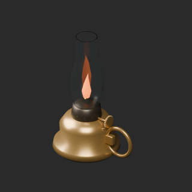](../previews/quality-if003-td006-v1/IF_003__repair_thumb.png)

[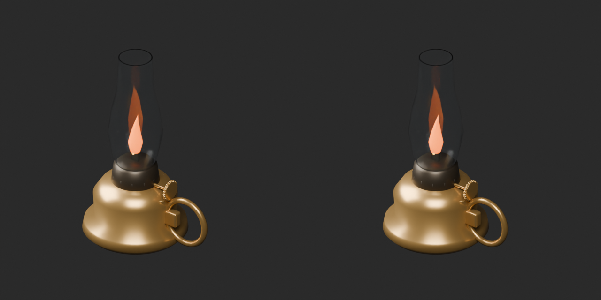](../previews/quality-if003-td006-v1/IF_003__repair_overview_comparison.png)

[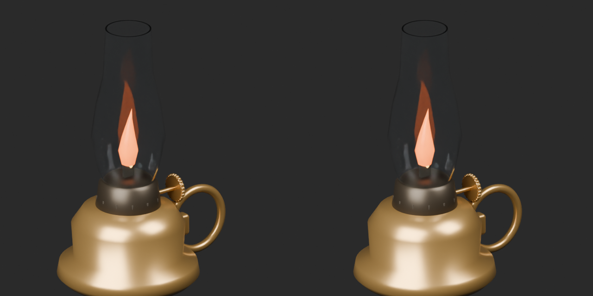](../previews/quality-if003-td006-v1/IF_003__repair_close_comparison.png)

Left: original; right: accepted revision/variant, identical camera/light/scale.

## IF_004__repair — Medium ceramic chimney oil lamp

中型・陶製油壺のホヤ油灯

Exact-zero-area cleanup, all positive surfaces retained; missing UV added where recorded. IF006 also replaces excessive striped wood basecolor and lowers existing normal strength to0.08. No new base.

[ZIP · BLEND/GLB](https://raw.githubusercontent.com/k3peta/tales-on-a-table/main/distributions/quality-if003-td006-v1/IF_004__repair_CC0.zip)

[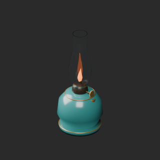](../previews/quality-if003-td006-v1/IF_004__repair_thumb.png)

[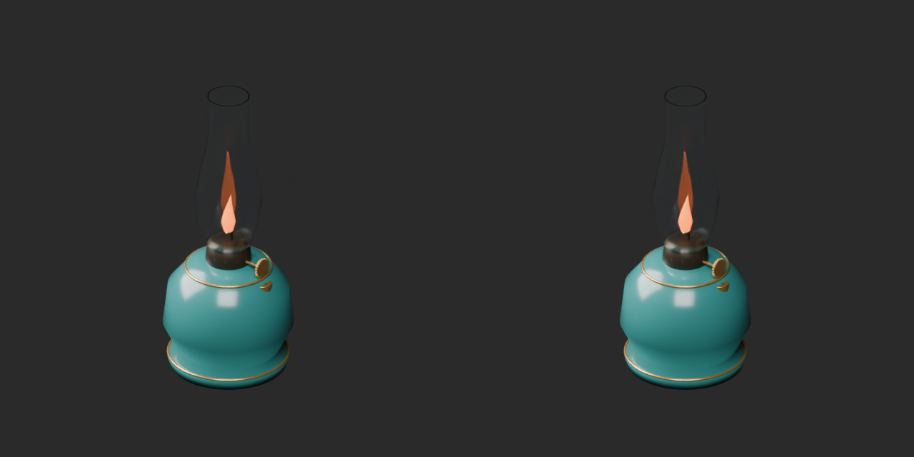](../previews/quality-if003-td006-v1/IF_004__repair_overview_comparison.png)

[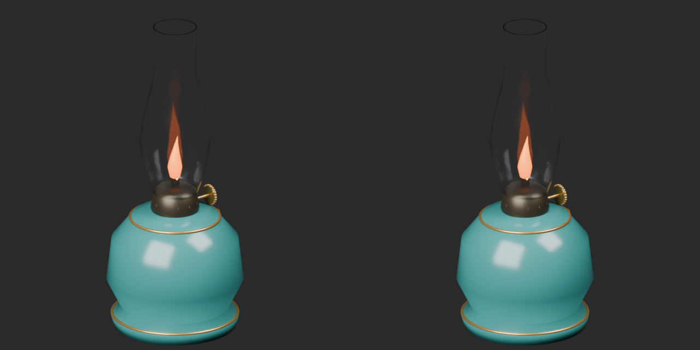](../previews/quality-if003-td006-v1/IF_004__repair_close_comparison.png)

Left: original; right: accepted revision/variant, identical camera/light/scale.

## IF_004__orange_ceramic — Medium ceramic chimney oil lamp

中型・陶製油壺のホヤ油灯

Orange ceramic basecolor on IF004 cleaned geometry/UV baseline. Glass and flame unchanged.

[ZIP · BLEND/GLB](https://raw.githubusercontent.com/k3peta/tales-on-a-table/main/distributions/quality-if003-td006-v1/IF_004__orange_ceramic_CC0.zip)

[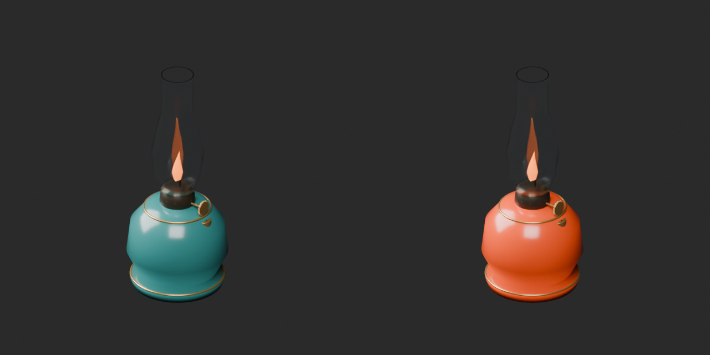](../previews/quality-if003-td006-v1/IF_004__orange_ceramic_overview_comparison.png)

[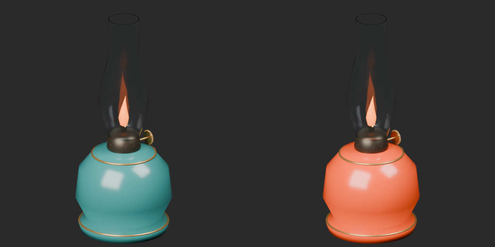](../previews/quality-if003-td006-v1/IF_004__orange_ceramic_close_comparison.png)

Left: original; right: accepted revision/variant, identical camera/light/scale.

## IF_005__repair — Large pedestal chimney oil lamp

大型・脚付き真鍮ホヤ油灯

Exact-zero-area cleanup, all positive surfaces retained; missing UV added where recorded. IF006 also replaces excessive striped wood basecolor and lowers existing normal strength to0.08. No new base.

[ZIP · BLEND/GLB](https://raw.githubusercontent.com/k3peta/tales-on-a-table/main/distributions/quality-if003-td006-v1/IF_005__repair_CC0.zip)

[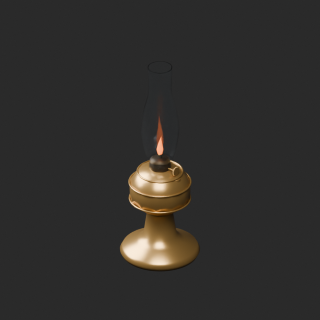](../previews/quality-if003-td006-v1/IF_005__repair_thumb.png)

[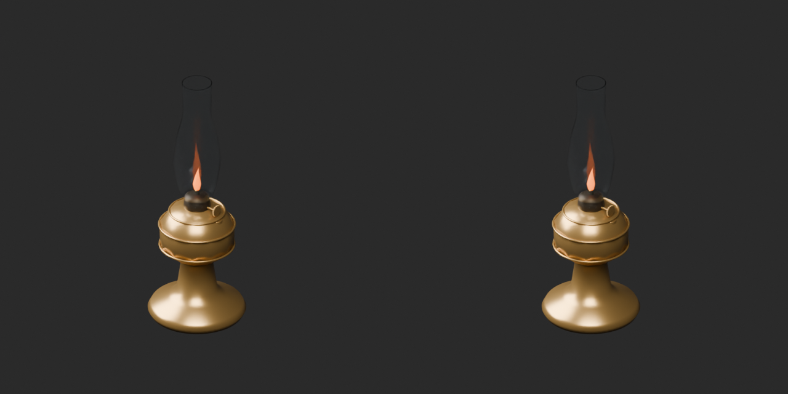](../previews/quality-if003-td006-v1/IF_005__repair_overview_comparison.png)

[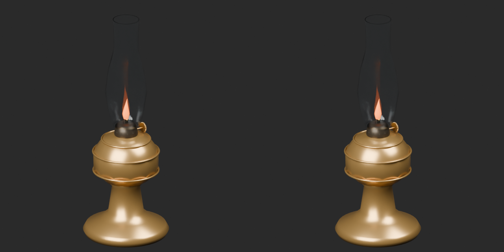](../previews/quality-if003-td006-v1/IF_005__repair_close_comparison.png)

Left: original; right: accepted revision/variant, identical camera/light/scale.

## IF_006__repair — Six-drawer document side chest

6段の書類用サイドチェスト

Exact-zero-area cleanup, all positive surfaces retained; missing UV added where recorded. IF006 also replaces excessive striped wood basecolor and lowers existing normal strength to0.08. No new base.

[ZIP · BLEND/GLB](https://raw.githubusercontent.com/k3peta/tales-on-a-table/main/distributions/quality-if003-td006-v1/IF_006__repair_CC0.zip)

[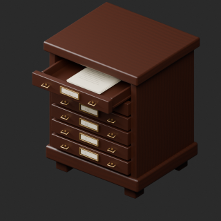](../previews/quality-if003-td006-v1/IF_006__repair_thumb.png)

[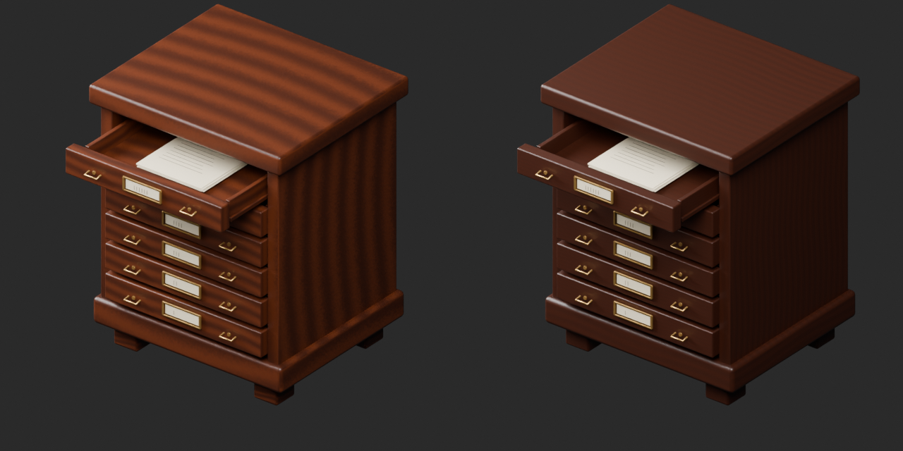](../previews/quality-if003-td006-v1/IF_006__repair_overview_comparison.png)

[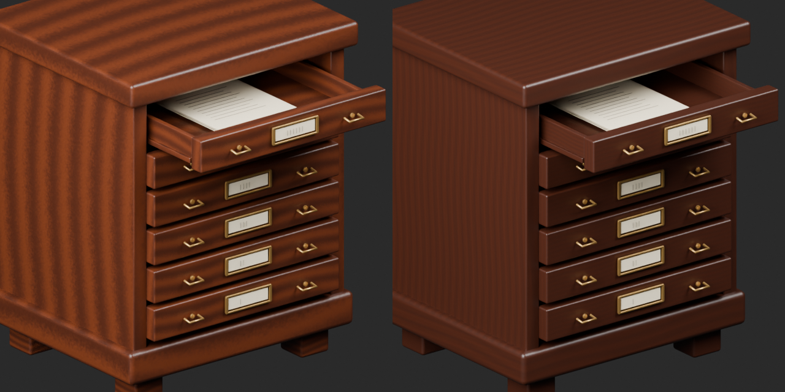](../previews/quality-if003-td006-v1/IF_006__repair_close_comparison.png)

Left: original; right: accepted revision/variant, identical camera/light/scale.

## TD_002__repair — Moonlight longsword

月光の長剣

Exact-zero-area cleanup, all positive surfaces retained; missing UV added where recorded. IF006 also replaces excessive striped wood basecolor and lowers existing normal strength to0.08. No new base.

[ZIP · BLEND/GLB](https://raw.githubusercontent.com/k3peta/tales-on-a-table/main/distributions/quality-if003-td006-v1/TD_002__repair_CC0.zip)

[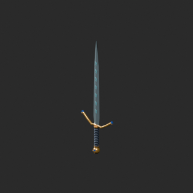](../previews/quality-if003-td006-v1/TD_002__repair_thumb.png)

[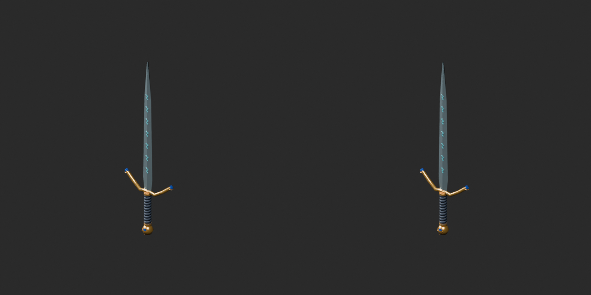](../previews/quality-if003-td006-v1/TD_002__repair_overview_comparison.png)

[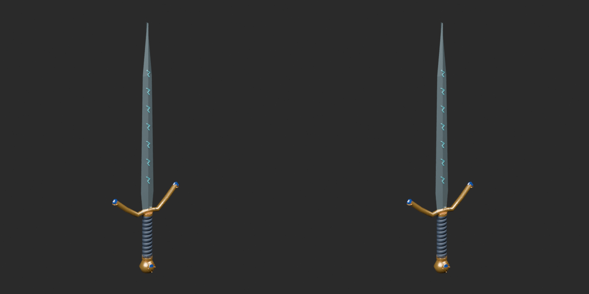](../previews/quality-if003-td006-v1/TD_002__repair_close_comparison.png)

Left: original; right: accepted revision/variant, identical camera/light/scale.

## TD_003__repair — Dragon-headed ceremonial dagger

竜頭の儀礼短剣

Exact-zero-area cleanup, all positive surfaces retained; missing UV added where recorded. IF006 also replaces excessive striped wood basecolor and lowers existing normal strength to0.08. No new base.

[ZIP · BLEND/GLB](https://raw.githubusercontent.com/k3peta/tales-on-a-table/main/distributions/quality-if003-td006-v1/TD_003__repair_CC0.zip)

[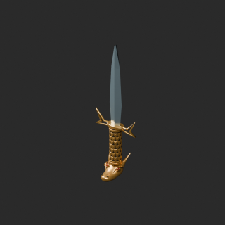](../previews/quality-if003-td006-v1/TD_003__repair_thumb.png)

[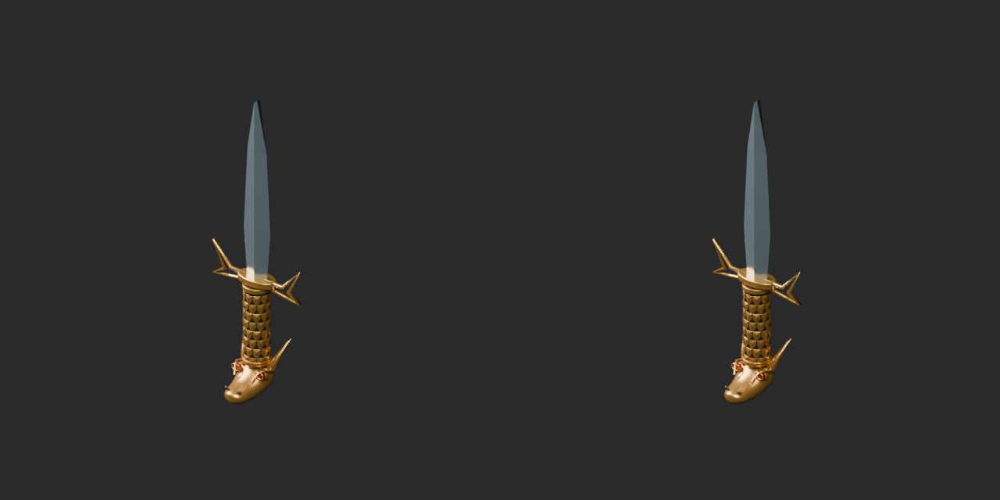](../previews/quality-if003-td006-v1/TD_003__repair_overview_comparison.png)

[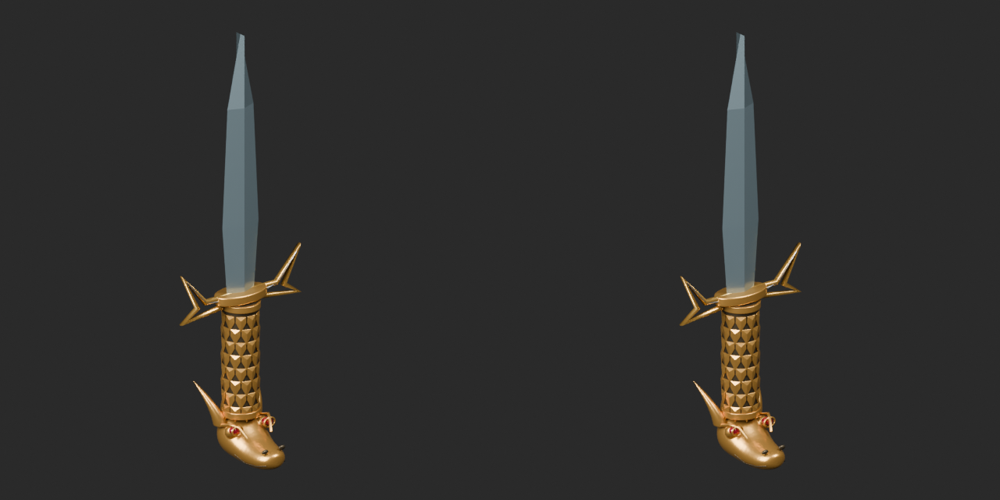](../previews/quality-if003-td006-v1/TD_003__repair_close_comparison.png)

Left: original; right: accepted revision/variant, identical camera/light/scale.

## TD_006__repair — Wax-sealed secret scroll

封蝋と金帯の秘伝巻物

Exact-zero-area cleanup, all positive surfaces retained; missing UV added where recorded. IF006 also replaces excessive striped wood basecolor and lowers existing normal strength to0.08. No new base.

[ZIP · BLEND/GLB](https://raw.githubusercontent.com/k3peta/tales-on-a-table/main/distributions/quality-if003-td006-v1/TD_006__repair_CC0.zip)

[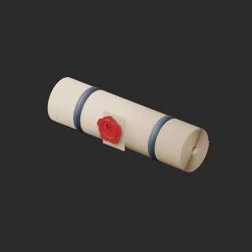](../previews/quality-if003-td006-v1/TD_006__repair_thumb.png)

[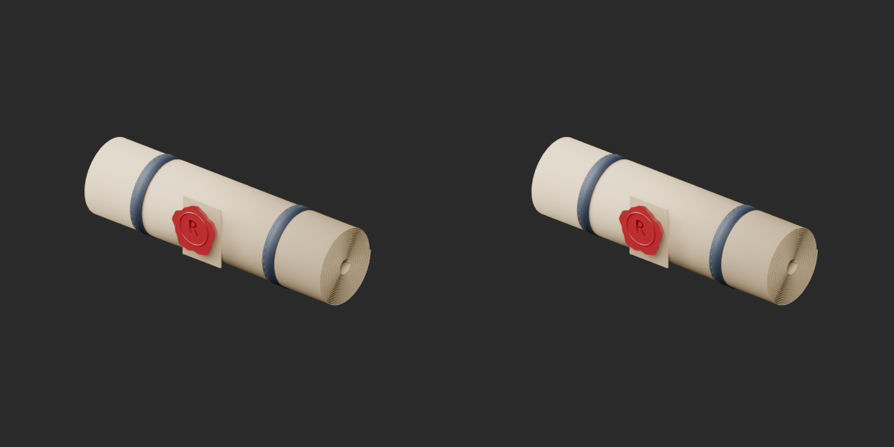](../previews/quality-if003-td006-v1/TD_006__repair_overview_comparison.png)

[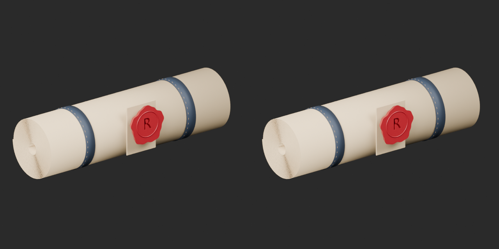](../previews/quality-if003-td006-v1/TD_006__repair_close_comparison.png)

Left: original; right: accepted revision/variant, identical camera/light/scale.
