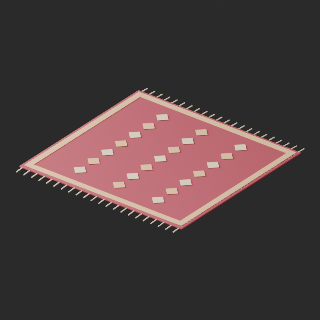
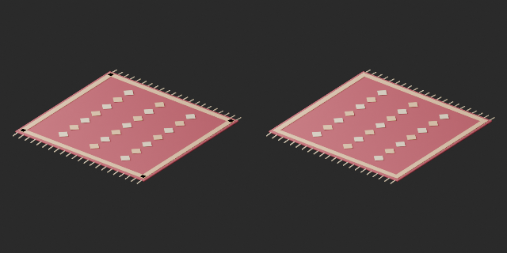
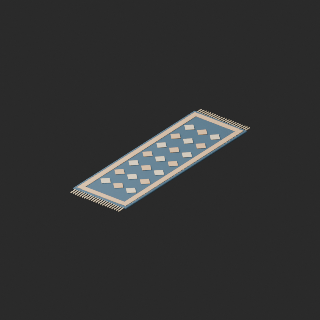
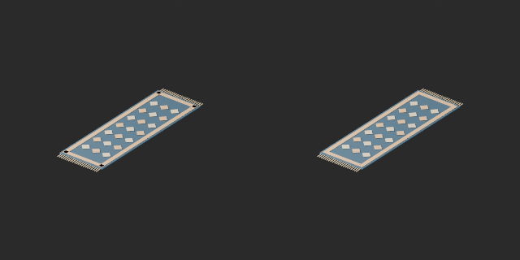
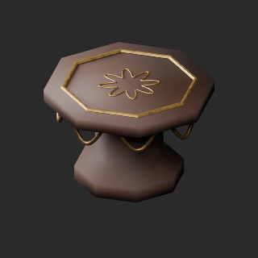
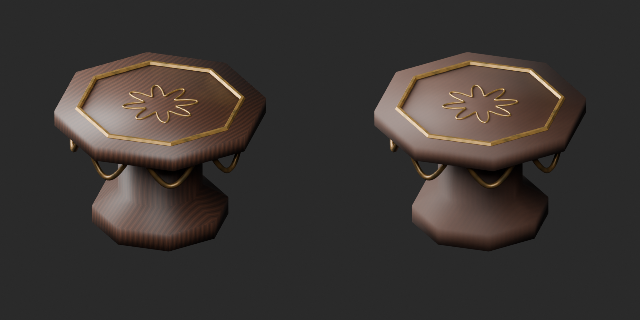

# OL005–014 品質改訂とvariant / Revisions and variants / 修订与变体

**Existing 1008 records unchanged; 96 material variants = 92 + 4, counted separately. Three revisions are not new records.**

10元配布記録査定、累積126/1008、未査定882。独立形状総数や全欠陥修復数ではありません。改訂3=絨毯OL005/011形状修整2＋OL013机の材質改訂1。新基本0。絨毯の四隅で同じ高さの縦横縁が重なり黒矩形が出るため、横縁2objectの端を縦縁内側まで切り詰めました。高さをずらして隠す処置ではありません。原本と修整版は異なる形状で、旧版保持。

OL005緑/OL011赤茶variantは修整後border_trim_v1を基準に幾何・原UV保持。その比較画像の左は修整版、改訂の比較画像の左は旧原本です。OL012銀金属とOL014緑/赤茶巻絨毯は元形状基準、宝石や紐は保持。採用variant4/棄却0。WearUV追加。机木目はコントラスト低減でUV継ぎ目完全除去ではありません。

Ten original records assessed, cumulative126/1008,882 unassessed; not unique shapes or fully repaired records. Three revisions: two rug geometry fixes OL005/011 and one material revision OL013. Transverse border ends on two objects trimmed to longitudinal inner edges to remove coplanar corner overlap; not hidden by height offsets. Original and repaired geometry differ, old versions preserved. Green OL005 and red-brown OL011 variants retain repaired border_trim_v1 geometry/UV; their comparison left is repaired base. Revision comparison left is old original. OL012 silver metal and OL014 rolled-rug colors retain original geometry, gems/ties unchanged. Four variants, zero new bases; WearUV added. Wood seams not fully removed.

査定10条，累计126条、未査定882条。修订3不加新数；两种地毯修整前后形状不同，颜色变体以修整后border_trim_v1为基准。原版保留。其余颜色基于原形状。

OL00638908/OL00747500triは小物予算超過で未改修。既存予算超過・軽量化棄却と残件JSONを保持。全非多様体/衝突/実歩行/耐荷重/燃焼/可動/他engine透過発光/Blender4.3.2互換未検証。静的鑑賞用。

OL00638908/OL00747500 triangle budget issues remain open. Existing residual issues and rejected lightweight work retained. Full manifold/collision/walking/load/fire/motion/other-engine transparency/emission/Blender4.3.2 untested. Static viewing only.

モデル/埋込材質のみCC0。画像は閲覧用でモデルCC0対象外、[既存画像権利](../LICENSE.md)維持。代码图片私有査定不属模型CC0。

## OL_005__repair — 深紅のメダリオン絨毯

revision · [ZIP · BLEND/GLB](https://raw.githubusercontent.com/k3peta/tales-on-a-table/main/distributions/quality-ol005-014-v1/OL_005__repair_CC0.zip)

[拡大 / Full image](https://raw.githubusercontent.com/k3peta/tales-on-a-table/main/previews/quality-ol005-014-v1/OL_005__repair_thumb.png)

[拡大 / Full image](https://raw.githubusercontent.com/k3peta/tales-on-a-table/main/previews/quality-ol005-014-v1/OL_005__repair_comparison.png)

left: original; right: accepted revision or variant; same camera

## OL_005__color — 深紅のメダリオン絨毯

material_variant · [ZIP · BLEND/GLB](https://raw.githubusercontent.com/k3peta/tales-on-a-table/main/distributions/quality-ol005-014-v1/OL_005__color_CC0.zip)

[拡大 / Full image](https://raw.githubusercontent.com/k3peta/tales-on-a-table/main/previews/quality-ol005-014-v1/OL_005__color_thumb.png)

[拡大 / Full image](https://raw.githubusercontent.com/k3peta/tales-on-a-table/main/previews/quality-ol005-014-v1/OL_005__color_comparison.png)

left: border_trim_v1 repaired base; right: same-shape color variant

## OL_011__repair — 藍色の細長い敷物

revision · [ZIP · BLEND/GLB](https://raw.githubusercontent.com/k3peta/tales-on-a-table/main/distributions/quality-ol005-014-v1/OL_011__repair_CC0.zip)

[拡大 / Full image](https://raw.githubusercontent.com/k3peta/tales-on-a-table/main/previews/quality-ol005-014-v1/OL_011__repair_thumb.png)

[拡大 / Full image](https://raw.githubusercontent.com/k3peta/tales-on-a-table/main/previews/quality-ol005-014-v1/OL_011__repair_comparison.png)

left: original; right: accepted revision or variant; same camera

## OL_011__color — 藍色の細長い敷物

material_variant · [ZIP · BLEND/GLB](https://raw.githubusercontent.com/k3peta/tales-on-a-table/main/distributions/quality-ol005-014-v1/OL_011__color_CC0.zip)

[拡大 / Full image](https://raw.githubusercontent.com/k3peta/tales-on-a-table/main/previews/quality-ol005-014-v1/OL_011__color_thumb.png)

[拡大 / Full image](https://raw.githubusercontent.com/k3peta/tales-on-a-table/main/previews/quality-ol005-014-v1/OL_011__color_comparison.png)

left: border_trim_v1 repaired base; right: same-shape color variant

## OL_012__color — 宝飾品の展示トレイ

material_variant · [ZIP · BLEND/GLB](https://raw.githubusercontent.com/k3peta/tales-on-a-table/main/distributions/quality-ol005-014-v1/OL_012__color_CC0.zip)

[拡大 / Full image](https://raw.githubusercontent.com/k3peta/tales-on-a-table/main/previews/quality-ol005-014-v1/OL_012__color_thumb.png)

[拡大 / Full image](https://raw.githubusercontent.com/k3peta/tales-on-a-table/main/previews/quality-ol005-014-v1/OL_012__color_comparison.png)

left: original; right: accepted revision or variant; same camera

## OL_013__repair — 八角形のサイドテーブル

revision · [ZIP · BLEND/GLB](https://raw.githubusercontent.com/k3peta/tales-on-a-table/main/distributions/quality-ol005-014-v1/OL_013__repair_CC0.zip)

[拡大 / Full image](https://raw.githubusercontent.com/k3peta/tales-on-a-table/main/previews/quality-ol005-014-v1/OL_013__repair_thumb.png)

[拡大 / Full image](https://raw.githubusercontent.com/k3peta/tales-on-a-table/main/previews/quality-ol005-014-v1/OL_013__repair_comparison.png)

left: original; right: accepted revision or variant; same camera

## OL_014__color — 巻いた絨毯3本

material_variant · [ZIP · BLEND/GLB](https://raw.githubusercontent.com/k3peta/tales-on-a-table/main/distributions/quality-ol005-014-v1/OL_014__color_CC0.zip)

[拡大 / Full image](https://raw.githubusercontent.com/k3peta/tales-on-a-table/main/previews/quality-ol005-014-v1/OL_014__color_thumb.png)

[拡大 / Full image](https://raw.githubusercontent.com/k3peta/tales-on-a-table/main/previews/quality-ol005-014-v1/OL_014__color_comparison.png)

left: original; right: accepted revision or variant; same camera
