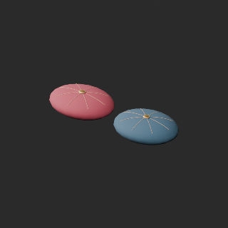
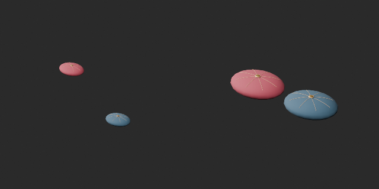
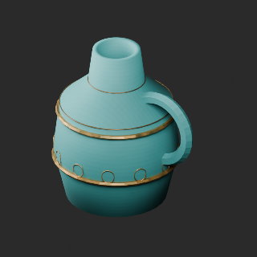
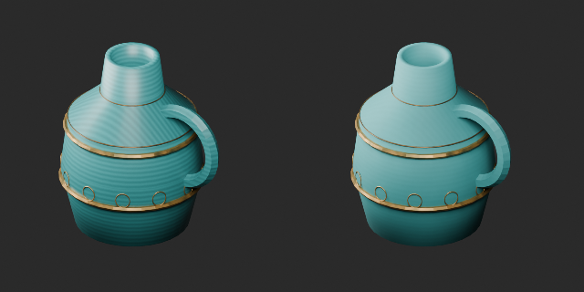
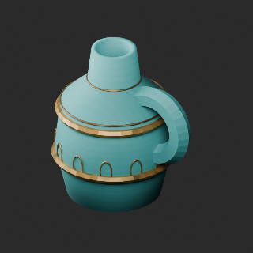
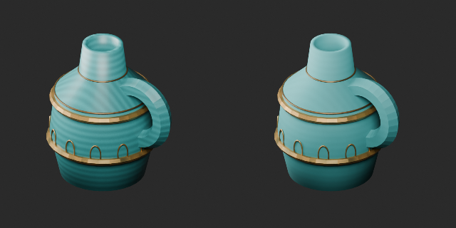

# OL015–024 品質改訂とvariant / Revisions and variant / 修订与变体

**Existing 1008 records unchanged; 97 material variants = 96 + 1, counted separately. Three revisions are not new records.**

元配布記録10件査定、累積136/1008、未査定872。独立形状総数や全欠陥修復数ではありません。改訂3=OL019クッション配置1＋OL023水差し/024飾り壺材質2、新基本0。OL019は各クッション群を剛体平行移動で間隔12cmへ集約したcompact_pair_v1。個別の造形/UV/トポロジーとZ接地は保持、世界座標配置は旧版と異なります。旧配置は旧版を利用できます。配置比較は各boundsにカメラを合わせており同縮尺ではありません。

OL019緑/赤茶variant1は配置改訂後compact_pair_v1基準で幾何/UV保持、金ボタンと糸は保持。variant比較の左は配置改訂版です。OL023/024は反復釉薬のコントラスト軽減、青緑/金帯/元形状は保持。波模様全除去ではありません。WearUV追加、旧版保持、棄却0。

Ten original records assessed, cumulative136/1008,872 unassessed; not unique shapes or fully repaired records. Three revisions: compact cushion arrangement OL019 plus material revisions OL023/024. Cushion groups rigidly translated to12cm gap, preserving individual meshes/UV/topology and ground contact. World-space arrangement differs from original. Before/after arrangement cameras fit their own bounds, not the same scale. Green/red-brown OL019 variant retains revised compact_pair_v1 geometry/UV; comparison left is revised base. Jug/vase glaze contrast reduced, original teal/gold/geometry retained; not complete pattern removal. WearUV added, old versions preserved, zero new bases.

査定10条，累计136条、未査定872条。配置修订1与材质修订2不加新数。抱枕仅平移，单体形状不变；颜色变体以修订配置为基准。前后配置图不是同一比例。

OL001〜024の三角形hash比較は一致候補なしでも独立形状の証明ではありません。ランタンOL015/016/017/018/022は約31〜47k三角形、予算超過未改修を残件として保持。過去軽量化棄却も保持。全非多様体/衝突/耐荷重/燃焼/可動/実歩行/実機性能/他engine/Blender4.3.2未検証。静的鑑賞用。

Family geometry hashes found no exact matches in OL001–024; this does not prove independent shapes. Lanterns OL015/016/017/018/022 remain31–47k triangles over budget. Previous rejected lightweight work and residuals preserved. Full manifold/collision/load/fire/motion/walking/game performance/other engines/Blender4.3.2 untested.

モデル/埋込材質のみCC0。画像は閲覧用でモデルCC0対象外、[既存画像権利](../LICENSE.md)維持。代码图片私有査定不属模型CC0。

## OL_019__repair — 絹のクッション一式

revision · [ZIP · BLEND/GLB](https://raw.githubusercontent.com/k3peta/tales-on-a-table/main/distributions/quality-ol015-024-v1/OL_019__repair_CC0.zip)

[拡大 / Full image](https://raw.githubusercontent.com/k3peta/tales-on-a-table/main/previews/quality-ol015-024-v1/OL_019__repair_thumb.png)

[拡大 / Full image](https://raw.githubusercontent.com/k3peta/tales-on-a-table/main/previews/quality-ol015-024-v1/OL_019__repair_comparison.png)

left: original; right: accepted revision; camera fitted separately to bounds

## OL_019__color — 絹のクッション一式

material_variant · [ZIP · BLEND/GLB](https://raw.githubusercontent.com/k3peta/tales-on-a-table/main/distributions/quality-ol015-024-v1/OL_019__color_CC0.zip)

[拡大 / Full image](https://raw.githubusercontent.com/k3peta/tales-on-a-table/main/previews/quality-ol015-024-v1/OL_019__color_thumb.png)

[拡大 / Full image](https://raw.githubusercontent.com/k3peta/tales-on-a-table/main/previews/quality-ol015-024-v1/OL_019__color_comparison.png)

left: compact_pair_v1 repaired layout; right: same-layout color variant

## OL_023__repair — 床置きの青緑色水差し

revision · [ZIP · BLEND/GLB](https://raw.githubusercontent.com/k3peta/tales-on-a-table/main/distributions/quality-ol015-024-v1/OL_023__repair_CC0.zip)

[拡大 / Full image](https://raw.githubusercontent.com/k3peta/tales-on-a-table/main/previews/quality-ol015-024-v1/OL_023__repair_thumb.png)

[拡大 / Full image](https://raw.githubusercontent.com/k3peta/tales-on-a-table/main/previews/quality-ol015-024-v1/OL_023__repair_comparison.png)

left: original; right: accepted revision; camera fitted separately to bounds

## OL_024__repair — 青緑色の飾り壺

revision · [ZIP · BLEND/GLB](https://raw.githubusercontent.com/k3peta/tales-on-a-table/main/distributions/quality-ol015-024-v1/OL_024__repair_CC0.zip)

[拡大 / Full image](https://raw.githubusercontent.com/k3peta/tales-on-a-table/main/previews/quality-ol015-024-v1/OL_024__repair_thumb.png)

[拡大 / Full image](https://raw.githubusercontent.com/k3peta/tales-on-a-table/main/previews/quality-ol015-024-v1/OL_024__repair_comparison.png)

left: original; right: accepted revision; camera fitted separately to bounds
