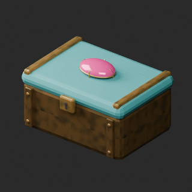
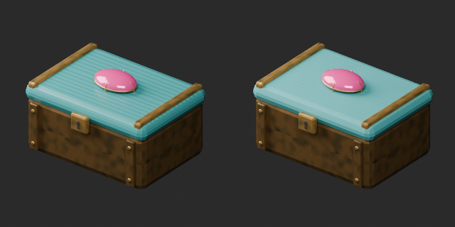
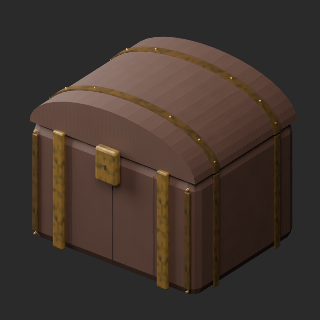
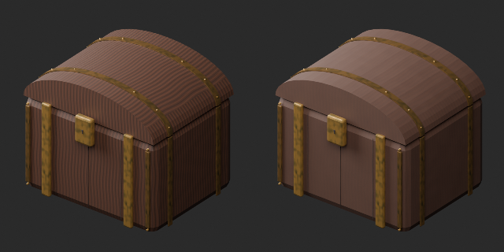

# OL025–034 材質改訂とvariant / Material revisions and variants / 材质修订与变体

**Existing 1008 records unchanged; 99 material variants = 97 + 2, counted separately. Two revisions are not new records.**

元配布記録10件査定、累積146/1008、未査定862。独立形状総数や全欠陥修復数ではありません。材質改訂2=OL033宝石箱の陶器蓋/OL034商人の櫃の周期模様低減。金帯/錠前/宝石は保持、UV継ぎ目自体の完全除去ではありません。同形variant2=OL028扁球形ランプの金属枠だけ銅色、OL029装飾用水煙草器の上部陶器だけ赤茶色。ガラス/発光/鎖/ホース等は保持。OL034使用感1候補は差不足で棄却。新基本/形状改訂0、原形状/原UV/寸法/原点保持、WearUV追加、旧版保持。

Ten original records assessed, cumulative146/1008,862 unassessed; not unique shapes or fully repaired records. Two material revisions reduce repetitive patterns on OL033 lid and OL034 chest, retaining gems/metal/lock. Two same-geometry variants: copper frame OL028 lamp and red-brown upper ceramic OL029 decorative hookah. Glass/emission/dark chain/hose unchanged. One weak wear candidate rejected. Original geometry/UV/dimensions/origin retained with WearUV added, zero new bases or geometry revisions. UV seams not fully removed; earlier versions preserved.

査定10条、累计146条、未査定862条。材质修订2不加新数，变体2单独统计。玻璃和发光不变，原形状UV保留，弱差异候选1棄却。

OL025/026/027/028/030/031/032灯具7件は約39〜48k三角形で小物20k予算超過、未修復残件として保持。OL028今回色variantも軽量化ではありません。類似品を独立種類と推定加算しません。過去軽量化棄却も維持。全非多様体/衝突/可動/吸引/燃焼/安全/実歩行/実機性能/他engine/Blender4.3.2未検証。静的鑑賞用。

Seven lamps OL025/026/027/028/030/031/032 remain about39–48k triangles over20k small-prop budget. OL028 color variant is not a lightweight model. Similar products not assumed independent shapes. Prior failed lightweight work retained. Full manifold/collision/motion/suction/fire/safety/walking/game performance/other engines/Blender4.3.2 untested; static viewing only.

モデル/埋込材質のみCC0。画像は閲覧用でモデルCC0対象外、[既存画像権利](../LICENSE.md)維持。代码图片私有査定不属模型CC0。

## OL_028__color — 青い扁球形ランプ

material_variant · [ZIP · BLEND/GLB](https://raw.githubusercontent.com/k3peta/tales-on-a-table/main/distributions/quality-ol025-034-v1/OL_028__color_CC0.zip)

[拡大 / Full image](https://raw.githubusercontent.com/k3peta/tales-on-a-table/main/previews/quality-ol025-034-v1/OL_028__color_thumb.png)

[拡大 / Full image](https://raw.githubusercontent.com/k3peta/tales-on-a-table/main/previews/quality-ol025-034-v1/OL_028__color_comparison.png)

left: original base; right: accepted variant; same overview camera

## OL_029__color — 装飾用の水煙草器

material_variant · [ZIP · BLEND/GLB](https://raw.githubusercontent.com/k3peta/tales-on-a-table/main/distributions/quality-ol025-034-v1/OL_029__color_CC0.zip)

[拡大 / Full image](https://raw.githubusercontent.com/k3peta/tales-on-a-table/main/previews/quality-ol025-034-v1/OL_029__color_thumb.png)

[拡大 / Full image](https://raw.githubusercontent.com/k3peta/tales-on-a-table/main/previews/quality-ol025-034-v1/OL_029__color_comparison.png)

left: original base; right: accepted variant; same overview camera

## OL_033__repair — 金装飾の宝石箱

revision · [ZIP · BLEND/GLB](https://raw.githubusercontent.com/k3peta/tales-on-a-table/main/distributions/quality-ol025-034-v1/OL_033__repair_CC0.zip)

[拡大 / Full image](https://raw.githubusercontent.com/k3peta/tales-on-a-table/main/previews/quality-ol025-034-v1/OL_033__repair_thumb.png)

[拡大 / Full image](https://raw.githubusercontent.com/k3peta/tales-on-a-table/main/previews/quality-ol025-034-v1/OL_033__repair_comparison.png)

left: original base; right: accepted variant; same overview camera

## OL_034__repair — 金帯の商人の櫃

revision · [ZIP · BLEND/GLB](https://raw.githubusercontent.com/k3peta/tales-on-a-table/main/distributions/quality-ol025-034-v1/OL_034__repair_CC0.zip)

[拡大 / Full image](https://raw.githubusercontent.com/k3peta/tales-on-a-table/main/previews/quality-ol025-034-v1/OL_034__repair_thumb.png)

[拡大 / Full image](https://raw.githubusercontent.com/k3peta/tales-on-a-table/main/previews/quality-ol025-034-v1/OL_034__repair_comparison.png)

left: original base; right: accepted variant; same overview camera
