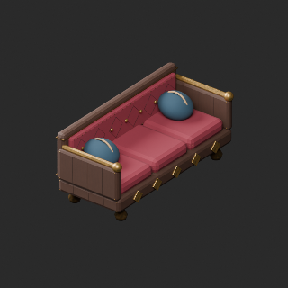
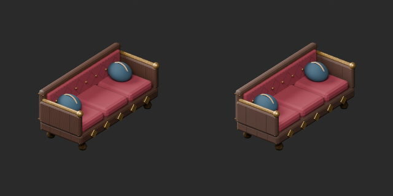
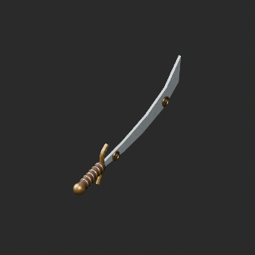
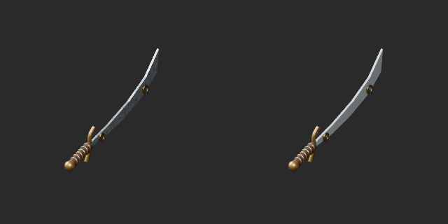

# OL035–044 材質改訂とvariant / Material revisions and variants / 材质修订与变体

**Existing 1008 records unchanged; 101 material variants = 99 + 2, counted separately. Two revisions are not new records.**

元配布記録10件査定、累積156/1008、未査定852。独立形状総数や全欠陥修復数ではありません。材質改訂2=OL036長椅子の周期木目/OL038壁飾り曲刀の斑模様低減。同形variant2=OL035壁掛け絨毯の緑布/OL037銀硬貨。房・装飾・刻印・積み方を保持。弱い使用感1候補は棄却。新基本/形状改訂0、原形状/原UV/寸法/原点保持、WearUV追加、旧版保持。木目やUV継ぎ目の完全除去ではありません。

Ten original records assessed, cumulative156/1008,852 unassessed; not unique shapes or fully repaired records. Two material revisions reduce repetitive bench wood grain OL036 and blade mottling on decorative sword OL038. Two same-geometry variants: green wall rug OL035 and silver coins OL037; fringe/decoration/engraving/stack arrangement retained. One weak wear candidate rejected. Original geometry/UV/dimensions/origin retained with WearUV added, zero new bases or geometry revisions. Earlier versions preserved; not complete UV seam removal.

査定10条、累计156条、未査定852条；材质修订2不加新数，绿布和银币变体2单独统计。弱使用感1棄却，原形状UV与旧版保持。

再読込最大座標差約1.20e-7m（許容1e-5m）、UV差0。OL036は44472三角形で家具暫定50k内、性能保証ではありません。OL039〜044灯具は148796〜199868triで小物20k超過、未修復残件を保持。本便の材質変更は軽量化ではありません。全非多様体/衝突/実歩行/可動/燃焼/武器機能/安全/ゲーム性能/他engine/Blender4.3.2未検証。静的鑑賞用。

Reimport coordinate error about1.20e-7m within1e-5 tolerance, UV error zero. Bench44472 triangles within provisional furniture50k budget is not a performance guarantee. Lamps OL039–044 remain148796–199868 triangles over20k small-prop budget; unresolved redesign retained. This material batch is not lightweight optimization. Full manifold/collision/walking/motion/fire/weapon function/safety/game performance/other engines/Blender4.3.2 untested. Static viewing only.

モデル/埋込材質のみCC0。画像は閲覧用でモデルCC0対象外、[既存画像権利](../LICENSE.md)維持。代码图片私有査定不属模型CC0。

## OL_035__color — 壁掛けの藍色絨毯

material_variant · [ZIP · BLEND/GLB](https://raw.githubusercontent.com/k3peta/tales-on-a-table/main/distributions/quality-ol035-044-v1/OL_035__color_CC0.zip)

[拡大 / Full image](https://raw.githubusercontent.com/k3peta/tales-on-a-table/main/previews/quality-ol035-044-v1/OL_035__color_thumb.png)

[拡大 / Full image](https://raw.githubusercontent.com/k3peta/tales-on-a-table/main/previews/quality-ol035-044-v1/OL_035__color_comparison.png)

left: original base; right: accepted variant; same overview camera

## OL_036__repair — 横たわるためのベルベット長椅子

revision · [ZIP · BLEND/GLB](https://raw.githubusercontent.com/k3peta/tales-on-a-table/main/distributions/quality-ol035-044-v1/OL_036__repair_CC0.zip)

[拡大 / Full image](https://raw.githubusercontent.com/k3peta/tales-on-a-table/main/previews/quality-ol035-044-v1/OL_036__repair_thumb.png)

[拡大 / Full image](https://raw.githubusercontent.com/k3peta/tales-on-a-table/main/previews/quality-ol035-044-v1/OL_036__repair_comparison.png)

left: original base; right: accepted variant; same overview camera

## OL_037__color — 小さな金貨の山

material_variant · [ZIP · BLEND/GLB](https://raw.githubusercontent.com/k3peta/tales-on-a-table/main/distributions/quality-ol035-044-v1/OL_037__color_CC0.zip)

[拡大 / Full image](https://raw.githubusercontent.com/k3peta/tales-on-a-table/main/previews/quality-ol035-044-v1/OL_037__color_thumb.png)

[拡大 / Full image](https://raw.githubusercontent.com/k3peta/tales-on-a-table/main/previews/quality-ol035-044-v1/OL_037__color_comparison.png)

left: original base; right: accepted variant; same overview camera

## OL_038__repair — 壁飾りの曲刀

revision · [ZIP · BLEND/GLB](https://raw.githubusercontent.com/k3peta/tales-on-a-table/main/distributions/quality-ol035-044-v1/OL_038__repair_CC0.zip)

[拡大 / Full image](https://raw.githubusercontent.com/k3peta/tales-on-a-table/main/previews/quality-ol035-044-v1/OL_038__repair_thumb.png)

[拡大 / Full image](https://raw.githubusercontent.com/k3peta/tales-on-a-table/main/previews/quality-ol035-044-v1/OL_038__repair_comparison.png)

left: original base; right: accepted variant; same overview camera
