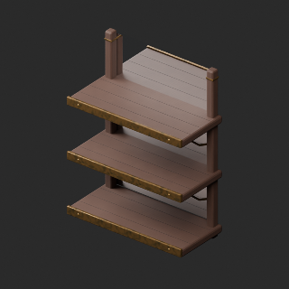
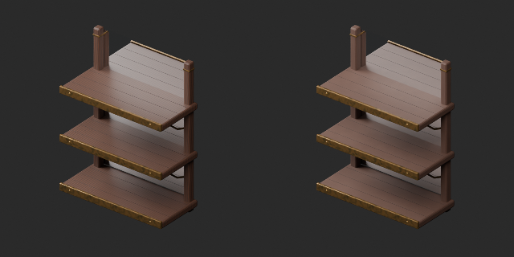

# OL045–054 材質改訂とvariant / Material revision and variants / 材质修订与变体

**Existing 1008 records unchanged; 104 material variants = 101 + 3, counted separately. One revision is not a new record.**

元配布記録10件査定、累積166/1008、未査定842。独立形状総数や全欠陥修復数ではありません。材質改訂1=OL054鏡付き棚の周期木目抑制。同形variant3=OL045外装モザイクガラスのオレンジ/グリーン、OL053銀鏡枠。新基本/形状改訂0、全件原本形状・既存UV基準、旧版保持。

OL045の変更は外装Art glassのbasecolor画像のみ、液体色ではなく液体はありません。原本透過0.52/roughness/IOR/alpha/発光・目地・脚を保持、発光増強なし。元から半透明装飾ガラスで、透明瓶のような見通しを保証しません。131936triのままで軽量版ではありません。OL053は金属枠のみ銀色、鏡面は保持。木/金属にはWearUV追加、ガラスは元UV使用。

Ten original records assessed, cumulative166/1008,842 unassessed; not unique shapes or fully repaired records. One material revision reduces shelf wood grain OL054. Three variants: OL045 orange/green exterior mosaic glass and OL053 silver mirror frame. No new bases or geometry revisions; original geometry/UV baseline and old versions retained. Glass variants change only exterior Art glass basecolor image, not liquid; no liquid exists. Original transmission0.52/roughness/IOR/alpha/emission retained, no emission boost. Semi-transparent decorative glass does not guarantee clear-bottle visibility. Still131936 triangles, not lightweight. Mirror surface unchanged; only frame recolored. WearUV added to wood/metal, original UV used for glass.

査定10条、累计166条、未査定842条。修订1不加新数、变体3单独统计。橙/绿是外装玻璃颜色而非液体色，发光不增强；镜面保持仅改银框。

再読込座標/既存UV差0。材質数値の再書出し誤差最大約2.42e-8、許容1e-6で検査（JSON全値完全一致とはしない）。鏡反射はBlenderの反射カード画像で確認、他engine互換は未検証。OL045〜052予算超過は再設計残件として保持。全非多様体/衝突/実歩行/機能/燃焼/安全/ゲーム性能/他engine反射透過/Blender4.3.2未検証。静的鑑賞用。

Reimport geometry/UV error zero. Material numeric roundtrip error up to2.42e-8 within1e-6 tolerance, not exact JSON equality. Mirror reflection checked using Blender cards, other engines untested. OL045–052 triangle budgets remain redesign work. Full manifold/collision/walking/function/fire/safety/game performance/other-engine reflection/transparency/Blender4.3.2 untested.

モデル/埋込材質のみCC0。画像は閲覧用でモデルCC0対象外、[既存画像権利](../LICENSE.md)維持。代码图片私有査定不属模型CC0。

## OL_045__glass_orange — 三脚の卓上ランプ

material_variant · [ZIP · BLEND/GLB](https://raw.githubusercontent.com/k3peta/tales-on-a-table/main/distributions/quality-ol045-054-v1/OL_045__glass_orange_CC0.zip)

[拡大 / Full image](https://raw.githubusercontent.com/k3peta/tales-on-a-table/main/previews/quality-ol045-054-v1/OL_045__glass_orange_thumb.png)

[拡大 / Full image](https://raw.githubusercontent.com/k3peta/tales-on-a-table/main/previews/quality-ol045-054-v1/OL_045__glass_orange_comparison.png)

left: original base; right: accepted variant; same overview camera

## OL_045__glass_green — 三脚の卓上ランプ

material_variant · [ZIP · BLEND/GLB](https://raw.githubusercontent.com/k3peta/tales-on-a-table/main/distributions/quality-ol045-054-v1/OL_045__glass_green_CC0.zip)

[拡大 / Full image](https://raw.githubusercontent.com/k3peta/tales-on-a-table/main/previews/quality-ol045-054-v1/OL_045__glass_green_thumb.png)

[拡大 / Full image](https://raw.githubusercontent.com/k3peta/tales-on-a-table/main/previews/quality-ol045-054-v1/OL_045__glass_green_comparison.png)

left: original base; right: accepted variant; same overview camera

## OL_053__color — 額縁付き鏡パネル

material_variant · [ZIP · BLEND/GLB](https://raw.githubusercontent.com/k3peta/tales-on-a-table/main/distributions/quality-ol045-054-v1/OL_053__color_CC0.zip)

[拡大 / Full image](https://raw.githubusercontent.com/k3peta/tales-on-a-table/main/previews/quality-ol045-054-v1/OL_053__color_thumb.png)

[拡大 / Full image](https://raw.githubusercontent.com/k3peta/tales-on-a-table/main/previews/quality-ol045-054-v1/OL_053__color_comparison.png)

left: original base; right: accepted variant; same overview camera

## OL_054__repair — 鏡付き三段棚

revision · [ZIP · BLEND/GLB](https://raw.githubusercontent.com/k3peta/tales-on-a-table/main/distributions/quality-ol045-054-v1/OL_054__repair_CC0.zip)

[拡大 / Full image](https://raw.githubusercontent.com/k3peta/tales-on-a-table/main/previews/quality-ol045-054-v1/OL_054__repair_thumb.png)

[拡大 / Full image](https://raw.githubusercontent.com/k3peta/tales-on-a-table/main/previews/quality-ol045-054-v1/OL_054__repair_comparison.png)

left: original base; right: accepted variant; same overview camera
