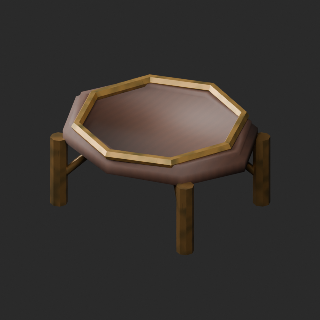
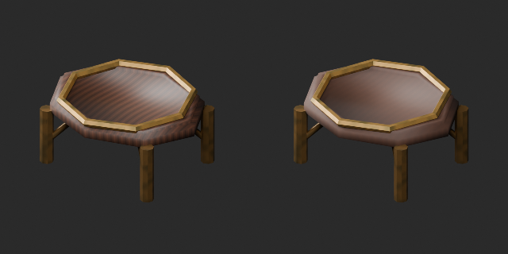
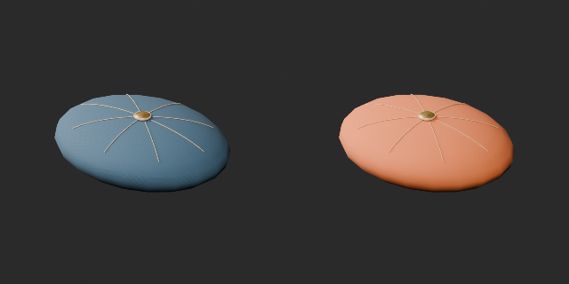
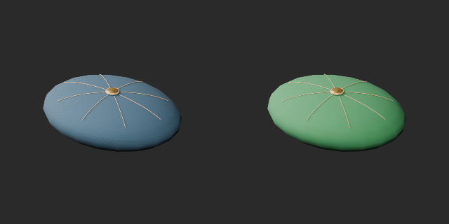
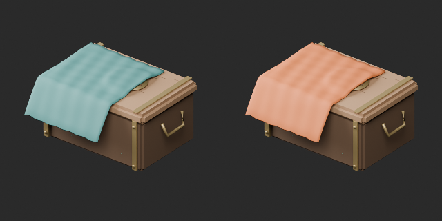
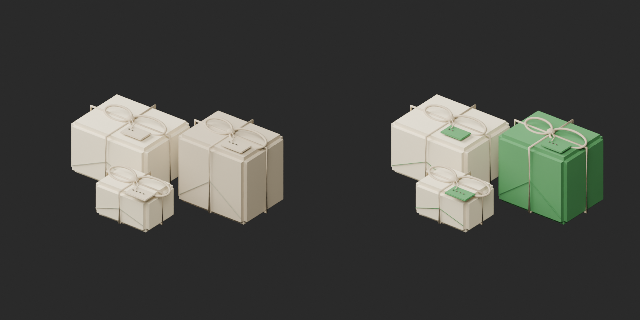
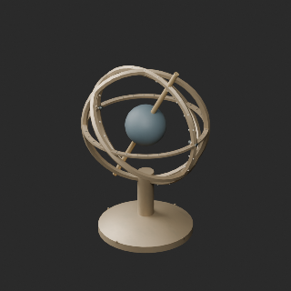
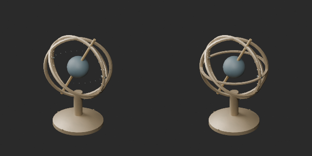

# OL055 / cushion / STORY / AT001 — quality batch 18

**1008 base distribution records unchanged; 108 material variants = 104 + 4, counted separately. Two revisions do not add records.**

10 records assessed; cumulative 176/1008, 832 unassessed. These are distribution records, not unique shapes. One material revision reduces OL055 display-stand wood grain. AT001 gains a brass support ring beneath 36 horizontal ticks: original 5300 triangles plus 768 = 6068. Original mesh vertices/faces/transforms preserved; this is a geometry revision, not a geometry-preserving color variant. Revised baseline: tick_support_v1. Old versions retained.

Four same-geometry variants: orange/green blue-cushion derivatives, orange cloth on the STORY001 chest, and green cloth in the STORY005 souvenir arrangement. Paper, rope, metal and arrangement positions retained; not all souvenir objects are cloth. Two arrangement variants are not new standalone shapes. Blue/red cushion geometric identity remains unproven despite small coordinate distances. No glass/liquid color or emission changes.

基本配布1008維持、材質variant104+4=108を別集計。展示台材質と天球儀支持輪の改訂2は非加算。累積査定176、未査定832。青クッションの橙/緑、手箱掛布の橙、土産配置の布の緑。配置作品の色違いを新単品形状に数えません。天球儀は原本5300triに支持輪768tri追加、原本頂点不変更。青/赤クッション完全同形証明は保留。

基础配发1008不变，材质变体108单独统计，修订2不加新数。4变体含2个组合场景颜色变体。天球仪增加支撑环，不是仅材质变化。累计査定176，未査定832。

Producer final BLEND/GLB reimport: maximum coordinate error 1.68e-8 m, existing UV error 2.98e-8. Support ring closed with no nonmanifold edges/tiny faces in the scoped check; 36 tick contacts overlap approximately 0.4 mm. Initial rounded-hash mismatch was investigated using reference vertex correspondence, not ignored. Not a working measuring instrument, bearing or strength test. Whole-model collision, walking, game performance, full manifold coverage and Blender 4.3.2 compatibility remain unverified. Earlier over-budget/lightweight-rejection issues remain open.

モデル/埋込材質のみCC0。画像は閲覧用でモデルCC0対象外、[既存画像権利](../LICENSE.md)維持。代码图片私有査定不属模型CC0。

## OL_055__repair — 小さな展示台

revision · [ZIP · BLEND/GLB](https://raw.githubusercontent.com/k3peta/tales-on-a-table/main/distributions/quality-ol055-story-at001-v1/OL_055__repair_CC0.zip)

[拡大 / Full image](https://raw.githubusercontent.com/k3peta/tales-on-a-table/main/previews/quality-ol055-story-at001-v1/OL_055__repair_thumb.png)

[拡大 / Full image](https://raw.githubusercontent.com/k3peta/tales-on-a-table/main/previews/quality-ol055-story-at001-v1/OL_055__repair_comparison.png)

left: original base; right: accepted variant; same overview camera

## OL_extra_blue__color_orange — 青い単体クッション

material_variant · [ZIP · BLEND/GLB](https://raw.githubusercontent.com/k3peta/tales-on-a-table/main/distributions/quality-ol055-story-at001-v1/OL_extra_blue__color_orange_CC0.zip)

[拡大 / Full image](https://raw.githubusercontent.com/k3peta/tales-on-a-table/main/previews/quality-ol055-story-at001-v1/OL_extra_blue__color_orange_thumb.png)

[拡大 / Full image](https://raw.githubusercontent.com/k3peta/tales-on-a-table/main/previews/quality-ol055-story-at001-v1/OL_extra_blue__color_orange_comparison.png)

left: original base; right: accepted variant; same overview camera

## OL_extra_blue__color_green — 青い単体クッション

material_variant · [ZIP · BLEND/GLB](https://raw.githubusercontent.com/k3peta/tales-on-a-table/main/distributions/quality-ol055-story-at001-v1/OL_extra_blue__color_green_CC0.zip)

[拡大 / Full image](https://raw.githubusercontent.com/k3peta/tales-on-a-table/main/previews/quality-ol055-story-at001-v1/OL_extra_blue__color_green_thumb.png)

[拡大 / Full image](https://raw.githubusercontent.com/k3peta/tales-on-a-table/main/previews/quality-ol055-story-at001-v1/OL_extra_blue__color_green_comparison.png)

left: original base; right: accepted variant; same overview camera

## OL_STORY_001__color_orange — 布を掛けた手箱

material_variant · [ZIP · BLEND/GLB](https://raw.githubusercontent.com/k3peta/tales-on-a-table/main/distributions/quality-ol055-story-at001-v1/OL_STORY_001__color_orange_CC0.zip)

[拡大 / Full image](https://raw.githubusercontent.com/k3peta/tales-on-a-table/main/previews/quality-ol055-story-at001-v1/OL_STORY_001__color_orange_thumb.png)

[拡大 / Full image](https://raw.githubusercontent.com/k3peta/tales-on-a-table/main/previews/quality-ol055-story-at001-v1/OL_STORY_001__color_orange_comparison.png)

left: original base; right: accepted variant; same overview camera

## OL_STORY_005__color_green — 旅の土産包み

material_variant · [ZIP · BLEND/GLB](https://raw.githubusercontent.com/k3peta/tales-on-a-table/main/distributions/quality-ol055-story-at001-v1/OL_STORY_005__color_green_CC0.zip)

[拡大 / Full image](https://raw.githubusercontent.com/k3peta/tales-on-a-table/main/previews/quality-ol055-story-at001-v1/OL_STORY_005__color_green_thumb.png)

[拡大 / Full image](https://raw.githubusercontent.com/k3peta/tales-on-a-table/main/previews/quality-ol055-story-at001-v1/OL_STORY_005__color_green_comparison.png)

left: original base; right: accepted variant; same overview camera

## AT_001__repair — 古い天球儀

revision · [ZIP · BLEND/GLB](https://raw.githubusercontent.com/k3peta/tales-on-a-table/main/distributions/quality-ol055-story-at001-v1/AT_001__repair_CC0.zip)

[拡大 / Full image](https://raw.githubusercontent.com/k3peta/tales-on-a-table/main/previews/quality-ol055-story-at001-v1/AT_001__repair_thumb.png)

[拡大 / Full image](https://raw.githubusercontent.com/k3peta/tales-on-a-table/main/previews/quality-ol055-story-at001-v1/AT_001__repair_comparison.png)

left: original base; right: accepted variant; same overview camera
