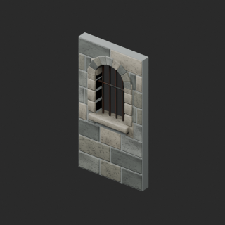
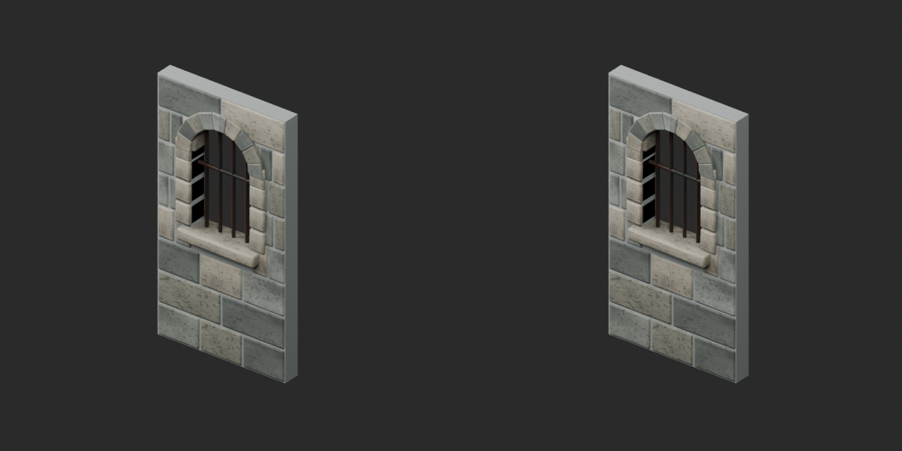
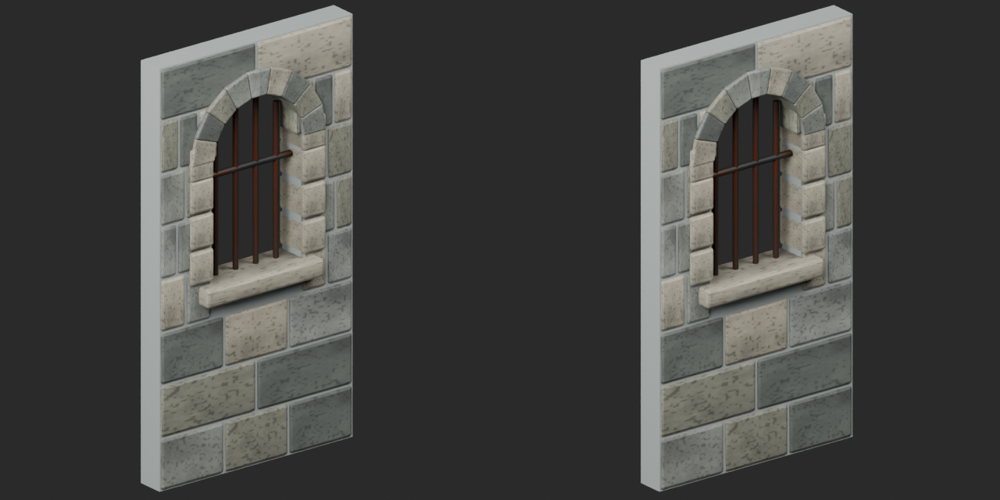

# Quality56 / 品質第56便 / 质量第56批

Base1008 and material variants171 unchanged. One UV-only revision, zero geometry revisions/new variants/new base. Originals retained.

PM005 arched-window6388tri: add missing UV0 only on PM005_Mortar_Core. Geometry/materials and existing UV layers retained. Missing UV added against explicit updated baseline; NOT original-UV-invariant or silhouette improvement. Recess intentionally dark.

10配布レコードを現行版で査定。PM005のUV補完改訂1件のみ、形状・variant・基本加算0。10个配布记录按现行版本检查；仅PM005补充缺失UV，不增加基础形状或颜色变体。

PM006/009/010/011 retain exact existing public mortar-recess repairs. Configuration rows reuse common pillar geometry,not independent new shapes; no old-version restoration. Source primary hashes and selected current-revision hashes checked separately.

WM00133058tri below provisional50k large static-assembly warning; timber-check detail lacks UV and remains UNREPAIRED. No rotation clearance/water/power simulation. PM003 wall uses pillars at2m pitch; PM008 raised hatch hardware up to0.051m is intentional,not forced flat.

Same camera/light/scale comparison. Final-ZIP both formats geometry/UV/spatial attributes checked against original geometry plus added missingUV baseline. Original COLOR_0 absence retained. Five bad color fixtures rejected. Public artifact matching is pending. Publication did not rerun Blender.

Assessed556 distribution records;452 remain;143 budget issues and existing BM007/BM054/material diagnostics retained. Private connection scene checks selected current versions,not exhaustive collisions/door movement. No security/load/rig/gameplay/fluid/Blender4.3.2 guarantee. Source GLB audited;original bundled BLEND not independently imported;final candidate both formats tested.

Models/embedded materials only CC0; images separate catalogue artwork. [License](../LICENSE.md). Private code/handoff/connection scene excluded.

## PM005__repair — Arched Window Wall 2m

アーチ窓壁2m

Add missing UV0 only on PM005_Mortar_Core. Original geometry/materials and existing UV layers retained. UV-only revision, no new base or palette variant.

[ZIP · BLEND/GLB](https://raw.githubusercontent.com/k3peta/tales-on-a-table/main/distributions/quality-pm003-wm001-v1/PM005__repair_CC0.zip)

Left: original; right: accepted revision/variant, identical camera/light/scale.
