# Quality36 / 品質第36便 / 质量第36批

Base1008 unchanged; material variants141=137+4 counted separately. TD011 revision adds no model. All originals retained.

TD011 chest:96 exact-zero triangles removed,79288 to79192tri; all positive surfaces retained. Furnishing50k budget remains exceeded; coarse wood grain retained. TD013 orange,TD014 cyan,TD015 amber andTD016 violet are gem body color variants, not liquids or bottles. Geometry unchanged from original; missing UV added before the variant baseline, not original-UV-invariant. Transmission, IOR, roughness and emission unchanged; no new emission.

改訂1件は非加算。宝石本体色4件は別集計。欠落UVを追加しており元UV完全不変とは扱いません。TD011の予算超過と粗い木目は残ります。

1个修订不新增模型；4个宝石本体颜色变体单独统计。缺失UV已补充，不宣称原UV完全不变。TD011仍超预算并保留粗木纹。

Same camera/light/scale comparisons. Producer final-ZIP guard binds accepted packages, input/script/model hashes and run/time/build. Public ZIP/member hashes match the final guarded artifacts. Publication did not rerun Blender.

Assessed356 distribution records,652 remain;73 budget/redesign issues unresolved. TD01044180tri andTD01225128tri remain over20k. TD007 black cutoff was camera near clipping, corrected in audit renders only; model unchanged. TD00925,TD01010 andTD0121 constant-material objects lack UV. No collision/gameplay/animation/optical-engine equivalence or Blender4.3.2 guarantee. Colors are not repairs; earlier diagnoses remain.

Models/embedded materials only CC0; images separate catalogue artwork. [License](../LICENSE.md). Private reports/code excluded.

## TD_011__repair — Open gilded treasure chest

金装飾の開いた宝箱

TD011 exact96 zero-area triangles removed; all positive surfaces retained. Budget remains exceeded. No new base.

[ZIP · BLEND/GLB](https://raw.githubusercontent.com/k3peta/tales-on-a-table/main/distributions/quality-td007-016-v1/TD_011__repair_CC0.zip)

[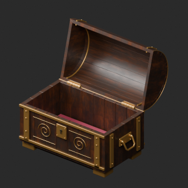](../previews/quality-td007-016-v1/TD_011__repair_thumb.png)

[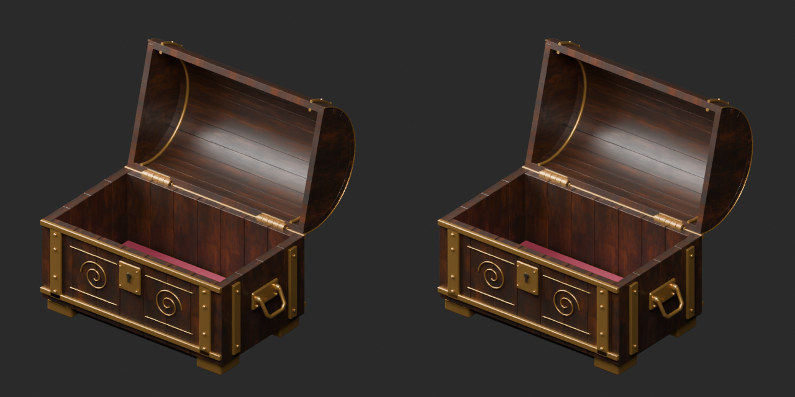](../previews/quality-td007-016-v1/TD_011__repair_overview_comparison.png)

[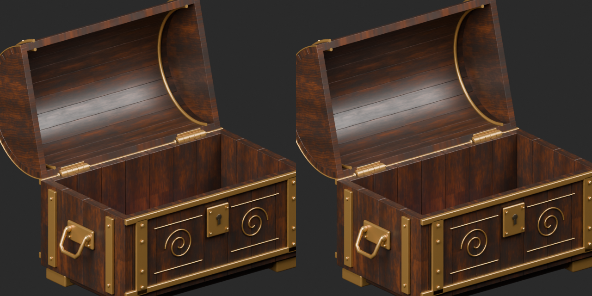](../previews/quality-td007-016-v1/TD_011__repair_close_comparison.png)

Left: original; right: accepted revision/variant, identical camera/light/scale.

## TD_013__orange — Round brilliant-cut gem

円形ブリリアント宝石

Gem body color texture only; geometry unchanged from original, UV baseline explicitly added. Transmission/IOR/roughness/emission unchanged. Not a liquid or glass-bottle variant.

[ZIP · BLEND/GLB](https://raw.githubusercontent.com/k3peta/tales-on-a-table/main/distributions/quality-td007-016-v1/TD_013__orange_CC0.zip)

[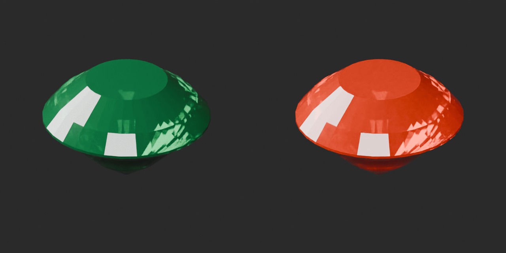](../previews/quality-td007-016-v1/TD_013__orange_overview_comparison.png)

[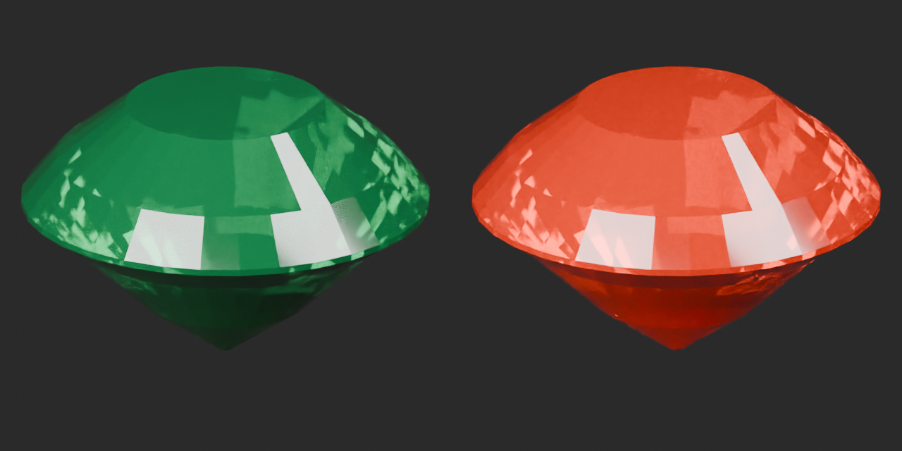](../previews/quality-td007-016-v1/TD_013__orange_close_comparison.png)

Left: original; right: accepted revision/variant, identical camera/light/scale.

## TD_014__cyan — Rectangular step-cut gem

長方形ステップカット宝石

Gem body color texture only; geometry unchanged from original, UV baseline explicitly added. Transmission/IOR/roughness/emission unchanged. Not a liquid or glass-bottle variant.

[ZIP · BLEND/GLB](https://raw.githubusercontent.com/k3peta/tales-on-a-table/main/distributions/quality-td007-016-v1/TD_014__cyan_CC0.zip)

[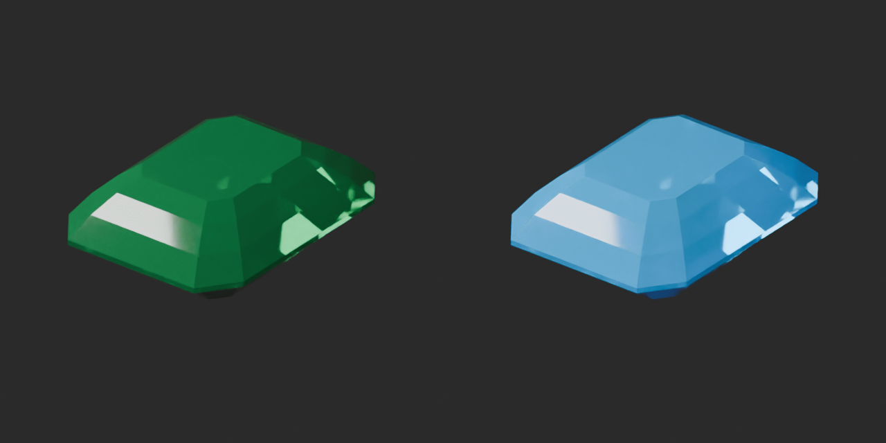](../previews/quality-td007-016-v1/TD_014__cyan_overview_comparison.png)

[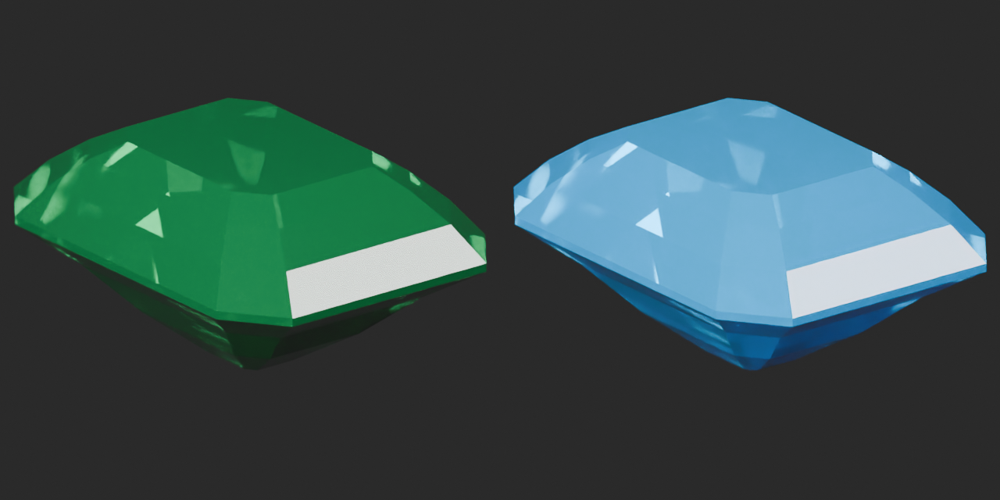](../previews/quality-td007-016-v1/TD_014__cyan_close_comparison.png)

Left: original; right: accepted revision/variant, identical camera/light/scale.

## TD_015__amber — Pear-cut gem

洋梨形カット宝石

Gem body color texture only; geometry unchanged from original, UV baseline explicitly added. Transmission/IOR/roughness/emission unchanged. Not a liquid or glass-bottle variant.

[ZIP · BLEND/GLB](https://raw.githubusercontent.com/k3peta/tales-on-a-table/main/distributions/quality-td007-016-v1/TD_015__amber_CC0.zip)

[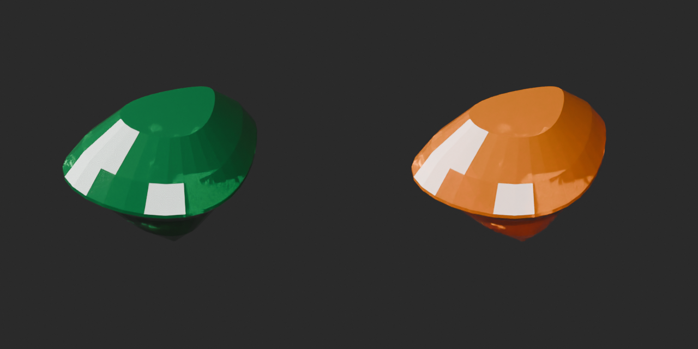](../previews/quality-td007-016-v1/TD_015__amber_overview_comparison.png)

[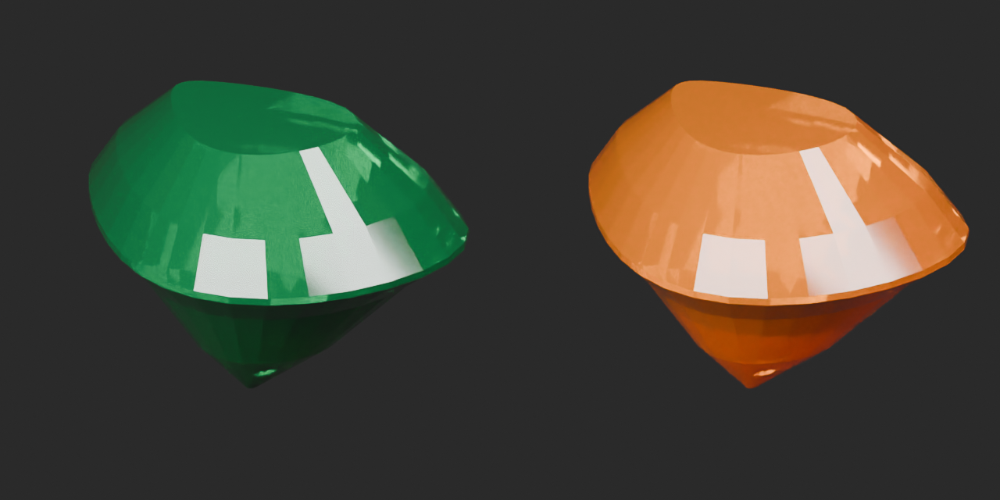](../previews/quality-td007-016-v1/TD_015__amber_close_comparison.png)

Left: original; right: accepted revision/variant, identical camera/light/scale.

## TD_016__violet — Marquise-cut gem

マーキス形カット宝石

Gem body color texture only; geometry unchanged from original, UV baseline explicitly added. Transmission/IOR/roughness/emission unchanged. Not a liquid or glass-bottle variant.

[ZIP · BLEND/GLB](https://raw.githubusercontent.com/k3peta/tales-on-a-table/main/distributions/quality-td007-016-v1/TD_016__violet_CC0.zip)

[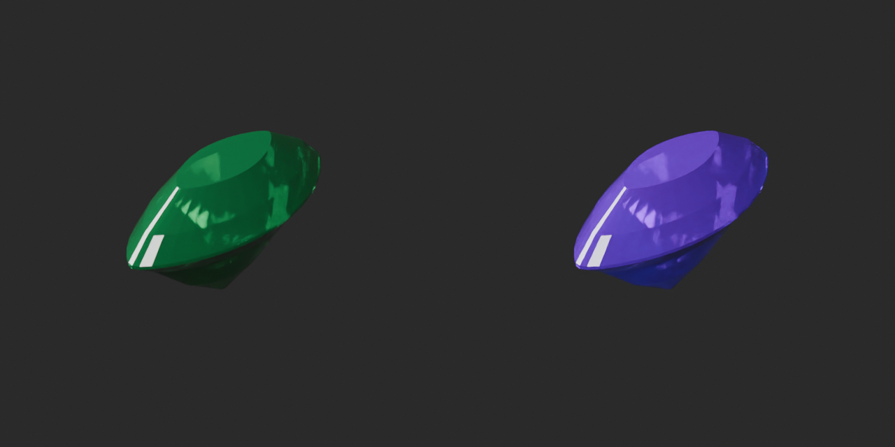](../previews/quality-td007-016-v1/TD_016__violet_overview_comparison.png)

[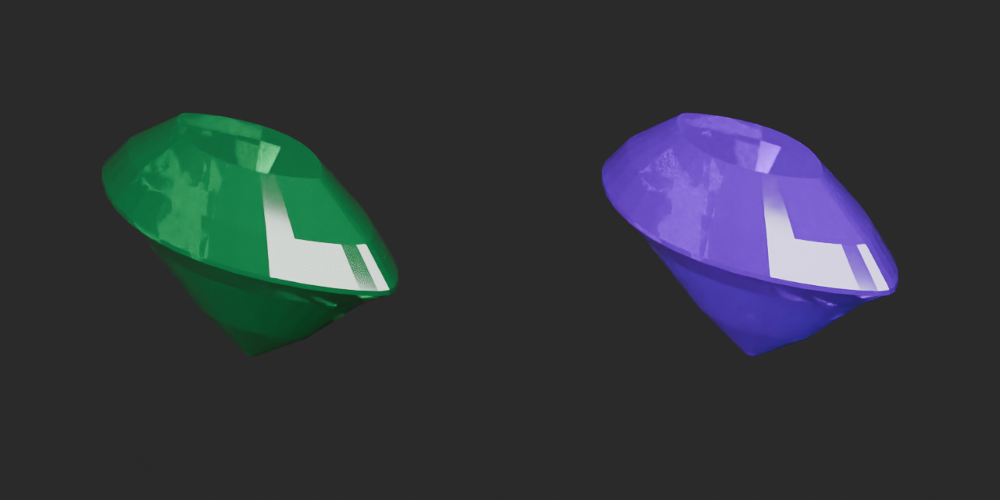](../previews/quality-td007-016-v1/TD_016__violet_close_comparison.png)

Left: original; right: accepted revision/variant, identical camera/light/scale.

[Exact package validation evidence](../distributions/quality-td007-016-v1/validation.json).
