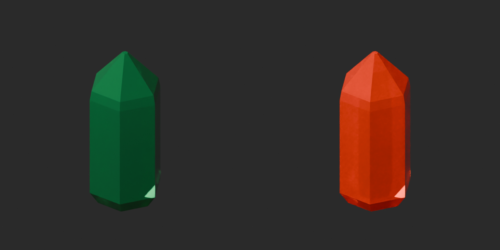
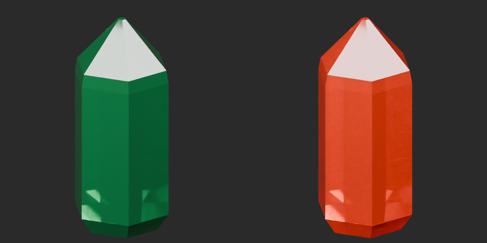
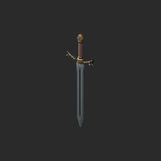
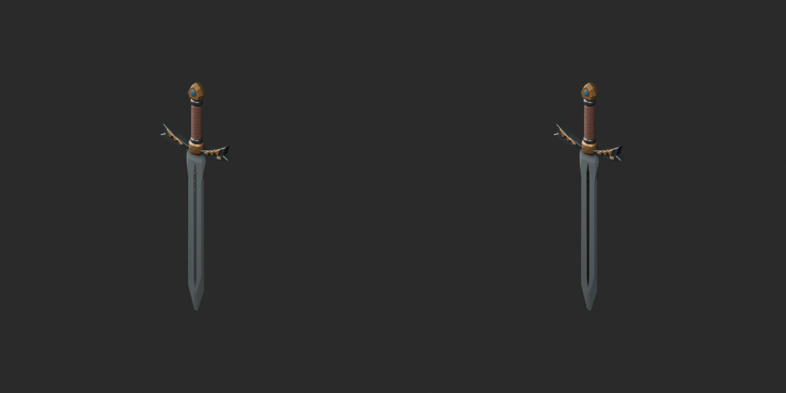
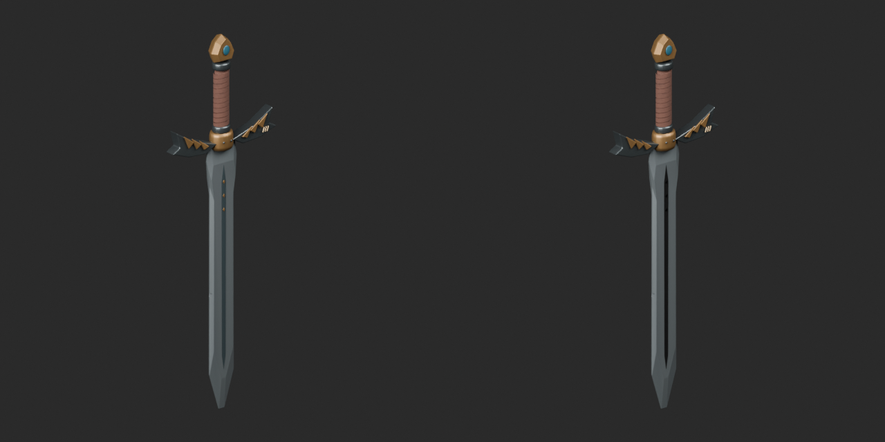
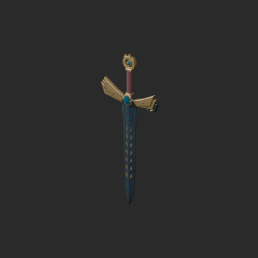
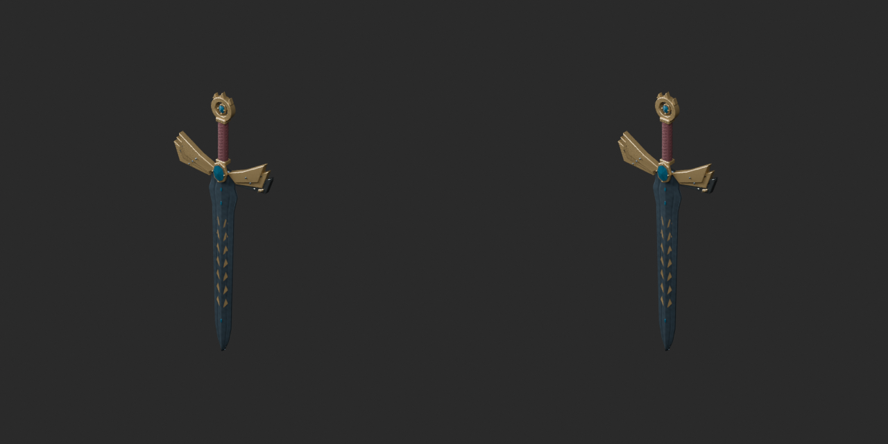
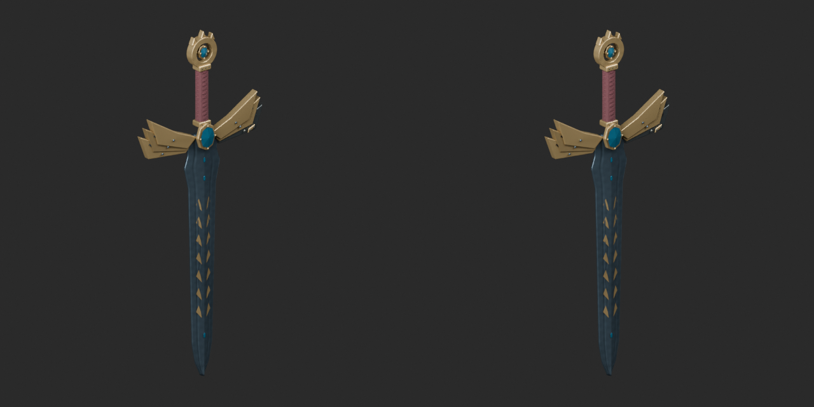
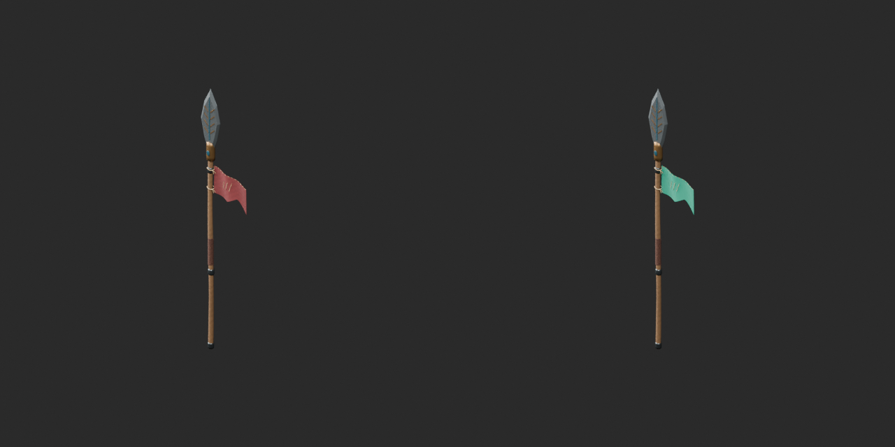
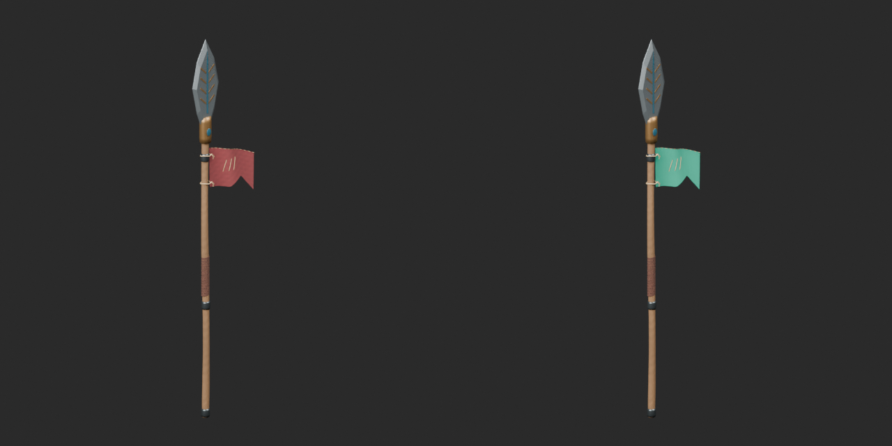

# Quality37 / 品質第37便 / 质量第37批

> Resolved for v2 only: ARM001/003 repair_color_v2 BLEND and GLB final-ZIP geometry/UV/position-bound vertex-color checks and public ZIP/member/image hashes verified. Earlier __repair files remain withdrawn for vertex-color loss in BOTH formats; originals retain zero-area defects. Historical alerts below are retained. ARM003 budget issue remains. [Verified v2](https://github.com/k3peta/tales-on-a-table/blob/main/catalog/arm001_003_color_correction_v2.md).

> Correction / 訂正待ち: ARM001/ARM003 quality37 GLB revisions lose COLOR_0 vertex colors on rebuilt meshes. GLB color preservation FAILED; do not treat these packages as complete/recommended repairs. BLEND geometry checks remain historical evidence, but BLEND color preservation is not independently cleared by this alert. Await corrected packages and format-specific validation. Original versions also contain zero-area defects and are not certified normal alternatives. Hash identity is not quality approval; files retained as history.

Base1008 unchanged; material variants143=141+2 counted separately. Two revisions add no model; all originals retained.

ARM00142 andARM00396 exact-zero triangles removed; all positive surfaces retained. ARM001160 andARM00319 positive tiny triangles retained. ARM00341808tri remains over20k. TD017 orange crystal body variant retains original geometry but adds missing UV before baseline; not original-UV-invariant. ARM011 teal pennant retains original geometry and UV. Only basecolor changes, with no new emission or changed transmission/IOR/roughness; not liquid-color variants.

改訂2件は非加算。橙結晶と青緑旗2件は別集計。TD017は欠落UV追加、ARM011は元UV保持。色変更で予算超過を解消したとは扱いません。

2个修订不新增模型；橙色晶体和蓝绿色旗帜2个颜色变体单独统计。TD017补充UV，ARM011保留原UV。颜色调整不代表解决多边形预算问题。

Same camera/light/scale comparisons. Producer final-ZIP guard binds accepted packages, input/script/model hashes and run/time/build. Public ZIP/member hashes match the final guarded artifacts. Publication did not rerun Blender.

Assessed366 distribution records,642 remain;79 budget/redesign issues unresolved. Over20k: ARM00229068, ARM00341808, ARM004156580, ARM006124796, ARM01122384, ARM013127892. ARM002 mottled alloy texture is authored display material, not a detected basecolor-to-normal reference error. Positive tiny decorative surfaces retained. Static display props; no load/weapon function, collision/gameplay, optical equivalence or Blender4.3.2 guarantee. Earlier diagnoses remain.

Models/embedded materials only CC0; images separate catalogue artwork. [License](../LICENSE.md). Private reports/code excluded.

## TD_017__orange — Hexagonal crystal

六角柱の原石結晶

TD017 gem body or ARM011 pennant cloth basecolor texture only. Original geometry retained; TD017 UV added before color baseline. Other material channels unchanged. Not a liquid-color variant.

[ZIP · BLEND/GLB](https://raw.githubusercontent.com/k3peta/tales-on-a-table/main/distributions/quality-td017-arm013-v1/TD_017__orange_CC0.zip)

Left: original; right: accepted revision/variant, identical camera/light/scale.

## ARM_001__repair — 竜翼鍔の旅剣

竜翼鍔の旅剣

Exact-zero-area cleanup: ARM001 42 faces or ARM003 96 faces. All positive surfaces retained; ARM003 remains over budget. No new base.

[ZIP · BLEND/GLB](https://raw.githubusercontent.com/k3peta/tales-on-a-table/main/distributions/quality-td017-arm013-v1/ARM_001__repair_CC0.zip)

Left: original; right: accepted revision/variant, identical camera/light/scale.

## ARM_003__repair — 海門守護の伝説剣

海門守護の伝説剣

Exact-zero-area cleanup: ARM001 42 faces or ARM003 96 faces. All positive surfaces retained; ARM003 remains over budget. No new base.

[ZIP · BLEND/GLB](https://raw.githubusercontent.com/k3peta/tales-on-a-table/main/distributions/quality-td017-arm013-v1/ARM_003__repair_CC0.zip)

Left: original; right: accepted revision/variant, identical camera/light/scale.

## ARM_011__tealcloth — 葉飾り儀礼槍

葉飾り儀礼槍

TD017 gem body or ARM011 pennant cloth basecolor texture only. Original geometry retained; TD017 UV added before color baseline. Other material channels unchanged. Not a liquid-color variant.

[ZIP · BLEND/GLB](https://raw.githubusercontent.com/k3peta/tales-on-a-table/main/distributions/quality-td017-arm013-v1/ARM_011__tealcloth_CC0.zip)

Left: original; right: accepted revision/variant, identical camera/light/scale.

[Exact package validation evidence](../distributions/quality-td017-arm013-v1/validation.json).
