# Quality44 / 品質第44便 / 质量第44批

Base1008 unchanged; material variants154=153+1 separately. Four revisions:2 mesh/UV and2 UV-only; no new base. Originals retained.

WH0072942/WH0083096 exact-zero faces removed and missing UV added; positive surfaces retained. WH00747298tri now below50k furnishing warning; WH00851944tri still above. BN003 one missing UV layer, BN005 eleven missing UV layers added with unchanged mesh: UV-only revisions, NOT original-UV-invariant. BN006 blue wood pigment variant preserves original geometry/UV/grain/normal/roughness and other non-basecolor channels. All10 originals have no vertex colors, not attribute loss.

形状UV改訂2件、UVのみ改訂2件は非加算。青木目variant1件別集計。UV追加を元UV保持とはしません。2个网格/UV修订和2个仅UV修订不增加基本模型数；1个蓝色木纹变体单独统计。新增UV不等于保留原UV。

Same camera/light/scale comparisons. Final ZIP validation-v2 binds BLEND/GLB geometry/UV/spatial vertex attributes and four rejected old color-loss fixtures. Public artifact matching is pending. Publication did not rerun Blender.

Assessed436 distribution records;572 remain;133 budget issues unresolved. BN00585280tri hay retains dense straight fibers;WH008 fine uniform grain remains. UV additions do not redesign these. Empty20slot rack has no swords; tool rack has no extra tools counted. No collision/load/rolling/sieving simulation/mechanism/gameplay/Blender4.3.2 approval. Earlier diagnoses retained.

Models/embedded materials only CC0; images separate catalogue artwork. [License](../LICENSE.md). Private reports/code excluded.

## BN_003__repair — Grain spade

穀物用の鋤

Missing UV added; geometry and original materials preserved.

[ZIP · BLEND/GLB](https://raw.githubusercontent.com/k3peta/tales-on-a-table/main/distributions/quality-wh007-bn008-v1/BN_003__repair_CC0.zip)

[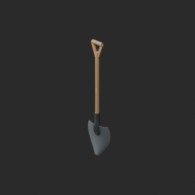](../previews/quality-wh007-bn008-v1/BN_003__repair_thumb.png)

[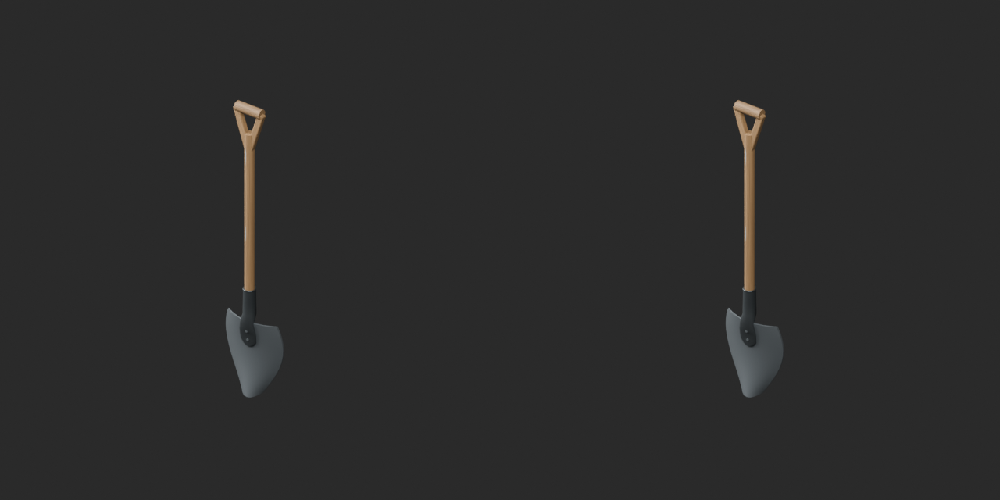](../previews/quality-wh007-bn008-v1/BN_003__repair_overview_comparison.png)

[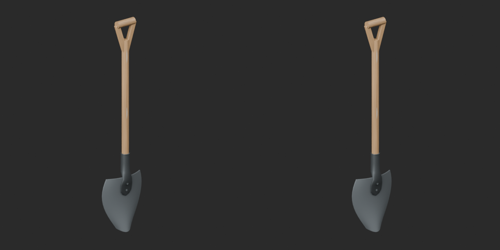](../previews/quality-wh007-bn008-v1/BN_003__repair_close_comparison.png)

Left: original; right: accepted revision/variant, identical camera/light/scale.

## BN_005__repair — Tied hay bale

結束した干し草

Missing UV added; geometry and original materials preserved.

[ZIP · BLEND/GLB](https://raw.githubusercontent.com/k3peta/tales-on-a-table/main/distributions/quality-wh007-bn008-v1/BN_005__repair_CC0.zip)

[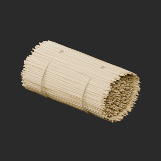](../previews/quality-wh007-bn008-v1/BN_005__repair_thumb.png)

[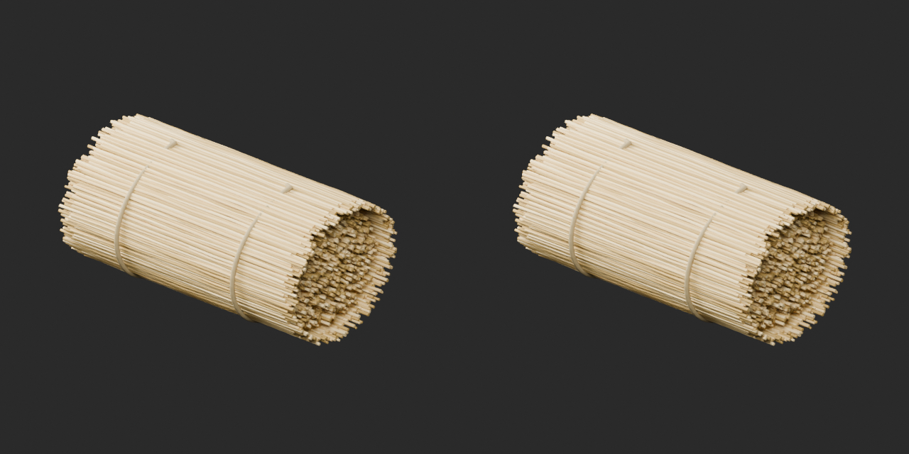](../previews/quality-wh007-bn008-v1/BN_005__repair_overview_comparison.png)

[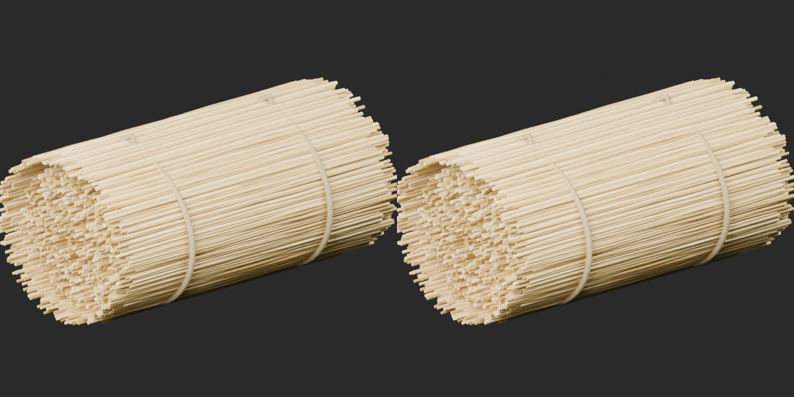](../previews/quality-wh007-bn008-v1/BN_005__repair_close_comparison.png)

Left: original; right: accepted revision/variant, identical camera/light/scale.

## BN_006__bluewood — Three-compartment grain bin

三区画の穀物箱

Blue wood pigment texture on original geometry and UV. Existing grain retained; normal, roughness and other channels unchanged.

[ZIP · BLEND/GLB](https://raw.githubusercontent.com/k3peta/tales-on-a-table/main/distributions/quality-wh007-bn008-v1/BN_006__bluewood_CC0.zip)

[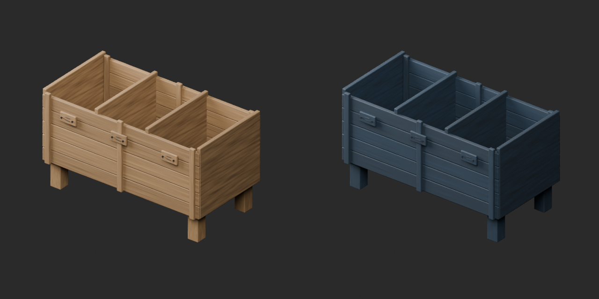](../previews/quality-wh007-bn008-v1/BN_006__bluewood_overview_comparison.png)

[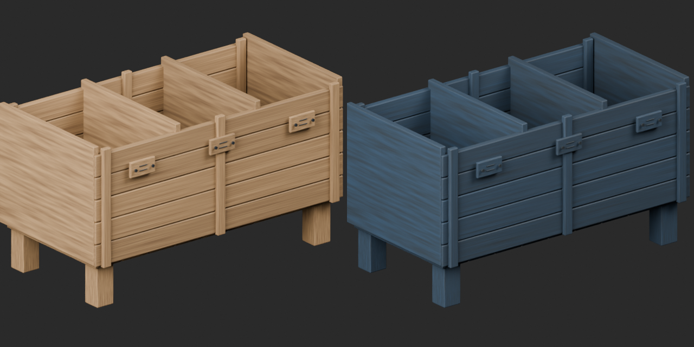](../previews/quality-wh007-bn008-v1/BN_006__bluewood_close_comparison.png)

Left: original; right: accepted revision/variant, identical camera/light/scale.

## WH_NEW_007__repair — 低い二列20本剣ラック

低い二列20本剣ラック

Exact-zero-face removal plus missing UV addition; positive surface and existing UV preserved.

[ZIP · BLEND/GLB](https://raw.githubusercontent.com/k3peta/tales-on-a-table/main/distributions/quality-wh007-bn008-v1/WH_NEW_007__repair_CC0.zip)

[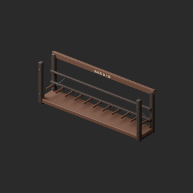](../previews/quality-wh007-bn008-v1/WH_NEW_007__repair_thumb.png)

[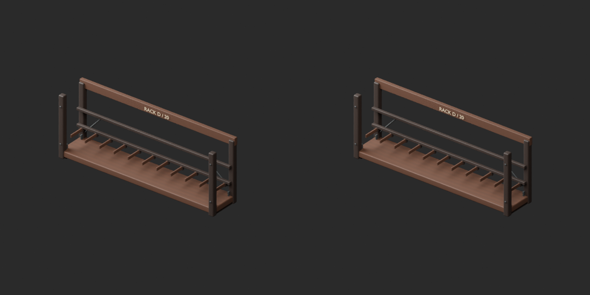](../previews/quality-wh007-bn008-v1/WH_NEW_007__repair_overview_comparison.png)

[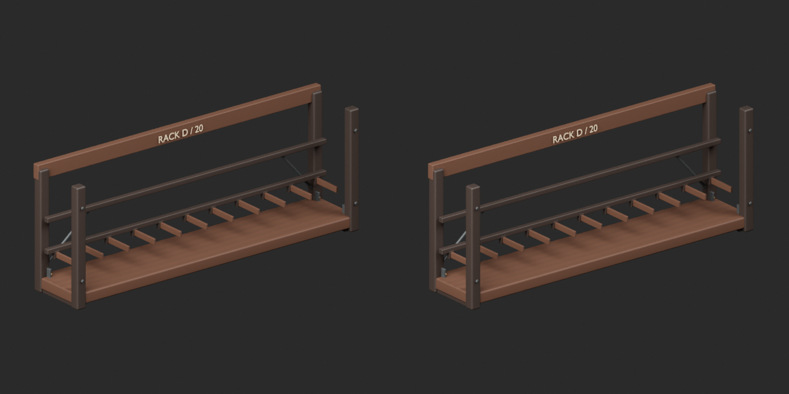](../previews/quality-wh007-bn008-v1/WH_NEW_007__repair_close_comparison.png)

Left: original; right: accepted revision/variant, identical camera/light/scale.

## WH_NEW_008__repair — 倉庫の梱包箱

倉庫の梱包箱

Exact-zero-face removal plus missing UV addition; positive surface and existing UV preserved.

[ZIP · BLEND/GLB](https://raw.githubusercontent.com/k3peta/tales-on-a-table/main/distributions/quality-wh007-bn008-v1/WH_NEW_008__repair_CC0.zip)

[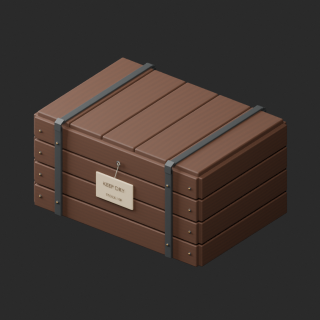](../previews/quality-wh007-bn008-v1/WH_NEW_008__repair_thumb.png)

[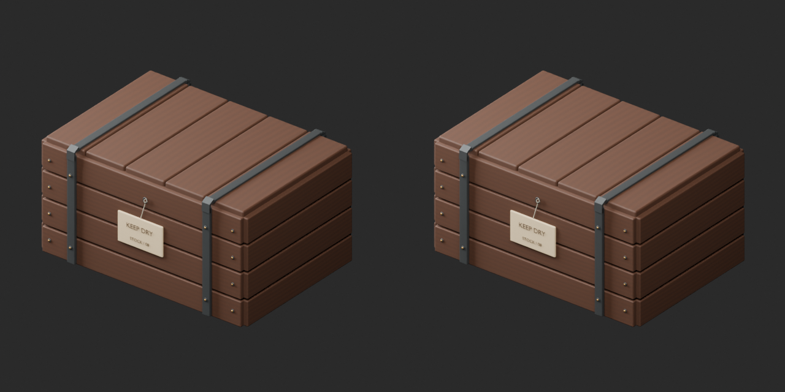](../previews/quality-wh007-bn008-v1/WH_NEW_008__repair_overview_comparison.png)

[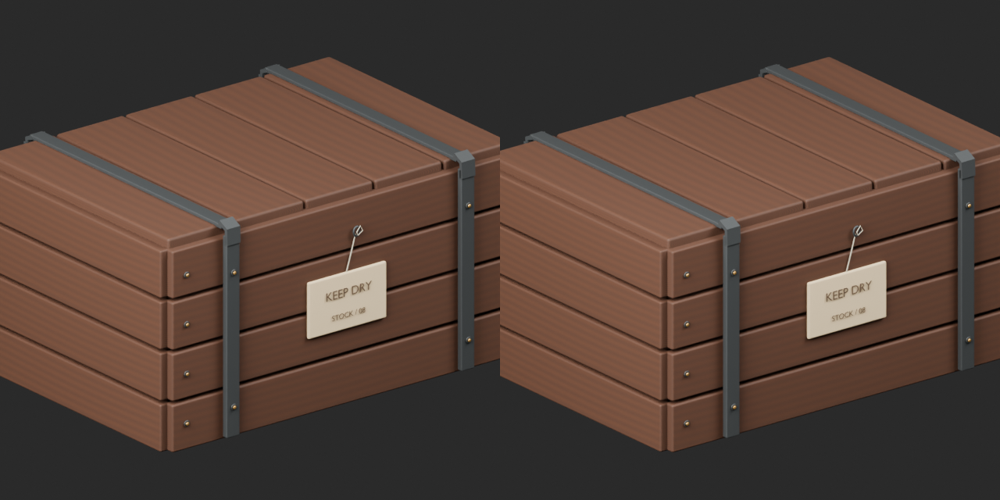](../previews/quality-wh007-bn008-v1/WH_NEW_008__repair_close_comparison.png)

Left: original; right: accepted revision/variant, identical camera/light/scale.
