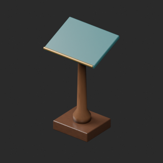
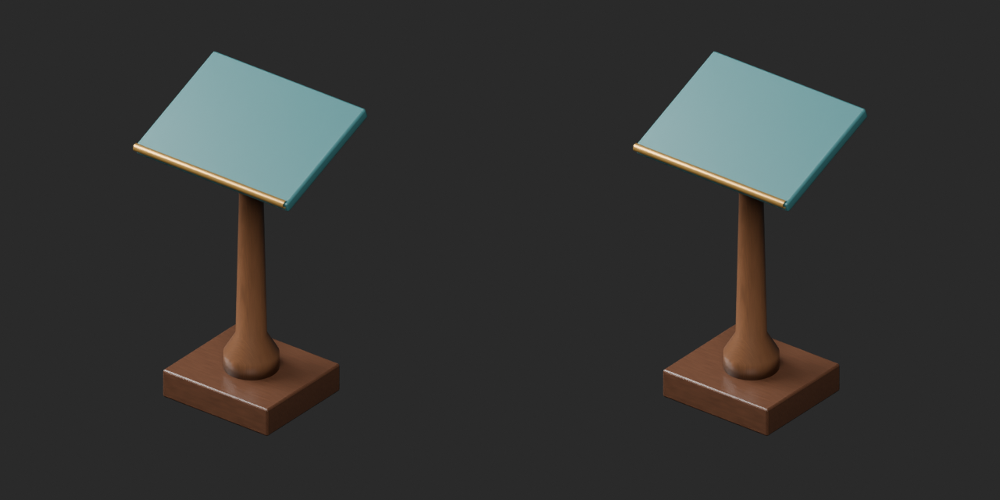
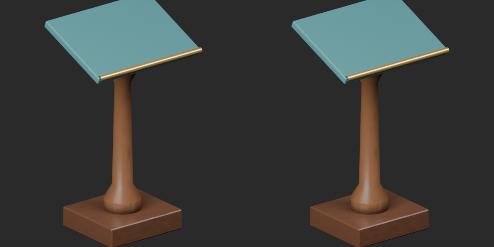
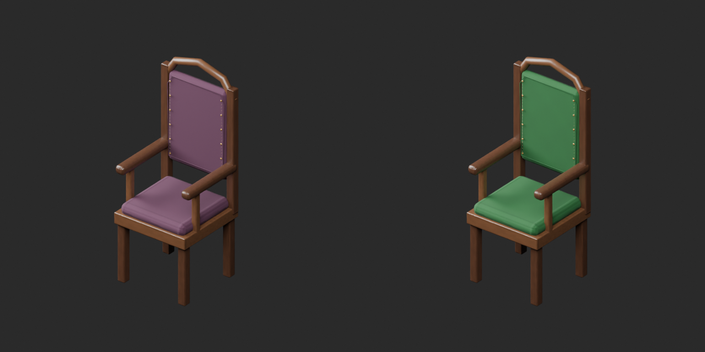
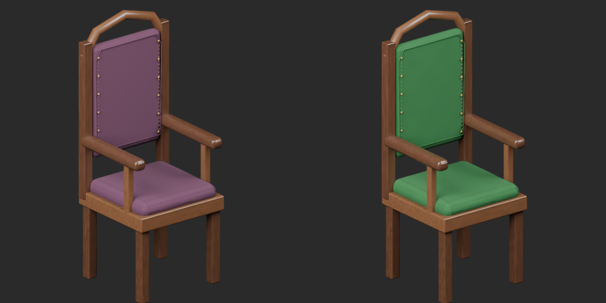

# Quality29 / 品質第29便 / 质量第29批

Base1008 unchanged; material variants130=129+1 counted separately. WS014 topology revision adds no model. Old versions retained.

WS014 removes128 strictly zero-area column triangles, retaining all positive surface faces and UV.1480 to1352 triangles; final BLEND/GLB reimports have zero exactly-zero-area faces. WS015 green upholstery retains original geometry/UV, wood/metal and other material properties.

WS014は柱の面積ゼロ三角形128枚のみ除去した改訂で非加算。正の面とUVを保持。WS015緑張地は形状UVを保持した色variant1件として別集計。

WS014仅移除128个严格零面积三角形，保留正面积表面与UV，不新增模型。WS015绿色软垫保持几何UV，单独计为1个材质变体。

Same camera/light/scale comparisons. Producer final-ZIP guard binds final packages, inputs, scripts, run/time/build and packed-image decoding. Public artifact matching is pending. Publication did not rerun Blender.

Assessed286 source records,722 remain;54 budget/redesign issues remain. WS00923076tri, WS013628692tri and WS01853460tri exceed their budgets. WS013 requires repeated-detail redesign, no automatic decimation adopted. No working drawers, climbing/load safety, screw mechanism, collision, transparent rendering across engines or Blender4.3.2 guarantee. Camera does not establish intended pivot/front.

Models/embedded materials only CC0; images separate catalogue artwork. [License](../LICENSE.md). Private reports/code excluded.

## WS_014__repair — Sloped reading lectern

傾斜天板の書見台

Removed128 strictly zero-area column triangles; all positive surface faces and UV retained. Topology revision, not a new model.

[ZIP · BLEND/GLB](https://raw.githubusercontent.com/k3peta/tales-on-a-table/main/distributions/quality-ws009-018-v1/WS_014__repair_CC0.zip)

Left: original; right: accepted revision/variant, identical camera/light/scale.

## WS_015__color_green — High-backed reading chair

高背の読書椅子

Green upholstery mapped micrograin; original geometry and UV retained. Wood, metal and all other material parameters unchanged.

[ZIP · BLEND/GLB](https://raw.githubusercontent.com/k3peta/tales-on-a-table/main/distributions/quality-ws009-018-v1/WS_015__color_green_CC0.zip)

Left: original; right: accepted revision/variant, identical camera/light/scale.
