# Quality30 / 品質第30便 / 质量第30批

Base1008 unchanged; material variants131=130+1 counted separately. Four topology revisions add no models. Old versions retained.

Only strictly zero-area triangles removed: WS019 feather8 (61216 to61208tri), WS020 leaves42 (56384 to56342tri,14 tiny positive faces retained), WS022 lens96 (2704 to2608tri), WS023 envelope/sand384 (5632 to5248tri). All positive surfaces and UV retained. WS019/020 remain over20k budget. WS024 orange painted lampshade preserves geometry/UV and other material properties; no emission added.

面積ゼロの三角形だけを除去した改訂4件は非加算。正の面とUVを保持。WS024橙色ランプ傘のみ同形色variant1として別集計、発光追加なし。WS021修復は公開検査保留、暗くなるガラス色候補は棄却、いずれも配布対象外。

4个严格零面积面清理修订不新增模型，保留正面积表面与UV。WS024橙色灯罩为1个同形材质变体，无新增发光。WS021修复待审，暗色玻璃候选拒绝，均不发布。

Same camera/light/scale comparisons. Producer final-ZIP guard binds approved packages only, input/model/script hashes and run/time/build. Material-property tests for attempted candidates are not publication approval. Public artifact matching is pending. Publication did not rerun Blender.

Assessed296 source records,712 remain;56 budget/redesign issues remain. WS021 publication scan unresolved; no credential exposure is established. WS026 coarse lid grain and joint gaps need diagnosis. No optical accuracy, sand simulation/timing, astronomy precision, working mechanisms, collision, load or Blender4.3.2 guarantee.

Models/embedded materials only CC0; images separate catalogue artwork. [License](../LICENSE.md). Private reports/code excluded.

## WS_019__repair — Narrow-neck feather specimen jar

羽根標本の細口瓶

Strictly zero-area triangle cleanup only; all positive surfaces and UV retained. No new base. Original small-prop polygon budget still exceeded for WS019/020.

[ZIP · BLEND/GLB](https://raw.githubusercontent.com/k3peta/tales-on-a-table/main/distributions/quality-ws019-028-v1/WS_019__repair_CC0.zip)

[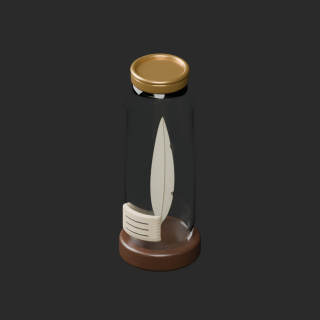](../previews/quality-ws019-028-v1/WS_019__repair_thumb.png)

[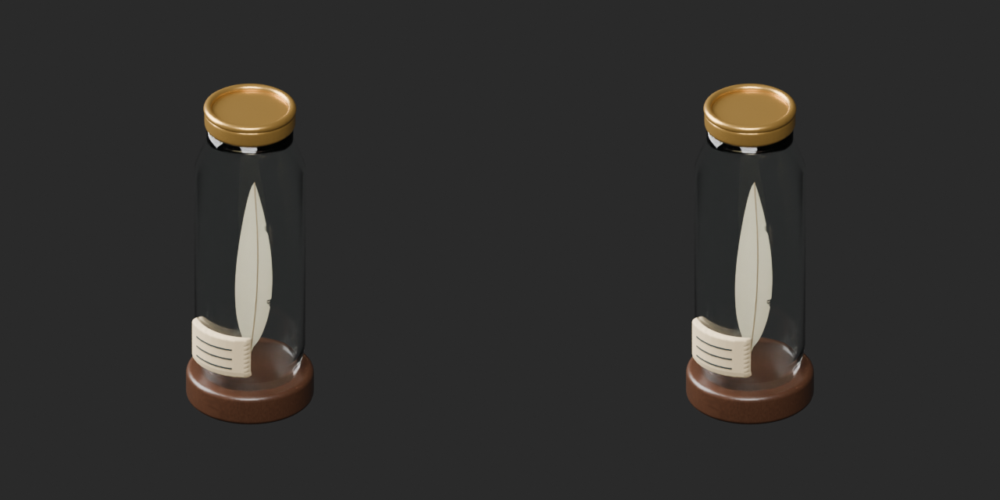](../previews/quality-ws019-028-v1/WS_019__repair_overview_comparison.png)

[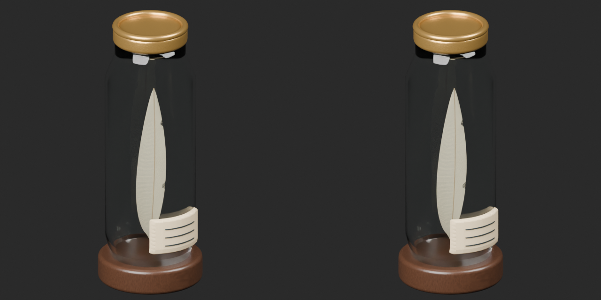](../previews/quality-ws019-028-v1/WS_019__repair_close_comparison.png)

Left: original; right: accepted revision/variant, identical camera/light/scale.

## WS_020__repair — Botanical specimen dome

植物採集のドーム

Strictly zero-area triangle cleanup only; all positive surfaces and UV retained. No new base. Original small-prop polygon budget still exceeded for WS019/020.

[ZIP · BLEND/GLB](https://raw.githubusercontent.com/k3peta/tales-on-a-table/main/distributions/quality-ws019-028-v1/WS_020__repair_CC0.zip)

[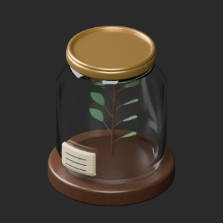](../previews/quality-ws019-028-v1/WS_020__repair_thumb.png)

[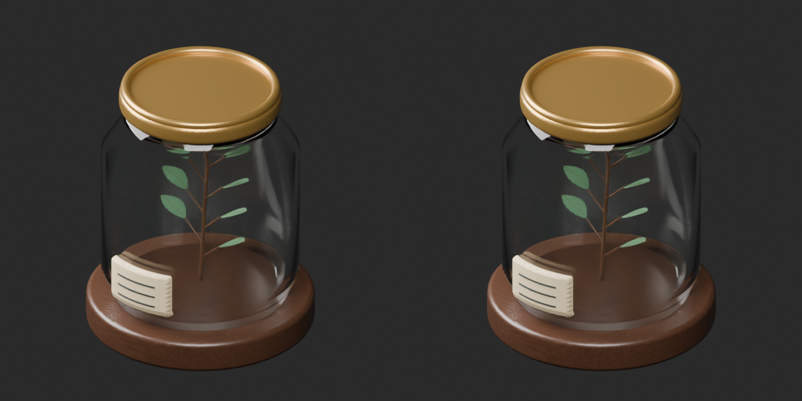](../previews/quality-ws019-028-v1/WS_020__repair_overview_comparison.png)

[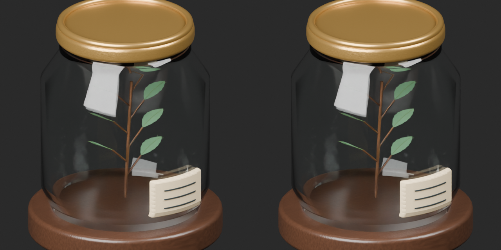](../previews/quality-ws019-028-v1/WS_020__repair_close_comparison.png)

Left: original; right: accepted revision/variant, identical camera/light/scale.

## WS_022__repair — Desk magnifying glass

机上の拡大鏡

Strictly zero-area triangle cleanup only; all positive surfaces and UV retained. No new base. Original small-prop polygon budget still exceeded for WS019/020.

[ZIP · BLEND/GLB](https://raw.githubusercontent.com/k3peta/tales-on-a-table/main/distributions/quality-ws019-028-v1/WS_022__repair_CC0.zip)

[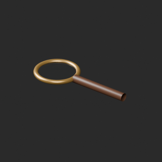](../previews/quality-ws019-028-v1/WS_022__repair_thumb.png)

[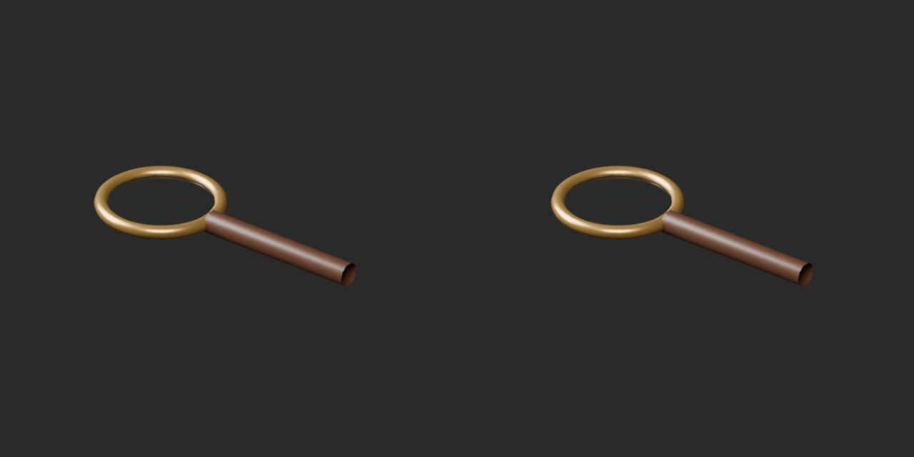](../previews/quality-ws019-028-v1/WS_022__repair_overview_comparison.png)

[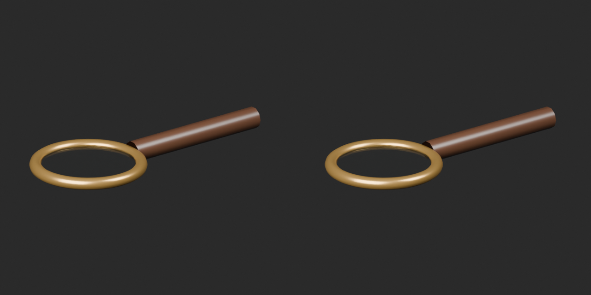](../previews/quality-ws019-028-v1/WS_022__repair_close_comparison.png)

Left: original; right: accepted revision/variant, identical camera/light/scale.

## WS_023__repair — Hourglass with brass columns

真鍮柱の砂時計

Strictly zero-area triangle cleanup only; all positive surfaces and UV retained. No new base. Original small-prop polygon budget still exceeded for WS019/020.

[ZIP · BLEND/GLB](https://raw.githubusercontent.com/k3peta/tales-on-a-table/main/distributions/quality-ws019-028-v1/WS_023__repair_CC0.zip)

[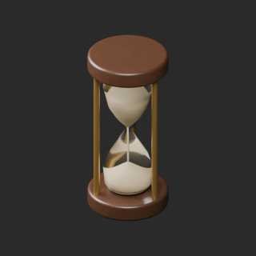](../previews/quality-ws019-028-v1/WS_023__repair_thumb.png)

[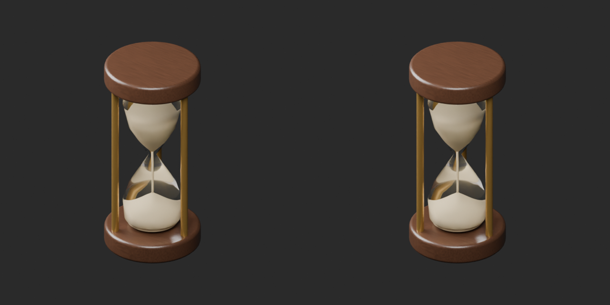](../previews/quality-ws019-028-v1/WS_023__repair_overview_comparison.png)

[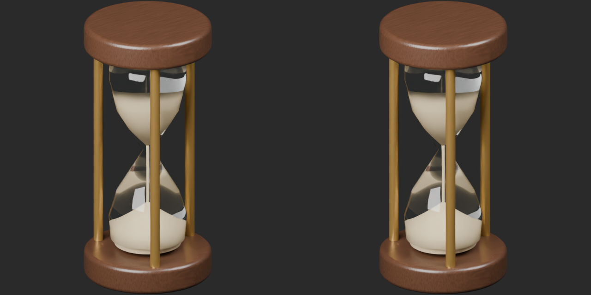](../previews/quality-ws019-028-v1/WS_023__repair_close_comparison.png)

Left: original; right: accepted revision/variant, identical camera/light/scale.

## WS_024__color_orange — Hooded research lamp

遮光フード付き研究灯

Orange lampshade basecolor texture; original geometry/UV and other material properties retained; no added emission.

[ZIP · BLEND/GLB](https://raw.githubusercontent.com/k3peta/tales-on-a-table/main/distributions/quality-ws019-028-v1/WS_024__color_orange_CC0.zip)

[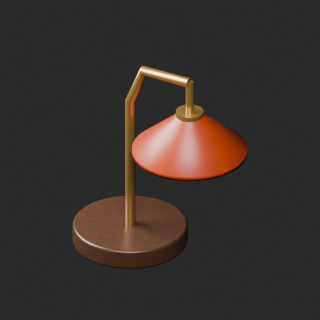](../previews/quality-ws019-028-v1/WS_024__color_orange_thumb.png)

[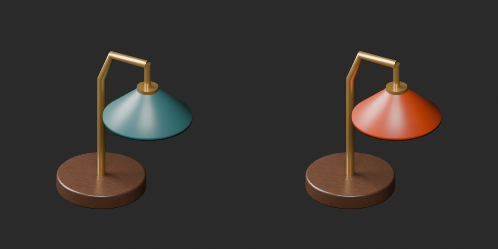](../previews/quality-ws019-028-v1/WS_024__color_orange_overview_comparison.png)

[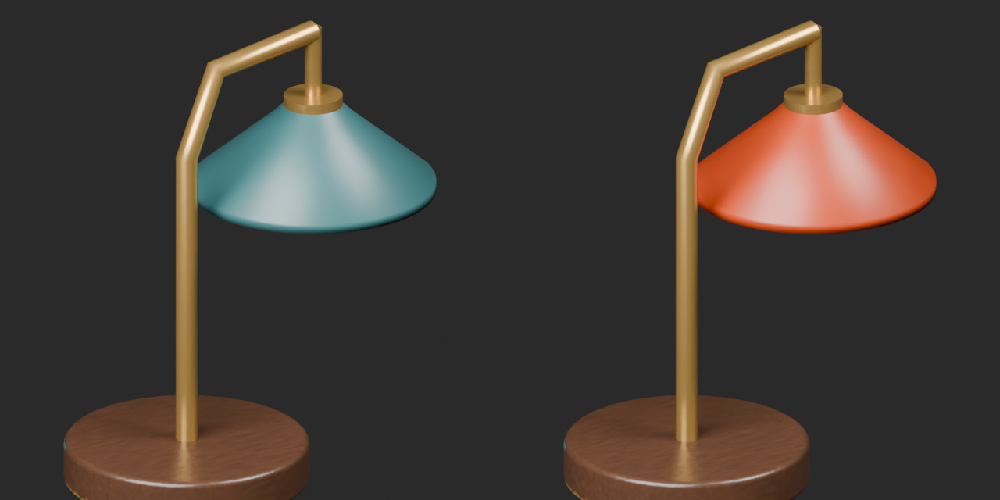](../previews/quality-ws019-028-v1/WS_024__color_orange_close_comparison.png)

Left: original; right: accepted revision/variant, identical camera/light/scale.
