# Quality31 / 品質第31便 / 质量第31批

Base1008 unchanged; material variants132=131+1 counted separately. Five topology/UV revisions add no models. Old versions retained. Separate WS021 repair also adds no count.

Zero-area faces removed: WS02932, WS031224, WS03628, WS037256, WS038128. Positive surfaces retained. Missing UV added on WS031 six glass panes, WS037 three objects and WS03833 objects: these are UV revisions, NOT original-UV-invariant. WS036 blue leather uses the cleaned WS036 repair baseline with retained positive surfaces and UV; paper, ink and strings unchanged.

修復5件は非加算。WS031のガラス6枚、WS037の3物体、WS038の33物体には欠落UVを追加し、元UV完全不変とは扱いません。青革variant1はWS036修復後を基準に形状UVを保持。旧版保全。

5个修订不新增模型。WS031六块玻璃、WS037三个对象、WS038三十三个对象补充缺失UV，不宣称原始UV完全不变。蓝皮变体以修复后的WS036为基准。

Same camera/light/scale comparisons. Producer final-ZIP guard binds accepted final packages and exact inputs/scripts, run/time/build. Strict scan and other-material contract passed. Public artifact matching is pending. Publication did not rerun Blender.

Assessed306 source records,702 remain;56 budget/redesign issues remain. WS03527 constant-color mineral meshes lack UV, a future texture-mapping limitation. FCS103 partly unsupported-looking top plates remain diagnosis pending. No working mechanism, collision/load, weighing calibration or Blender4.3.2 guarantee.

Models/embedded materials only CC0; images separate catalogue artwork. [License](../LICENSE.md). Private reports/code excluded.

## WS_029__repair — Working calculation slate

計算途中の石板

Exact-zero-area cleanup only, all positive surfaces retained; missing UV added where recorded in revision notes. No new base.

[ZIP · BLEND/GLB](https://raw.githubusercontent.com/k3peta/tales-on-a-table/main/distributions/quality-ws029-038-v1/WS_029__repair_CC0.zip)

[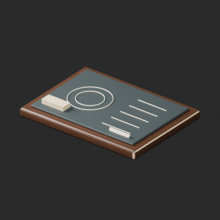](../previews/quality-ws029-038-v1/WS_029__repair_thumb.png)

[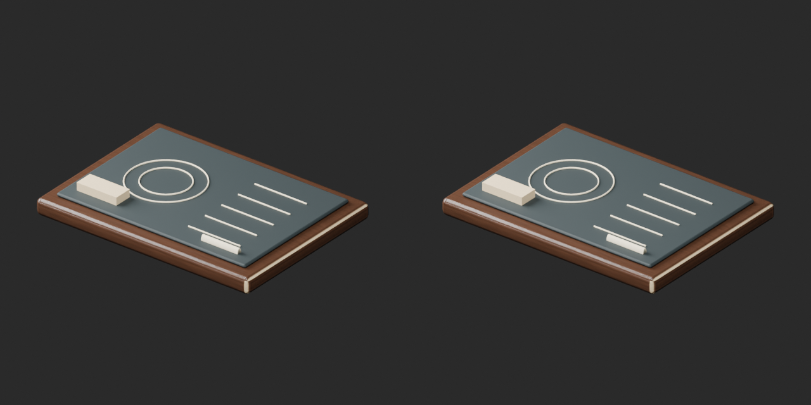](../previews/quality-ws029-038-v1/WS_029__repair_overview_comparison.png)

[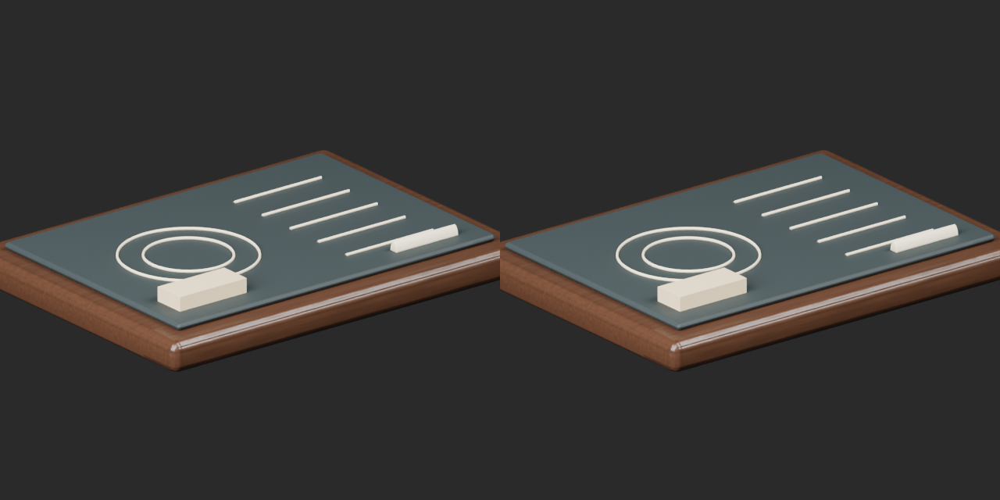](../previews/quality-ws029-038-v1/WS_029__repair_close_comparison.png)

Left: original; right: accepted revision/variant, identical camera/light/scale.

## WS_031__repair — Hexagonal brass lantern

六角真鍮ランタン

Exact-zero-area cleanup only, all positive surfaces retained; missing UV added where recorded in revision notes. No new base.

[ZIP · BLEND/GLB](https://raw.githubusercontent.com/k3peta/tales-on-a-table/main/distributions/quality-ws029-038-v1/WS_031__repair_CC0.zip)

[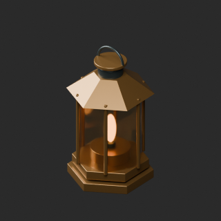](../previews/quality-ws029-038-v1/WS_031__repair_thumb.png)

[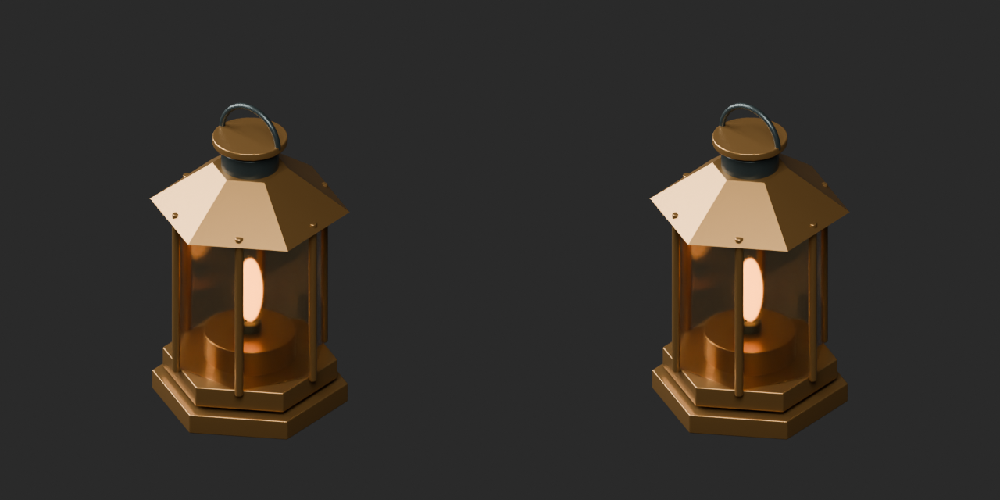](../previews/quality-ws029-038-v1/WS_031__repair_overview_comparison.png)

[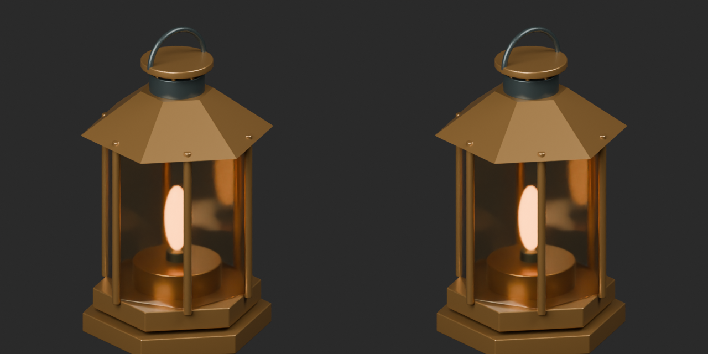](../previews/quality-ws029-038-v1/WS_031__repair_close_comparison.png)

Left: original; right: accepted revision/variant, identical camera/light/scale.

## WS_036__repair — Open leather document portfolio

開いた革の資料挟み

Exact-zero-area cleanup only, all positive surfaces retained; missing UV added where recorded in revision notes. No new base.

[ZIP · BLEND/GLB](https://raw.githubusercontent.com/k3peta/tales-on-a-table/main/distributions/quality-ws029-038-v1/WS_036__repair_CC0.zip)

[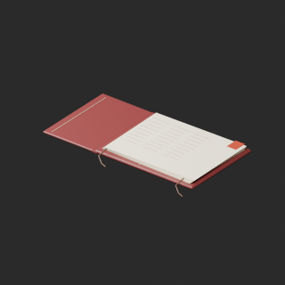](../previews/quality-ws029-038-v1/WS_036__repair_thumb.png)

[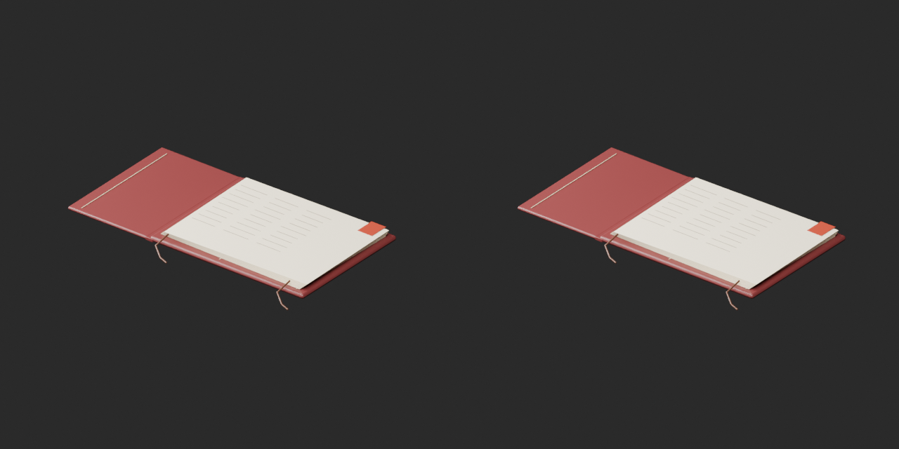](../previews/quality-ws029-038-v1/WS_036__repair_overview_comparison.png)

[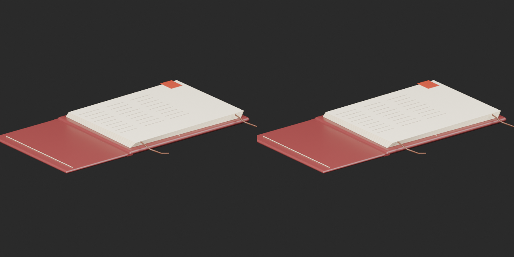](../previews/quality-ws029-038-v1/WS_036__repair_close_comparison.png)

Left: original; right: accepted revision/variant, identical camera/light/scale.

## WS_036__color_blue — Open leather document portfolio

開いた革の資料挟み

Blue leather texture on WS036 cleaned geometry baseline; same positive surface and retained UV as repair. Original paper/ink/strings and material properties unchanged.

[ZIP · BLEND/GLB](https://raw.githubusercontent.com/k3peta/tales-on-a-table/main/distributions/quality-ws029-038-v1/WS_036__color_blue_CC0.zip)

[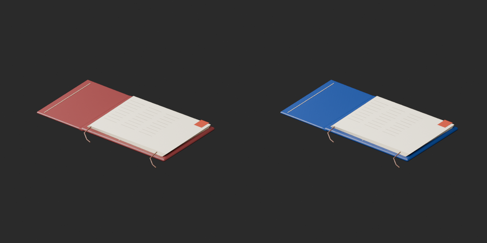](../previews/quality-ws029-038-v1/WS_036__color_blue_overview_comparison.png)

[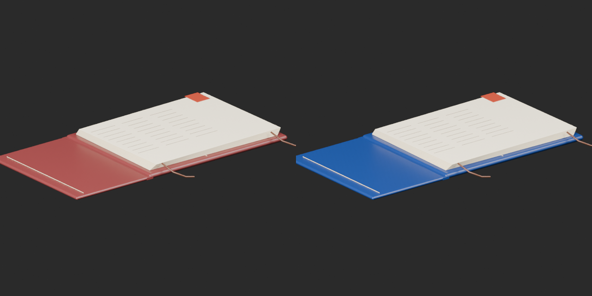](../previews/quality-ws029-038-v1/WS_036__color_blue_close_comparison.png)

Left: original; right: accepted revision/variant, identical camera/light/scale.

## WS_037__repair — Apothecary balance

研究用の皿天秤

Exact-zero-area cleanup only, all positive surfaces retained; missing UV added where recorded in revision notes. No new base.

[ZIP · BLEND/GLB](https://raw.githubusercontent.com/k3peta/tales-on-a-table/main/distributions/quality-ws029-038-v1/WS_037__repair_CC0.zip)

[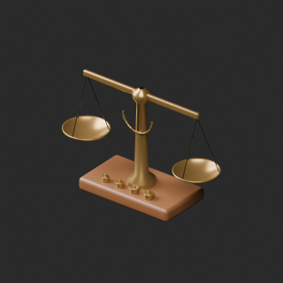](../previews/quality-ws029-038-v1/WS_037__repair_thumb.png)

[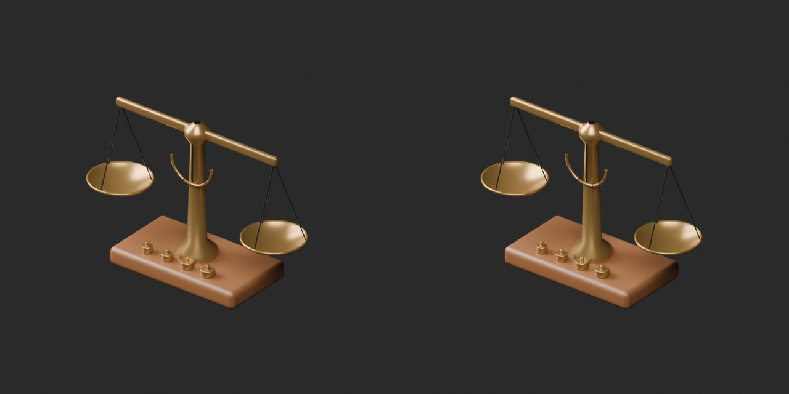](../previews/quality-ws029-038-v1/WS_037__repair_overview_comparison.png)

[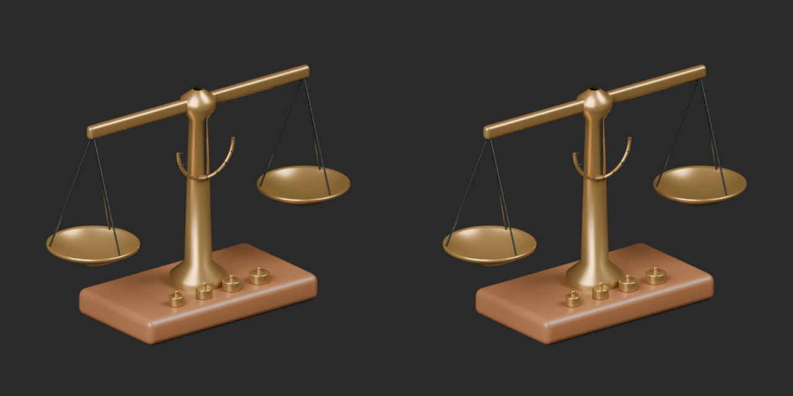](../previews/quality-ws029-038-v1/WS_037__repair_close_comparison.png)

Left: original; right: accepted revision/variant, identical camera/light/scale.

## WS_038__repair — Scroll sorting carousel

巻物の回転整理台

Exact-zero-area cleanup only, all positive surfaces retained; missing UV added where recorded in revision notes. No new base.

[ZIP · BLEND/GLB](https://raw.githubusercontent.com/k3peta/tales-on-a-table/main/distributions/quality-ws029-038-v1/WS_038__repair_CC0.zip)

[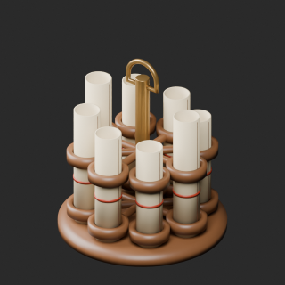](../previews/quality-ws029-038-v1/WS_038__repair_thumb.png)

[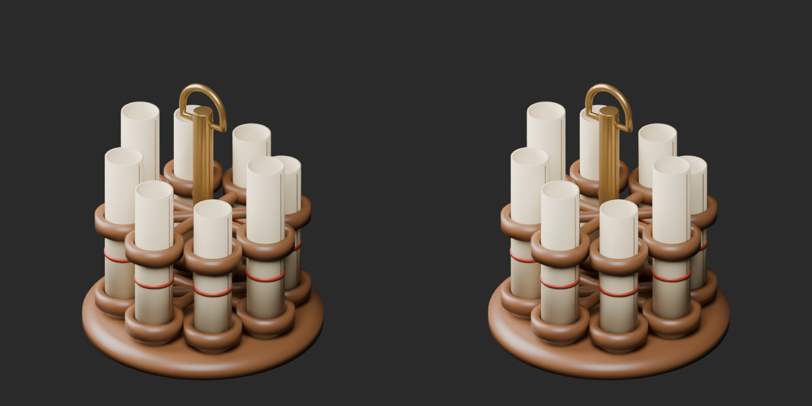](../previews/quality-ws029-038-v1/WS_038__repair_overview_comparison.png)

[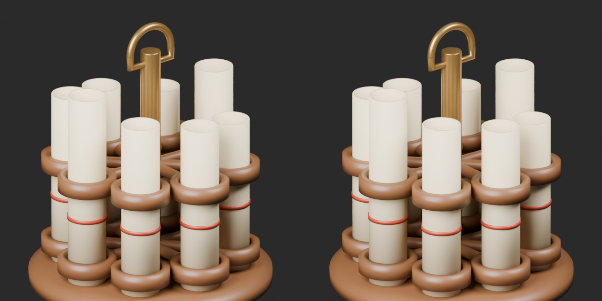](../previews/quality-ws029-038-v1/WS_038__repair_close_comparison.png)

Left: original; right: accepted revision/variant, identical camera/light/scale.
