# Quality32 / 品質第32便 / 质量第32批

Base1008 unchanged; material variants133=132+1 counted separately. Four revisions add no model. Old versions and preliminary validation preserved; final validation v2 is authoritative.

Zero-area triangles removed: CP003192, CP004192, CP00564, CP010256. Positive surfaces retained. Missing UV added to CP003 three layers and CP004 one layer: not original-UV-invariant. CP004 green goatskin variant uses the cleaned repair geometry/UV baseline, canvas and other materials unchanged. CP00328596tri remains over20k budget; cleanup is not complete lightweight redesign.

改訂4件は非加算。CP003に欠落UV3層、CP004に1層を追加し、元UV完全不変とは扱いません。緑革variant1はCP004修復後形状UV基準。CP003の予算超過は未解消。最終検証v2のみを正本として照合。

4个修订不新增模型。CP003补充3层UV、CP004补充1层UV，绿色皮革变体以修复后的CP004为基准。CP003仍超预算。仅最终验证v2为依据。

Same camera/light/scale comparisons. Producer final-ZIP v2 guard binds accepted packages, input/script/model hashes and run/time/build. Public ZIP/member hashes match the final guarded artifacts. Publication did not rerun Blender.

Assessed316 source records,692 remain;57 budget/redesign issues remain. Constant-color missing UV retained: WS0395 paper parts, WS04046 meshes, CP0019 parts, CP0021 part. Future texture-mapping limitations, not proven visual defects. HCV103 peg and HCV303 brace contact diagnoses remain open. No optics, navigation calibration, load, steering/telescoping/hinge/pulley motion, collision or Blender4.3.2 guarantee.

Models/embedded materials only CC0; images separate catalogue artwork. [License](../LICENSE.md). Private reports/code excluded.

## CP_003__repair — Three-section hand telescope

三段伸縮の携帯望遠鏡

Exact-zero-area cleanup only, all positive surfaces retained; missing UV added where recorded in revision notes. No new base.

[ZIP · BLEND/GLB](https://raw.githubusercontent.com/k3peta/tales-on-a-table/main/distributions/quality-ws039-cp012-v1/CP_003__repair_CC0.zip)

[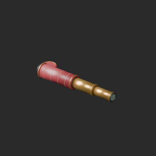](../previews/quality-ws039-cp012-v1/CP_003__repair_thumb.png)

[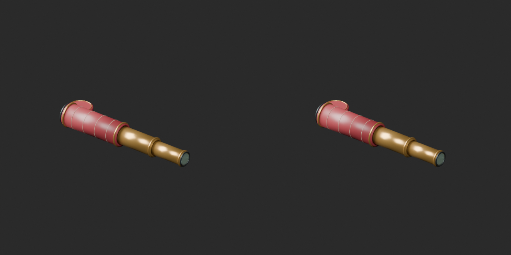](../previews/quality-ws039-cp012-v1/CP_003__repair_overview_comparison.png)

[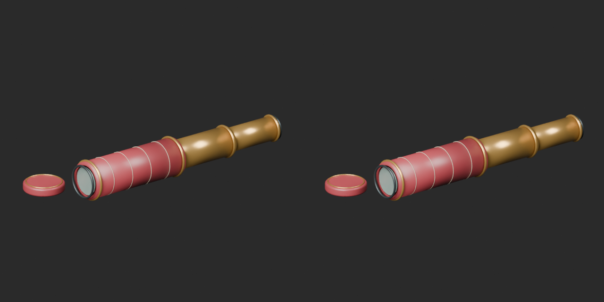](../previews/quality-ws039-cp012-v1/CP_003__repair_close_comparison.png)

Left: original; right: accepted revision/variant, identical camera/light/scale.

## CP_004__repair — Hollow leather telescope case

望遠鏡の筒形革ケース

Exact-zero-area cleanup only, all positive surfaces retained; missing UV added where recorded in revision notes. No new base.

[ZIP · BLEND/GLB](https://raw.githubusercontent.com/k3peta/tales-on-a-table/main/distributions/quality-ws039-cp012-v1/CP_004__repair_CC0.zip)

[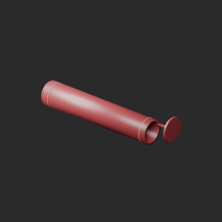](../previews/quality-ws039-cp012-v1/CP_004__repair_thumb.png)

[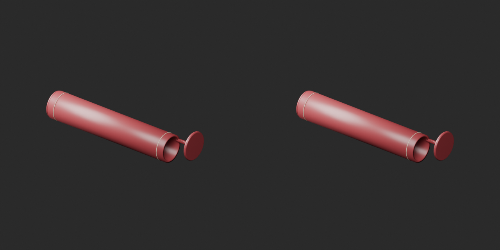](../previews/quality-ws039-cp012-v1/CP_004__repair_overview_comparison.png)

[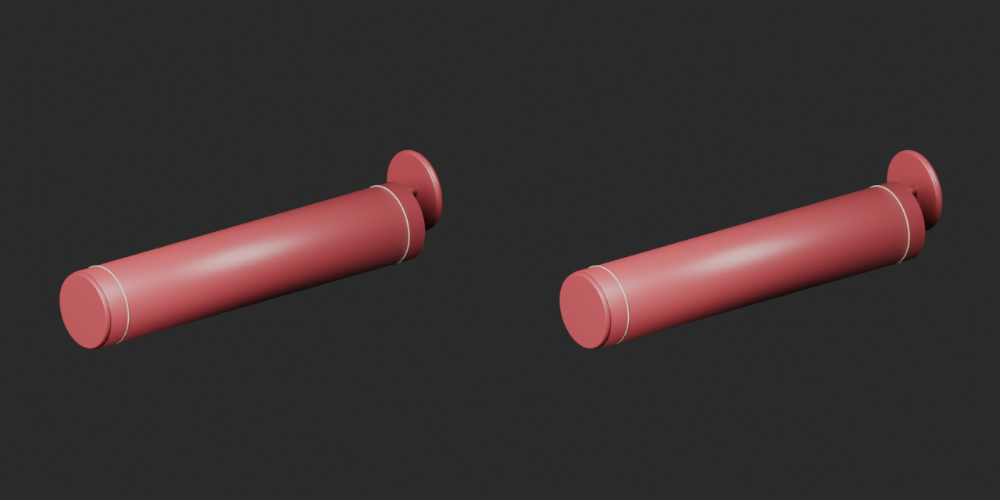](../previews/quality-ws039-cp012-v1/CP_004__repair_close_comparison.png)

Left: original; right: accepted revision/variant, identical camera/light/scale.

## CP_004__color_green — Hollow leather telescope case

望遠鏡の筒形革ケース

Green goatskin texture on CP004 cleaned geometry baseline; same positive surface and retained UV as repair. Original canvas and other material properties unchanged.

[ZIP · BLEND/GLB](https://raw.githubusercontent.com/k3peta/tales-on-a-table/main/distributions/quality-ws039-cp012-v1/CP_004__color_green_CC0.zip)

[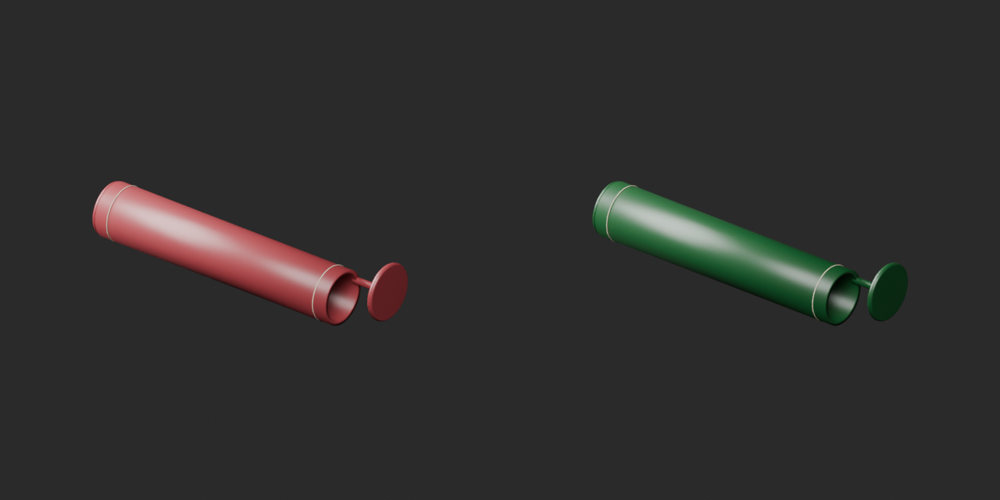](../previews/quality-ws039-cp012-v1/CP_004__color_green_overview_comparison.png)

[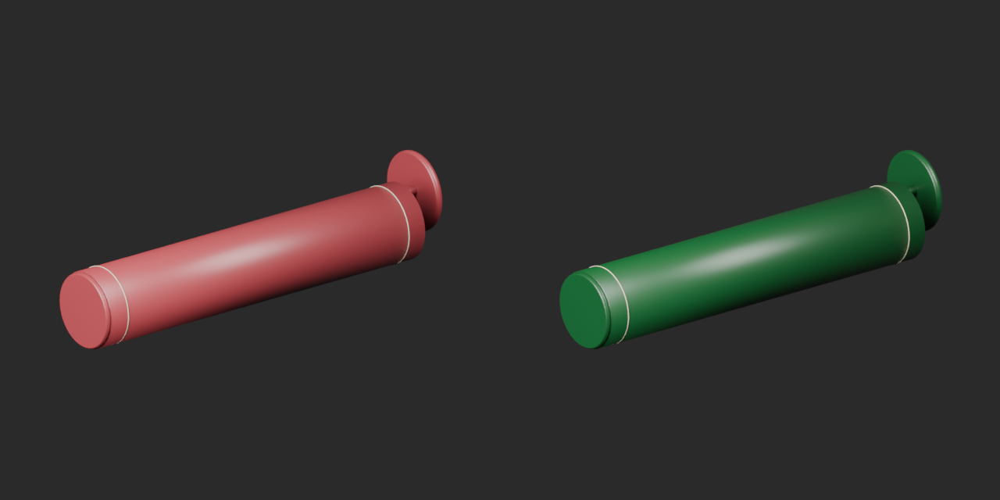](../previews/quality-ws039-cp012-v1/CP_004__color_green_close_comparison.png)

Left: original; right: accepted revision/variant, identical camera/light/scale.

## CP_005__repair — Handheld sextant

握り付きの手持ち六分儀

Exact-zero-area cleanup only, all positive surfaces retained; missing UV added where recorded in revision notes. No new base.

[ZIP · BLEND/GLB](https://raw.githubusercontent.com/k3peta/tales-on-a-table/main/distributions/quality-ws039-cp012-v1/CP_005__repair_CC0.zip)

[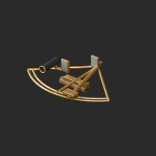](../previews/quality-ws039-cp012-v1/CP_005__repair_thumb.png)

[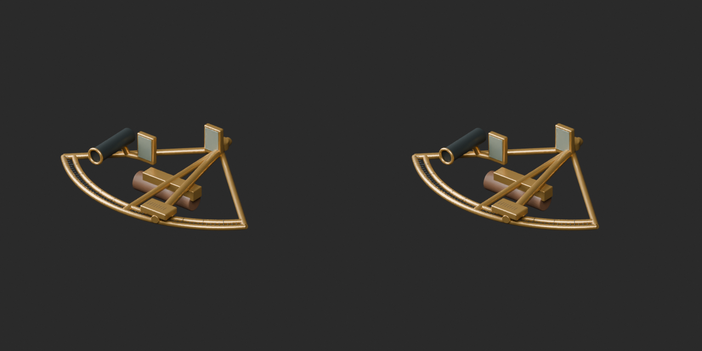](../previews/quality-ws039-cp012-v1/CP_005__repair_overview_comparison.png)

[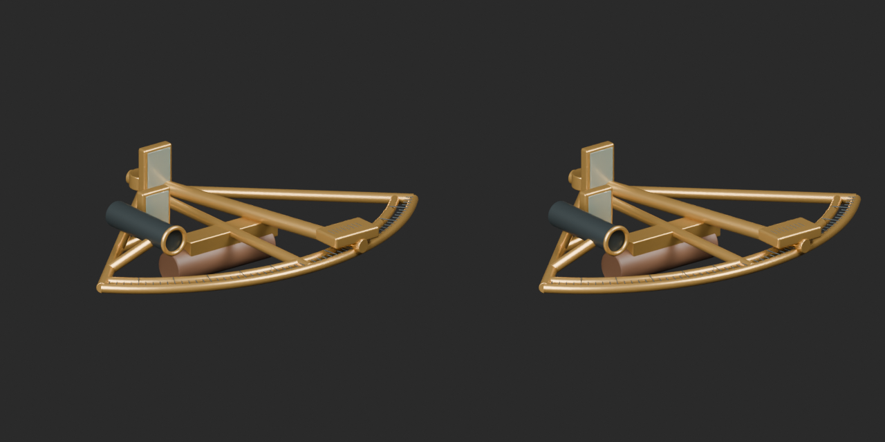](../previews/quality-ws039-cp012-v1/CP_005__repair_close_comparison.png)

Left: original; right: accepted revision/variant, identical camera/light/scale.

## CP_010__repair — Double-sheave block

二輪溝の複滑車

Exact-zero-area cleanup only, all positive surfaces retained; missing UV added where recorded in revision notes. No new base.

[ZIP · BLEND/GLB](https://raw.githubusercontent.com/k3peta/tales-on-a-table/main/distributions/quality-ws039-cp012-v1/CP_010__repair_CC0.zip)

[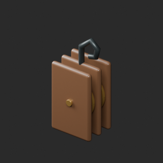](../previews/quality-ws039-cp012-v1/CP_010__repair_thumb.png)

[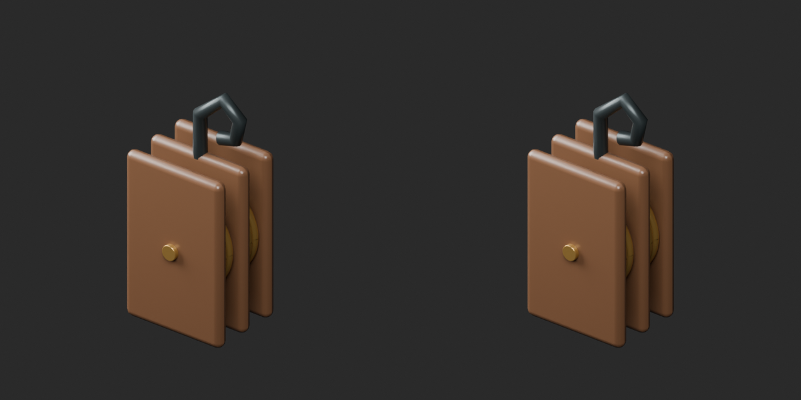](../previews/quality-ws039-cp012-v1/CP_010__repair_overview_comparison.png)

[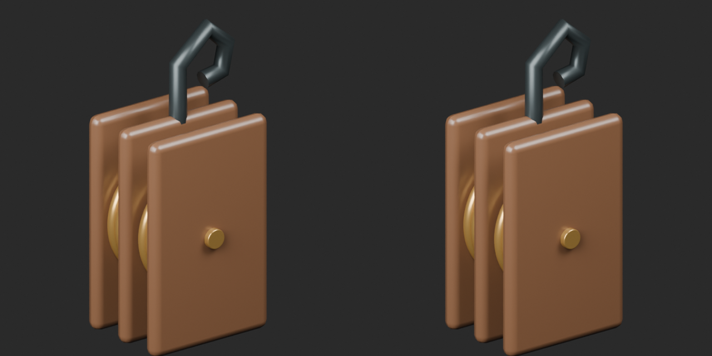](../previews/quality-ws039-cp012-v1/CP_010__repair_close_comparison.png)

Left: original; right: accepted revision/variant, identical camera/light/scale.

[Exact package validation evidence](../distributions/quality-ws039-cp012-v1/validation.json).
