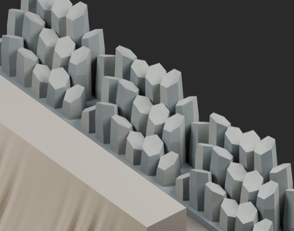
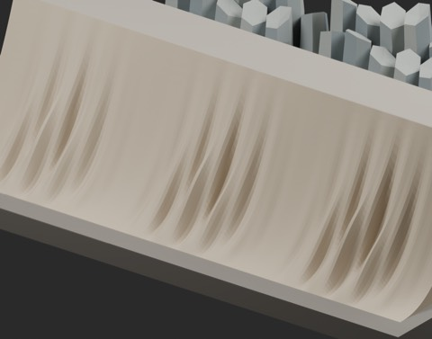
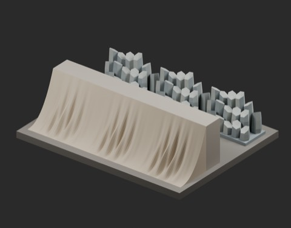

# Natural rock forms: two static models

909 previous records + 2 = 911 distribution records. Global historical shape independence is unconfirmed. BLEND and GLB are two formats per record.

### NR101_FlowstoneApron

[ZIP](https://raw.githubusercontent.com/k3peta/tales-on-a-table/main/distributions/natural-rock-forms-v1/NR101_FlowstoneApron_CC0.zip)

231169

### NR102_ColumnarLedge

[ZIP](https://raw.githubusercontent.com/k3peta/tales-on-a-table/main/distributions/natural-rock-forms-v1/NR102_ColumnarLedge_CC0.zip)

92874

## Placement and limitations

- NR101_FlowstoneApron: 2m wide rock apron. Toe y-.8 at Z0, back y.5 topZ1.6. Matching E/W profile for 2m pitch. Longitudinal folds on curved solid surface. Cave dressing, not a walkable ramp.
- NR102_ColumnarLedge: 2x1m grounded columnar rock cluster. Polygonal vertical fracture faces with chipped/dished caps. Common baseZ0..0.1. Intended exposed rock dressing; top silhouette does not form a sealed terrain-tile port.

Metres, Z up, origin and ground at zero. NR101 matching side profiles permit 2 m pitch placement; a separate wall or rock body is needed behind it. It is not a walking ramp. NR102 bases can meet, but the upper broken silhouette is not a watertight terrain connector. Repetition remains visible when three copies are placed in a row. These models do not constitute a completed renovation of an existing mine scene.

Blender 5.2.2 reloading, dimensions, ground contact and sampled seam geometry were checked by production. Collision, actual walking, structural strength, geological fidelity, Blender 4.3.2 compatibility and global historical independence remain unverified. Internal overlaps are possible; a watertight single body for 3D printing is not guaranteed. Append the named Collection from BLEND.

Model geometry and embedded display materials only: CC0-1.0. No code, images, private evidence or assembled scenes included. [Checksums](../distributions/natural-rock-forms-v1/SHA256SUMS.txt).

## 実作画像 / Actual renders

完成バッチの配置・接写。画像は閲覧用でモデルCC0の対象外です。[既存の画像利用条件](../LICENSE.md)を維持します。

### NR101_FlowstoneApron

FlowstoneApron

[ZIP](https://raw.githubusercontent.com/k3peta/tales-on-a-table/main/distributions/natural-rock-forms-v1/NR101_FlowstoneApron_CC0.zip)

### NR102_ColumnarLedge

ColumnarLedge

[ZIP](https://raw.githubusercontent.com/k3peta/tales-on-a-table/main/distributions/natural-rock-forms-v1/NR102_ColumnarLedge_CC0.zip)

