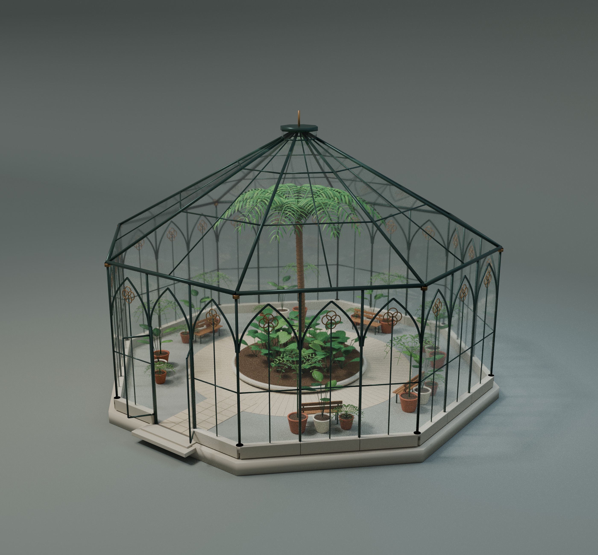

# 八角形のゴチック温室

12方位配置レコード、6設計。通常壁7方位は同一設計、ARCH_15は南側入口壁です。すべて上部ガラスを含む最終closed版。

各パーツは組立中心とワールド配置を保持しています。原点をリセットせず一緒に読み込んでください。中央ヤシ・ベンチ・既存植物・完成配置シーンはこの単体配布に含みません。モデルと必要な同梱材質のみCC0。記事と作例画像は対象外です。

| ID | 元ID | 素材 | ZIP |
|---|---|---|---|
| OC001 | ARCH_01 | Octagonal stone foundation | [ZIP](https://github.com/k3peta/tales-on-a-table/releases/download/v2026.10.21-octagonal-conservatory/OC001_CC0.zip) |
| OC002 | ARCH_02 | Central raised bed | [ZIP](https://github.com/k3peta/tales-on-a-table/releases/download/v2026.10.21-octagonal-conservatory/OC002_CC0.zip) |
| OC010 | ARCH_10 | Gothic wall sector | [ZIP](https://github.com/k3peta/tales-on-a-table/releases/download/v2026.10.21-octagonal-conservatory/OC010_CC0.zip) |
| OC011 | ARCH_11 | Gothic wall sector | [ZIP](https://github.com/k3peta/tales-on-a-table/releases/download/v2026.10.21-octagonal-conservatory/OC011_CC0.zip) |
| OC012 | ARCH_12 | Gothic wall sector | [ZIP](https://github.com/k3peta/tales-on-a-table/releases/download/v2026.10.21-octagonal-conservatory/OC012_CC0.zip) |
| OC013 | ARCH_13 | Gothic wall sector | [ZIP](https://github.com/k3peta/tales-on-a-table/releases/download/v2026.10.21-octagonal-conservatory/OC013_CC0.zip) |
| OC014 | ARCH_14 | Gothic wall sector | [ZIP](https://github.com/k3peta/tales-on-a-table/releases/download/v2026.10.21-octagonal-conservatory/OC014_CC0.zip) |
| OC015 | ARCH_15 | Gothic wall sector (entrance / south) | [ZIP](https://github.com/k3peta/tales-on-a-table/releases/download/v2026.10.21-octagonal-conservatory/OC015_CC0.zip) |
| OC016 | ARCH_16 | Gothic wall sector | [ZIP](https://github.com/k3peta/tales-on-a-table/releases/download/v2026.10.21-octagonal-conservatory/OC016_CC0.zip) |
| OC017 | ARCH_17 | Gothic wall sector | [ZIP](https://github.com/k3peta/tales-on-a-table/releases/download/v2026.10.21-octagonal-conservatory/OC017_CC0.zip) |
| OC020 | ARCH_20 | High octagonal glass roof | [ZIP](https://github.com/k3peta/tales-on-a-table/releases/download/v2026.10.21-octagonal-conservatory/OC020_CC0.zip) |
| OC021 | ARCH_21 | Entrance details | [ZIP](https://github.com/k3peta/tales-on-a-table/releases/download/v2026.10.21-octagonal-conservatory/OC021_CC0.zip) |

## 作例・カタログ画像

画像は単体のすべてを示す保証ではありません。完成シーンは配布対象外です。画像にモデル用CC0を適用しません。

[Release](https://github.com/k3peta/tales-on-a-table/releases/tag/v2026.10.21-octagonal-conservatory) · [SHA256](../releases/octagonal_conservatory/SHA256SUMS.txt) · [License](../LICENSE.md)
