# 画家のアトリエ

24配布レコード、24設計。

各単体ZIPはBLEND・GLB・README・ライセンスを含みます。モデルと必要な同梱材質のみCC0 1.0。記事・作例画像・完成配置シーンは対象外です。
BLENDは単体データのため、一部はFile > Appendでオブジェクト/コレクションを読み込んでください。GLBは微細バンプ等の表現がBlenderと異なることがあります。実機性能は未検証です。

| ID | 元ID | 素材 | 配布 |
|---|---|---|---|
| PA001 | A01 | Paint spattered worktable | [ZIP](https://github.com/k3peta/tales-on-a-table/releases/download/v2026.10.21-painter-atelier/PA001_CC0.zip) |
| PA002 | A02 | Adjustable studio easel | [ZIP](https://github.com/k3peta/tales-on-a-table/releases/download/v2026.10.21-painter-atelier/PA002_CC0.zip) |
| PA003 | A03 | Unfinished original river landscape | [ZIP](https://github.com/k3peta/tales-on-a-table/releases/download/v2026.10.21-painter-atelier/PA003_CC0.zip) |
| PA004 | A04 | Round painters stool | [ZIP](https://github.com/k3peta/tales-on-a-table/releases/download/v2026.10.21-painter-atelier/PA004_CC0.zip) |
| PA005 | A05 | Oval loaded palette | [ZIP](https://github.com/k3peta/tales-on-a-table/releases/download/v2026.10.21-painter-atelier/PA005_CC0.zip) |
| PA006 | A06 | Brush crock | [ZIP](https://github.com/k3peta/tales-on-a-table/releases/download/v2026.10.21-painter-atelier/PA006_CC0.zip) |
| PA007 | A07 | Rinsing jar | [ZIP](https://github.com/k3peta/tales-on-a-table/releases/download/v2026.10.21-painter-atelier/PA007_CC0.zip) |
| PA008 | A08 | Pigment jars on tray | [ZIP](https://github.com/k3peta/tales-on-a-table/releases/download/v2026.10.21-painter-atelier/PA008_CC0.zip) |
| PA009 | A09 | Paint tubes | [ZIP](https://github.com/k3peta/tales-on-a-table/releases/download/v2026.10.21-painter-atelier/PA009_CC0.zip) |
| PA010 | A10 | Palette knives | [ZIP](https://github.com/k3peta/tales-on-a-table/releases/download/v2026.10.21-painter-atelier/PA010_CC0.zip) |
| PA011 | A11 | Paint stained linen rag | [ZIP](https://github.com/k3peta/tales-on-a-table/releases/download/v2026.10.21-painter-atelier/PA011_CC0.zip) |
| PA012 | A12 | Open sketchbook | [ZIP](https://github.com/k3peta/tales-on-a-table/releases/download/v2026.10.21-painter-atelier/PA012_CC0.zip) |
| PA013 | A13 | Charcoal sticks | [ZIP](https://github.com/k3peta/tales-on-a-table/releases/download/v2026.10.21-painter-atelier/PA013_CC0.zip) |
| PA014 | A14 | Canvas rolls | [ZIP](https://github.com/k3peta/tales-on-a-table/releases/download/v2026.10.21-painter-atelier/PA014_CC0.zip) |
| PA015 | A15 | Blank stretched canvas | [ZIP](https://github.com/k3peta/tales-on-a-table/releases/download/v2026.10.21-painter-atelier/PA015_CC0.zip) |
| PA016 | A16 | Empty carved picture frame | [ZIP](https://github.com/k3peta/tales-on-a-table/releases/download/v2026.10.21-painter-atelier/PA016_CC0.zip) |
| PA017 | A17 | Plaster stilllife stand | [ZIP](https://github.com/k3peta/tales-on-a-table/releases/download/v2026.10.21-painter-atelier/PA017_CC0.zip) |
| PA018 | A18 | Plaster classical vessel | [ZIP](https://github.com/k3peta/tales-on-a-table/releases/download/v2026.10.21-painter-atelier/PA018_CC0.zip) |
| PA019 | A19 | Plaster geometric studies | [ZIP](https://github.com/k3peta/tales-on-a-table/releases/download/v2026.10.21-painter-atelier/PA019_CC0.zip) |
| PA020 | A20 | Wooden supply chest | [ZIP](https://github.com/k3peta/tales-on-a-table/releases/download/v2026.10.21-painter-atelier/PA020_CC0.zip) |
| PA021 | A21 | Folded dropcloth | [ZIP](https://github.com/k3peta/tales-on-a-table/releases/download/v2026.10.21-painter-atelier/PA021_CC0.zip) |
| PA022 | A22 | Small ceramic pitcher | [ZIP](https://github.com/k3peta/tales-on-a-table/releases/download/v2026.10.21-painter-atelier/PA022_CC0.zip) |
| PA023 | A23 | Wall shelf with drawing papers | [ZIP](https://github.com/k3peta/tales-on-a-table/releases/download/v2026.10.21-painter-atelier/PA023_CC0.zip) |
| PA024 | A24 | Pinboard and reference sketches | [ZIP](https://github.com/k3peta/tales-on-a-table/releases/download/v2026.10.21-painter-atelier/PA024_CC0.zip) |

## 作例・カタログ画像

画像は単体のすべてを示す保証ではありません。完成シーンは配布対象外です。画像にモデル用CC0を適用しません。

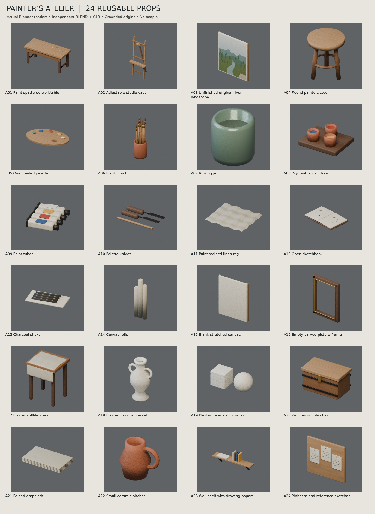

[Release](https://github.com/k3peta/tales-on-a-table/releases/tag/v2026.10.21-painter-atelier) · [SHA256](../releases/painter_atelier/SHA256SUMS.txt) · [License](../LICENSE.md)

## Individual images / 個別画像 / 单件图片

Actual distributed models; chosen camera view does not establish intended front or placement pivot. Images are outside model CC0. Original links and archives retained.

### PA001 — Paint spattered worktable

Paint spattered worktable

[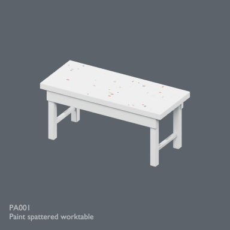](../previews/inn-conservatory-atelier24/renders/PA001.png)

[Full image](../previews/inn-conservatory-atelier24/renders/PA001.png) · [ZIP · BLEND/GLB](https://github.com/k3peta/tales-on-a-table/releases/download/v2026.10.21-painter-atelier/PA001_CC0.zip)

### PA002 — Adjustable studio easel

Adjustable studio easel

[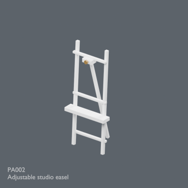](../previews/inn-conservatory-atelier24/renders/PA002.png)

[Full image](../previews/inn-conservatory-atelier24/renders/PA002.png) · [ZIP · BLEND/GLB](https://github.com/k3peta/tales-on-a-table/releases/download/v2026.10.21-painter-atelier/PA002_CC0.zip)

## Individual images / 個別画像 / 单件图片

Actual distributed models; chosen camera view does not establish intended front or placement pivot. Images are outside model CC0. Original links and archives retained.

### PA003 — Unfinished original river landscape

Unfinished original river landscape

[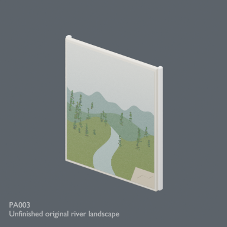](../previews/atelier-terrain24/renders/PA003.png)

[Full image](../previews/atelier-terrain24/renders/PA003.png) · [ZIP · BLEND/GLB](https://github.com/k3peta/tales-on-a-table/releases/download/v2026.10.21-painter-atelier/PA003_CC0.zip)

### PA004 — Round painters stool

Round painters stool

[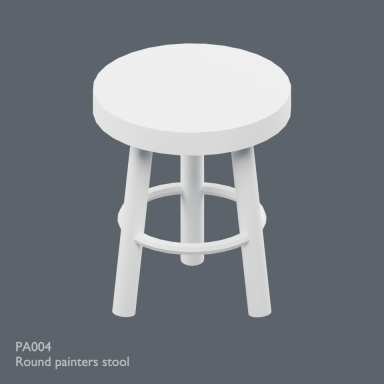](../previews/atelier-terrain24/renders/PA004.png)

[Full image](../previews/atelier-terrain24/renders/PA004.png) · [ZIP · BLEND/GLB](https://github.com/k3peta/tales-on-a-table/releases/download/v2026.10.21-painter-atelier/PA004_CC0.zip)

### PA005 — Oval loaded palette

Oval loaded palette

[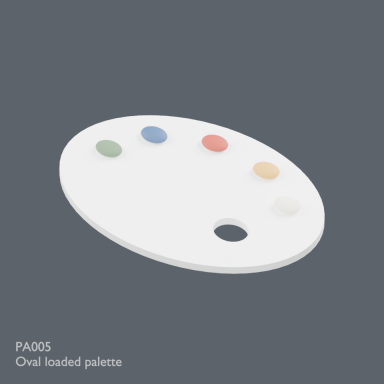](../previews/atelier-terrain24/renders/PA005.png)

[Full image](../previews/atelier-terrain24/renders/PA005.png) · [ZIP · BLEND/GLB](https://github.com/k3peta/tales-on-a-table/releases/download/v2026.10.21-painter-atelier/PA005_CC0.zip)

### PA006 — Brush crock

Brush crock

[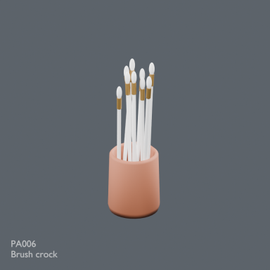](../previews/atelier-terrain24/renders/PA006.png)

[Full image](../previews/atelier-terrain24/renders/PA006.png) · [ZIP · BLEND/GLB](https://github.com/k3peta/tales-on-a-table/releases/download/v2026.10.21-painter-atelier/PA006_CC0.zip)

### PA007 — Rinsing jar

Rinsing jar

[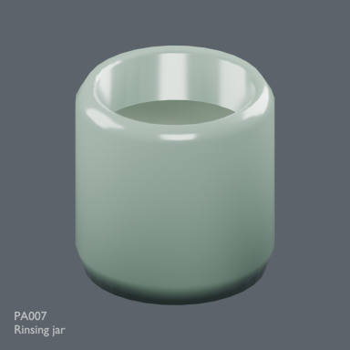](../previews/atelier-terrain24/renders/PA007.png)

[Full image](../previews/atelier-terrain24/renders/PA007.png) · [ZIP · BLEND/GLB](https://github.com/k3peta/tales-on-a-table/releases/download/v2026.10.21-painter-atelier/PA007_CC0.zip)

### PA008 — Pigment jars on tray

Pigment jars on tray

[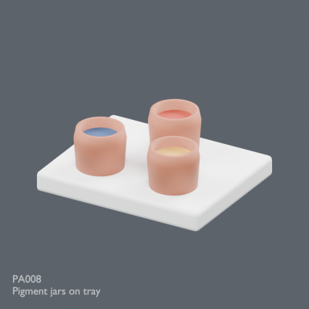](../previews/atelier-terrain24/renders/PA008.png)

[Full image](../previews/atelier-terrain24/renders/PA008.png) · [ZIP · BLEND/GLB](https://github.com/k3peta/tales-on-a-table/releases/download/v2026.10.21-painter-atelier/PA008_CC0.zip)

### PA009 — Paint tubes

Paint tubes

[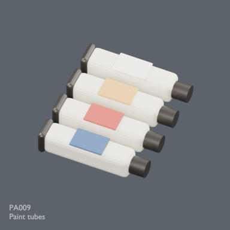](../previews/atelier-terrain24/renders/PA009.png)

[Full image](../previews/atelier-terrain24/renders/PA009.png) · [ZIP · BLEND/GLB](https://github.com/k3peta/tales-on-a-table/releases/download/v2026.10.21-painter-atelier/PA009_CC0.zip)

### PA010 — Palette knives

Palette knives

[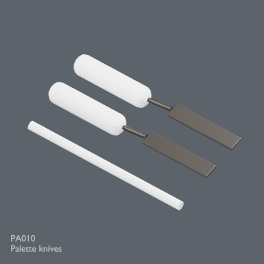](../previews/atelier-terrain24/renders/PA010.png)

[Full image](../previews/atelier-terrain24/renders/PA010.png) · [ZIP · BLEND/GLB](https://github.com/k3peta/tales-on-a-table/releases/download/v2026.10.21-painter-atelier/PA010_CC0.zip)

### PA011 — Paint stained linen rag

Paint stained linen rag

[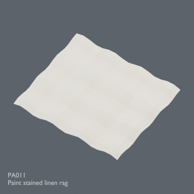](../previews/atelier-terrain24/renders/PA011.png)

[Full image](../previews/atelier-terrain24/renders/PA011.png) · [ZIP · BLEND/GLB](https://github.com/k3peta/tales-on-a-table/releases/download/v2026.10.21-painter-atelier/PA011_CC0.zip)

### PA012 — Open sketchbook

Open sketchbook

[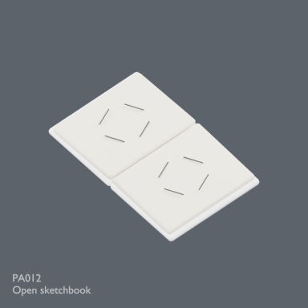](../previews/atelier-terrain24/renders/PA012.png)

[Full image](../previews/atelier-terrain24/renders/PA012.png) · [ZIP · BLEND/GLB](https://github.com/k3peta/tales-on-a-table/releases/download/v2026.10.21-painter-atelier/PA012_CC0.zip)

### PA013 — Charcoal sticks

Charcoal sticks

[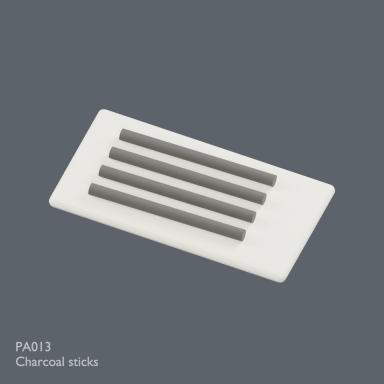](../previews/atelier-terrain24/renders/PA013.png)

[Full image](../previews/atelier-terrain24/renders/PA013.png) · [ZIP · BLEND/GLB](https://github.com/k3peta/tales-on-a-table/releases/download/v2026.10.21-painter-atelier/PA013_CC0.zip)

### PA014 — Canvas rolls

Canvas rolls

[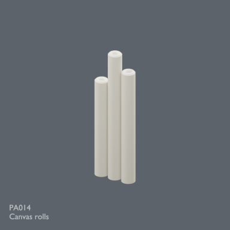](../previews/atelier-terrain24/renders/PA014.png)

[Full image](../previews/atelier-terrain24/renders/PA014.png) · [ZIP · BLEND/GLB](https://github.com/k3peta/tales-on-a-table/releases/download/v2026.10.21-painter-atelier/PA014_CC0.zip)

### PA015 — Blank stretched canvas

Blank stretched canvas

[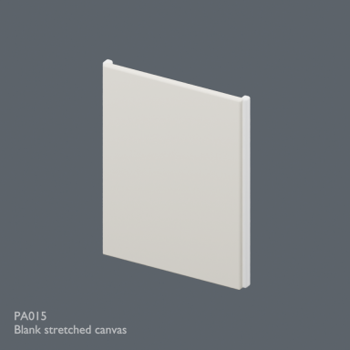](../previews/atelier-terrain24/renders/PA015.png)

[Full image](../previews/atelier-terrain24/renders/PA015.png) · [ZIP · BLEND/GLB](https://github.com/k3peta/tales-on-a-table/releases/download/v2026.10.21-painter-atelier/PA015_CC0.zip)

### PA016 — Empty carved picture frame

Empty carved picture frame

[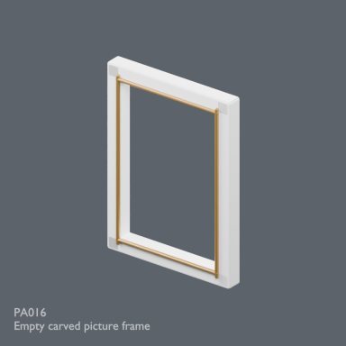](../previews/atelier-terrain24/renders/PA016.png)

[Full image](../previews/atelier-terrain24/renders/PA016.png) · [ZIP · BLEND/GLB](https://github.com/k3peta/tales-on-a-table/releases/download/v2026.10.21-painter-atelier/PA016_CC0.zip)

### PA017 — Plaster stilllife stand

Plaster stilllife stand

[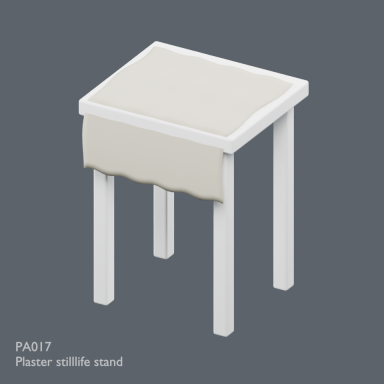](../previews/atelier-terrain24/renders/PA017.png)

[Full image](../previews/atelier-terrain24/renders/PA017.png) · [ZIP · BLEND/GLB](https://github.com/k3peta/tales-on-a-table/releases/download/v2026.10.21-painter-atelier/PA017_CC0.zip)

### PA018 — Plaster classical vessel

Plaster classical vessel

[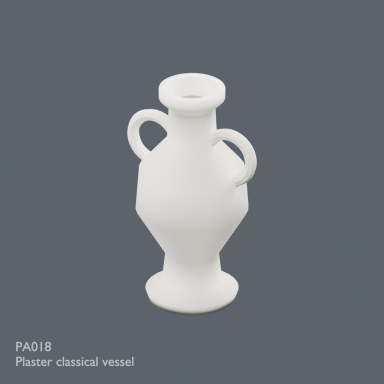](../previews/atelier-terrain24/renders/PA018.png)

[Full image](../previews/atelier-terrain24/renders/PA018.png) · [ZIP · BLEND/GLB](https://github.com/k3peta/tales-on-a-table/releases/download/v2026.10.21-painter-atelier/PA018_CC0.zip)

### PA019 — Plaster geometric studies

Plaster geometric studies

[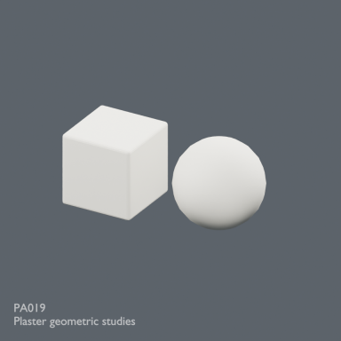](../previews/atelier-terrain24/renders/PA019.png)

[Full image](../previews/atelier-terrain24/renders/PA019.png) · [ZIP · BLEND/GLB](https://github.com/k3peta/tales-on-a-table/releases/download/v2026.10.21-painter-atelier/PA019_CC0.zip)

### PA020 — Wooden supply chest

Wooden supply chest

[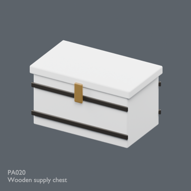](../previews/atelier-terrain24/renders/PA020.png)

[Full image](../previews/atelier-terrain24/renders/PA020.png) · [ZIP · BLEND/GLB](https://github.com/k3peta/tales-on-a-table/releases/download/v2026.10.21-painter-atelier/PA020_CC0.zip)

### PA021 — Folded dropcloth

Folded dropcloth

[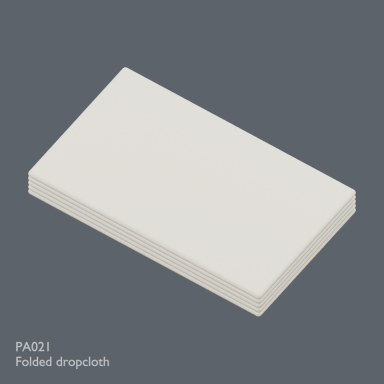](../previews/atelier-terrain24/renders/PA021.png)

[Full image](../previews/atelier-terrain24/renders/PA021.png) · [ZIP · BLEND/GLB](https://github.com/k3peta/tales-on-a-table/releases/download/v2026.10.21-painter-atelier/PA021_CC0.zip)

### PA022 — Small ceramic pitcher

Small ceramic pitcher

[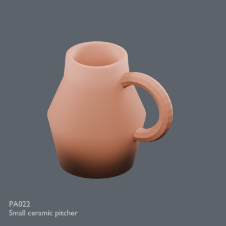](../previews/atelier-terrain24/renders/PA022.png)

[Full image](../previews/atelier-terrain24/renders/PA022.png) · [ZIP · BLEND/GLB](https://github.com/k3peta/tales-on-a-table/releases/download/v2026.10.21-painter-atelier/PA022_CC0.zip)

### PA023 — Wall shelf with drawing papers

Wall shelf with drawing papers

[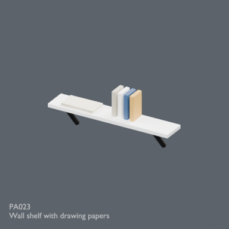](../previews/atelier-terrain24/renders/PA023.png)

[Full image](../previews/atelier-terrain24/renders/PA023.png) · [ZIP · BLEND/GLB](https://github.com/k3peta/tales-on-a-table/releases/download/v2026.10.21-painter-atelier/PA023_CC0.zip)

### PA024 — Pinboard and reference sketches

Pinboard and reference sketches

[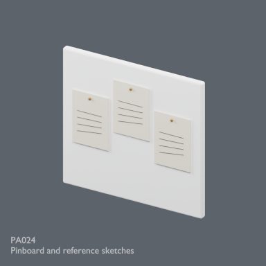](../previews/atelier-terrain24/renders/PA024.png)

[Full image](../previews/atelier-terrain24/renders/PA024.png) · [ZIP · BLEND/GLB](https://github.com/k3peta/tales-on-a-table/releases/download/v2026.10.21-painter-atelier/PA024_CC0.zip)

Image scope: PA oak appears default white in distributed GLBs;PA011 stains not visible,PA022 dark lower shading undiagnosed. Real model images, not claimed repairs.
