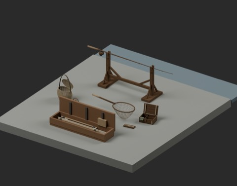
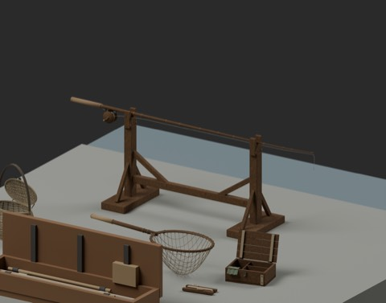
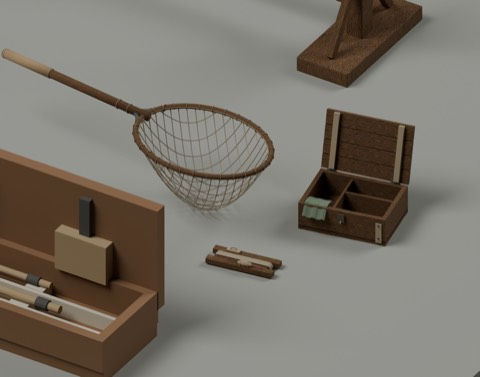
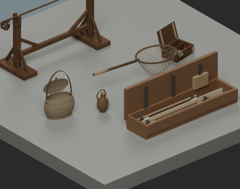

# 個人釣り一式 / Personal fishing kit

**950 distribution records = 949 + 1 assembly. New shapes: 0.** Eight existing types are reused without adding new standalone models.

[Download PFKV01_PersonalFishingKit](https://raw.githubusercontent.com/k3peta/tales-on-a-table/main/distributions/personal-fishing-kit-v1/PFKV01_PersonalFishingKit_CC0.zip) — 13668029 bytes; SHA256 `dcc2a038b6305921b142eacebd33da4f9583392121e7717bd8f2606c829477e3`.

## Searchable component index

|Source|Item|Approximate size|
|---|---|---|
|FH_051|Rod, reel, line and guides|2.10m long|
|FH_053|Two-point rod support|1.28m wide,0.718m high|
|FH_052|Landing net|1.11m long|
|FH_054|Bait box with open lid|0.31m wide|
|FH_055|Tackle winder, line, float and stored hook|0.24m long|
|FH_056|Shoulder creel|0.376m wide, strap to0.57m|
|FH_036|Leather-wrapped water bottle|0.27m high|
|FTR102_SegmentedRodCase|Segmented-rod case|1.35m frame length|

## Arrangement and limits

Metres, Z up; components retained at scale1 and repositionable using placement roots and their children. Append the Collection from BLEND or import GLB. The rod is positioned on two sampled support-groove centres; other components meet ground Z0. The approximately3.4m display bank and water are example fixtures, not newly counted assets.

This is a display arrangement, not verified one-person carrying/storage or a working fishing mechanism. Rod-to-case storage compatibility is not guaranteed: the case sections are separate display parts. Actual fishing, support/load capacity, collision, walking, complete intersection volumes and Blender4.3.2 compatibility are unverified. Sampled contact is not proof of real support performance.

Seven FH source ZIP hashes/licenses match existing published records. FTR102 is also published in [Field/travel tools](field_travel_tools_v1.md); the ZIP SOURCES.json retains its historical pre-publication candidate wording. That wording is not the current source publication status. All eight existing model/material CC0 scopes were checked. CC0-1.0 covers included geometry and embedded materials only; code, rendered images, articles and private records are excluded. [Checksums](../distributions/personal-fishing-kit-v1/SHA256SUMS.txt).

## 実作画像 / Actual renders

完成バッチの配置・接写。画像は閲覧用でモデルCC0の対象外です。[既存の画像利用条件](../LICENSE.md)を維持します。

### FH_036

革巻きの水筒

[ZIP](https://github.com/k3peta/tales-on-a-table/releases/download/v2026.10.18/FH_036_CC0.zip)

### FH_051

釣り竿

[ZIP](https://github.com/k3peta/tales-on-a-table/releases/download/v2026.10.18/FH_051_CC0.zip)

### FH_052

タモ

[ZIP](https://github.com/k3peta/tales-on-a-table/releases/download/v2026.10.18/FH_052_CC0.zip)

### FH_053

竿立て

[ZIP](https://github.com/k3peta/tales-on-a-table/releases/download/v2026.10.18/FH_053_CC0.zip)

### FH_054

餌箱

[ZIP](https://github.com/k3peta/tales-on-a-table/releases/download/v2026.10.18/FH_054_CC0.zip)

### FH_055

仕掛け巻き

[ZIP](https://github.com/k3peta/tales-on-a-table/releases/download/v2026.10.18/FH_055_CC0.zip)

### FH_056

肩掛け魚籠

[ZIP](https://github.com/k3peta/tales-on-a-table/releases/download/v2026.10.18/FH_056_CC0.zip)

### FTR102_SegmentedRodCase

SegmentedRodCase

[ZIP](https://raw.githubusercontent.com/k3peta/tales-on-a-table/main/distributions/field-travel-tools-v1/FTR102_SegmentedRodCase_CC0.zip)

### PFKV01_PersonalFishingKit

PersonalFishingKit

[ZIP](https://raw.githubusercontent.com/k3peta/tales-on-a-table/main/distributions/personal-fishing-kit-v1/PFKV01_PersonalFishingKit_CC0.zip)

