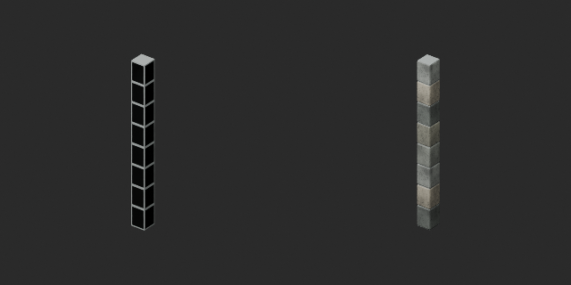
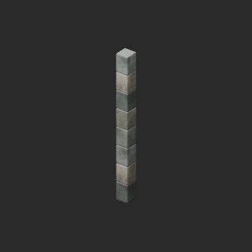
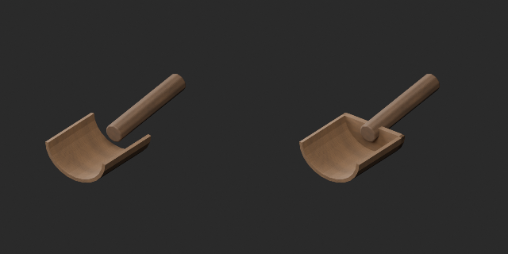

# Stone-node and grain-scoop repairs / 石柱・穀物すくい修復 / 石柱与谷物铲修复

Five distribution-record revisions, zero new base models or variants. PM009–011 reuse PM006 geometry; not four independent shapes. Original versions and downloads retained.

PM006/009/010/011: original mortar core side faces coincided with outer stone faces at ±0.14m, causing black faces in the tested views. Recessing the core to ±0.13m removes coincidence; outer stones, materials, origin, height3.2m and width0.28m retained. Revision recess_mortar_core_v1.

WM009: the original handle was detached and rear scoop end open. Added18mm rear heel wall using existing cross-section/material to connect handle and bowl. Original mesh vertices/UV unchanged. Revision scoop_heel_wall_v1. Original generation script unavailable, so original author intent is not asserted.

黒面と柄離れは原本版の課題として履歴を保持。修正版では内部芯10mm後退と後壁追加で該当欠陥を修復。新モデル・variant加算0、重点修復5は累積全件査定へ重複加算しません。旧版は削除しません。

原版黑面和柄分离保留为历史问题；新修订分别后退砂浆芯与增加后壁。5记录修订不增加模型或颜色变体数量。

Producer final10 BLEND/GLB reimports checked against revised references; original materials retained. This scoped visual/geometry repair does not certify full model safety, strength, food contact, game collision, working mechanisms or Blender4.3.2 compatibility.

モデル/埋込材質のみCC0。画像は閲覧用でモデルCC0対象外、[既存画像権利](../LICENSE.md)維持。代码图片私有査定不属模型CC0。

## PM006__repair — 共通石柱

revision · [ZIP · BLEND/GLB](https://raw.githubusercontent.com/k3peta/tales-on-a-table/main/distributions/quality-pmnode-wm009-repair-v1/PM006__repair_CC0.zip)

[拡大 / Full image](https://raw.githubusercontent.com/k3peta/tales-on-a-table/main/previews/quality-pmnode-wm009-repair-v1/PM006__repair_thumb.png)

[拡大 / Full image](https://raw.githubusercontent.com/k3peta/tales-on-a-table/main/previews/quality-pmnode-wm009-repair-v1/PM006__repair_comparison.png)

left: original base; right: revised model; same overview camera

## PM009__repair — L字接続設定

revision · [ZIP · BLEND/GLB](https://raw.githubusercontent.com/k3peta/tales-on-a-table/main/distributions/quality-pmnode-wm009-repair-v1/PM009__repair_CC0.zip)

[拡大 / Full image](https://raw.githubusercontent.com/k3peta/tales-on-a-table/main/previews/quality-pmnode-wm009-repair-v1/PM009__repair_thumb.png)

[拡大 / Full image](https://raw.githubusercontent.com/k3peta/tales-on-a-table/main/previews/quality-pmnode-wm009-repair-v1/PM009__repair_comparison.png)

left: original base; right: revised model; same overview camera

## PM010__repair — T字接続設定

revision · [ZIP · BLEND/GLB](https://raw.githubusercontent.com/k3peta/tales-on-a-table/main/distributions/quality-pmnode-wm009-repair-v1/PM010__repair_CC0.zip)

[拡大 / Full image](https://raw.githubusercontent.com/k3peta/tales-on-a-table/main/previews/quality-pmnode-wm009-repair-v1/PM010__repair_thumb.png)

[拡大 / Full image](https://raw.githubusercontent.com/k3peta/tales-on-a-table/main/previews/quality-pmnode-wm009-repair-v1/PM010__repair_comparison.png)

left: original base; right: revised model; same overview camera

## PM011__repair — 端部接続設定

revision · [ZIP · BLEND/GLB](https://raw.githubusercontent.com/k3peta/tales-on-a-table/main/distributions/quality-pmnode-wm009-repair-v1/PM011__repair_CC0.zip)

[拡大 / Full image](https://raw.githubusercontent.com/k3peta/tales-on-a-table/main/previews/quality-pmnode-wm009-repair-v1/PM011__repair_thumb.png)

[拡大 / Full image](https://raw.githubusercontent.com/k3peta/tales-on-a-table/main/previews/quality-pmnode-wm009-repair-v1/PM011__repair_comparison.png)

left: original base; right: revised model; same overview camera

## WM009__repair — Wooden grain scoop

revision · [ZIP · BLEND/GLB](https://raw.githubusercontent.com/k3peta/tales-on-a-table/main/distributions/quality-pmnode-wm009-repair-v1/WM009__repair_CC0.zip)

[拡大 / Full image](https://raw.githubusercontent.com/k3peta/tales-on-a-table/main/previews/quality-pmnode-wm009-repair-v1/WM009__repair_thumb.png)

[拡大 / Full image](https://raw.githubusercontent.com/k3peta/tales-on-a-table/main/previews/quality-pmnode-wm009-repair-v1/WM009__repair_comparison.png)

left: original base; right: revised model; same overview camera
