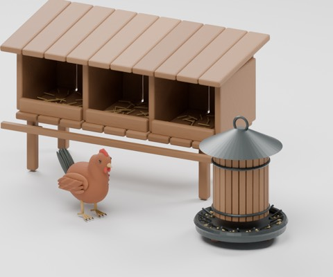
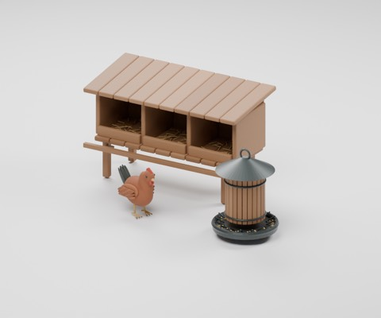

# poultry-support-v1

972 distribution records = 970 + 2 poultry equipment candidates. Existing HCV604 hen is reused, not newly added. Private arrangements and two images are not distributed or counted.

|ID|Kind|License|Download|
|---|---|---|---|
|HCV701|model|CC0-1.0|[ZIP](https://raw.githubusercontent.com/k3peta/tales-on-a-table/main/distributions/poultry-support-v1/HCV701-CC0.zip)|
|HCV702|model|CC0-1.0|[ZIP](https://raw.githubusercontent.com/k3peta/tales-on-a-table/main/distributions/poultry-support-v1/HCV702-CC0.zip)|

HCV701 is a raised three-compartment nesting box with straw, front edge, landing perch and sloped roof. HCV702 is a gravity feeder with rain cover, lower outlets, divided pecking tray and displayed grain. Feed flow is not simulated. These are use candidates, not a confirmed audit of unique historical shapes. Food hygiene and real poultry-equipment suitability are unverified.

Metres, ground-centered component origins, Blender Z up / standard glTF axes. Global historical shape independence is unverified. Static display only: no animated doors/wheels/walking, rigid-body coupling, load simulation or fluid mechanisms. Safety, full motion/intersection volumes, real use, app UI/GPU/FPS and older Blender compatibility are unverified. Code, rendered images and private records are excluded.

[Checksums](../distributions/poultry-support-v1/SHA256SUMS.txt).

## 実作画像 / Actual renders

完成バッチの配置・接写。画像は閲覧用でモデルCC0の対象外です。[既存の画像利用条件](../LICENSE.md)を維持します。

|ID|名称 / Name|Download|
|---|---|---|
|HCV604|HCV604|[ZIP](https://raw.githubusercontent.com/k3peta/tales-on-a-table/main/distributions/livestock-tack-v1/HCV604-CC0.zip)|
|HCV701|HCV701|[ZIP](https://raw.githubusercontent.com/k3peta/tales-on-a-table/main/distributions/poultry-support-v1/HCV701-CC0.zip)|
|HCV702|HCV702|[ZIP](https://raw.githubusercontent.com/k3peta/tales-on-a-table/main/distributions/poultry-support-v1/HCV702-CC0.zip)|

