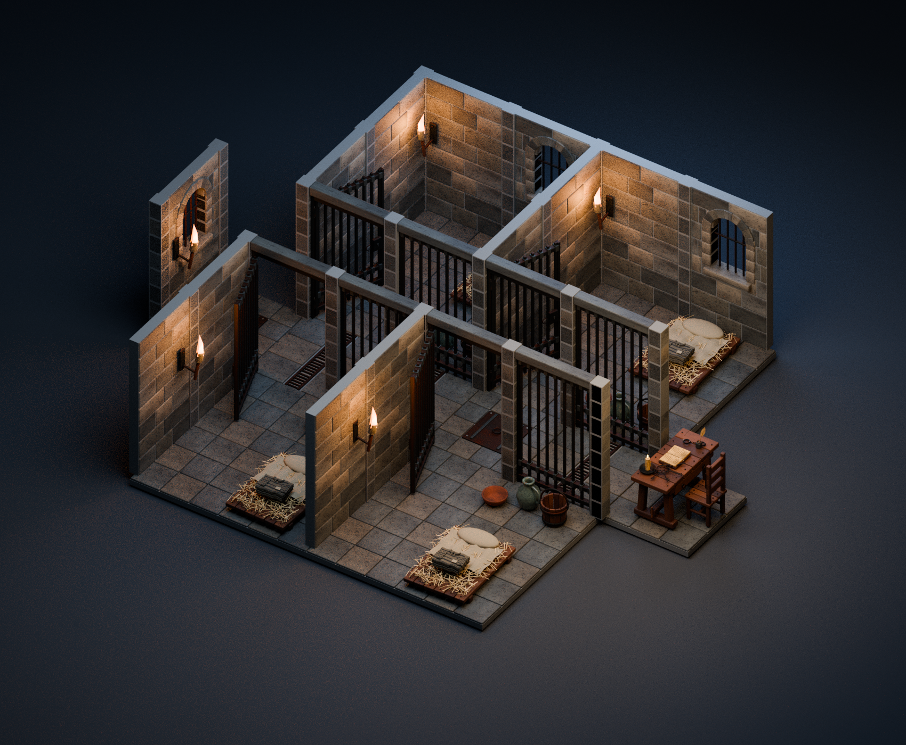
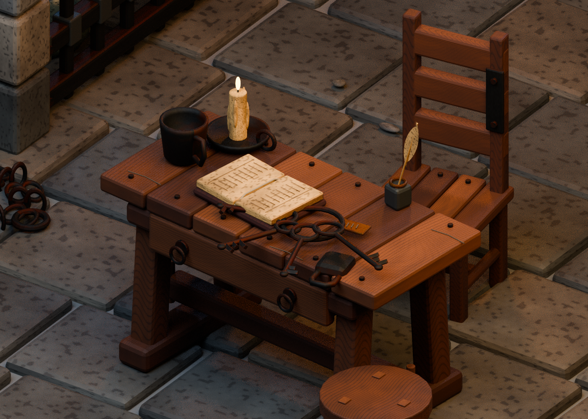
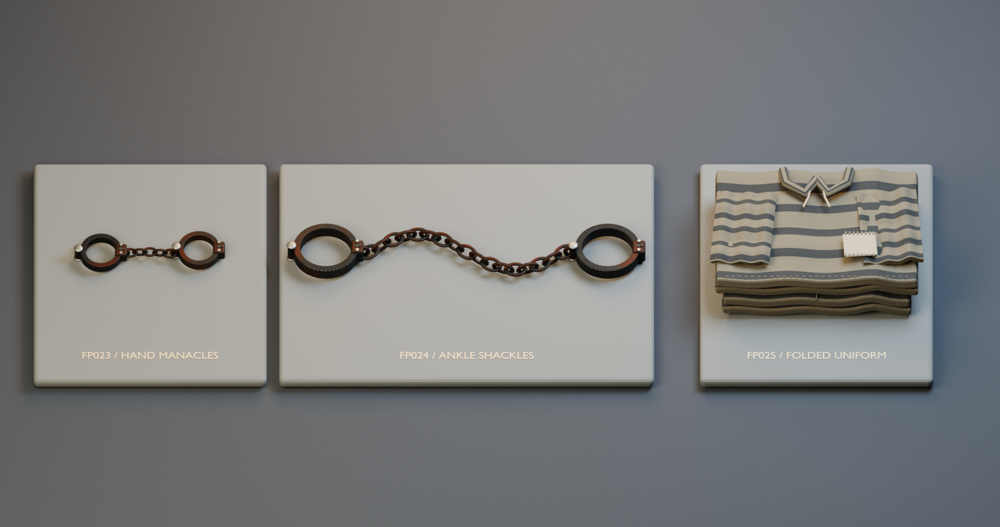
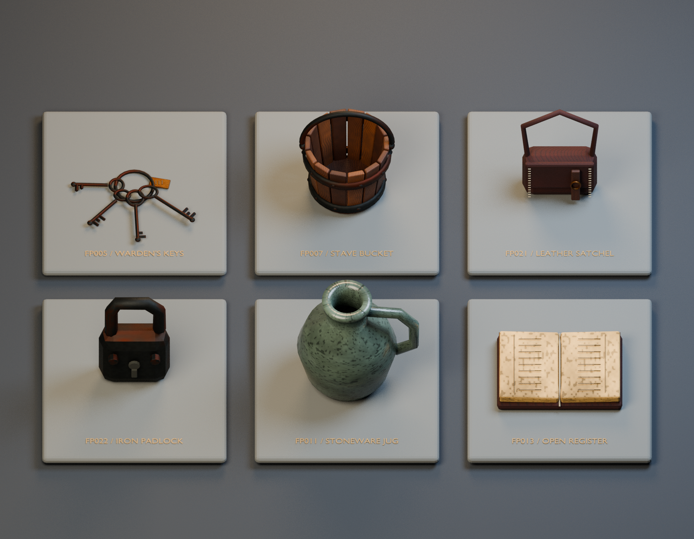
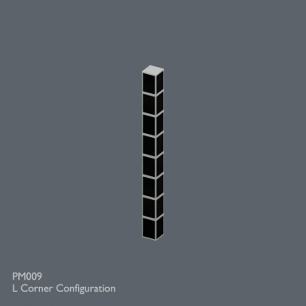
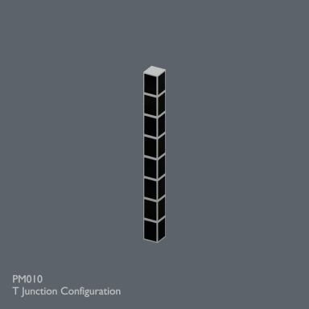
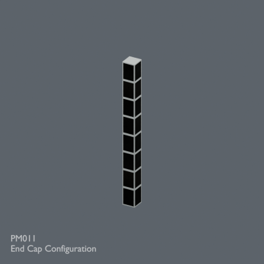

# 夜番の牢獄 — 36 / 33

[日本語](prison.md) · [English](prison.en.md) · [简体中文](prison.zh-CN.md)

小物25設計＋基本構造8設計＝33設計。PM006と同形状の接続設定3種を含め、36配布レコードです。従来519＋36＝555レコード。完成配置シーン・制作コードは配布しません。大規模ゲーム内性能は未検証です。

夜番の牢獄 / The Night Watch — Fantasy Prison

小物・家具25設計、基本建築モジュール8設計、接続設定3種。36配布セット、33設計です。各セットはBLENDとGLBを含みます。完成配置シーン・生成コード・作例画像はモデルZIPには含みません。

モデルと必要な同梱材質はCC0 1.0。商用利用・改変・再配布可、クレジット不要。記事・作例画像にはこの許諾を適用しません。

単位はm、Z上向き。GLBの色画像は埋込済み。BLENDは編集用、撮影用照明・カメラはありません。GLBは微細なバンプを省略し、表示結果は利用環境に依存します。
ゲーム用開閉処理、コリジョン、LODは付属しません。手枷・足枷は静的な装飾用モデルです。大規模な牢獄での負荷と各ゲームエンジンの動作は未検証です。

組立規格: X/Yの2mグリッド、床面Z=0、床下端Z=-0.16m、壁高さ3.2m。壁ピッチ2mに対して実形状はX=0.14..1.86m。接点には0.28m角の柱を一つずつ置きます。壁の短さを隙間の不具合と取り違えず、柱と組み合わせてください。床原点は南西の角、壁原点は始点接点、長手はローカル+Xです。
PM009/010/011はPM006と同形状のL字/T字/端部接続設定で、新設計ではありません。壁と柱の共有箇所は重複配置しないでください。窓台は片側約10.5cm突出します。
PM004のDoor_Hinge_PivotをZ回転すると開閉姿勢を変えられます。作例では内開き0～85度を検査しましたが、家具配置や開く方向を変えた場合は再確認してください。

Blender 4.3.2で制作。全単体BLEND/GLBの読み戻しと寸法、作例の接続および扉72姿勢を検査済み。作例のレンダーは一部外壁を非表示にして内部を見せています。

| ID | 素材 | ZIP (BLEND + GLB) |
|---|---|---|
| FP001 | 固定鉄格子 | [ZIP](https://github.com/k3peta/tales-on-a-table/releases/download/v2026.10.20-prison/FP001_Fixed_cell_grille.zip) |
| FP002 | 格子扉 | [ZIP](https://github.com/k3peta/tales-on-a-table/releases/download/v2026.10.20-prison/FP002_Barred_cell_gate.zip) |
| FP003 | 看守の机 | [ZIP](https://github.com/k3peta/tales-on-a-table/releases/download/v2026.10.20-prison/FP003_Jailer_trestle_desk.zip) |
| FP004 | 看守の背もたれ椅子 | [ZIP](https://github.com/k3peta/tales-on-a-table/releases/download/v2026.10.20-prison/FP004_Jailer_high_back_chair.zip) |
| FP005 | 鍵束 | [ZIP](https://github.com/k3peta/tales-on-a-table/releases/download/v2026.10.20-prison/FP005_Wardens_keyring.zip) |
| FP006 | 寝藁の寝台 | [ZIP](https://github.com/k3peta/tales-on-a-table/releases/download/v2026.10.20-prison/FP006_Straw_sleeping_pallet.zip) |
| FP007 | 板組みの水桶 | [ZIP](https://github.com/k3peta/tales-on-a-table/releases/download/v2026.10.20-prison/FP007_Stave_water_bucket.zip) |
| FP008 | 壁松明 | [ZIP](https://github.com/k3peta/tales-on-a-table/releases/download/v2026.10.20-prison/FP008_Wall_torch.zip) |
| FP009 | 巻いた鉄鎖 | [ZIP](https://github.com/k3peta/tales-on-a-table/releases/download/v2026.10.20-prison/FP009_Coiled_iron_chain.zip) |
| FP010 | 欠けた食器 | [ZIP](https://github.com/k3peta/tales-on-a-table/releases/download/v2026.10.20-prison/FP010_Chipped_food_bowl.zip) |
| FP011 | 水差し | [ZIP](https://github.com/k3peta/tales-on-a-table/releases/download/v2026.10.20-prison/FP011_Water_jug.zip) |
| FP012 | 錫の杯 | [ZIP](https://github.com/k3peta/tales-on-a-table/releases/download/v2026.10.20-prison/FP012_Pewter_drinking_cup.zip) |
| FP013 | 囚人台帳 | [ZIP](https://github.com/k3peta/tales-on-a-table/releases/download/v2026.10.20-prison/FP013_Prisoners_ledger.zip) |
| FP014 | インク壺と羽根ペン | [ZIP](https://github.com/k3peta/tales-on-a-table/releases/download/v2026.10.20-prison/FP014_Inkpot_and_quill.zip) |
| FP015 | 蝋燭と受け皿 | [ZIP](https://github.com/k3peta/tales-on-a-table/releases/download/v2026.10.20-prison/FP015_Candle_and_drip_tray.zip) |
| FP016 | 配給パン | [ZIP](https://github.com/k3peta/tales-on-a-table/releases/download/v2026.10.20-prison/FP016_Ration_bread.zip) |
| FP017 | 白樺の箒 | [ZIP](https://github.com/k3peta/tales-on-a-table/releases/download/v2026.10.20-prison/FP017_Birch_broom.zip) |
| FP018 | 三脚腰掛け | [ZIP](https://github.com/k3peta/tales-on-a-table/releases/download/v2026.10.20-prison/FP018_Three_leg_stool.zip) |
| FP019 | 鉄帯の小箱 | [ZIP](https://github.com/k3peta/tales-on-a-table/releases/download/v2026.10.20-prison/FP019_Iron_bound_lockbox.zip) |
| FP020 | 看守の壁棚 | [ZIP](https://github.com/k3peta/tales-on-a-table/releases/download/v2026.10.20-prison/FP020_Jailer_wall_shelf.zip) |
| FP021 | 革の書類鞄 | [ZIP](https://github.com/k3peta/tales-on-a-table/releases/download/v2026.10.20-prison/FP021_Leather_dispatch_satchel.zip) |
| FP022 | 古い鉄錠 | [ZIP](https://github.com/k3peta/tales-on-a-table/releases/download/v2026.10.20-prison/FP022_Old_iron_padlock.zip) |
| FP023 | 手枷 | [ZIP](https://github.com/k3peta/tales-on-a-table/releases/download/v2026.10.20-prison/FP023_Forged_hand_manacles.zip) |
| FP024 | 足枷 | [ZIP](https://github.com/k3peta/tales-on-a-table/releases/download/v2026.10.20-prison/FP024_Heavy_ankle_shackles.zip) |
| FP025 | 畳んだ囚人服 | [ZIP](https://github.com/k3peta/tales-on-a-table/releases/download/v2026.10.20-prison/FP025_Folded_prison_uniform.zip) |
| PM001 | 床2×2m | [ZIP](https://github.com/k3peta/tales-on-a-table/releases/download/v2026.10.20-prison/PM001_Floor_2x2.zip) |
| PM002 | 石壁2m | [ZIP](https://github.com/k3peta/tales-on-a-table/releases/download/v2026.10.20-prison/PM002_Solid_Wall_2m.zip) |
| PM003 | 格子壁2m | [ZIP](https://github.com/k3peta/tales-on-a-table/releases/download/v2026.10.20-prison/PM003_Barred_Wall_2m.zip) |
| PM004 | 牢房扉2m | [ZIP](https://github.com/k3peta/tales-on-a-table/releases/download/v2026.10.20-prison/PM004_Cell_Door_2m.zip) |
| PM005 | アーチ窓壁2m | [ZIP](https://github.com/k3peta/tales-on-a-table/releases/download/v2026.10.20-prison/PM005_Arched_Window_Wall_2m.zip) |
| PM006 | 共通石柱 | [ZIP](https://github.com/k3peta/tales-on-a-table/releases/download/v2026.10.20-prison/PM006_Universal_Stone_Node.zip) |
| PM007 | 排水溝付き廊下床 | [ZIP](https://github.com/k3peta/tales-on-a-table/releases/download/v2026.10.20-prison/PM007_Drained_Corridor_Floor_2x2.zip) |
| PM008 | 点検蓋付き交差部床 | [ZIP](https://github.com/k3peta/tales-on-a-table/releases/download/v2026.10.20-prison/PM008_Corridor_Junction_Hatch_2x2.zip) |
| PM009 | L字接続設定 | [ZIP](https://github.com/k3peta/tales-on-a-table/releases/download/v2026.10.20-prison/PM009_L_Corner_Configuration.zip) |
| PM010 | T字接続設定 | [ZIP](https://github.com/k3peta/tales-on-a-table/releases/download/v2026.10.20-prison/PM010_T_Junction_Configuration.zip) |
| PM011 | 端部接続設定 | [ZIP](https://github.com/k3peta/tales-on-a-table/releases/download/v2026.10.20-prison/PM011_End_Cap_Configuration.zip) |

[GitHub Release](https://github.com/k3peta/tales-on-a-table/releases/tag/v2026.10.20-prison) · [SHA256](../releases/prison/SHA256SUMS.txt)

## Individual images / 個別画像 / 单件图片

Actual distributed models; chosen camera view does not establish intended front or placement pivot. Images are outside model CC0. Original links and archives retained.

### FP001 — Fixed cell grille

固定鉄格子

[Full image](../previews/prison-fp001-024/renders/FP001.png) · [ZIP · BLEND/GLB](https://github.com/k3peta/tales-on-a-table/releases/download/v2026.10.20-prison/FP001_Fixed_cell_grille.zip)

### FP002 — Barred cell gate

格子扉

[Full image](../previews/prison-fp001-024/renders/FP002.png) · [ZIP · BLEND/GLB](https://github.com/k3peta/tales-on-a-table/releases/download/v2026.10.20-prison/FP002_Barred_cell_gate.zip)

### FP003 — Jailer trestle desk

看守の机

[Full image](../previews/prison-fp001-024/renders/FP003.png) · [ZIP · BLEND/GLB](https://github.com/k3peta/tales-on-a-table/releases/download/v2026.10.20-prison/FP003_Jailer_trestle_desk.zip)

### FP004 — Jailer high back chair

看守の背もたれ椅子

[Full image](../previews/prison-fp001-024/renders/FP004.png) · [ZIP · BLEND/GLB](https://github.com/k3peta/tales-on-a-table/releases/download/v2026.10.20-prison/FP004_Jailer_high_back_chair.zip)

### FP005 — Wardens keyring

鍵束

[Full image](../previews/prison-fp001-024/renders/FP005.png) · [ZIP · BLEND/GLB](https://github.com/k3peta/tales-on-a-table/releases/download/v2026.10.20-prison/FP005_Wardens_keyring.zip)

### FP006 — Straw sleeping pallet

寝藁の寝台

[Full image](../previews/prison-fp001-024/renders/FP006.png) · [ZIP · BLEND/GLB](https://github.com/k3peta/tales-on-a-table/releases/download/v2026.10.20-prison/FP006_Straw_sleeping_pallet.zip)

### FP007 — Stave water bucket

板組みの水桶

[Full image](../previews/prison-fp001-024/renders/FP007.png) · [ZIP · BLEND/GLB](https://github.com/k3peta/tales-on-a-table/releases/download/v2026.10.20-prison/FP007_Stave_water_bucket.zip)

### FP008 — Wall torch

壁松明

[Full image](../previews/prison-fp001-024/renders/FP008.png) · [ZIP · BLEND/GLB](https://github.com/k3peta/tales-on-a-table/releases/download/v2026.10.20-prison/FP008_Wall_torch.zip)

### FP009 — Coiled iron chain

巻いた鉄鎖

[Full image](../previews/prison-fp001-024/renders/FP009.png) · [ZIP · BLEND/GLB](https://github.com/k3peta/tales-on-a-table/releases/download/v2026.10.20-prison/FP009_Coiled_iron_chain.zip)

### FP010 — Chipped food bowl

欠けた食器

[Full image](../previews/prison-fp001-024/renders/FP010.png) · [ZIP · BLEND/GLB](https://github.com/k3peta/tales-on-a-table/releases/download/v2026.10.20-prison/FP010_Chipped_food_bowl.zip)

### FP011 — Water jug

水差し

[Full image](../previews/prison-fp001-024/renders/FP011.png) · [ZIP · BLEND/GLB](https://github.com/k3peta/tales-on-a-table/releases/download/v2026.10.20-prison/FP011_Water_jug.zip)

### FP012 — Pewter drinking cup

錫の杯

[Full image](../previews/prison-fp001-024/renders/FP012.png) · [ZIP · BLEND/GLB](https://github.com/k3peta/tales-on-a-table/releases/download/v2026.10.20-prison/FP012_Pewter_drinking_cup.zip)

### FP013 — Prisoners ledger

囚人台帳

[Full image](../previews/prison-fp001-024/renders/FP013.png) · [ZIP · BLEND/GLB](https://github.com/k3peta/tales-on-a-table/releases/download/v2026.10.20-prison/FP013_Prisoners_ledger.zip)

### FP014 — Inkpot and quill

インク壺と羽根ペン

[Full image](../previews/prison-fp001-024/renders/FP014.png) · [ZIP · BLEND/GLB](https://github.com/k3peta/tales-on-a-table/releases/download/v2026.10.20-prison/FP014_Inkpot_and_quill.zip)

### FP015 — Candle and drip tray

蝋燭と受け皿

[Full image](../previews/prison-fp001-024/renders/FP015.png) · [ZIP · BLEND/GLB](https://github.com/k3peta/tales-on-a-table/releases/download/v2026.10.20-prison/FP015_Candle_and_drip_tray.zip)

### FP016 — Ration bread

配給パン

[Full image](../previews/prison-fp001-024/renders/FP016.png) · [ZIP · BLEND/GLB](https://github.com/k3peta/tales-on-a-table/releases/download/v2026.10.20-prison/FP016_Ration_bread.zip)

### FP017 — Birch broom

白樺の箒

[Full image](../previews/prison-fp001-024/renders/FP017.png) · [ZIP · BLEND/GLB](https://github.com/k3peta/tales-on-a-table/releases/download/v2026.10.20-prison/FP017_Birch_broom.zip)

### FP018 — Three leg stool

三脚腰掛け

[Full image](../previews/prison-fp001-024/renders/FP018.png) · [ZIP · BLEND/GLB](https://github.com/k3peta/tales-on-a-table/releases/download/v2026.10.20-prison/FP018_Three_leg_stool.zip)

### FP019 — Iron bound lockbox

鉄帯の小箱

[Full image](../previews/prison-fp001-024/renders/FP019.png) · [ZIP · BLEND/GLB](https://github.com/k3peta/tales-on-a-table/releases/download/v2026.10.20-prison/FP019_Iron_bound_lockbox.zip)

### FP020 — Jailer wall shelf

看守の壁棚

[Full image](../previews/prison-fp001-024/renders/FP020.png) · [ZIP · BLEND/GLB](https://github.com/k3peta/tales-on-a-table/releases/download/v2026.10.20-prison/FP020_Jailer_wall_shelf.zip)

### FP021 — Leather dispatch satchel

革の書類鞄

[Full image](../previews/prison-fp001-024/renders/FP021.png) · [ZIP · BLEND/GLB](https://github.com/k3peta/tales-on-a-table/releases/download/v2026.10.20-prison/FP021_Leather_dispatch_satchel.zip)

### FP022 — Old iron padlock

古い鉄錠

[Full image](../previews/prison-fp001-024/renders/FP022.png) · [ZIP · BLEND/GLB](https://github.com/k3peta/tales-on-a-table/releases/download/v2026.10.20-prison/FP022_Old_iron_padlock.zip)

### FP023 — Forged hand manacles

手枷

[Full image](../previews/prison-fp001-024/renders/FP023.png) · [ZIP · BLEND/GLB](https://github.com/k3peta/tales-on-a-table/releases/download/v2026.10.20-prison/FP023_Forged_hand_manacles.zip)

### FP024 — Heavy ankle shackles

足枷

[Full image](../previews/prison-fp001-024/renders/FP024.png) · [ZIP · BLEND/GLB](https://github.com/k3peta/tales-on-a-table/releases/download/v2026.10.20-prison/FP024_Heavy_ankle_shackles.zip)

[FP017 bristles detail](../previews/prison-fp001-024/details/FP017_detail.png)

## Individual images / 個別画像 / 单件图片

Actual distributed models; chosen camera view does not establish intended front or placement pivot. Images are outside model CC0. Original links and archives retained.

### FP025 — Folded prison uniform

畳んだ囚人服

[Full image](../previews/prison-mill24/renders/FP025.png) · [ZIP · BLEND/GLB](https://github.com/k3peta/tales-on-a-table/releases/download/v2026.10.20-prison/FP025_Folded_prison_uniform.zip)

### PM001 — Floor 2x2

床2×2m

[Full image](../previews/prison-mill24/renders/PM001.png) · [ZIP · BLEND/GLB](https://github.com/k3peta/tales-on-a-table/releases/download/v2026.10.20-prison/PM001_Floor_2x2.zip)

### PM002 — Solid Wall 2m

石壁2m

[Full image](../previews/prison-mill24/renders/PM002.png) · [ZIP · BLEND/GLB](https://github.com/k3peta/tales-on-a-table/releases/download/v2026.10.20-prison/PM002_Solid_Wall_2m.zip)

### PM003 — Barred Wall 2m

格子壁2m

[Full image](../previews/prison-mill24/renders/PM003.png) · [ZIP · BLEND/GLB](https://github.com/k3peta/tales-on-a-table/releases/download/v2026.10.20-prison/PM003_Barred_Wall_2m.zip)

### PM004 — Cell Door 2m

牢房扉2m

[Full image](../previews/prison-mill24/renders/PM004.png) · [ZIP · BLEND/GLB](https://github.com/k3peta/tales-on-a-table/releases/download/v2026.10.20-prison/PM004_Cell_Door_2m.zip)

### PM005 — Arched Window Wall 2m

アーチ窓壁2m

[Full image](../previews/prison-mill24/renders/PM005.png) · [ZIP · BLEND/GLB](https://github.com/k3peta/tales-on-a-table/releases/download/v2026.10.20-prison/PM005_Arched_Window_Wall_2m.zip)

**Known issue:** Black side faces are an unresolved original-model issue.

### PM006 — Universal Stone Node

共通石柱

[Full image](../previews/prison-mill24/renders/PM006.png) · [ZIP · BLEND/GLB](https://github.com/k3peta/tales-on-a-table/releases/download/v2026.10.20-prison/PM006_Universal_Stone_Node.zip)

### PM007 — Drained Corridor Floor 2x2

排水溝付き廊下床

[Full image](../previews/prison-mill24/renders/PM007.png) · [ZIP · BLEND/GLB](https://github.com/k3peta/tales-on-a-table/releases/download/v2026.10.20-prison/PM007_Drained_Corridor_Floor_2x2.zip)

### PM008 — Corridor Junction Hatch 2x2

点検蓋付き交差部床

[Full image](../previews/prison-mill24/renders/PM008.png) · [ZIP · BLEND/GLB](https://github.com/k3peta/tales-on-a-table/releases/download/v2026.10.20-prison/PM008_Corridor_Junction_Hatch_2x2.zip)

**Known issue:** Black side faces are an unresolved original-model issue; reused PM006 configuration.

### PM009 — L Corner Configuration

L字接続設定

[Full image](../previews/prison-mill24/renders/PM009.png) · [ZIP · BLEND/GLB](https://github.com/k3peta/tales-on-a-table/releases/download/v2026.10.20-prison/PM009_L_Corner_Configuration.zip)

**Known issue:** Black side faces are an unresolved original-model issue; reused PM006 configuration.

### PM010 — T Junction Configuration

T字接続設定

[Full image](../previews/prison-mill24/renders/PM010.png) · [ZIP · BLEND/GLB](https://github.com/k3peta/tales-on-a-table/releases/download/v2026.10.20-prison/PM010_T_Junction_Configuration.zip)

**Known issue:** Black side faces are an unresolved original-model issue; reused PM006 configuration.

### PM011 — End Cap Configuration

端部接続設定

[Full image](../previews/prison-mill24/renders/PM011.png) · [ZIP · BLEND/GLB](https://github.com/k3peta/tales-on-a-table/releases/download/v2026.10.20-prison/PM011_End_Cap_Configuration.zip)
