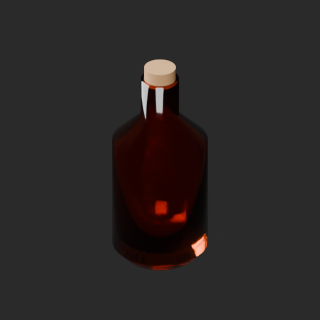
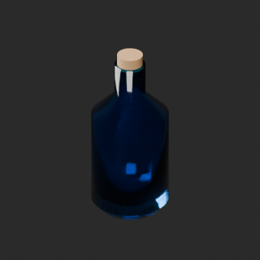
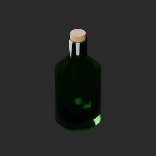
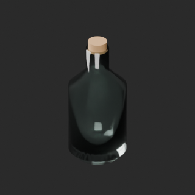
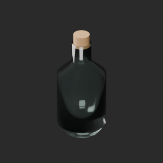
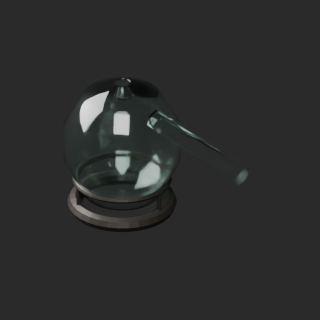
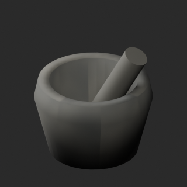
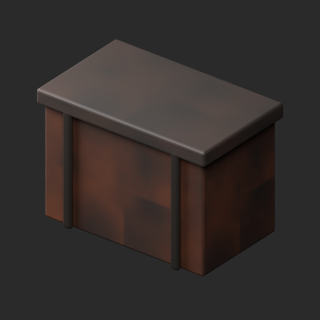

# quality-al007-016-v1

[Quality57–76 overview](quality-57-76.md) · [International catalogue](international/README.md)

AL008 variants color the glass shell, not liquid. Transmission/IOR/roughness retained. Scaled AL009 bottle is related geometry, not an independent new shape.

Existing distribution revisions and material variants only; zero new base records. Models/embedded materials only CC0; images are separate catalogue artwork. [License](../LICENSE.md).

Producer final-ZIP numerical reimports passed; all adopted public ZIP/member and image hashes independently matched. No publication-side Blender rerun. No gameplay, collision, load, fluid, mechanism or Blender4.3.2 approval. Images compare fixed camera/light per model; layouts differ by batch, source and final panels must not be interchanged.

## AL007__repair

**Assayers balance** · Assayers balance

Remove exact-zero world-area faces only; preserve all positive surfaces/materials/UV/colors. No new base model.

[ZIP · BLEND/GLB](https://raw.githubusercontent.com/k3peta/tales-on-a-table/main/distributions/quality-al007-016-v1/AL007__repair_CC0.zip) · [Enlarge](../previews/quality-al007-016-v1/AL007__repair_full.png) · [overview comparison](../previews/quality-al007-016-v1/AL007__repair_overview_comparison.png) · [close comparison](../previews/quality-al007-016-v1/AL007__repair_close_comparison.png)

Variant/revision dimensions, pivot/facing and triangle count: not independently measured by publisher; refer to the base record and validation scope.

## AL008__amber_glass

**Green reagent bottle** · Green reagent bottle

Glass-shell UV color on repaired AL008 baseline; not liquid. Cork, transmission, IOR, alpha, roughness and other channels retained. No new base model.

[ZIP · BLEND/GLB](https://raw.githubusercontent.com/k3peta/tales-on-a-table/main/distributions/quality-al007-016-v1/AL008__amber_glass_CC0.zip) · [Enlarge](../previews/quality-al007-016-v1/AL008__amber_glass_full.png) · [overview comparison](../previews/quality-al007-016-v1/AL008__amber_glass_overview_comparison.png) · [close comparison](../previews/quality-al007-016-v1/AL008__amber_glass_close_comparison.png)

Variant/revision dimensions, pivot/facing and triangle count: not independently measured by publisher; refer to the base record and validation scope.

## AL008__cyan_glass

**Green reagent bottle** · Green reagent bottle

Glass-shell UV color on repaired AL008 baseline; not liquid. Cork, transmission, IOR, alpha, roughness and other channels retained. No new base model.

[ZIP · BLEND/GLB](https://raw.githubusercontent.com/k3peta/tales-on-a-table/main/distributions/quality-al007-016-v1/AL008__cyan_glass_CC0.zip) · [Enlarge](../previews/quality-al007-016-v1/AL008__cyan_glass_full.png) · [overview comparison](../previews/quality-al007-016-v1/AL008__cyan_glass_overview_comparison.png) · [close comparison](../previews/quality-al007-016-v1/AL008__cyan_glass_close_comparison.png)

Variant/revision dimensions, pivot/facing and triangle count: not independently measured by publisher; refer to the base record and validation scope.

## AL008__emerald_glass

**Green reagent bottle** · Green reagent bottle

Glass-shell UV color on repaired AL008 baseline; not liquid. Cork, transmission, IOR, alpha, roughness and other channels retained. No new base model.

[ZIP · BLEND/GLB](https://raw.githubusercontent.com/k3peta/tales-on-a-table/main/distributions/quality-al007-016-v1/AL008__emerald_glass_CC0.zip) · [Enlarge](../previews/quality-al007-016-v1/AL008__emerald_glass_full.png) · [overview comparison](../previews/quality-al007-016-v1/AL008__emerald_glass_overview_comparison.png) · [close comparison](../previews/quality-al007-016-v1/AL008__emerald_glass_close_comparison.png)

Variant/revision dimensions, pivot/facing and triangle count: not independently measured by publisher; refer to the base record and validation scope.

## AL008__repair

**Green reagent bottle** · Green reagent bottle

Remove exact-zero world-area faces only; preserve all positive surfaces/materials/UV/colors. No new base model.

[ZIP · BLEND/GLB](https://raw.githubusercontent.com/k3peta/tales-on-a-table/main/distributions/quality-al007-016-v1/AL008__repair_CC0.zip) · [Enlarge](../previews/quality-al007-016-v1/AL008__repair_full.png) · [overview comparison](../previews/quality-al007-016-v1/AL008__repair_overview_comparison.png) · [close comparison](../previews/quality-al007-016-v1/AL008__repair_close_comparison.png)

Variant/revision dimensions, pivot/facing and triangle count: not independently measured by publisher; refer to the base record and validation scope.

## AL009__repair

**Small reagent bottle** · Small reagent bottle

Remove exact-zero world-area faces only; preserve all positive surfaces/materials/UV/colors. No new base model.

[ZIP · BLEND/GLB](https://raw.githubusercontent.com/k3peta/tales-on-a-table/main/distributions/quality-al007-016-v1/AL009__repair_CC0.zip) · [Enlarge](../previews/quality-al007-016-v1/AL009__repair_full.png) · [overview comparison](../previews/quality-al007-016-v1/AL009__repair_overview_comparison.png) · [close comparison](../previews/quality-al007-016-v1/AL009__repair_close_comparison.png)

Variant/revision dimensions, pivot/facing and triangle count: not independently measured by publisher; refer to the base record and validation scope.

## AL010__repair

**Glass retort** · Glass retort

Remove exact-zero world-area faces only; preserve all positive surfaces/materials/UV/colors. No new base model.

[ZIP · BLEND/GLB](https://raw.githubusercontent.com/k3peta/tales-on-a-table/main/distributions/quality-al007-016-v1/AL010__repair_CC0.zip) · [Enlarge](../previews/quality-al007-016-v1/AL010__repair_full.png) · [overview comparison](../previews/quality-al007-016-v1/AL010__repair_overview_comparison.png) · [close comparison](../previews/quality-al007-016-v1/AL010__repair_close_comparison.png)

Variant/revision dimensions, pivot/facing and triangle count: not independently measured by publisher; refer to the base record and validation scope.

## AL011__repair

**Mortar pestle** · Mortar pestle

Remove exact-zero world-area faces only; preserve all positive surfaces/materials/UV/colors. No new base model.

[ZIP · BLEND/GLB](https://raw.githubusercontent.com/k3peta/tales-on-a-table/main/distributions/quality-al007-016-v1/AL011__repair_CC0.zip) · [Enlarge](../previews/quality-al007-016-v1/AL011__repair_full.png) · [overview comparison](../previews/quality-al007-016-v1/AL011__repair_overview_comparison.png) · [close comparison](../previews/quality-al007-016-v1/AL011__repair_close_comparison.png)

Variant/revision dimensions, pivot/facing and triangle count: not independently measured by publisher; refer to the base record and validation scope.

## AL016__repair

**Storage chest** · Storage chest

Remove exact-zero world-area faces only; preserve all positive surfaces/materials/UV/colors. No new base model.

[ZIP · BLEND/GLB](https://raw.githubusercontent.com/k3peta/tales-on-a-table/main/distributions/quality-al007-016-v1/AL016__repair_CC0.zip) · [Enlarge](../previews/quality-al007-016-v1/AL016__repair_full.png) · [overview comparison](../previews/quality-al007-016-v1/AL016__repair_overview_comparison.png) · [close comparison](../previews/quality-al007-016-v1/AL016__repair_close_comparison.png)

Variant/revision dimensions, pivot/facing and triangle count: not independently measured by publisher; refer to the base record and validation scope.

[Exact ZIP/image bindings](../distributions/quality-al007-016-v1/image-bindings.json) · [Validation scope](../distributions/quality-al007-016-v1/validation.json).
