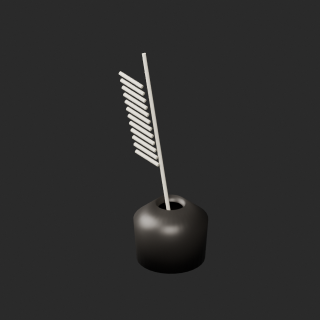
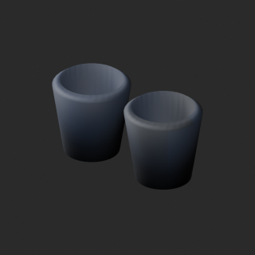
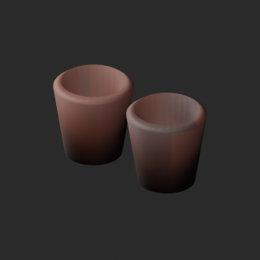
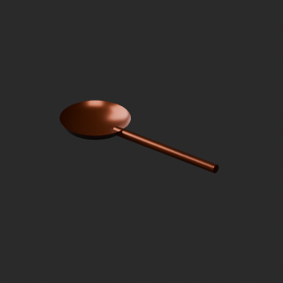
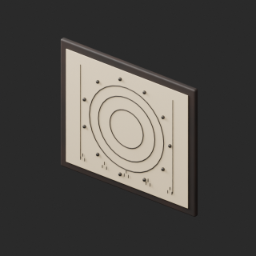
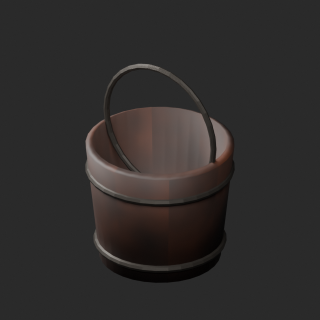
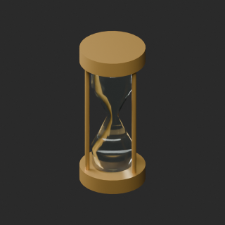

# quality-al017-026-v1

[Quality57–76 overview](quality-57-76.md) · [International catalogue](international/README.md)

Exact-zero cleanup retains positive tiny triangles, including24 in AL022. Ivory ceramic candidate rejected; blue accepted. Stylized feather remains.

Existing distribution revisions and material variants only; zero new base records. Models/embedded materials only CC0; images are separate catalogue artwork. [License](../LICENSE.md).

Producer final-ZIP numerical reimports passed; all adopted public ZIP/member and image hashes independently matched. No publication-side Blender rerun. No gameplay, collision, load, fluid, mechanism or Blender4.3.2 approval. Images compare fixed camera/light per model; layouts differ by batch, source and final panels must not be interchanged.

## AL018__repair

**Ink and quill** · Ink and quill

Remove exact-zero world-area faces only; preserve all positive surfaces/materials/UV/colors. No new base model.

[ZIP · BLEND/GLB](https://raw.githubusercontent.com/k3peta/tales-on-a-table/main/distributions/quality-al017-026-v1/AL018__repair_CC0.zip) · [Enlarge](../previews/quality-al017-026-v1/AL018__repair_full.png) · [overview comparison](../previews/quality-al017-026-v1/AL018__repair_overview_comparison.png) · [close comparison](../previews/quality-al017-026-v1/AL018__repair_close_comparison.png)

Variant/revision dimensions, pivot/facing and triangle count: not independently measured by publisher; refer to the base record and validation scope.

## AL020__blue_ceramic

**Crucibles** · Crucibles

Ceramic UV color on repaired AL020 baseline; roughness and other channels retained. No heat/material safety claim. No new base model.

[ZIP · BLEND/GLB](https://raw.githubusercontent.com/k3peta/tales-on-a-table/main/distributions/quality-al017-026-v1/AL020__blue_ceramic_CC0.zip) · [Enlarge](../previews/quality-al017-026-v1/AL020__blue_ceramic_full.png) · [overview comparison](../previews/quality-al017-026-v1/AL020__blue_ceramic_overview_comparison.png) · [close comparison](../previews/quality-al017-026-v1/AL020__blue_ceramic_close_comparison.png)

Variant/revision dimensions, pivot/facing and triangle count: not independently measured by publisher; refer to the base record and validation scope.

## AL020__repair

**Crucibles** · Crucibles

Remove exact-zero world-area faces only; preserve all positive surfaces/materials/UV/colors. No new base model.

[ZIP · BLEND/GLB](https://raw.githubusercontent.com/k3peta/tales-on-a-table/main/distributions/quality-al017-026-v1/AL020__repair_CC0.zip) · [Enlarge](../previews/quality-al017-026-v1/AL020__repair_full.png) · [overview comparison](../previews/quality-al017-026-v1/AL020__repair_overview_comparison.png) · [close comparison](../previews/quality-al017-026-v1/AL020__repair_close_comparison.png)

Variant/revision dimensions, pivot/facing and triangle count: not independently measured by publisher; refer to the base record and validation scope.

## AL021__repair

**Copper ladle** · Copper ladle

Remove exact-zero world-area faces only; preserve all positive surfaces/materials/UV/colors. No new base model.

[ZIP · BLEND/GLB](https://raw.githubusercontent.com/k3peta/tales-on-a-table/main/distributions/quality-al017-026-v1/AL021__repair_CC0.zip) · [Enlarge](../previews/quality-al017-026-v1/AL021__repair_full.png) · [overview comparison](../previews/quality-al017-026-v1/AL021__repair_overview_comparison.png) · [close comparison](../previews/quality-al017-026-v1/AL021__repair_close_comparison.png)

Variant/revision dimensions, pivot/facing and triangle count: not independently measured by publisher; refer to the base record and validation scope.

## AL022__repair

**Wall instrument chart** · Wall instrument chart

Remove exact-zero world-area faces only; preserve all positive surfaces/materials/UV/colors. No new base model.

[ZIP · BLEND/GLB](https://raw.githubusercontent.com/k3peta/tales-on-a-table/main/distributions/quality-al017-026-v1/AL022__repair_CC0.zip) · [Enlarge](../previews/quality-al017-026-v1/AL022__repair_full.png) · [overview comparison](../previews/quality-al017-026-v1/AL022__repair_overview_comparison.png) · [close comparison](../previews/quality-al017-026-v1/AL022__repair_close_comparison.png)

Variant/revision dimensions, pivot/facing and triangle count: not independently measured by publisher; refer to the base record and validation scope.

## AL023__repair

**Bucket** · Bucket

Remove exact-zero world-area faces only; preserve all positive surfaces/materials/UV/colors. No new base model.

[ZIP · BLEND/GLB](https://raw.githubusercontent.com/k3peta/tales-on-a-table/main/distributions/quality-al017-026-v1/AL023__repair_CC0.zip) · [Enlarge](../previews/quality-al017-026-v1/AL023__repair_full.png) · [overview comparison](../previews/quality-al017-026-v1/AL023__repair_overview_comparison.png) · [close comparison](../previews/quality-al017-026-v1/AL023__repair_close_comparison.png)

Variant/revision dimensions, pivot/facing and triangle count: not independently measured by publisher; refer to the base record and validation scope.

## AL024__repair

**Hourglass** · Hourglass

Remove exact-zero world-area faces only; preserve all positive surfaces/materials/UV/colors. No new base model.

[ZIP · BLEND/GLB](https://raw.githubusercontent.com/k3peta/tales-on-a-table/main/distributions/quality-al017-026-v1/AL024__repair_CC0.zip) · [Enlarge](../previews/quality-al017-026-v1/AL024__repair_full.png) · [overview comparison](../previews/quality-al017-026-v1/AL024__repair_overview_comparison.png) · [close comparison](../previews/quality-al017-026-v1/AL024__repair_close_comparison.png)

Variant/revision dimensions, pivot/facing and triangle count: not independently measured by publisher; refer to the base record and validation scope.

[Exact ZIP/image bindings](../distributions/quality-al017-026-v1/image-bindings.json) · [Validation scope](../distributions/quality-al017-026-v1/validation.json).
