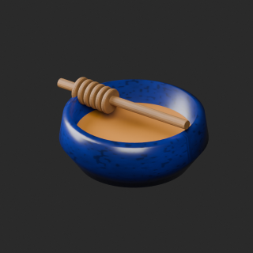
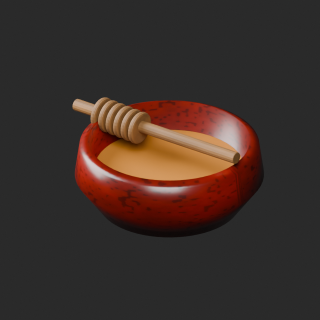

# quality-ap007-016-v1

[Quality57–76 overview](quality-57-76.md) · [International catalogue](international/README.md)

Zero-face cleanup and ceramic color variants. AP009 glossy opaque material remains opaque despite its glass name. No fluid/heat simulation.

Existing distribution revisions and material variants only; zero new base records. Models/embedded materials only CC0; images are separate catalogue artwork. [License](../LICENSE.md).

Producer final-ZIP numerical reimports passed; independent public-download match pending. No publication-side Blender rerun. No gameplay, collision, load, fluid, mechanism or Blender4.3.2 approval. Images compare fixed camera/light per model; layouts differ by batch, source and final panels must not be interchanged.

## AP007__repair

**Manual honey press** · Manual honey press

Remove exact-zero world-area faces only; preserve all positive surfaces/materials/UV/colors. No new base model.

[ZIP · BLEND/GLB](https://raw.githubusercontent.com/k3peta/tales-on-a-table/main/distributions/quality-ap007-016-v1/AP007__repair_CC0.zip) · [Enlarge](../previews/quality-ap007-016-v1/AP007__repair_full.png) · [overview comparison](../previews/quality-ap007-016-v1/AP007__repair_overview_comparison.png) · [close comparison](../previews/quality-ap007-016-v1/AP007__repair_close_comparison.png)

Variant/revision dimensions, pivot/facing and triangle count: not independently measured by publisher; refer to the base record and validation scope.

## AP009__repair

**Honey storage jar** · Honey storage jar

Remove exact-zero world-area faces only; preserve all positive surfaces/materials/UV/colors. No new base model.

[ZIP · BLEND/GLB](https://raw.githubusercontent.com/k3peta/tales-on-a-table/main/distributions/quality-ap007-016-v1/AP009__repair_CC0.zip) · [Enlarge](../previews/quality-ap007-016-v1/AP009__repair_full.png) · [overview comparison](../previews/quality-ap007-016-v1/AP009__repair_overview_comparison.png) · [close comparison](../previews/quality-ap007-016-v1/AP009__repair_close_comparison.png)

Variant/revision dimensions, pivot/facing and triangle count: not independently measured by publisher; refer to the base record and validation scope.

## AP010__cobalt_glaze

**Honey dipper bowl** · Honey dipper bowl

Recolor existing bowl glaze UV texture on repaired AP010 baseline. Honey/wood, alpha, roughness and other channels retained. No new base model.

[ZIP · BLEND/GLB](https://raw.githubusercontent.com/k3peta/tales-on-a-table/main/distributions/quality-ap007-016-v1/AP010__cobalt_glaze_CC0.zip) · [Enlarge](../previews/quality-ap007-016-v1/AP010__cobalt_glaze_full.png) · [overview comparison](../previews/quality-ap007-016-v1/AP010__cobalt_glaze_overview_comparison.png) · [close comparison](../previews/quality-ap007-016-v1/AP010__cobalt_glaze_close_comparison.png)

Variant/revision dimensions, pivot/facing and triangle count: not independently measured by publisher; refer to the base record and validation scope.

## AP010__repair

**Honey dipper bowl** · Honey dipper bowl

Remove exact-zero world-area faces only; preserve all positive surfaces/materials/UV/colors. No new base model.

[ZIP · BLEND/GLB](https://raw.githubusercontent.com/k3peta/tales-on-a-table/main/distributions/quality-ap007-016-v1/AP010__repair_CC0.zip) · [Enlarge](../previews/quality-ap007-016-v1/AP010__repair_full.png) · [overview comparison](../previews/quality-ap007-016-v1/AP010__repair_overview_comparison.png) · [close comparison](../previews/quality-ap007-016-v1/AP010__repair_close_comparison.png)

Variant/revision dimensions, pivot/facing and triangle count: not independently measured by publisher; refer to the base record and validation scope.

## AP010__rust_red_glaze

**Honey dipper bowl** · Honey dipper bowl

Recolor existing bowl glaze UV texture on repaired AP010 baseline. Honey/wood, alpha, roughness and other channels retained. No new base model.

[ZIP · BLEND/GLB](https://raw.githubusercontent.com/k3peta/tales-on-a-table/main/distributions/quality-ap007-016-v1/AP010__rust_red_glaze_CC0.zip) · [Enlarge](../previews/quality-ap007-016-v1/AP010__rust_red_glaze_full.png) · [overview comparison](../previews/quality-ap007-016-v1/AP010__rust_red_glaze_overview_comparison.png) · [close comparison](../previews/quality-ap007-016-v1/AP010__rust_red_glaze_close_comparison.png)

Variant/revision dimensions, pivot/facing and triangle count: not independently measured by publisher; refer to the base record and validation scope.

## AP012__repair

**Candle drying rack** · Candle drying rack

Remove exact-zero world-area faces only; preserve all positive surfaces/materials/UV/colors. No new base model.

[ZIP · BLEND/GLB](https://raw.githubusercontent.com/k3peta/tales-on-a-table/main/distributions/quality-ap007-016-v1/AP012__repair_CC0.zip) · [Enlarge](../previews/quality-ap007-016-v1/AP012__repair_full.png) · [overview comparison](../previews/quality-ap007-016-v1/AP012__repair_overview_comparison.png) · [close comparison](../previews/quality-ap007-016-v1/AP012__repair_close_comparison.png)

Variant/revision dimensions, pivot/facing and triangle count: not independently measured by publisher; refer to the base record and validation scope.

## AP014__repair

**Wax melting cauldron** · Wax melting cauldron

Remove exact-zero world-area faces only; preserve all positive surfaces/materials/UV/colors. No new base model.

[ZIP · BLEND/GLB](https://raw.githubusercontent.com/k3peta/tales-on-a-table/main/distributions/quality-ap007-016-v1/AP014__repair_CC0.zip) · [Enlarge](../previews/quality-ap007-016-v1/AP014__repair_full.png) · [overview comparison](../previews/quality-ap007-016-v1/AP014__repair_overview_comparison.png) · [close comparison](../previews/quality-ap007-016-v1/AP014__repair_close_comparison.png)

Variant/revision dimensions, pivot/facing and triangle count: not independently measured by publisher; refer to the base record and validation scope.

[Exact ZIP/image bindings](../distributions/quality-ap007-016-v1/image-bindings.json) · [Validation scope](../distributions/quality-ap007-016-v1/validation.json).
