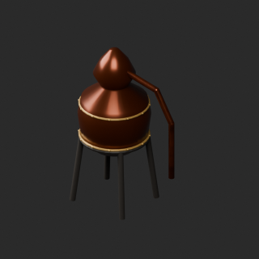
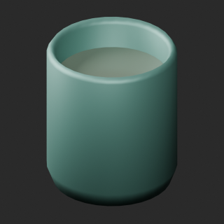
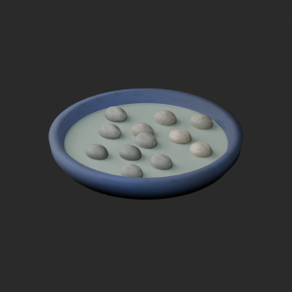

# quality-ap017-al006-v1

[Quality57–76 overview](quality-57-76.md) · [International catalogue](international/README.md)

Zero-face cleanup; ceramic color does not change stones or water. Static props only; heat/pressure not validated.

Existing distribution revisions and material variants only; zero new base records. Models/embedded materials only CC0; images are separate catalogue artwork. [License](../LICENSE.md).

Producer final-ZIP numerical reimports passed; all adopted public ZIP/member and image hashes independently matched. No publication-side Blender rerun. No gameplay, collision, load, fluid, mechanism or Blender4.3.2 approval. Images compare fixed camera/light per model; layouts differ by batch, source and final panels must not be interchanged.

## AL003__repair

**Copper alembic** · Copper alembic

Remove exact-zero world-area faces only; preserve all positive surfaces/materials/UV/colors. No new base model.

[ZIP · BLEND/GLB](https://raw.githubusercontent.com/k3peta/tales-on-a-table/main/distributions/quality-ap017-al006-v1/AL003__repair_CC0.zip) · [Enlarge](../previews/quality-ap017-al006-v1/AL003__repair_full.png) · [overview comparison](../previews/quality-ap017-al006-v1/AL003__repair_overview_comparison.png) · [close comparison](../previews/quality-ap017-al006-v1/AL003__repair_close_comparison.png)

Variant/revision dimensions, pivot/facing and triangle count: not independently measured by publisher; refer to the base record and validation scope.

## AL004__repair

**Cooling vat** · Cooling vat

Remove exact-zero world-area faces only; preserve all positive surfaces/materials/UV/colors. No new base model.

[ZIP · BLEND/GLB](https://raw.githubusercontent.com/k3peta/tales-on-a-table/main/distributions/quality-ap017-al006-v1/AL004__repair_CC0.zip) · [Enlarge](../previews/quality-ap017-al006-v1/AL004__repair_full.png) · [overview comparison](../previews/quality-ap017-al006-v1/AL004__repair_overview_comparison.png) · [close comparison](../previews/quality-ap017-al006-v1/AL004__repair_close_comparison.png)

Variant/revision dimensions, pivot/facing and triangle count: not independently measured by publisher; refer to the base record and validation scope.

## AP018__repair

**Uncapping board** · Uncapping board

Remove exact-zero world-area faces only; preserve all positive surfaces/materials/UV/colors. No new base model.

[ZIP · BLEND/GLB](https://raw.githubusercontent.com/k3peta/tales-on-a-table/main/distributions/quality-ap017-al006-v1/AP018__repair_CC0.zip) · [Enlarge](../previews/quality-ap017-al006-v1/AP018__repair_full.png) · [overview comparison](../previews/quality-ap017-al006-v1/AP018__repair_overview_comparison.png) · [close comparison](../previews/quality-ap017-al006-v1/AP018__repair_close_comparison.png)

Variant/revision dimensions, pivot/facing and triangle count: not independently measured by publisher; refer to the base record and validation scope.

## AP019__blue_ceramic

**Bee water tray** · Bee water tray

Recolor existing ceramic UV texture on repaired AP019 baseline. Water/stone, transmission, alpha, roughness and other channels retained. No new base model.

[ZIP · BLEND/GLB](https://raw.githubusercontent.com/k3peta/tales-on-a-table/main/distributions/quality-ap017-al006-v1/AP019__blue_ceramic_CC0.zip) · [Enlarge](../previews/quality-ap017-al006-v1/AP019__blue_ceramic_full.png) · [overview comparison](../previews/quality-ap017-al006-v1/AP019__blue_ceramic_overview_comparison.png) · [close comparison](../previews/quality-ap017-al006-v1/AP019__blue_ceramic_close_comparison.png)

Variant/revision dimensions, pivot/facing and triangle count: not independently measured by publisher; refer to the base record and validation scope.

## AP019__repair

**Bee water tray** · Bee water tray

Remove exact-zero world-area faces only; preserve all positive surfaces/materials/UV/colors. No new base model.

[ZIP · BLEND/GLB](https://raw.githubusercontent.com/k3peta/tales-on-a-table/main/distributions/quality-ap017-al006-v1/AP019__repair_CC0.zip) · [Enlarge](../previews/quality-ap017-al006-v1/AP019__repair_full.png) · [overview comparison](../previews/quality-ap017-al006-v1/AP019__repair_overview_comparison.png) · [close comparison](../previews/quality-ap017-al006-v1/AP019__repair_close_comparison.png)

Variant/revision dimensions, pivot/facing and triangle count: not independently measured by publisher; refer to the base record and validation scope.

[Exact ZIP/image bindings](../distributions/quality-ap017-al006-v1/image-bindings.json) · [Validation scope](../distributions/quality-ap017-al006-v1/validation.json).
